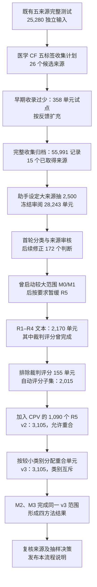

# 数据构建、审核、抽样与版本沿革

2026-09-18 20:04补充：[CAD 固定分层语义抽查](#r5-cad-premise-supervision-qualification)已完整读 30 母题/150 端，区分明显冲突、支持缺口和语用边界；原标签与固定样本保持，未决训练资格或运行模型。

2026-09-18 19:55补充：[CAD前提监督与同母题RH控制资格](#r5-cad-premise-supervision-qualification)完成结构与暴露核查。原始gold保持，未冻结训练；官方test只做汇总和身份比较，不读逐题正文。

最新状态：2026-09-18（Asia/Shanghai）。[R5首轮输入审核](#r5-pilot-input-scope)新增目标保持与控制范围证据；原v5范围、gold和历史分数保持。[R4作者解释核查](#r4-author-reference-audit)发现已知相互作用与单药风险遗漏及错误指定机制；原13题、gold和作者一致率均保留，没有生成替代临床gold。[R1冻结后验证资格](#r1-frozen-validation-qualification)完成ASCENT64候选逐例审核并固定47病例（test5/train42）；处理源内与既有MedQA派生重合，未修改v5。[R1关系任务的三例标签语义审核](#r1-medcounterfact-label-scope)发现点估计/显著性口径尚未解释的差异，保留原gold及分母。当前选定评测集为v5：6,104唯一单元、13,000选中判断，R1–R5允许重叠；由完整v4保留合格R1–R4并从八个来源各随机选择450个R5单元得到。v3互斥类别、v4全量分类及早期样本均保留，历史MedEinst开发/校准/测试暴露在本文追溯。

同日14:00，[R5机制确认数据重冻](#r5-mechanism-confirmation-data)完成：排除正式v5、已知探索及发现的旧M0/M1实际生成母题后，固定五来源128母题/512原生输入，另8组作者相关变化控制/16输入。13:51初版及晚发现的历史暴露保留；14:28正式原生检索上下文和CPU核查已完成，确认集仍0新答案、方法尚未据此验证。

同日17:20，[固定H、改变P的受限合成诊断](#r5-synthetic-premise-sensitivity)冻结：任务代理逐条编写16个虚构实验family，根代理全文语义审查，形成64个输入、32条保持对及32条相关变化对。标签来自明确给定实验，不能称自然医学gold或专家标注。它独立于未消费的自然D范围；三头机制评分及结论归R5研究主记录。

同日预先固定[NLI离散选择后续验证输入](#r5-nli-choice-validation-selection)：16个新于此次R5调优的M23 group/32输入，另8对作者原生相关变化控制/16输入。选择只读输入与作者标签，排除既用目标premise，未读取新机制输出；整个v5历史暴露边界保持。

同日更新[simglucose开发/保留划分](#r4-physiology-development-split)：6个开发profile完成方法开发后，于22:49:38先冻结方法，再首次生成全部24个保留profile的288题；数值容差比较无二元翻转，76 yes/212 no原样保留，保留侧现转为冻结后验证已暴露。

同日，[R1的六组Bronchitis原文/标签对照](#r1-bronchitis-support-scope)确认本地映射一致，同时明确“新增相容支持”分类与作者唯一诊断gold的解释边界；未修改分类或评分。 同轮[MedCounterFact分组审核](#r1-medcounterfact-question-groups)确认201问句族仅对应91个original_review，不能按独立研究解释扩展。

2026-09-14新增[R3公开训练病例资格审计](#r3-memory-qualification)，用于独立记忆head研究；v5输入、分母与开发/确认划分未变。

2026-09-15新增[ASCENT/CUPCase结构与暴露核对](#r3-ascent-qualification)。原[CUPCase冻结后28例审核](#r3-cupcase-frozen-qualification)纳入4例；后续[64组资格扩展](#r3-cupcase-expansion-qualification)已全部裁决，纳入8例，51组无原生候选比较、5组来源或参考范围问题。参考身份和限定文本重合检查已完成，新范围评分及负结果见[R3主记录](../research/r3_candidate_comparison.md#r3-cupcase-expansion)。ASCENT多诊断适配仍待完成，当前v5不变。

2026-09-15完成：[既有R3头的第三批64组验证资格](#r3-cupcase-validation-qualification)。64组全部审核，6组通过来源核对及限定文本重合检查并完成冻结评测；53组未建立原生候选比较，5组存在参考错误或范围歧义。全部逐例处置保留，成绩只在[R3第三批验证](../research/r3_candidate_comparison.md#r3-cupcase-validation)维护。

[工作区总入口](/home/data3/txy/docs/README.md) · [记录归属与迁移证据](/home/data3/txy/docs/workspace.md#documentation-migration-20260914)

本文是该方向的长期主记录。下文按来源章节合入实际正文，保留历史配置、成功/失败尝试、结果与证据。历史段落中的“当前”“继续在原文件更新”和运行中状态均以其原记录日期为准；今后在本文件续写。

## 内容导航

- [R5前提监督：CAD成对结构、二分类与暴露边界](#r5-cad-premise-supervision-qualification)

- [R5开发首轮：输入与相关变化控制的范围](#r5-pilot-input-scope)

- [R1冻结后验证：ASCENT资格、MedPIC暴露与机制探针](#r1-frozen-validation-qualification)

- [R1关系任务：问句族与原始review重合](#r1-medcounterfact-question-groups)

- [R1诊断：相容支持与唯一疾病标签的边界](#r1-bronchitis-support-scope)
- [R1关系任务：点估计与显著性标签语义](#r1-medcounterfact-label-scope)
- [ASCENT结构与暴露核对](#r3-ascent-qualification)
- [R3公开训练病例资格审计](#r3-memory-qualification)

- [R1–R5 paper work and adjustment record (2026-09-13)](#record-0008)
- [Latest selection: v5, eight random R5 strata (2026-09-10)](#record-0009)
- [Latest full-coverage classification delivery (2026-09-10)](#record-0011)
- [10. Counterfactual datasets, actual use, and split lineage](#record-0038)
- [10.1 Model-inference coverage beyond MedEinst](#record-0039)
- [10.2 MedEinst split reuse](#record-0040)
- [5. 来源追溯、抽样解释和分类规则的调整](#record-0241)
- [7. 后续 v4/v5 的已存调整记录](#record-0243)
- [7.1 v4：完成覆盖后的实际数量和资格修正](#record-0244)
- [7.2 没有实施的删除方案与实际采用的 v5](#record-0245)
- [README.md](#record-0315)
- [README.md](#record-0316)
- [README.md](#record-0321)
- [README.md](#record-0322)
- [initial_分类审核报告.md](#record-0323)
- [修正后分类复核.md](#record-0324)
- [分类审核报告.md](#record-0325)
- [README.md](#record-0326)
- [README.md](#record-0327)
- [cpv_tail_review_summary.md](#record-0328)
- [full_summary.md](#record-0329)
- [review_summary.md](#record-0330)
- [summary.md](#record-0331)
- [amqa_feasibility_patch_notes.md](#record-0332)
- [equity_review_notes.md](#record-0333)
- [full_summary.md](#record-0334)
- [review_summary.md](#record-0335)
- [summary.md](#record-0336)
- [summary.md](#record-0337)
- [cpv_review_summary.md](#record-0338)
- [full_summary.md](#record-0339)
- [review_summary.md](#record-0340)
- [summary.md](#record-0341)
- [分类审阅报告.md](#record-0342)
- [历史试点报告范围.md](#record-0343)
- [工作记录_修正证据摘录.md](#record-0345)
- [来源与标签计数.md](#record-0346)
- [标注复核.md](#record-0347)
- [统计口径与R5分布.md](#record-0348)
- [分类与抽样说明.md](#record-0349)
- [工作过程与调整记录_论文参考.md](#record-0351)
- [README.md](#record-0355)
- [DELIVERY.md](#record-0356)
- [README.md](#record-0357)
- [completion_gap_review.md](#record-0358)
- [README.md](#record-0359)
- [README.md](#record-0360)
- [README.md](#record-0361)
- [README.md](#record-0362)
- [legacy_target_qualification_overrides_report.md](#record-0363)
- [README.md](#record-0364)
- [source_scope_inventory.md](#record-0365)
- [README.md](#record-0366)
- [evaluation_eligibility_README.md](#record-0367)
- [README.md](#record-0368)
- [evaluation_eligibility_README.md](#record-0369)
- [tail_review_method.md](#record-0370)
- [cpv_semantic_review_report.md](#record-0371)
- [evaluation_eligibility_README.md](#record-0372)
- [README.md](#record-0373)

<a id="r3-ascent-qualification"></a>

## 2026-09-15：ASCENT结构与暴露核对

来源版本与获取过程见[sources.md](sources.md#r3-additional-sources)。本阶段为新R3评测准备资格证据，不将取得文件等同于合格评测集，也不改变v5。运行[ r3_ascent_qualification.py ](/home/data3/txy/Documents/Codex/2026-09-14/new-chat/r3_ascent_qualification.py)，制品在`/home/data3/txy/Documents/Codex/2026-09-14/new-chat/r3_generalization_sources/ascent/`，结果为`qualification_summary.json`及`case_groups.jsonl`。

**实际检查与数量。** train 2,773条、test 305条；以每例前两段`Section`/`Findings`的完整文本为病例分组代理，分别得到1,113/125组，两split的该键交集为0。全部3,078条原生`Text`均以对应完整上下文序列结束，最后一段`Imp`/`Reason`均为空；因此本次没有发现当前目标经这两个字段进入提示。既往印象非空的记录为train 1,752/test 189条。分组只检查已发布文本，未验证近义改写、跨来源MedQA重合或预训练暴露，不能将零交集扩写成全面去污染结论。

**已确认的适配陷阱与修正。** 首版检查假设`len(diagnostic_context) == step + 1`，在train 270条、test 25条失败，首次退出1；旧代码与完整失败结果保存在`qualification_initial_failure.py/json`。复核公开train时，row4/5同例分别有4/5段信息却均标`step=3`，row8已有3段但标`step=1`；所以`step`不是可直接截取信息的列表下标。未认定这些记录本身有数据错误，也未删样本或改上游字段；修正本地检查，将差异留作描述性记录，推理权限以后以原生上下文及最后一段为准。其余输入检查全部通过，重跑退出0。若要复现作者按step分层，保留原字段；若进行逐段rollout，则需另行明确阶段索引，不能混用。

**暴露与尚未完成的工作。** 人工查看了train前两条原生记录，另看少量train的段名/长度作故障定位；检查程序将test目标列排除后才转换Python行对象，未展示test逐题文本或答案、未评分。Arrow原文件含参考答案，不能声称文件内没有标签。CUPCase先前网页预览暴露首病例片段，其完整选择和资格审核尚未进行。ASCENT逐题是否满足R3的双候选/相对依据标准、与现有MedQA派生范围的重合及多诊断语义评分仍待完成；目前不把test 305条当作已冻结R3分母，未生成任何新来源模型预测。

**CUPCase适配样本后续检查。** 同日将原始行0–7明确划为接口理解用的开发样例；展示其中输入里的时间/诊断语句，另实读row2和row7的完整病例与原生四候选，见`r3_generalization_sources/cupcase/adapter_exposure.json`，今后不能把这8例当成新独立评测。观察到“叙述含诊断变化”不等于“原生选择题考查该变化”：row2早期腹股沟疝假设与后续静脉病变不同，但三个干扰项都是大隐静脉损伤；row7叙述肿瘤与骨折的鉴别，四个原生候选却全为髋臼骨折的类型/位置表述。因此不能只按病例中的suspected/differential关键词把原生四选一全部标为R3，也不据本次所见8例推断全来源比例。row4输入还明确出现“confirming the diagnosis of NEC”，但本次没有读取其gold，是否直接透露目标仍待核对，暂不认定全来源存在已验证泄漏。没有改病例、替换干扰项、生成候选成绩或冻结新R3分母；CUPCase继续作为辅助候选来源。

**仅train的公开目录兼容检查（2026-09-15）。** 为判断现有49疾病接口能否直接迁入ASCENT，程序读取train的`gt_diagnosis`、`diagnostic_context`、`step`三列；目标字段实际为字符串。只允许大小写、空白和末尾句号归一，要求整个目标字符串恰好等于一个公开目录名称，不新增别名、不按子串命中。2,773条中仅97条/57个初始病例文本组满足；其中有既往印象62条/45组。最后既往印象和当前目标都精确属于目录且名称不同的只有1条（train row108）。这不是“ASCENT只有一个R3案例”：多诊断、上位诊断和别名不能靠本检查完成资格判断，有既往印象本身也不证明出现相对证据变化。当前未据此冻结子集、扩充目录或宣告来源不可用。

本次只作训练侧范围统计；再次展示已暴露的train row0目标，程序读取全部train目标以得到上述计数。该脚本未打开test文件、未读取test答案或生成任何模型预测。实际统计先由内联脚本执行，等价逻辑随后保存在[r3_ascent_catalog_scope.py](/home/data3/txy/Documents/Codex/2026-09-14/new-chat/r3_ascent_catalog_scope.py)，未为归档重复计算。制品`r3_generalization_sources/ascent/catalog_train_compatibility.json`记录分母、逐类数量和暴露范围，`catalog_train_rows.jsonl`保存97条匹配的训练行索引。下一步仍需围绕原生任务明确R3资格、多答案评分与来源重合，不能为了适配当前头把普通诊断或全部ASCENT硬套入49类。

**ASCENT原生训练任务抽查（2026-09-15）。** 为判断是否能以“有既往印象”直接筛出R3，按seed20260915随机抽16个有既往印象的train初始病例文本组，每组随机取一条符合该结构的行；抽样不使用gold、目录命中或模型成绩。随后完整阅读其上下文和train目标。索引及暴露声明保存为`r3_generalization_sources/ascent/native_qualification_sample.json`。本次读取train全集为Python对象以抽样，test文件未打开，没有生成模型答案。

实际观察到不同任务形态：row552旧/新目标均为DVT；row548、867、834从神经/遗传系统层级收窄到具体诊断；row333目标同时包含既往出现的两个诊断，不能当作二选一淘汰；row1064在新增职业致癌讨论后仍标原呼吸感染；row702新增围手术期事件后目标为事件机制。这里记录的是原生字段及任务结构，未以“答案相同”判R5，也未以“名称改变”判R3。这16例尚未形成全部通过语义审核的R3分母；如row1127需比较近期脑血管事件与药物作用，仍应明确临床证据如何改变相对支持，不能靠字段差异自动标注。

结论是停止“仅凭既往印象存在”或“49类精确名称命中”即冻结ASCENT R3集合的路径；保留ASCENT为候选来源，后续原生多诊断接口和比较依据审核另行推进。当前未改作者输入、目标或候选，未新增test暴露或泛化成绩。

**来源划分的补充核对（2026-09-15）。** 本次实读[ASCENT论文§3.2](https://proceedings.mlr.press/v333/choi26a.html)的构建流程：作者先保留MedQA-USMLE中同时出现在HuatuoGPT-o1 SFT资源里的问题，以FuzzyWuzzy相似度0.85匹配；1,338题经诊断任务、病例及图片可用性过滤后为1,238个原问题，再构造3,078个阶段目标。最终在原MedQA问题层面、分别对两种标注来源按9:1随机划分（seed3407）。因此ASCENT的test身份来自这次重新划分，不能直接等同于原MedQA或Huatuo资源中从未见过的测试病例。后续工作区重合核对应覆盖这些上游来源；本次没有据此认定我们的原骨干一定见过其训练内容，也没有认定本地存在已验证重合。

本次未打开test逐题输入或标签，没有新的资格分母与模型分数。网页PDF接口返回unsupported content-type，随后使用已经下载的`r3_generalization_sources/ascent_choi26a.pdf`及`ascent_choi26a.txt`（文本§3.2）核对，未重复下载；上述源码/文本位于既有运行根目录。该补证只澄清来源沿革，现有49目录单诊断头与ASCENT原生多诊断任务的适配缺口仍在。

**CUPCase追加16例结构审核（2026-09-15）。** 为检查自然诊断经过能否对应原生候选之间的R3比较，先仅按输入中的initially、initial diagnosis、differential diagnosis、misdiagnosis、suspect等诊断/时间关键词筛选，按小写及空白归一病例原文分组，排除已用row0–7及其同文组；得到1174个候选组，再用seed20260915随机抽16组。索引106/265/363/582/586/654/748/895/925/1120/1197/1710/1943/2367/2649/3471，全部保留为新增资格开发样例，不纳入未来声称独立的评测。已完整阅读16例输入及原生四候选；选择过程不使用模型成绩或gold身份。四候选由含correct_diagnosis在内的原列读取后排序显示，不能声称程序没有读取gold列；其列身份未向审核展示。

逐题观察见运行包`r3_generalization_sources/cupcase/r3_qualification_structural_review.json`，抽样输入/计划为同目录`r3_qualification_input_sample.jsonl`及`r3_qualification_input_sample_plan.json`。本次仍未形成已完成临床审核的R3分母。row925的锂中毒/小脑梗死、row3471的肝性脑病/发作比较虽然出现在病例中，均不等于原生四候选间的比较；row895在一行描述两个患者，后续分组不能只假设一行一例。row265、1710、2367的输入直接写出一个候选名称，2367另有重复干扰项；这是输入与原生任务的具体结构问题，不能由16例推算全来源比例。row106、586、654、1120等仍需临床相对依据及诊断粒度审核，不能因为有检查变化就自动计为合格，也不能因为候选可共存就自动排除R3。

原论文核对额外暴露了row106和654的诊断身份：row106的[原病例报告](https://d-nb.info/1272219038/34)实际打开并阅读摘要/病例段落，提示HUV及后续狼疮肾炎；后一诊断不在原生四候选，不能将该后续变化直接当作原生R3任务。row654仅取得[原论文](https://pmc.ncbi.nlm.nih.gov/articles/PMC8097811/)搜索摘要身份，PMC打开返回验证页，未完成全文阅读。两个病例均已属于开发样例，来源暴露随审核文件保存。未替换干扰项、改造病例、修改head或生成CUPCase模型答案；独立评测资格继续待定。

**两个开发样例的候选相对依据补证（2026-09-15）。** 完整七方法head回放完成后，优先补新来源资格，而未继续扫描开发提示。对已暴露row106/654补齐两个原生候选及具体新增证据，记录在`cupcase/r3_candidate_evidence_examples.json`：row106的日晒线索可引出Solar urticaria，与原生HUV选项相比，后续皮肤组织学和低补体组合提高后者支持；原病例结果见[病例报告](https://d-nb.info/1272219038/34)，日光性荨麻疹的表现范围另核对[87例队列](https://jamanetwork.com/journals/jamadermatology/fullarticle/479499)。没有把日晒或皮损持续时间单独写成排他诊断，也没有用原生选项外的狼疮肾炎充当比较对象。

row654的原生候选ESS/GIST可围绕新免疫组化结果比较，而不是将不在选项内的初始肌瘤假设替换成GIST。[原病例报告](https://d-nb.info/1240671296/34)的病例及讨论段已实际阅读，明确其肿瘤部位、形态和CD10/SMA/ER阳性、CD117/CD34阴性组合；另取得[147例免疫组化研究](https://publikace.k.utb.cz/bitstream/handle/10563/1012358/Fulltext_1012358.pdf?sequence=1)，实际阅读第11页ESS/GIST鉴别段落，用以支持组合标记的相对判断，不把单个阴性或CD10阳性当成必要充分条件。这两个开发例现有具体候选比较依据，其余14例不由此自动获得最终临床R3标签。标注由当前代理结合原始文献完成，不称临床专家委员会审核。

这些是原生病例叙述中的自然诊断信息更新，作者没有提供对应反事实病例对；本次不构造参考端gold，也不将它们直接作为官方CF配对评测。它们继续用于资格/接口开发，独立R3分母尚未冻结，没有新模型调用、head修改或输入/干扰项改写。程序本次将`correct_diagnosis`整列读取为Arrow，仅索引并展示106/654两行，确认与原论文身份一致；没有利用其他gold或模型成绩选择病例。来源暴露及两行gold展示情况同步追加到原结构审核文件。

147例论文的web PDF打开先报超时，PMC页面返回浏览器验证；后续从公开机构PDF原URL直接取得4,282,191字节、HTTP200、约0.75秒，保存为`cupcase/lg_ess_147_primary.pdf`，用既有pypdf抽出16页文本至同名txt。获取及先前失败见`lg_ess_147_primary_acquisition.json`，不把全文提取等同于16页全部人工阅读。关于另一候选来源MamaBench，已向用户询问是否已有授权或本地副本；回答为可选信息，公开来源资格工作继续，不提交访问申请或分享用户信息。

**原生适配完成及冻结后抽样（2026-09-15）。** 已用row106/654完成128次两骨干开发评分和回放；完整方法、对照及结果只见[R3原生四候选适配](../research/r3_candidate_comparison.md#r3-cupcase-native-adapter)。随后固定原六排列校正候选及全部对照，运行`r3_cupcase_qualification.py`：排除此前24个开发行及同文组后，原输入关键词候选池剩1158组；seed20260917抽32组，索引和完整资格计划见`cupcase/frozen_qualification/plan.json`。没有根据模型分数选题或替换题目。首次脚本因多一个右括号在解析阶段退出1，未读取数据/生成预测；源码和日志保存在运行根目录`r3_cupcase_qualification_initial_failure.py/log`，修复后抽样退出0。

实际只阅读前四例18/37/134/171的完整病例和排序四候选，其余28例未向审核展示。18的叙述中主要比较对象不在原生四候选；37的精神病/甲状腺相关比较、134的慢性静脉问题与后续AVF发现、171的淋巴结病理与淋巴瘤/结节病比较暂保留为待核对关系，尚未完成临床依据及目标粒度裁决。逐项记录在`frozen_qualification/partial_structural_review.json`。目前没有该32例的模型预测、最终R3资格分母或参考端金标。

**实际发现选项格式捷径，暂停原始四选一泛化计划。** 前四例的候选呈现出一个带句号、其余不带的差异，遂只在此前24例开发范围核对源标签：24/24均恰有一个以句号结尾的候选，且它就是原生正确诊断。因此“不读取患者、选择唯一句号候选”的规则在这24例为24/24；不能把新来源原始四候选的高分直接当成医学比较能力泛化。此观察不证明原模型确实使用了标点，也没有据24例推断全3562例的发生比例。原有无内容先验零调用回算在两例106/654、两骨干上均1/2正确，具体模型依赖仍需对照。

程序和逐行证据为`cupcase/option_style_development_audit.py/json`。本次明确检查了24例开发行的gold身份；没有查询新32行的正确列身份。前四例的输入格式触发了后续适配对照，故将18/37/134/171也记为新增开发暴露，不再将其当作未参与方法适配的病例；其余28例保留尚未实读状态。抽样清单及全部输入制品保留，计划状态改为`paused_for_option_style_audit`，不是根据新样本模型成绩筛除病例。暂不运行这32例；先在原两例上把四个候选的末尾标点统一，核查真实head敏感性，方法试验归[R3选项格式控制](../research/r3_candidate_comparison.md#r3-cupcase-option-style)。原源文件、原选项和原评分均保留，不将此格式缺陷改写成整个来源已无使用价值。

**统一格式后恢复剩余28例资格（2026-09-15）。** 上述两例格式敏感性控制已完成；在阅读剩余28例之前，固定了统一句号展示、原校正head及对应plain/chat完整名称似然对照，见`frozen_qualification/evaluation_protocol.json`及`frozen_method/`代码/配置快照。原32例计划已备份至`plan_before_uniform_resume.json`，当前状态`resumed_uniform_format_qualification`；18/37/134/171保持开发排除，其余28例按原清单全部审核，不按预测替换。向审核展示的四个候选先统一末尾句号，避免再次用该线索显露正确列身份；原文、原候选和目标文件不修改。来源文献可能在资格过程中显露诊断身份，须记录实际暴露，但固定后的提示/策略不得据此调整。启动时剩余28例尚未阅读、没有模型预测或独立资格分母。

<a id="r3-cupcase-frozen-qualification"></a>

**剩余28例审核完成（2026-09-15）。** 已完整阅读原清单全部28例病例及统一标点的四个候选，逐项裁决在[review_notes.json](/home/data3/txy/Documents/Codex/2026-09-14/new-chat/r3_generalization_sources/cupcase/frozen_qualification/review_notes.json)。固定4个自然诊断更新R3记录：282的急性肺炎/Long COVID时间解释，785的疼痛性主动脉瘤破裂/导管相关感染性瘤鉴别，1302的尿液细菌证据/血流感染比较，3028的功能性归因/家族神经疾病解释。各例原生候选、先前与新增证据、理由及粒度限制均保留，不要求比较对象互斥或最终答案必须改变。3028按一个家族来源记录计数，不按9位成员拆分；785不把原文“即将破裂”改成“已经破裂”，3028不把无症状携带者也诊断患病。

其余23例未建立本原生任务中的候选相对比较，原因逐条记录；这不等于原病例完全没有诊断变化。1950原报告确认链球菌中毒性休克，但一般皮疹不足以把原生葡萄球菌烫伤样皮肤综合征建立为先前特定候选，不能换成选项中没有的葡萄球菌中毒性休克来凑双候选。保留这一未成立判断，不补造既往诊断或随意换干扰项。

**确认源标签错误。** row1200的27岁爪哇患者及FGFR2变异对应[原病例Apert综合征](https://pubmed.ncbi.nlm.nih.gov/31387623/)，CUPCase正确列却为`Achondroplasia (AS).`，另外三个候选也不是Apert。已显式读取这一行的正确列并核实，单列`excluded_source_label_mismatch`，不改原数据或用它评价head临床正确性。本结论只涉及该例，不能推算全来源错误率。

四个纳入例的原论文分别为[282](https://d-nb.info/1258051044/34)、[785](https://link.springer.com/article/10.1186/s13256-021-02661-4)、[1302](https://link.springer.com/article/10.1186/s13256-019-2062-3)、[3028](https://d-nb.info/1106106237/34)，已读相关病例/摘要及必要讨论；1950另读[病例与讨论](https://link.springer.com/article/10.1186/s13256-017-1350-z)。PMC对785/1302/1950返回浏览器验证，改从出版社正文读取；没有把搜索摘要冒充全文阅读。纳入例所需比较依据已在病例文字中提供，不依赖独立解读图片。审核由当前代理结合原文完成，不称临床专家独立委员会。

本阶段所有纳入/排除先于新病例预测。原论文确实暴露了282/785/1302/1950/3028的诊断身份，但没有据此改冻结提示、顺序或选择策略。原32例中最先4例因引发适配仍属开发暴露；其余28来自同一关键词候选池抽样，不称全3562例的无筛选代表样本。参考列核对、与已有暴露文本的重合及最终模型结果继续在原计划和[R3方法记录](../research/r3_candidate_comparison.md#r3-cupcase-frozen-subset)衔接。一次写入审核JSON的补丁因同路径删除/新增冲突被工具拒绝，未写文件；随后直接保存成功，未改变数据或裁决。

**四例参考与文本重合检查完成。** 资格裁决之后、模型预测之前，显式读取282/785/1302/3028的原正确列，均与已读原报告身份对应；1302的泛称菌血症仍属真实上位描述，原生评分保留更具体病原体目标，不将上位回答自动解释为医学事实错误。程序以大小写/空白归一完整病例对13,905条v5原问题、21,218条MedEinst train叙述和10,766条完整test叙述检查相等及整段包含（反向被包含文本至少100字符），命中0，见[r3_cupcase_holdout/overlap.json](/home/data3/txy/Documents/Codex/2026-09-14/new-chat/r3_cupcase_holdout/overlap.json)。该检查覆盖这些明确已暴露文本，不证明没有近义改写或预训练暴露。参考文件与推理输入分存；准备阶段两骨干最大请求分别2,815/2,833token，完整名称续写边界全部通过。

**CUPCase下一批64组资格扩展启动（2026-09-15）。** 前四记录冻结成绩已披露，样本少且投票/校正没有独立增量，因此开展同方法的覆盖扩展。`r3_cupcase_expansion_qualification.py`沿用原输入关键词和归一病例分组，排除全部56个已审/开发行及同文组，以seed20260918固定抽64组。方法、候选统一句号及全部对照沿用此前`frozen_qualification/evaluation_protocol.json`和`frozen_method/`，不按上一轮各骨干成绩选择策略。实际抽样计划与输入在`cupcase/expansion_qualification/`；全部64组先做资格裁决，再运行纳入记录，不按正例数或分数提前停止、替换。扩展的独立结果将与前四例分开报告，累计结果仅作补充；不能将看到四例结果后作出的扩展计划写成原先就预注册的总样本。

<a id="r3-cupcase-expansion-qualification"></a>

**64组资格扩展审核完成（2026-09-15，预测前）。** 排除既往56行及同文组后，原关键词条件留下1,126组，固定抽样64组均已完整阅读。最终8组纳入、51组未建立原生候选比较、2组源标签错误、1组无临床候选、1组参考答案范围歧义、1组参考时间范围不合。逐例判断、参考列核对及先前候选状态分别保存在[review_notes.json](/home/data3/txy/Documents/Codex/2026-09-14/new-chat/r3_generalization_sources/cupcase/expansion_qualification/review_notes.json)、`reference_checks.json`、`structural_review_before_source_checks.json`，没有按预测选择样本或替换干扰项。

| 纳入行 | 原生候选之间的关系 | 本例提供的更新 |
|---|---|---|
| 284 | 肌炎／合并重症肌无力与肌炎 | CK升高后出现眼球、延髓及呼吸肌表现 |
| 702 | 特发性／化疗相关间质性肺病 | 用药时序、BAL、辅助药物试验与后续病程 |
| 1228 | 完全性／部分性葡萄胎 | 肉眼胎盘异常之后的局灶绒毛组织学 |
| 1432 | AL／TTR心脏淀粉样变 | PYP和题面保留的TTR家族基因线索 |
| 1479 | 局部滑囊炎／结核性髋关节及滑囊病变 | 组织肉芽肿及结核PCR |
| 1783 | 原发性／达沙替尼相关肺动脉高压 | 病因排查、暴露时序及后续病程 |
| 1833 | 经典登革热／出血热合并DKA | 渗漏与新发现的糖、酮体、酸碱结果 |
| 2769 | 视神经萎缩描述／骨性压迫病因 | 随后影像及手术定位骨性狭窄 |

这些是自然诊断信息更新，不是作者提供的CF配对；允许共存及从描述到病因的比较，不捏造两端gold。八行原生参考列与相应原论文身份对应。原论文相关病例和必要讨论已读，链接及每例粒度限制在逐例记录中；外部论文新增事实不补进模型输入。1432原输入删去了免疫组化分型和具体变异，不能借原文替模型补齐；702的DLST只是辅助，1783停药后同时接受西地那非，均不能证明单一药物因果效应。1479原文也有左右侧取样叙述不一致；2769最后一次手术已无新压迫，目标取病程中确立的病因，不宣称随访时仍受压。普通上位名称仍可能医学上成立，原生exact评分只评来源指定名称。

**五组来源或评分范围问题在预测前单列。** 1324原正确列把OFM展开成`Odontogenic fibromyxoma`，而[原三病例报告](https://link.springer.com/article/10.1186/s13256-019-2033-8)为oral focal mucinosis，四选项缺少对应诊断；1494正确列保留胆管癌，但[原病例病理](https://link.springer.com/article/10.1186/s13256-018-1858-x)修正为结直肠来源的胆道转移。2155正确列本身是`<final diagnosis>.`，其他选项也不对应题面的化脓性肌炎。1892原生单系统／多系统LCH关系明确，但gold为肺部LCH，与[原文肺及结直肠肛门受累](https://link.springer.com/article/10.1186/s13256-017-1428-7)中的多系统选项均可为真，缺少指定局部或整体诊断的问句，单列参考范围歧义；不把肺部诊断本身说成假。3556 gold沿用初诊“可能合并尿道损伤”，但[后续两项检查及手术](https://link.springer.com/article/10.1186/1752-1947-6-321)排除了这一伴发损伤，原生选项没有解决后的答案。全部保留原数据，不修gold凑成绩；这些计数不是全来源错误率。

本次审核由当前代理完成，不称独立临床专家审核。病例及来源身份在方法冻结后暴露，提示、排列和选择规则未修改。PMC对若干论文返回浏览器验证，已从出版社正文完成必要核对；不把摘要检索当全文阅读。抽样器仍运行时的一次提前读制品返回`FileNotFoundError`，等待同一进程退出0后成功读取，没有重抽样。一次不限制线程的Parquet核对运行约数分钟后正常退出0；随后限制OPENBLAS/OMP/MKL各4线程的参考列读取0.34秒完成，未中断原进程。模型准备及结果接续[R3扩展评测](../research/r3_candidate_comparison.md#r3-cupcase-expansion)。

<a id="r3-cupcase-validation-qualification"></a>

**冻结既有头的下一批64组验证准备（2026-09-15）。** 用户确认七方法开发提升应保留为成果后，将后续工作重点转向既有头的验证。沿用原`frozen_qualification/evaluation_protocol.json`和方法快照，所有提示、排列、先验算法、统一句号、对照与评分保持；前两批新来源结果包括负结果全部保留。修改既有`r3_cupcase_expansion_qualification.py`仅使抽样入口接收上一计划、输出目录和种子，以完整继承暴露名单，不重抽或覆盖旧批次。新计划`cupcase/validation_qualification/plan.json`，seed20260919；排除此前120个已审/开发行及同文病例组，剩余相同输入关键词候选1062组，固定抽64组。抽样session46183正常退出0，检查64行无重复、与既往行无交集。当前仅抽样、尚未展示新病例或参考身份、未产生预测；四候选仍去除correct列身份并统一展示。后续须阅读全部64组并记录资格、来源问题和排除，再运行全部纳入记录，不按正例数量或成绩停止/替换。本批结果单列，累计结果只作补充；仍是自然诊断更新资格，不称原生CF配对或七检索方法新运行。

**首17组资格进展（预测前）。** 原始输入34/38/72/81/174/179/247/274/321/338/374/424/428/453/511/513/516均完整阅读，14组未建立原生候选间的相对更新；例如38的HUS/HIT比较、453的甲状腺激素抵抗/TSH肿瘤比较均没有被原生候选编码，不能替换干扰项使其纳入。338、374、424暂纳入并已核对参考列，尚待统一重合检查，剩余47组未审；每条理由在`validation_qualification/review_notes.json`，来源身份核对在`reference_checks.json`。

三组分别是一般病毒感染到病原体明确、垂体功能减退到病因明确、单病描述到共病完整诊断。依据来自[338原病例及讨论](https://link.springer.com/article/10.1186/s13256-021-03197-3)、[374原病例及讨论](https://link.springer.com/article/10.1186/s13256-021-03146-0)、[424原论文病例与讨论](https://d-nb.info/1248407512/34)；相关正文已读，未把论文里额外检查数值补进模型输入。它们是原标准允许的诊断细化/共存，较宽或单病候选并非因此变成医学假命题，评分仍按来源指定名称解释。本次不改变提示、目标或资格规则，也不将暂纳入3组冒充已冻结完整64组分母。首8组的大批显示曾截断，缺失部分改小批完整读取后才裁决；PMC对338/424的正文访问遇浏览器检查，改用出版社正文及原论文PDF，未把访问失败说成全文已读。

**继续至26/64组。** 新审526/527/584/615/621/641/644/788/820；前八组未建立原生候选比较，820加入暂纳入范围，累计22组未建立、4组待重合检查、38组未审，下一条914。820的序贯超声与病毒检测用于从未限定积液/心包炎到包含病原关联及压塞的具体诊断；已读[原病例及讨论](https://link.springer.com/article/10.1186/s13256-020-02618-z)，参考列一致。其入院低血压及奇脉已提示压塞风险，不能捏造确定阴性的早期参考端；原文心包液PCR阴性，不能将病毒关联写成直接侵袭机制已证明。527原候选有重复显示，记为接口覆盖问题而非整体来源无效；644的实质心衰/肺栓塞比较未在原候选中体现。所有逐条裁决和暴露已更新同一JSON，尚无本批预测，不按当前4例提前运行或停止审核。

**64组资格审核完成（2026-09-15，预测前）。** 全部输入已完整阅读，暂纳入338/374/424/820/1420/2304，共6组；53组未建立原生候选比较；914为源标签错误，1210为早期诊断参考与当前时间范围不合，1286为标签混合表述，2818/2897为参考粒度歧义。所有64组逐条处置及来源身份检查已写入同一`review_notes.json/reference_checks.json`，抽样不替换、方法不改；重合检查及模型运行待执行。判断来自当前助手，未经独立临床专家审核。

新增1420从脉络膜脱离的初判经增强MRI转为伴视网膜脱离的黑色素瘤；[原病例与讨论](https://link.springer.com/article/10.1186/s13256-018-1921-7)确认MRI是该例临床区分依据，原生输入已有文字影像解释，不补入之后摘除眼球的病理。2304从未限定病因的代谢性酸中毒经尿焦谷氨酸检查明确原因，[原报告病例](https://pmc.ncbi.nlm.nih.gov/articles/PMC4918112/)的索引正文与参考一致；仍保留未限定候选是部分真实描述的边界。两例无作者提供的CF配对端。

914的参考将FBS展开成fructose-1,6-bisphosphatase deficiency，但[原文](https://link.springer.com/article/10.1186/s13256-020-02488-5)明确为Fanconi–Bickel syndrome；1210的参考保留suspected schwannoma，而[原病例后续](https://link.springer.com/article/10.1186/s13256-019-2155-z)改为转移瘤并有腺癌病理，原生输入本身已含转移怀疑，但未含最后病理，不能补题或改标。1286的括号desmoid tumor与[原文检查](https://link.springer.com/article/10.1186/s13256-019-2088-6)一致，额外lipomatosis表述不受支持，故不把整个标签说成完全错误。2818的通用CDI参考与复发型候选同时成立；2897通用异位妊娠参考与部分病例的输卵管亚型范围不一致，均保留为粒度歧义，不谎报错诊。1420的PMC正文触发浏览器检查，改读出版社；其余未完整打开全文的核查明确记录为索引病例/摘要阅读。

**重合检查及评测交接完成。** 六个纳入记录与13905条v5输入、21218条MedEinst train、10766条test比较归一全文相等/包含，命中0；规则及边界见`r3_cupcase_validation/overlap.json`。资格文件已登记该证据，固定评测分母为6个来源记录。原生四候选归一后均仍为4个不同字符串，准备退出0，无截断需求；运行及成绩继续归[R3第三批验证](../research/r3_candidate_comparison.md#r3-cupcase-validation)，本文不重复维护分数。

<a id="r3-memory-qualification"></a>

## R3公开训练病例资格审计

2026-09-14。研究目标是为R3候选比較提供外部训练病例经验，来源与下载许可见[MedEinst train获取记录](sources.md#medeinst-train-r3)。本次未把v5参考端或确认题改作训练样本。

脚本[r3_memory_source_audit.py](/home/data3/txy/Documents/Codex/2026-09-14/new-chat/r3_memory_source_audit.py)读取公开train的21,218条记录（10,609对）及相同revision完整test的10,766条记录（5,383对），以病例ID及大小写/空白归一原文做直接比较。任一端发生重叠即排除整对；此外排除不完整配对、原文未改变、标签未改变及训练内部同文异标的病例。没有按开发题正确率择例，也未用测试标签补知识。

共排除494对，保留10,115对/20,230条，保留集含46个训练来源疾病标签。排除原因计数为ID与完整test重叠339对、原文重叠64对、原文不变151对、训练内部同文异标151对；原因可重叠，不能相加作为排除总数。无不完整配对或同标签对。已发现真实重叠，不能以文件名train作为独立性的证明。

证据均在[r3_memory_source](/home/data3/txy/Documents/Codex/2026-09-14/new-chat/r3_memory_source)：`audit_summary.json`记录分母与规则，`excluded_groups.jsonl`保留逐组原因，`eligible_pairs.jsonl`保留通过资格的两端训练原文与训练标签，脚本副本用于复现。当前未训练生成模型；该排除仅核对ID与归一原文，没有声称清除了全部语义近重复或获得独立临床来源。记忆构建、使用范围与方法对照继续归[R3研究](../research/r3_candidate_comparison.md)。

<a id="record-0008"></a>

## R1–R5 paper work and adjustment record (2026-09-13)

来源：[MEDRGAG_WORKSPACE_GUIDE.md](/home/data3/txy/MEDRGAG_WORKSPACE_GUIDE.md)，原文第345行起。命令以原文指定工作目录为准；相对文件引用原属 `/home/data3/txy`。

##### R1–R5 paper work and adjustment record (2026-09-13)

For the construction thread's concrete before/after changes, read
[the paper work record](/home/data3/txy/docs/data/construction.md#record-0355) ([GitHub](https://github.com/xiotakut/cf_mrg/blob/main/benchmarks/2026-09-13_r1_r5_paper_work_record/README.md)).
It covers v3 M2/M3 handling and method identities, full v4 classification and
qualification, semantic preservation, 16 specific adjustments, rejected scope
previews, v5 random sampling, proof boundaries, and a Methods draft. Later
M0/M2/M4/M5 runs belong to their separate run directory: on 2026-09-13 its
`validation.json` reports complete coverage of 13,905 inputs per method with
zero missing/duplicate predictions. The September 10 v5 construction files'
`runtime_compatibility=not_verified` is a dated construction-stage statement.
No model was run or dataset selection changed to create this record.

<a id="record-0009"></a>

## Latest selection: v5, eight random R5 strata (2026-09-10)

来源：[MEDRGAG_WORKSPACE_GUIDE.md](/home/data3/txy/MEDRGAG_WORKSPACE_GUIDE.md)，原文第358行起。命令以原文指定工作目录为准；相对文件引用原属 `/home/data3/txy`。

##### Latest selection: v5, eight random R5 strata (2026-09-10)

The user approved 450 randomly sampled R5 comparison units per source, totaling
3,600, while preserving complete v4 and every eligible R1–R4 target. The resulting
v5 selection has 6,104 unique units and 13,000 eligible judgments across 11 sources.
R1–R5 evaluation memberships: 2,866 / 79 / 733 / 13 / 3,600 (overlapping).

Start with [v5 README](/home/data3/txy/docs/data/construction.md#record-0373),
[sampling protocol](/home/data3/txy/Documents/Codex/2026-09-09/agent-md-medrgag-workspace-guide-md/benchmark_r1_r5_v5_20260910/sampling_protocol.json),
[full exploration history](/home/data3/txy/docs/data/construction.md#record-0355), and
[verification](/home/data3/txy/Documents/Codex/2026-09-09/agent-md-medrgag-workspace-guide-md/benchmark_r1_r5_v5_20260910/verification.json). The [GitHub v5 archive](https://github.com/xiotakut/cf_mrg/blob/main/benchmarks/2026-09-10_r1_r5_v5/README.md)
includes candidate IDs, selected IDs and a standalone replay script.

The protocol seed was generated once before selection. Within each source, sorted
eligible unit IDs were sampled without replacement using Python `random.sample`;
v3 membership and model predictions played no role. All eight draws replay exactly.

Read `selected_targets.jsonl.gz` and **`evaluation_labels`** when loading v5.
`labels` preserves original semantics, including R5 memberships that were not sampled
but coexist with retained R1 targets. Never use semantic R5 alone to rebuild the
v5 evaluation subset. `v3_v4_v5_membership.csv` contains all v4 eligible units and
membership flags; v5 includes 2,116 v3 units and 3,988 units outside v3. Prediction
reuse still requires exact input/task/method compatibility. The V5 native input pack is now materialized and validated. The requested M0/M2/M4/M5 run started on 2026-09-11; use the active-run entry below before launching any inference.

<a id="record-0011"></a>

## Latest full-coverage classification delivery (2026-09-10)

来源：[MEDRGAG_WORKSPACE_GUIDE.md](/home/data3/txy/MEDRGAG_WORKSPACE_GUIDE.md)，原文第397行起。命令以原文指定工作目录为准；相对文件引用原属 `/home/data3/txy`。

##### Latest full-coverage classification delivery (2026-09-10)

Classification and qualification are complete; v3 remains the latest completed M0–M3 evaluation. Start with the [new delivery](/home/data3/txy/docs/data/construction.md#record-0356) for the expanded data, and the v3 section below for existing model results.

The 24,436 sampling omissions and 18,238 previously deferred R5 units are fully accounted for. Existing R5 labels, reasons and evidence were reused. RESOURCE adds 3,615 judgments on existing units, with 3,529 eligible targets. The complete 55,991-unit archive now has 38,123 units with at least one eligible target and 77,781 eligible judgments. These are not distinct inference-input counts; a new evaluation run pack has not been materialized.

| Read | Entry |
|---|---|
| Classification definitions and examples | [Classification guide](/home/data3/txy/docs/data/classification.md#record-0253) |
| Full delivery and limitations | [DELIVERY.md](/home/data3/txy/docs/data/construction.md#record-0356) |
| Final target annotations and eligibility | [all_reviewed_target_annotations.jsonl.gz](/home/data3/txy/Documents/Codex/2026-09-09/agent-md-medrgag-workspace-guide-md/benchmark_r1_r5_v4_20260910/exports/all_reviewed_target_annotations.jsonl.gz) |
| All archived unit dispositions | [archive_unit_coverage.csv](/home/data3/txy/Documents/Codex/2026-09-09/agent-md-medrgag-workspace-guide-md/benchmark_r1_r5_v4_20260910/exports/archive_unit_coverage.csv) |
| Source scope and exclusion reasons | [source_scope_inventory.md](/home/data3/txy/docs/data/construction.md#record-0365) |
| Figures and tables | [figures/README.md](/home/data3/txy/docs/data/construction.md#record-0362) |
| Verified coverage and preservation | [completion_audit.json](/home/data3/txy/Documents/Codex/2026-09-09/agent-md-medrgag-workspace-guide-md/benchmark_r1_r5_v4_20260910/completion_audit.json) |
| GitHub report | [Published classification delivery](https://github.com/xiotakut/cf_mrg/tree/main/benchmarks/2026-09-10_r1_r5_full_classification/README.md) |

Use each target's `evaluation_eligible`; a qualified parent does not qualify every child. Ten newly identified unchanged controls are excluded by a separate qualification override, preserving historical semantic records. Required missing multimodal input is excluded. New classification does not overwrite v3 or its results.

<a id="record-0038"></a>

## 10. Counterfactual datasets, actual use, and split lineage

来源：[MEDRGAG_WORKSPACE_GUIDE.md](/home/data3/txy/MEDRGAG_WORKSPACE_GUIDE.md)，原文第1394行起。命令以原文指定工作目录为准；相对文件引用原属 `/home/data3/txy`。

#### 10. Counterfactual datasets, actual use, and split lineage

Three different “five dataset” phrases occur in this workspace:

- the all-Llama MedRGAG baseline's five ordinary medical-QA datasets are
  MedQA, MedMCQA, MMLU, PubMedQA, and BioASQ;
- the historical CF plan had five **roles**: MedPIC, CLIR, MedEinst,
  MedCounterFact, and one invariant-control role containing ReMedQA plus
  CPV/MedEqualQA;
- the 2026-09-07 full baseline comparison uses MedEinst, MedPIC, CPV-MedQA,
  Cultural-Cues and MedCounterFact, with complete counts in section 1.

The Gate-A table and subsections below describe historical subsets, not the
current full-test coverage. Sections 11–16 retain the historical adapter and
MA-RAG implementation, results, cost and open-question record.

Gate A actually froze six named sources because ReMedQA and CPV were prepared
separately. MedEqualQA was discussed but not run.

| Source | Pinned revision | Raw rows observed | Prepared subset |
|---|---|---:|---:|
| MedPIC | `9ef6db4f13865b14fc2e6be3f94dcfaf3a0cf983` | 467 | 467 rows |
| CLIR | `e7e1733b74819bbefa2a1b5bf653a0d1e00fbb9a` | 3,000 in the pinned snapshot | 500 rows, t6–t10 with 100 each; only t6/t8 had usable observations |
| MedEinst | `354f4b527e764a8f2bebea8f71be55e0a6966402` | 10,766 | 500 pairs / 1,000 rows; upstream total 5,383 pairs |
| MedCounterFact | `f35b98063b51a63e677829b6d173029d98dd3b1e` | 1,012 | 200 pairs / 400 rows |
| ReMedQA | `3abb4b47a5859c7b46c0a1872a58c82e2e3029e3` | 5,036 | 300 IDs / 1,200 rows |
| CPV | `ba7e59489f4c8e2a32d977a099e95bc3bc2587b5` | 12,310 | 300 case IDs / 3,010 rows |

The exact source report is `$CF_PACK/GATE_A_RESULTS.md`. Raw public-source and
private clinical caches are intentionally ignored by Git.

<a id="record-0039"></a>

## 10.1 Model-inference coverage beyond MedEinst

来源：[MEDRGAG_WORKSPACE_GUIDE.md](/home/data3/txy/MEDRGAG_WORKSPACE_GUIDE.md)，原文第1425行起。命令以原文指定工作目录为准；相对文件引用原属 `/home/data3/txy`。

##### 10.1 Model-inference coverage beyond MedEinst

The balanced Gate-B pilot passed only 60 items through inference:

```text
MedPIC 10, CLIR 10, MedEinst 20, MedCounterFact 16, ReMedQA 2, CPV 2
```

The revised gold-free heldout run used 78 MedPIC, 79 CLIR, 72 MedEinst, and
74 MedCounterFact items. The later CF-MoE secondary checks used all 467 MedPIC
rows and 400 ReMedQA variant rows. None produced a broad positive
cross-dataset CF conclusion.

<a id="record-0040"></a>

## 10.2 MedEinst split reuse

来源：[MEDRGAG_WORKSPACE_GUIDE.md](/home/data3/txy/MEDRGAG_WORKSPACE_GUIDE.md)，原文第1438行起。命令以原文指定工作目录为准；相对文件引用原属 `/home/data3/txy`。

##### 10.2 MedEinst split reuse

One modern MedEinst JSONL row is one `(control, trap)` pair. MA-RAG turns that
pair into three separate records: control, trap, and pair prompt.

| Experiment | Development | Calibration | Later test |
|---|---:|---:|---:|
| DeltaRev | 40 | — | 160 |
| DeltaRank | 300 | — | 300 |
| CFShift | 800 | 200 | 500 |
| CF-KADS-MoE | same 800 | same 200 | 1,000 |
| RiskRoute | same asset family | same asset family | 1,000 |
| MA-RAG CF-Residual | first 400 of the reused 800 | first 150 of the reused 200 | 500 |

All DeltaRank development IDs are inside the later 800-row development set.
CFShift and CF-MoE development/calibration files are identical. RiskRoute
learned from the same feature family. These are valid iterative-development
assets, not independent confirmations.

The five later test files for DeltaRank, CFShift, CF-MoE, RiskRoute, and
MA-RAG are pairwise disjoint by `source_case_id`, totaling 3,300 IDs. The old
DeltaRev test was omitted from the later exclusion code, however: 115 of its
160 IDs were later reused, including seven in the MA-RAG 500-pair test. The
MA-RAG test also contains exact pair `case_180796` from earlier CFShift/CF-MoE
calibration. There are nine conservatively exposed rows in total when all old
DeltaRev rows plus that prior-calibration duplicate are removed.

An offline sensitivity on the remaining 491 rows, without refitting or model
reruns, gives:

| Method | Original 500 | Conservative 491 |
|---|---:|---:|
| MA-RAG | 39.2% | 39.51% |
| MA-RAG + adapter | 80.0% | 79.84% |
| Profile-only | 79.4% | 79.02% |
| Adapter without MA-RAG | 81.8% | 81.87% |
| MedRGAG-style | 40.8% | 40.53% |
| MedRGAG + adapter | 82.4% | 82.48% |

The 491-row adapter-minus-base differences remain large: +40.33 points for
MA-RAG, 95% CI +35.64 to +44.81, and +41.96 points for MedRGAG, 95% CI
+37.27 to +46.84. This sensitivity is audit evidence only and did not replace
the canonical 500-row results.

The broad “zero overlap with every earlier use” wording in older summaries is
therefore not literally correct. The detailed audit in
`$CF_REPO/chatgpt_handoff_2026-09-05/README.md` supersedes it.

<a id="record-0241"></a>

## 5. 来源追溯、抽样解释和分类规则的调整

来源：[R1_R5_V3_BASELINES_WORK_RECORD.md](/home/data3/txy/R1_R5_V3_BASELINES_WORK_RECORD.md)，原文第104行起。命令以原文指定工作目录为准；相对文件引用原属 `/home/data3/txy`。

#### 5. 来源追溯、抽样解释和分类规则的调整

| 原表述 / 容易混淆之处 | 已澄清或调整的内容 | 依据及论文影响 |
|---|---|---|
| 把 v3 称为几个原 benchmark 的完整测试 | v3 是 8 来源、3,105 个单元的构建子集；逐来源交代归档、已审、定类、资格和最终成员 | [历史流程](https://github.com/xiotakut/cf_mrg/blob/main/benchmarks/2026-09-10_r1_r5_process_history/README.md)阶段 3、12；不能声称完整覆盖这些来源全部原生任务 |
| 将 2,500 写成用户指定的样本量 | 用户曾允许大来源适量缩减；阈值 5,000、目标 2,500 是助手的实施选择 | [原抽样清单](https://github.com/xiotakut/cf_mrg/blob/main/benchmarks/2026-09-08_medical_cf_five_labels/reports/analysis_selection.json)及历史会话；没有当时预算、统计功效或代表性论证能证明这个精确值 |
| 把母库未审的 27,748 条都称为抽样遗漏 | 真正抽样遗漏为 24,436；其余是 83＋14 个无变化记录及 3,215 个 MedCF train/valid 实际编辑 | 不把非 test 或无变化记录补进测试来凑数 |
| 把旧 R5 暂缓全部写成无法评分 | 18,238 个已分类 R5 候选受旧来源/规模限制暂缓；重新审查资格时才确定可恢复内容 | 分类已存在与评测尚未采用是不同状态 |
| 将来源真实、分类正确和 gold 可靠合并 | 分别记录原件定位、具体功能判断、参考状态和执行资格 | 原来源核对通过，不代表全部题目已获临床语义确认 |
| 给整份 benchmark 一个标签 | 以比较单元中的具体判断为单位，保存 `change/target/labels/rationale/evidence/cannot_infer` | 父标签为子判断并集；保持多目标和比较轴 |
| 根据答案变动自动加 R1/R2/R3，或答案相同自动给 R5 | 依据具体支持、撤销、候选比较、下游关系或保持约束分类 | 原五类定义没有改变；指南把已有规则和纠错边界展开 |
| 看到图像字样就排除整题 | 按目标实际依赖判断；所需关系已在文字中完整给出时可恢复相应资格 | 20 个旧 CPV 的后续恢复见 v4；不等于把所有多模态任务改成文本任务 |
| 一个子任务需人工评分就删除混合来源 | 按原生可独立评分的目标处置；MedRGB 主问、错误文档定位、纠正文稿分开 | 合格任务保留，缺少评分依据的子目标留存排除理由 |

已落地的旧分类修正为 **172 个判断、130 个单元**：129 个 MedEinst/MedPIC 判断、30 个 AMQA 判断、13 个 BioRAB/MedCF/MedMKEB 判断；其中 149 个转为证据不足、23 个保留或收窄依据。另有 11 个具体参考禁用对应评分，原 gold 保留。数量变化不等于删除同等数量的整题。详细前后值直接引用[修改明细](https://github.com/xiotakut/cf_mrg/blob/main/benchmarks/2026-09-08_medical_cf_five_labels/audit_20260908/corrections/修改明细.csv)，不靠本文重新推断。

需要在论文说明的典型修正包括：夜间/体位差异误作较既往加重、重复已有家族史误作新增支持、缺少可核前态仍判 R2、泛称亲属病史被绑定为具体家族风险，以及有功能标签但参考不可评分。分类指南已给出原始 ID 和判断依据。

<a id="record-0243"></a>

## 7. 后续 v4/v5 的已存调整记录

来源：[R1_R5_V3_BASELINES_WORK_RECORD.md](/home/data3/txy/R1_R5_V3_BASELINES_WORK_RECORD.md)，原文第138行起。命令以原文指定工作目录为准；相对文件引用原属 `/home/data3/txy`。

#### 7. 后续 v4/v5 的已存调整记录

这一节依据现有交付补记，以免引用 09-10 初始计划时误认为补分类至今仍未完成。

<a id="record-0244"></a>

## 7.1 v4：完成覆盖后的实际数量和资格修正

来源：[R1_R5_V3_BASELINES_WORK_RECORD.md](/home/data3/txy/R1_R5_V3_BASELINES_WORK_RECORD.md)，原文第142行起。命令以原文指定工作目录为准；相对文件引用原属 `/home/data3/txy`。

##### 7.1 v4：完成覆盖后的实际数量和资格修正

- 24,436 个抽样遗漏候选全部分类或明确处置，其中 18,023 个单元可纳入。
- 18,238 个旧 R5 候选复用标签、理由和证据；既有目标最终恢复 16,972 个单元的资格。
- 另补判 MedPerturb RESOURCE 的 3,615 个目标：3,539 个可归类、65 个依据不足、1 个源无效、10 个无变化控制；3,529 个具备评分资格。这是已有单元上的新目标，不能与单元数相加。
- RESOURCE 是助手依据完整覆盖范围补充理解后增加的工作，用户追问后接受；不是用户最初单独点名的目标。该过程记在 [v5 探索记录](https://github.com/xiotakut/cf_mrg/blob/main/benchmarks/2026-09-10_r1_r5_v5/EXPLORATION_HISTORY.md)。
- 10 个新查明的控制实际只追加编辑说明而未改变病例，独立资格修正使旧 R5 恢复数从 16,981 调整到 16,972；其中 1 个此前已排除。RESOURCE 又使另外 3 个单元具有合格目标。
- 20 个旧 CPV 单元依据既有修正中已确认的图外文字充分性恢复资格；原分类直接保留。
- 原 1,127 个部分定类父单元的 2,078 个无标签子目标保留已有具体裁决，不能统称未读。

最终 55,991 个母库单元均有去向，待处理为 0；**38,123 个单元至少有一个合格目标，77,781 个合格具体判断，109,599 个已审具体判断**。分类数据来自 15 个已取得来源，其中合格评测内容来自 11 个来源；另外 11 个未取得候选的访问缺口另列。v3 和旧原件保留。[v4 交付](https://github.com/xiotakut/cf_mrg/blob/main/benchmarks/2026-09-10_r1_r5_full_classification/README.md)保存具体文件和限制。

<a id="record-0245"></a>

## 7.2 没有实施的删除方案与实际采用的 v5

来源：[R1_R5_V3_BASELINES_WORK_RECORD.md](/home/data3/txy/R1_R5_V3_BASELINES_WORK_RECORD.md)，原文第154行起。命令以原文指定工作目录为准；相对文件引用原属 `/home/data3/txy`。

##### 7.2 没有实施的删除方案与实际采用的 v5

整包删除七来源的预览会把合格范围从 38,123 个单元降至 7,611，R5 只剩 DiversityMedQA。用户拒绝该方案，v4 未删来源或记录。预览只能说明范围选择的数量影响，不能作为这些来源技术不合格的理由。[两方案记录](https://github.com/xiotakut/cf_mrg/blob/main/benchmarks/2026-09-10_r1_r5_v4_scope_comparison/README.md)

随后讨论了比例分配 3,000/3,500/4,000 个 R5 单元，这些也是预览。经过记录中的五轮理由—反驳—修正，用户明确批准 **8 来源各随机 450 个，共 3,600 个 R5 单元**，另存为 v5。实际为来源内对比较单元简单随机、不放回抽样；没有另外施加原题、人口属性、难度配额，也没有根据模型成绩或旧 v3 身份重抽。[v5 探索记录](https://github.com/xiotakut/cf_mrg/blob/main/benchmarks/2026-09-10_r1_r5_v5/EXPLORATION_HISTORY.md)

这里有三个不同的决定，论文必须分别说明：

| 决定 | 阶段与授权 | 对数据和论述的影响 |
|---|---|---|
| 大来源抽 2,500 | 早期分类前，由助手选择具体数量 | 决定当时审阅范围；未获精确样本量的方法学论证 |
| 补齐遗漏、恢复全部合格 R5 | 后续用户明确要求，形成完整 v4 | 取消分类前规模限制；按任务、内容与评分依据正式排除 |
| 每来源随机 450 个 R5 | 分类完成后，用户明确确认评测预算，形成独立 v5 | 完整 v4 保留；未抽中是本次评测未选中，不是技术不合格 |

450 的理由是给八个来源相近的比较单元预算，不是统计功效最优性证明。不同来源的入选概率为 450/N，同一原题可能贡献多个变体；来源等量不保证独立信息量、方差或人口属性分布相同。抽样分配与评分汇总权重另行说明，不能把子目标直接混合后称为来源等权。

v5 保存一次生成的种子、完整候选 ID、选中标记和重放脚本。`labels` 保留原语义，`evaluation_labels` 表示 v5 实际评测类别；未选中 R5 但仍有合格 R1 的单元继续用于 R1。原始及新旧版本的成员关系与能否复用预测也分别记录。

<a id="record-0315"></a>

## README.md

来源：[Documents/Codex/2026-08-23/https-github-com-xiotakut-cf-mrg/cf_medrgag_validation_pack/benchmark_r1_r5_text_auto_cpv_v2_20260909/README.md](/home/data3/txy/Documents/Codex/2026-08-23/https-github-com-xiotakut-cf-mrg/cf_medrgag_validation_pack/benchmark_r1_r5_text_auto_cpv_v2_20260909/README.md)，原文第1行起。命令以原文指定工作目录为准；相对文件引用原属 `/home/data3/txy/Documents/Codex/2026-08-23/https-github-com-xiotakut-cf-mrg/cf_medrgag_validation_pack/benchmark_r1_r5_text_auto_cpv_v2_20260909`。

### 新版 R1–R5 分类 benchmark 测试集（v2，2026-09-09）

本版按用户确认的范围冻结：沿用 R1–R4 的 2,015 个文本、固定规则评分单元，加入 CPV-MedQA 的全部 1,090 个合格 R5 单元。共 **3,105 个去重评测单元、8 个来源**。老版分类、数据、评分及其压缩包均保留。

#### 分类总表

| 分类 | 评测单元 | 来源数 |
|---|---:|---:|
| R1 新增支持 | 1,929 | 6 |
| R2 撤销支持 | 77 | 2 |
| R3 重新比较 | 327 | 3 |
| R4 推导后果 | 13 | 1 |
| R5 保持判断 | 1,090 | 1 |
| ALL 去重合计 | 3,105 | 8 |

R 标签允许重叠，五行相加不是去重总数。一个单元通常是一组原题与变体的比较；原题可被多个变体共享。全体单元对应 **4,872 个独立输入、6,030 条评测映射/方法**，参考题保留用于比较，但不重复计入分类单元数。

#### 来源分布

| 来源 | 去重单元 | R1 | R2 | R3 | R4 | R5 |
|---|---:|---:|---:|---:|---:|---:|
| MedEinst | 843 | 843 | 0 | 274 | 0 | 0 |
| MedPIC-Bench | 167 | 96 | 75 | 10 | 0 | 0 |
| HIV ART causal scenarios | 13 | 0 | 0 | 0 | 13 | 0 |
| CPV-MedQA | 1091 | 1 | 0 | 0 | 0 | 1090 |
| Counterfactual Cultural Cues | 67 | 67 | 0 | 0 | 0 | 0 |
| FairMedQA/AMQA | 134 | 134 | 0 | 43 | 0 | 0 |
| DiversityMedQA | 2 | 0 | 2 | 0 | 0 | 0 |
| MedCounterFact | 788 | 788 | 0 | 0 | 0 | 0 |

#### 纳入规则与原分类

- R1–R4 完全沿用上一版 automatic_only 的单元、输入、金标及评分规则。
- R5 仅取当前冻结清单中 CPV-MedQA 的 R5 子集：1,110 个候选中排除 20 个图像依赖单元，保留 1,090 个，未再次抽样。它们来自 672 个原始病例，对应 1,762 条独立输入；其中 62 条参考输入与 R1–R4 共享。
- 继续排除需要人工/LLM 裁判的 LabTest 和 EquityMedQA，以及图像依赖题。开放式回答如能按既定答案匹配规则计分，仍可纳入。
- `units.jsonl`、`units.csv`、`evaluation.jsonl` 和结果文件中的 `labels` 是本版纳入的评测类别。原始分类见 `units.jsonl` 的 `original_labels`、评测文件的 `original_unit_labels`，以及完整保留的 `classification_provenance.jsonl`。例如原 MedCounterFact 的部分单元同时属于 R1/R5，本版仅纳入它们的 R1 类别；其原分类没有被重新判定。
- 这是本项目冻结的评测子集，不是八个来源官方测试集的全集；沿用原有数据版本与切分，不重新划分训练/测试。

`coverage.jsonl` 覆盖本次候选范围的 3,366 个单元：纳入 3,105，排除需人工评分 155、图像依赖 106。其他 R5 来源不在本版候选范围，旧数据及已产生的结果继续保留。

#### 文件与使用

1. [units.csv](/home/data3/txy/Documents/Codex/2026-08-23/https-github-com-xiotakut-cf-mrg/cf_medrgag_validation_pack/benchmark_r1_r5_text_auto_cpv_v2_20260909/units.csv) / [units.jsonl](/home/data3/txy/Documents/Codex/2026-08-23/https-github-com-xiotakut-cf-mrg/cf_medrgag_validation_pack/benchmark_r1_r5_text_auto_cpv_v2_20260909/units.jsonl)：逐单元分类、来源、输入 ID 和原题 ID。按 `labels` 筛选 R1–R5。
2. [items.jsonl](/home/data3/txy/Documents/Codex/2026-08-23/https-github-com-xiotakut-cf-mrg/cf_medrgag_validation_pack/benchmark_r1_r5_text_auto_cpv_v2_20260909/items.jsonl)：完整问题、选项、固定证据和答案格式，按 `item_id` 取输入。模型输入仅使用这些输入字段，金标与分类理由用于评测。
3. [evaluation.jsonl](/home/data3/txy/Documents/Codex/2026-08-23/https-github-com-xiotakut-cf-mrg/cf_medrgag_validation_pack/benchmark_r1_r5_text_auto_cpv_v2_20260909/evaluation.jsonl)：金标、原生任务、类别及 `reference`/变体角色。按 `item_id` 关联输入与模型输出；按 `record_id` 保存评分。
4. [classification_provenance.jsonl](/home/data3/txy/Documents/Codex/2026-08-23/https-github-com-xiotakut-cf-mrg/cf_medrgag_validation_pack/benchmark_r1_r5_text_auto_cpv_v2_20260909/classification_provenance.jsonl)：3,105 个单元原有分类记录，包含原文、变更、判断目标、分类依据、原标签和来源，供追溯。
5. [分类总表](/home/data3/txy/Documents/Codex/2026-08-23/https-github-com-xiotakut-cf-mrg/cf_medrgag_validation_pack/benchmark_r1_r5_text_auto_cpv_v2_20260909/category_summary.csv)、[来源总表](/home/data3/txy/Documents/Codex/2026-08-23/https-github-com-xiotakut-cf-mrg/cf_medrgag_validation_pack/benchmark_r1_r5_text_auto_cpv_v2_20260909/source_summary.csv)、[排除清单](/home/data3/txy/Documents/Codex/2026-08-23/https-github-com-xiotakut-cf-mrg/cf_medrgag_validation_pack/benchmark_r1_r5_text_auto_cpv_v2_20260909/excluded_units.csv)、[版本清单](/home/data3/txy/Documents/Codex/2026-08-23/https-github-com-xiotakut-cf-mrg/cf_medrgag_validation_pack/benchmark_r1_r5_text_auto_cpv_v2_20260909/manifest.json)、[导出检查](/home/data3/txy/Documents/Codex/2026-08-23/https-github-com-xiotakut-cf-mrg/cf_medrgag_validation_pack/benchmark_r1_r5_text_auto_cpv_v2_20260909/validation.json)。
6. `results/`：复用的 [M0/M1 预测](/home/data3/txy/Documents/Codex/2026-08-23/https-github-com-xiotakut-cf-mrg/cf_medrgag_validation_pack/benchmark_r1_r5_text_auto_cpv_v2_20260909/results/predictions.jsonl)、[固定规则评分](/home/data3/txy/Documents/Codex/2026-08-23/https-github-com-xiotakut-cf-mrg/cf_medrgag_validation_pack/benchmark_r1_r5_text_auto_cpv_v2_20260909/results/scored.jsonl) 和 [分类成绩](/home/data3/txy/Documents/Codex/2026-08-23/https-github-com-xiotakut-cf-mrg/cf_medrgag_validation_pack/benchmark_r1_r5_text_auto_cpv_v2_20260909/results/category_scores.csv)。预测共 9,744 条，评分共 12,060 条（含参考题）。本次新增模型调用、LLM 裁判调用和 M2 调用均为 0。

M0 = direct_llama，M1 = retrieval_only_llama。分类成绩每个非参照单元等权，沿用各来源的固定规则正确性；跨来源总分是项目汇总口径，各来源原生指标见来源总表。R5 选择题准确率与原题/变体保持一致的比例是不同指标，本版分类成绩记录前者。

#### 范围限制

R4 仅包含 HIV ART 的 13 个场景；R5 仅包含 CPV-MedQA 的患者属性变体，不代表全部类型的“保持判断”。同一病例的多个变体有关联，后续不确定性分析应保留 `group_id` 分组。分类记录是既有项目审阅结果，并非新增临床专家标注；模型回答评分使用既定规则。

下载 [新版完整压缩包](/home/data3/txy/Documents/Codex/2026-08-23/https-github-com-xiotakut-cf-mrg/cf_medrgag_validation_pack/benchmark_r1_r5_text_auto_cpv_v2_20260909.zip)。

<a id="record-0316"></a>

## README.md

来源：[Documents/Codex/2026-08-23/https-github-com-xiotakut-cf-mrg/cf_medrgag_validation_pack/benchmark_r1_r5_text_auto_cpv_v3_exclusive_20260909/README.md](/home/data3/txy/Documents/Codex/2026-08-23/https-github-com-xiotakut-cf-mrg/cf_medrgag_validation_pack/benchmark_r1_r5_text_auto_cpv_v3_exclusive_20260909/README.md)，原文第1行起。命令以原文指定工作目录为准；相对文件引用原属 `/home/data3/txy/Documents/Codex/2026-08-23/https-github-com-xiotakut-cf-mrg/cf_medrgag_validation_pack/benchmark_r1_r5_text_auto_cpv_v3_exclusive_20260909`。

### R1–R5 互斥分类 benchmark（v3，2026-09-09）

按用户要求，将每个重合单元分配给其已有类别中题量最少的一类。题量使用调整前 v2 的固定计数，分配不依赖模型成绩：R1 1,929、R2 77、R3 327、R4 13、R5 1,090。

- 324 个 R1/R3 单元仅归 R3。
- 1 个 R1/R2 单元仅归 R2。
- 3 个 R1/R2/R3 单元仅归 R2。

共调整 328 个单元，消除 331 次重复类别归属。每个纳入单元现在只属于一个 R 类，五类合计直接相加为 **3,105**。所有题目、选项、证据、金标、原始分类依据与模型回答均保留；这次调整的是项目评测分组。旧版 v2 数据及结果继续保留。

#### 分类总表与成绩

| 分类 | v2 单元数 | v3 互斥单元数 | M0 通过率 | M1 通过率 |
|---|---:|---:|---:|---:|
| R1 新增支持 | 1,929 | 1,601 | 45.22% | 41.29% |
| R2 撤销支持 | 77 | 77 | 9.09% | 9.09% |
| R3 重新比较 | 327 | 324 | 18.83% | 28.40% |
| R4 推导后果 | 13 | 13 | 38.46% | 38.46% |
| R5 保持判断 | 1,090 | 1,090 | 66.51% | 69.82% |
| 合计 | 3,105 | 3,105 | 49.02% | 49.15% |

R2 的 77 个单元原本已经包含这 4 个重合单元，所以数量不增加；它们在 R1/R3 中的重复归属被移除。R3 从 327 降为 324，因为其中 3 个三标签单元仅归 R2。R1 从 1,929 降为 1,601。

M0 为直接回答，M1 为检索增强。每个非参照单元按既有固定规则计分，无效输出计错。总体仍为 M0 **1,522/3,105（49.02%）**、M1 **1,526/3,105（49.15%）**；类别分数的变化来自重新分组，单题正确性保持不变。新增推理、LLM 裁判和 M2 调用均为 0。


#### 来源分布

| 来源 | 单元数 | R1 | R2 | R3 | R4 | R5 |
|---|---:|---:|---:|---:|---:|---:|
| MedEinst | 843 | 569 | 0 | 274 | 0 | 0 |
| MedPIC-Bench | 167 | 85 | 75 | 7 | 0 | 0 |
| HIV ART causal scenarios | 13 | 0 | 0 | 0 | 13 | 0 |
| CPV-MedQA | 1091 | 1 | 0 | 0 | 0 | 1090 |
| Counterfactual Cultural Cues | 67 | 67 | 0 | 0 | 0 | 0 |
| FairMedQA/AMQA | 134 | 91 | 0 | 43 | 0 | 0 |
| DiversityMedQA | 2 | 0 | 2 | 0 | 0 | 0 |
| MedCounterFact | 788 | 788 | 0 | 0 | 0 | 0 |

#### 数据与溯源

- [units.csv](/home/data3/txy/Documents/Codex/2026-08-23/https-github-com-xiotakut-cf-mrg/cf_medrgag_validation_pack/benchmark_r1_r5_text_auto_cpv_v3_exclusive_20260909/units.csv) / [units.jsonl](/home/data3/txy/Documents/Codex/2026-08-23/https-github-com-xiotakut-cf-mrg/cf_medrgag_validation_pack/benchmark_r1_r5_text_auto_cpv_v3_exclusive_20260909/units.jsonl)：3,105 个单元。`labels` 仅含一个当前类别；`previous_labels` 保留 v2 的评测标签，`original_labels` 保留原始分类标签。
- [归属变更清单](/home/data3/txy/Documents/Codex/2026-08-23/https-github-com-xiotakut-cf-mrg/cf_medrgag_validation_pack/benchmark_r1_r5_text_auto_cpv_v3_exclusive_20260909/reassigned_units.csv)：328 个调整单元，记录原评测类别与唯一归属。
- [items.jsonl](/home/data3/txy/Documents/Codex/2026-08-23/https-github-com-xiotakut-cf-mrg/cf_medrgag_validation_pack/benchmark_r1_r5_text_auto_cpv_v3_exclusive_20260909/items.jsonl)：4,872 个完整独立输入。[evaluation.jsonl](/home/data3/txy/Documents/Codex/2026-08-23/https-github-com-xiotakut-cf-mrg/cf_medrgag_validation_pack/benchmark_r1_r5_text_auto_cpv_v3_exclusive_20260909/evaluation.jsonl)：每方法 6,030 条角色、金标、输入和类别映射。
- [classification_provenance.jsonl](/home/data3/txy/Documents/Codex/2026-08-23/https-github-com-xiotakut-cf-mrg/cf_medrgag_validation_pack/benchmark_r1_r5_text_auto_cpv_v3_exclusive_20260909/classification_provenance.jsonl)：完整复制原 3,105 条分类依据，保留原有多标签语义判断。评测映射和评分文件中 `original_unit_labels` 也保留原始标签。
- [分类数量表](/home/data3/txy/Documents/Codex/2026-08-23/https-github-com-xiotakut-cf-mrg/cf_medrgag_validation_pack/benchmark_r1_r5_text_auto_cpv_v3_exclusive_20260909/category_summary.csv)、[来源表](/home/data3/txy/Documents/Codex/2026-08-23/https-github-com-xiotakut-cf-mrg/cf_medrgag_validation_pack/benchmark_r1_r5_text_auto_cpv_v3_exclusive_20260909/source_summary.csv)、[覆盖记录](/home/data3/txy/Documents/Codex/2026-08-23/https-github-com-xiotakut-cf-mrg/cf_medrgag_validation_pack/benchmark_r1_r5_text_auto_cpv_v3_exclusive_20260909/coverage.jsonl)、[排除清单](/home/data3/txy/Documents/Codex/2026-08-23/https-github-com-xiotakut-cf-mrg/cf_medrgag_validation_pack/benchmark_r1_r5_text_auto_cpv_v3_exclusive_20260909/excluded_units.csv)、[版本清单](/home/data3/txy/Documents/Codex/2026-08-23/https-github-com-xiotakut-cf-mrg/cf_medrgag_validation_pack/benchmark_r1_r5_text_auto_cpv_v3_exclusive_20260909/manifest.json)、[检查结果](/home/data3/txy/Documents/Codex/2026-08-23/https-github-com-xiotakut-cf-mrg/cf_medrgag_validation_pack/benchmark_r1_r5_text_auto_cpv_v3_exclusive_20260909/validation.json)。覆盖记录中的排除行是历史候选，不参与互斥类别计数。
- [M0/M1 预测](/home/data3/txy/Documents/Codex/2026-08-23/https-github-com-xiotakut-cf-mrg/cf_medrgag_validation_pack/benchmark_r1_r5_text_auto_cpv_v3_exclusive_20260909/results/predictions.jsonl)：9,744 条；[合并评分](/home/data3/txy/Documents/Codex/2026-08-23/https-github-com-xiotakut-cf-mrg/cf_medrgag_validation_pack/benchmark_r1_r5_text_auto_cpv_v3_exclusive_20260909/results/scored.jsonl)：12,060 条，含参考题；[逐单元评分](/home/data3/txy/Documents/Codex/2026-08-23/https-github-com-xiotakut-cf-mrg/cf_medrgag_validation_pack/benchmark_r1_r5_text_auto_cpv_v3_exclusive_20260909/results/unit_scores.csv)：6,210 条方法单元记录。
- [分类成绩 CSV](/home/data3/txy/Documents/Codex/2026-08-23/https-github-com-xiotakut-cf-mrg/cf_medrgag_validation_pack/benchmark_r1_r5_text_auto_cpv_v3_exclusive_20260909/results/category_scores.csv)、[来源原生指标](/home/data3/txy/Documents/Codex/2026-08-23/https-github-com-xiotakut-cf-mrg/cf_medrgag_validation_pack/benchmark_r1_r5_text_auto_cpv_v3_exclusive_20260909/results/source_scores.csv)、[R4 逐题成绩](/home/data3/txy/Documents/Codex/2026-08-23/https-github-com-xiotakut-cf-mrg/cf_medrgag_validation_pack/benchmark_r1_r5_text_auto_cpv_v3_exclusive_20260909/results/r4_item_scores.csv)、[R5 配对成绩](/home/data3/txy/Documents/Codex/2026-08-23/https-github-com-xiotakut-cf-mrg/cf_medrgag_validation_pack/benchmark_r1_r5_text_auto_cpv_v3_exclusive_20260909/results/r5_pair_summary.csv)与[逐对记录](/home/data3/txy/Documents/Codex/2026-08-23/https-github-com-xiotakut-cf-mrg/cf_medrgag_validation_pack/benchmark_r1_r5_text_auto_cpv_v3_exclusive_20260909/results/r5_pair_scores.csv)。R4/R5 归属和配对结果均沿用 v2。
- 总图：[PNG](/home/data3/txy/Documents/Codex/2026-08-23/https-github-com-xiotakut-cf-mrg/cf_medrgag_validation_pack/benchmark_r1_r5_text_auto_cpv_v3_exclusive_20260909/results/r1_r5_total.png) · [PDF](/home/data3/txy/Documents/Codex/2026-08-23/https-github-com-xiotakut-cf-mrg/cf_medrgag_validation_pack/benchmark_r1_r5_text_auto_cpv_v3_exclusive_20260909/results/r1_r5_total.pdf) · [SVG](/home/data3/txy/Documents/Codex/2026-08-23/https-github-com-xiotakut-cf-mrg/cf_medrgag_validation_pack/benchmark_r1_r5_text_auto_cpv_v3_exclusive_20260909/results/r1_r5_total.svg)。

互斥按评测 `unit_id` 定义；同一参考输入或原始病例仍可关联多个单元。模型输入来自 `items.jsonl`，金标和分类理由用于评测。

#### 新对话读取入口

先读服务器的 [AGENTS.md](/home/data3/txy/AGENTS.md)，再读 [工作区指南](/home/data3/txy/docs/workspace.md#record-0001) 中 v3 的完整只读 Python 加载示例。直接读取本目录的 JSONL/CSV 即可，无需重新导出或启动模型。现有预测的原始回答字段是 `raw_response`；部分记录没有额外的 `answer` 字段。

本目录是数据及结果包。旧 `run_benchmark.py` 需要独立的 frozen plan、cache 和预检文件；只把 `R_BENCHMARK_OUTPUT` 设为本目录不能直接运行。需要新推理时，应从本版选定输入与评测映射准备另一个运行目录，保持本冻结版本供复用。`CF_FULL/commands.sh` 属于旧全发布对照实验。

`export_benchmark_v3.py` 是会写入文件的重建工具，仅在有意重建导出时于原工作区执行 `/home/data3/txy/MedRGAG/.venv/bin/python export_benchmark_v3.py`。v3 尚未发布到 GitHub；其他会话须能访问此服务器路径，或读取本版完整压缩包。

#### 范围说明

纳入范围继续为文本、固定规则可评分任务。R4 仅 13 个 HIV ART 场景，指标是与作者预期答案一致率；该题源预期答案未经临床验证。R5 仅 1,090 个 CPV-MedQA 单元，来自 672 个病例。总表按各来源原有任务规则汇总；R5 的答案一致率另行报告，不能替代选择题准确率。源数据版本与切分沿用 v2。

下载 [新版完整数据与结果包](/home/data3/txy/Documents/Codex/2026-08-23/https-github-com-xiotakut-cf-mrg/cf_medrgag_validation_pack/benchmark_r1_r5_text_auto_cpv_v3_exclusive_20260909.zip)。

<a id="record-0321"></a>

## README.md

来源：[Documents/Codex/2026-09-08/ben-c-h-ma-r-k/medical_cf_collection/README.md](/home/data3/txy/Documents/Codex/2026-09-08/ben-c-h-ma-r-k/medical_cf_collection/README.md)，原文第1行起。命令以原文指定工作目录为准；相对文件引用原属 `/home/data3/txy/Documents/Codex/2026-09-08/ben-c-h-ma-r-k/medical_cf_collection`。

### 医学CF收集与五标签标注

论文与后续接手统一从[工作过程与调整记录](/home/data3/txy/docs/data/construction.md#record-0351)阅读（2026-09-13 整理）：记录各阶段做法、参数来源、704 条 AMQA 裁决调整、172 项审核修正实例、评分与抽样边界，以及后续 v2–v5 衔接。下文数量仍是 2026-09-08 本目录的历史冻结范围。

已发布至 [GitHub 独立目录](https://github.com/xiotakut/cf_mrg/tree/main/benchmarks/2026-09-08_medical_cf_five_labels)，提交 `cfe8246`。公开包包含完整收集标注、冻结分析结果、审核及修正明细；原始题库镜像留在本工作区。发布数量和表间对应关系检查通过，详见 `reports/github_publication.json`。两个计数用语及 R5 占比的解释见[统计口径与 R5 分布](/home/data3/txy/docs/data/construction.md#record-0348)。

**2026-09-08 审核修正更新：已修正172个具体判断，涉及130个比较单元。** 来源审核确认原题真实；初审发现的问题及同规则扩查已处理，11个不可靠或证据不足的原参考已标明不能评分。原题、gold和28,243个固定分析ID不变。详见[修改报告](/home/data3/txy/docs/data/construction.md#record-0326)、[修改明细](/home/data3/txy/Documents/Codex/2026-09-08/ben-c-h-ma-r-k/medical_cf_collection/audit_20260908/corrections/修改明细.csv)及[审核器](/home/data3/txy/Documents/Codex/2026-09-08/ben-c-h-ma-r-k/medical_cf_collection/scripts/audit_collection.py)。下列数量为修正后的当前值。

2026-09-08 已完成本次选定的 **28,243 个分析单元**的首轮分类审阅及本次审核修正。其中文本类来源 **25,746条：21,695条至少一个具体目标有标签，4,051条审阅后暂不定类**；另有2,497条缺图多模态元数据单列。

没有按整份benchmark贴标签。每个单元保留原题/对照、改动、判断对象、R1–R5多标签、依据与不能据此推出的结论。父条目有标签只表示至少一个子目标成立；20,568条文本单元的全部已列目标可分类，1,127条仍有未决子目标。

|文件|用途|
|---|---|
|[分类审阅报告](/home/data3/txy/docs/data/construction.md#record-0342)|完成量、五类分布、方法与边界|
|[分析子集_逐题标注.csv](/home/data3/txy/Documents/Codex/2026-09-08/ben-c-h-ma-r-k/medical_cf_collection/分析子集_逐题标注.csv)|当前分析单元的分类表|
|[分析子集_具体判断.csv](/home/data3/txy/Documents/Codex/2026-09-08/ben-c-h-ma-r-k/medical_cf_collection/分析子集_具体判断.csv)|全部子判断及各自证据、未定类原因|
|[分析子集_未能定类.csv](/home/data3/txy/Documents/Codex/2026-09-08/ben-c-h-ma-r-k/medical_cf_collection/分析子集_未能定类.csv)|2,129条证据不足、1,901条源问题、21条五类不适用|
|[分析子集.jsonl](/home/data3/txy/Documents/Codex/2026-09-08/ben-c-h-ma-r-k/medical_cf_collection/分析子集.jsonl)|原始题目、参照关联及完整标注|
|[全部比较单元.jsonl](/home/data3/txy/Documents/Codex/2026-09-08/ben-c-h-ma-r-k/medical_cf_collection/全部比较单元.jsonl)|完整55,991条收集记录，未删除未入选数据|
|[医学CF资源清单](/home/data3/txy/docs/data/sources.md#record-0350)|26项候选的实际取得范围与缺口|
|[分类与抽样说明](/home/data3/txy/docs/data/construction.md#record-0349)|五类定义与字段说明|
|[来源与标签计数](/home/data3/txy/docs/data/construction.md#record-0346)|按来源核对数量|

|标签|文本比较单元|缺图多模态元数据|
|---|---:|---:|
|R1 新增支持|2,030|0|
|R2 撤销支持|88|0|
|R3 重新比较|389|0|
|R4 推导后果|53|86|
|R5 保持判断|20,318|2,496|

允许一单元多标签，以上不是互斥分桶，也不是独立患者数。4,051条无标签记录均已审阅并写明原因；不能把它们与完整库中本轮未选的27,748条混称。语义逐项、语义分组及结构核验分别记录，均未经过临床专家一致性验证。

#### 数量规则

不足1,000条的已取得目标子集全收；1,000–4,999条原则全收；达到5,000条的来源另取2,500个比较单元。固定种子20260908，按作者子任务/属性与源题分层，不使用标签或模型得分抽样。本轮严格保持既定28,243个ID和顺序。

MedCF完整保存各split，分析使用798个实际test编辑，另4个test无变化记录作参照。MedRGB的3,680组保留全部36,800文档位置。358条旧试点归档于[旧试点](/home/data3/txy/Documents/Codex/2026-09-08/ben-c-h-ma-r-k/medical_cf_collection/pilot_358/全部比较单元.jsonl)，不代表当前规模。原题参照不额外计CF，数据获取缺口也不从26项目录中删除。

MedMKEB全部缺图；其他文本类来源也保留缺原题图像等问题标记。MediEval、CLIR官方CF对、MamaBench等获取缺口见资源清单。MedCounterFact的809个已取得比较全部保留；不得误记为未取得。

#### 预测复用与重新导出

原库25,280输入、75,840条保存预测已全部对账；17,949个完整比较单元连接旧预测，其中7,341个属于分析子集。82,131条原评测记录按最终标签离线重分组，原输入/gold/评分不变，不启动新MedRGAG推理。见[复用对账](/home/data3/txy/Documents/Codex/2026-09-08/ben-c-h-ma-r-k/medical_cf_collection/reports/prediction_reuse.json)和[来源×标签的原任务评分](/home/data3/txy/Documents/Codex/2026-09-08/ben-c-h-ma-r-k/medical_cf_collection/reports/已有预测_来源标签统计.csv)。不同任务不合成总准确率，原任务得分也不直接等于具体子判断的推理错误率。

```bash
python3 medical_cf_collection/scripts/finalize_review.py
/home/data3/txy/MedRGAG/.venv/bin/python medical_cf_collection/scripts/reclassify_full_predictions.py
python3 medical_cf_collection/scripts/verify_full_collection.py
```

这组命令重新导出已冻结名单及裁决，不重新抽样。旧assemble_full.py属于初标阶段，已阻止其覆盖本轮审阅。各来源原始取得/展开记录与旧注释继续保留；当前结果以review_state、review_resolution和judgments为准。

<a id="record-0322"></a>

## README.md

来源：[Documents/Codex/2026-09-08/ben-c-h-ma-r-k/medical_cf_collection/audit_20260908/README.md](/home/data3/txy/Documents/Codex/2026-09-08/ben-c-h-ma-r-k/medical_cf_collection/audit_20260908/README.md)，原文第1行起。命令以原文指定工作目录为准；相对文件引用原属 `/home/data3/txy/Documents/Codex/2026-09-08/ben-c-h-ma-r-k/medical_cf_collection/audit_20260908`。

### 来源与分类审核

2026-09-08。**来源审核通过；初审定位的分类问题已执行修正。** 后续共修改172个具体判断、130个比较单元，11个原参考另列为不可评分。原题、gold、抽样名单和模型输出不变。当前结果见[修改报告](/home/data3/txy/docs/data/construction.md#record-0326)及[修改明细](/home/data3/txy/Documents/Codex/2026-09-08/ben-c-h-ma-r-k/medical_cf_collection/audit_20260908/corrections/修改明细.csv)；下文的187个判断是首次审核的历史范围。

#### 来源审核结果

26项医学CF候选以及另外引用的ReMedQA、BiasMedQA两项医学对照，均找到真实的第一手出处。审核逐项检查了论文题名、作者与发布仓库的关联、医学CF任务或指定子任务的依据。未发现本项目虚构的benchmark。

15个已有入库内容的来源，已从作者仓库、数据托管页或出版社重新下载固定版本原件，再对库内记录逐值比较。没有用旧收集报告或`parts/full_units.jsonl`作为真实性证明。

|核对对象|校验记录|结果|
|---|---:|---|
|完整收集库|55,991|全部与原始发布内容一致|
|实际分析子集文件|28,243|全部与原始发布内容一致|
|共享原题与清洁证据记录|11,751|全部一致，另检查单元到共享记录的关联|
|参照及不计CF记录|5,763|全部一致|
|MedPIC额外GF参照|284|所属467行文件完整一致，未编造GF–CF配对|

这些是不同层次的核对量，不能相加为独立题数。完整库包含已有质量标记和少量无变化记录；“内容一致”不表示每条都通过医学有效性审查。

审核器从JSON、JSONL、CSV和Parquet原件恢复记录；明确允许的字段投影、JSON解码和NaN→null单独记录。EquityMedQA从新下载XLSX重新解析323个比较对及原有理想答案评定；检验研究重新解析原XLSX；HIV研究20条从出版社PDF独立提取完整题目、答案、解释与引用。MedMKEB只验证2497条已取得的元数据，图像仍缺失。

来源名称真实与数据已经取得分开记录。MamaBench等访问受限、CLIR和ECG MCo等固定CF文件未取得的11项候选，均没有冒充已入库题目。CPV的MedQA发布扩展不能冒用原论文JAMA样本的验证结论；AMQA与FairMedQA是同一工作版本改名；BioRAB的两个noise20公开入口内容一致。详细证据与缺口见[来源审核表](/home/data3/txy/Documents/Codex/2026-09-08/ben-c-h-ma-r-k/medical_cf_collection/audit_20260908/来源审核表.csv)、[逐项原出处证据](/home/data3/txy/Documents/Codex/2026-09-08/ben-c-h-ma-r-k/medical_cf_collection/audit_20260908/provenance/resources.jsonl)及[两项医学对照](/home/data3/txy/Documents/Codex/2026-09-08/ben-c-h-ma-r-k/medical_cf_collection/audit_20260908/provenance/controls.jsonl)。

#### 首次分类审核与后续处理

对28,243个分析单元、80,910个具体判断进行了全量结构检查，未发现非法标签、父子标签并集、目标字段或冻结名单不一致。**结构通过不能证明分类语义正确。**

另按来源和标签固定抽查88个具体判断，覆盖15个已收录来源和R1–R5；发现规则问题后扩查99个，合计187个具体判断：

- 83个在本次检查范围内有支持依据。
- 92个存在明确分类问题。
- 3个仍需分类复核，9个需复核原参考答案。

已确认的问题包括：MedEinst的80个判断把夜间症状描述误作“较原先加重”；MedPIC一题把当前没有谵妄误作撤销未来谵妄风险；AMQA部分判断把原有家族史当新增、把否定的家族史当肯定，或绑定了不同疾病。

这不是全库错误率估计。88个固定样本中发现3个明确问题；后续有意沿问题规则扩查，导致187个检查结果中错误集中。**92个具体判断也不等于需要删除92道原题**，应修正对应标签或依据，其他子判断分别处理。

首次问题保存在[初审问题清单](/home/data3/txy/Documents/Codex/2026-09-08/ben-c-h-ma-r-k/medical_cf_collection/audit_20260908/classification/initial_问题清单.csv)及[初审语义记录](/home/data3/txy/Documents/Codex/2026-09-08/ben-c-h-ma-r-k/medical_cf_collection/audit_20260908/classification/semantic_review.jsonl)。这些已作为修正依据，当前标签和旧预测分组已经更新；[当前问题清单](/home/data3/txy/Documents/Codex/2026-09-08/ben-c-h-ma-r-k/medical_cf_collection/audit_20260908/classification/问题清单.csv)与[审核汇总](/home/data3/txy/Documents/Codex/2026-09-08/ben-c-h-ma-r-k/medical_cf_collection/audit_20260908/classification/summary.json)区分已处理的分类问题和仍有质量限制的原参考。

#### 重复运行

在本工作区根目录运行：

```bash
/home/data3/txy/MedRGAG/.venv/bin/python medical_cf_collection/scripts/audit_collection.py
```

[审核器入口](/home/data3/txy/Documents/Codex/2026-09-08/ben-c-h-ma-r-k/medical_cf_collection/scripts/audit_collection.py)先审来源与记录，再调用分类检查，更新[机器总状态](/home/data3/txy/Documents/Codex/2026-09-08/ben-c-h-ma-r-k/medical_cf_collection/audit_20260908/audit_status.json)。有未核验来源、原文不一致、待审定位或参考质量问题时返回非零；不能把“程序运行完毕”误作“全部通过”。当前仍保留11个原参考评分排除项，因此预期返回1；当前分类问题是否处理完毕另看 `correction_review.remaining_label_problems`。

```bash
/home/data3/txy/MedRGAG/.venv/bin/python medical_cf_collection/scripts/audit_collection.py --self-test
```

自检包含真实记录的篡改副本和缺失原件，确认审核器能拒绝。另已独立测试改写EquityMedQA题目或评定、BioRAB清洁端、MedRGB文档或共享根、错误作者URL及错误benchmark归属。

默认重跑使用本次独立下载的原件快照和已记录的出处裁决，不声称重新联网检查网站当日状态；新增来源或版本需补充第一手来源审核与下载记录，缺少映射会列为未核验。分类模块重放有明确范围的语义审查，标注变化后会报告审查过期；没有把规则脚本当成全量医学专家审阅。

出处真实不保证作者生成病例、参考答案或医学解释正确。本次没有进行临床专家一致性验证，也没有重新运行MedRGAG。

<a id="record-0323"></a>

## initial_分类审核报告.md

来源：[Documents/Codex/2026-09-08/ben-c-h-ma-r-k/medical_cf_collection/audit_20260908/classification/initial_分类审核报告.md](/home/data3/txy/Documents/Codex/2026-09-08/ben-c-h-ma-r-k/medical_cf_collection/audit_20260908/classification/initial_分类审核报告.md)，原文第1行起。命令以原文指定工作目录为准；相对文件引用原属 `/home/data3/txy/Documents/Codex/2026-09-08/ben-c-h-ma-r-k/medical_cf_collection/audit_20260908/classification`。

### 分类审核结果

2026-09-08。冻结分析库 **28,243 个比较单元、80,910 个具体判断**已完成全量结构检查，未发现标签非法、父子标签并集错误、缺少目标/定位依据或把未审状态写成已审的结构错误。**结构通过不代表全量语义合理。**

独立语义审核首先固定选择 88 个具体判断，覆盖全部 15 个实际收录资源及其现有 R1–R5 标签。选择只用冻结文件顺序、来源、标签及空标签状态，不使用模型结果。该样本中 80 个判断的分类依据得到支持，3 个发现明确问题，1 个需要补充分类依据，4 个有原参考答案的可靠性问题。再对发现的规则问题扩查 99 个判断，合计审查 187 个判断：83 个支持现有分类，92 个有明确标注问题，3 个待进一步分类复核，9 个待原参考复核。扩查集中于已发现问题的规则，**这些比例不能估计全库错误率**。

|发现|影响范围|证据与处理建议|
|---|---:|---|
|夜间症状被误读为相对既往加重|M01，80 个具体判断|`ME-worseningbreath` 把五种“夜间更多/更重”的措辞当作“较原先加重”。这些条目的原句均已写夜间症状更明显。应撤去或复核这个具体目标的 R1；同一父条目其他 R1 目标须单独判断。|
|没有当前谵妄被当成撤销未来风险|M02，1 个判断|`CS-CF-OP-001-B` 的 CAM 阴性不能取消 82 岁术后患者的谵妄风险。Beers 同时包含已发生谵妄及高风险情形；应收窄目标或暂撤该 R2。|
|重复家族史、否定误作肯定、亲属疾病绑定错误、偏离原题目标|M12，11 个明确问题判断|例如 `77:female` 的母亲 Hashimoto 已在原题中；`179:female` 明写无个人或家族哮喘史，却标成新增哮喘家族史。另有 2 个泛称家族史到当前结局的医学关系待补。|
|R3 缺第二个明确候选|M12，1 个判断|`44:female` 只写代谢性碱中毒与“其他触发因素”，没有交代第二候选及相对依据；正常 pH 仍保留，须区分暴露风险与已发生的碱中毒。|
|原参考不足以保证正确保持|M23、M24，共 8 个判断待核|BioNLI 两组自然语言相同而实体标记嵌套不同的条目有不同参考标签，另 1 条参考与可见推论需要复核；MedCF 两个 locality 参考需核医学含义，其中 FSGS → nephron tubule 与病变定位不符。|
|“可能后果”不足以验证“常见后果”|M25，1 个判断待核|`eval:2496:portability_0` 的 R4 类型成立，但原题问 common、现有理由只核验 possible；频率措辞不能随分类一并被视为已验证。|

以 `M01:case_19017:review_target_1` 为例，变体写夜间咳嗽增加及平卧呼吸困难，原文已经写显著呼吸困难、夜间症状更明显；没有相对原有状态突然加重的事实。[NHLBI 的 COPD 说明](https://www.nhlbi.nih.gov/health/copd/symptoms)区分常见症状与急性加重，不能只匹配 more 一词获得“加重”依据。

`M02:CS-CF-OP-001-B` 的问题是把当前诊断状态和未来风险混为一谈。[AGS Beers 原文](https://pmc.ncbi.nlm.nih.gov/articles/PMC12478568/)的阿片类条目覆盖已有或高风险谵妄，[NICE 风险评估](https://www.nice.org.uk/guidance/cg103/chapter/Recommendations)仍将老年年龄列为风险因素。`M24:test:542:locality_struc` 则是真实来源中的参考质量问题：FSGS 定位应核对肾小球，而原参考为肾单位小管。[NIDDK 病变说明](https://www.niddk.nih.gov/health-information/kidney-disease/glomerular-disease)支持这一定位差异。**原参考可能有误不等于 benchmark 或源数据被虚构。**

BioNLI 冲突只记录为待复核：已逐字核对两组完整前提/假设，差别是同一个 MAO-A 或 iNOS 文本的标记嵌套数量；没有把去掉任意实体位置之后相同的句子一概断言为同题。核对标准来自 [BioNLI 官方任务说明](https://github.com/StonyBrookNLP/BioNLI)。R5 的作者保持意图可以成立，原参考的医学或 NLI 正确性仍需单独验收。

运行 `python3 medical_cf_collection/audit_20260908/check_classification.py` 可复现结构检查、检测语义记录过期并汇总这些明确范围的审阅结果。返回码：0 为限定范围通过；1 为发现语义/参考待处理问题；2 为结构失败；3 为缺少语义审核、抽查不完整或审核记录过期。没有语义记录时不会给出通过结论。

逐条证据见 [问题清单.csv](/home/data3/txy/Documents/Codex/2026-09-08/ben-c-h-ma-r-k/medical_cf_collection/audit_20260908/classification/问题清单.csv)、[semantic_review.jsonl](/home/data3/txy/Documents/Codex/2026-09-08/ben-c-h-ma-r-k/medical_cf_collection/audit_20260908/classification/semantic_review.jsonl)；统计见 [summary.json](/home/data3/txy/Documents/Codex/2026-09-08/ben-c-h-ma-r-k/medical_cf_collection/audit_20260908/classification/summary.json)。`findings.jsonl` 另含两条 BioNLI 冲突组汇总，不能将组汇总再次计入上述具体判断数量。

本次未修改原题、原标签、原参考、抽样名单或模型预测。审核是独立代理审阅，不是临床专家一致性验证；缺图的 2,497 个多模态单元仍只处理已发布元数据。

<a id="record-0324"></a>

## 修正后分类复核.md

来源：[Documents/Codex/2026-09-08/ben-c-h-ma-r-k/medical_cf_collection/audit_20260908/classification/修正后分类复核.md](/home/data3/txy/Documents/Codex/2026-09-08/ben-c-h-ma-r-k/medical_cf_collection/audit_20260908/classification/修正后分类复核.md)，原文第1行起。命令以原文指定工作目录为准；相对文件引用原属 `/home/data3/txy/Documents/Codex/2026-09-08/ben-c-h-ma-r-k/medical_cf_collection/audit_20260908/classification`。

### 修正后的分类复核

已实际修正 172 个具体判断，涉及 130 个比较单元。随后独立读取最终导出的原题、原参考和完整子判断，复核全部 172 个修改项。此前 187 条审核记录原样保留，两个轮次共涉及 252 个不同判断；这不是全库语义验收。

|检查范围|结果|
|---|---|
|全量 28,243 单元、80,910 判断的结构|0 个结构问题|
|本轮 172 个修正判断|23 个有据标签；149 个恰当保留证据不足|
|此前 104 个问题判断|分类问题均已处理|
|修正清单未应用 / 再审缺失 / 再审过期|均为 0|
|本次复核范围内剩余标签问题|0|
|仍禁止使用原参考评分|11 个判断|

原参考的 11 项问题仍然保留：

- BioNLI：3 项 negative 参考与 [MAO-A 原研究](https://pmc.ncbi.nlm.nih.gov/articles/PMC4738766/)及 [iNOS 原研究](https://pubmed.ncbi.nlm.nih.gov/11742807/)的结论不一致；另 1 项 NLI 题内前提与 [USP5 原研究](https://pmc.ncbi.nlm.nih.gov/articles/PMC6791380/)表述存在歧义。
- MedCF：2 项 FSGS 原参考写成肾小管，而 [NIDDK](https://www.niddk.nih.gov/health-information/kidney-disease/glomerular-disease)说明其瘢痕涉及肾小球；1 项 Bifemelane 泛称 toxicity 参考不能由[培养神经元研究](https://pubmed.ncbi.nlm.nih.gov/9593226/)确定为无情境限制的临床疾病答案。
- MedMKEB：4 项鳞癌转移问题包含 common 频率断言，[AAD](https://www.aad.org/public/diseases/skin-cancer/squamous-cell-carcinoma)支持可能扩散，并未确证原题未分期情境下的该频率。

原题和原参考完全保留，通过 scoring_eligible=false 隔离其评分。这些是原参考质量问题，并不意味着 benchmark 或原始记录不存在。

可独立成立的标签保留：FSGS 的 R5 约束正确的肾小球知识，鳞癌的 R4 描述真实存在的后果推断要求；不把它们的原参考当成已核准答案。另两项 BioNLI positive 参考已按对应原研究结论核对。

修正复核逐项绑定完整原记录和子判断快照：[correction_review.jsonl](/home/data3/txy/Documents/Codex/2026-09-08/ben-c-h-ma-r-k/medical_cf_collection/audit_20260908/classification/correction_review.jsonl)。历史记录：[semantic_review.jsonl](/home/data3/txy/Documents/Codex/2026-09-08/ben-c-h-ma-r-k/medical_cf_collection/audit_20260908/classification/semantic_review.jsonl)；已处理问题：[resolved_findings.jsonl](/home/data3/txy/Documents/Codex/2026-09-08/ben-c-h-ma-r-k/medical_cf_collection/audit_20260908/classification/resolved_findings.jsonl)；当前 11 项评分隔离：[问题清单.csv](/home/data3/txy/Documents/Codex/2026-09-08/ben-c-h-ma-r-k/medical_cf_collection/audit_20260908/classification/问题清单.csv)。两个 BioNLI 同自然语言参考冲突组另列 [source_gold_groups.jsonl](/home/data3/txy/Documents/Codex/2026-09-08/ben-c-h-ma-r-k/medical_cf_collection/audit_20260908/classification/source_gold_groups.jsonl)，不重复加到 11 项中。

本轮依照原题和构造规则审查，没有读取模型预测。MedEinst 的 123 个修改判断按明确原句规则组独立复核，其余 49 个逐判断复核；gold 13 个补丁另经第二位审查代理核对。没有临床专家签署；没有验证所有原参考，也没有利用此目的抽查估计全库错误率。

审核器仍返回 issues_found（退出 1），原因是上述 11 项源参考质量隔离。缺少再审、最终记录与审阅快照不一致或补丁未应用会返回 incomplete（退出 3），不能由空审核记录自动通过。

<a id="record-0325"></a>

## 分类审核报告.md

来源：[Documents/Codex/2026-09-08/ben-c-h-ma-r-k/medical_cf_collection/audit_20260908/classification/分类审核报告.md](/home/data3/txy/Documents/Codex/2026-09-08/ben-c-h-ma-r-k/medical_cf_collection/audit_20260908/classification/分类审核报告.md)，原文第1行起。命令以原文指定工作目录为准；相对文件引用原属 `/home/data3/txy/Documents/Codex/2026-09-08/ben-c-h-ma-r-k/medical_cf_collection/audit_20260908/classification`。

> 此页保留修正前的审核发现。当前结果见[修正后分类复核](/home/data3/txy/docs/data/construction.md#record-0324)：104 个历史分类问题已处理，11 个原参考继续隔离评分。

### 首次分类审核结果

本页保留首次审核的发现，原标签随后已修正。当前结果见[修正后分类复核](/home/data3/txy/docs/data/construction.md#record-0324)与[修改明细](/home/data3/txy/Documents/Codex/2026-09-08/ben-c-h-ma-r-k/medical_cf_collection/audit_20260908/corrections/修改明细.csv)。

2026-09-08。冻结分析库 **28,243 个比较单元、80,910 个具体判断**已完成全量结构检查，未发现标签非法、父子标签并集错误、缺少目标/定位依据或把未审状态写成已审的结构错误。**结构通过不代表全量语义合理。**

独立语义审核首先固定选择 88 个具体判断，覆盖全部 15 个实际收录资源及其现有 R1–R5 标签。选择只用冻结文件顺序、来源、标签及空标签状态，不使用模型结果。该样本中 80 个判断的分类依据得到支持，3 个发现明确问题，1 个需要补充分类依据，4 个有原参考答案的可靠性问题。再对发现的规则问题扩查 99 个判断，合计审查 187 个判断：83 个支持现有分类，92 个有明确标注问题，3 个待进一步分类复核，9 个待原参考复核。扩查集中于已发现问题的规则，**这些比例不能估计全库错误率**。

|发现|影响范围|证据与处理建议|
|---|---:|---|
|夜间症状被误读为相对既往加重|M01，80 个具体判断|`ME-worseningbreath` 把五种“夜间更多/更重”的措辞当作“较原先加重”。这些条目的原句均已写夜间症状更明显。应撤去或复核这个具体目标的 R1；同一父条目其他 R1 目标须单独判断。|
|没有当前谵妄被当成撤销未来风险|M02，1 个判断|`CS-CF-OP-001-B` 的 CAM 阴性不能取消 82 岁术后患者的谵妄风险。Beers 同时包含已发生谵妄及高风险情形；应收窄目标或暂撤该 R2。|
|重复家族史、否定误作肯定、亲属疾病绑定错误、偏离原题目标|M12，11 个明确问题判断|例如 `77:female` 的母亲 Hashimoto 已在原题中；`179:female` 明写无个人或家族哮喘史，却标成新增哮喘家族史。另有 2 个泛称家族史到当前结局的医学关系待补。|
|R3 缺第二个明确候选|M12，1 个判断|`44:female` 只写代谢性碱中毒与“其他触发因素”，没有交代第二候选及相对依据；正常 pH 仍保留，须区分暴露风险与已发生的碱中毒。|
|原参考不足以保证正确保持|M23、M24，共 8 个判断待核|BioNLI 两组自然语言相同而实体标记嵌套不同的条目有不同参考标签，另 1 条参考与可见推论需要复核；MedCF 两个 locality 参考需核医学含义，其中 FSGS → nephron tubule 与病变定位不符。|
|“可能后果”不足以验证“常见后果”|M25，1 个判断待核|`eval:2496:portability_0` 的 R4 类型成立，但原题问 common、现有理由只核验 possible；频率措辞不能随分类一并被视为已验证。|

以 `M01:case_19017:review_target_1` 为例，变体写夜间咳嗽增加及平卧呼吸困难，原文已经写显著呼吸困难、夜间症状更明显；没有相对原有状态突然加重的事实。[NHLBI 的 COPD 说明](https://www.nhlbi.nih.gov/health/copd/symptoms)区分常见症状与急性加重，不能只匹配 more 一词获得“加重”依据。

`M02:CS-CF-OP-001-B` 的问题是把当前诊断状态和未来风险混为一谈。[AGS Beers 原文](https://pmc.ncbi.nlm.nih.gov/articles/PMC12478568/)的阿片类条目覆盖已有或高风险谵妄，[NICE 风险评估](https://www.nice.org.uk/guidance/cg103/chapter/Recommendations)仍将老年年龄列为风险因素。`M24:test:542:locality_struc` 则是真实来源中的参考质量问题：FSGS 定位应核对肾小球，而原参考为肾单位小管。[NIDDK 病变说明](https://www.niddk.nih.gov/health-information/kidney-disease/glomerular-disease)支持这一定位差异。**原参考可能有误不等于 benchmark 或源数据被虚构。**

BioNLI 冲突只记录为待复核：已逐字核对两组完整前提/假设，差别是同一个 MAO-A 或 iNOS 文本的标记嵌套数量；没有把去掉任意实体位置之后相同的句子一概断言为同题。核对标准来自 [BioNLI 官方任务说明](https://github.com/StonyBrookNLP/BioNLI)。R5 的作者保持意图可以成立，原参考的医学或 NLI 正确性仍需单独验收。

运行 `python3 medical_cf_collection/audit_20260908/check_classification.py` 可复现结构检查、检测语义记录过期并汇总这些明确范围的审阅结果。返回码：0 为限定范围通过；1 为发现语义/参考待处理问题；2 为结构失败；3 为缺少语义审核、抽查不完整或审核记录过期。没有语义记录时不会给出通过结论。

逐条证据见 [问题清单.csv](/home/data3/txy/Documents/Codex/2026-09-08/ben-c-h-ma-r-k/medical_cf_collection/audit_20260908/classification/问题清单.csv)、[semantic_review.jsonl](/home/data3/txy/Documents/Codex/2026-09-08/ben-c-h-ma-r-k/medical_cf_collection/audit_20260908/classification/semantic_review.jsonl)；统计见 [summary.json](/home/data3/txy/Documents/Codex/2026-09-08/ben-c-h-ma-r-k/medical_cf_collection/audit_20260908/classification/summary.json)。`findings.jsonl` 另含两条 BioNLI 冲突组汇总，不能将组汇总再次计入上述具体判断数量。

本次未修改原题、原标签、原参考、抽样名单或模型预测。审核是独立代理审阅，不是临床专家一致性验证；缺图的 2,497 个多模态单元仍只处理已发布元数据。

<a id="record-0326"></a>

## README.md

来源：[Documents/Codex/2026-09-08/ben-c-h-ma-r-k/medical_cf_collection/audit_20260908/corrections/README.md](/home/data3/txy/Documents/Codex/2026-09-08/ben-c-h-ma-r-k/medical_cf_collection/audit_20260908/corrections/README.md)，原文第1行起。命令以原文指定工作目录为准；相对文件引用原属 `/home/data3/txy/Documents/Codex/2026-09-08/ben-c-h-ma-r-k/medical_cf_collection/audit_20260908/corrections`。

### 审核后的分类修正

2026-09-08。已实际修改主库中的 **172个具体判断，涉及130个比较单元**，并重新导出分类表、标签统计及已有预测的分组。原题、选项、原gold、病例配对、28,243个分析ID及其顺序不变。

上次没有修改，是把“做审核器”的工作范围理解成了只出审查结果。明确发现的错误可以直接处理；需要区分的是标签证据不足、标签对象错误，以及原参考答案不可靠。

|修正范围|具体判断|处理|
|---|---:|---|
|MedEinst、MedPIC|129|撤下80个错误的“较既往加重”支持、43个重复原有夜间症状支持，以及6个无法确认具体撤销前提的R2|
|AMQA|30|18个改为证据不足；12个保留有依据的R1/R3/R5，修正或收窄其对象及理由|
|BioRAB、MedCF、MedMKEB|13|2个撤下无充分依据的R5；11个保留或收窄有据标签，同时单独审核原参考|

合计149个具体判断转为证据不足，23个保留或重新确定了有依据的标签。它们仍保留在数据中，没有删题或另抽题补数。初审104个非supported判断（92个明确问题、12个待核项）均已处理；172还包含同规则扩查与原来有标签但需收窄表述的判断，不应称为172个原标签全错。

MedEinst中24个明确写有“比平时更严重”的判断，以及MedPIC中2个明确排除高风险条件的判断，保留原有标签。撤销一条具体支持不等于撤销所有限制；6个暂撤R2的题目，是缺少可核前态或具体被取消条件的依据，并非因为其他风险仍在就不能标R2。

原参考方面，11个判断已设 `scoring_eligible=false` 并写明原因；另2个BioNLI原参考核实后保留可评分状态。例如FSGS的正确肾小球知识可以保持，因此保留收窄后的R5，但不使用原错误的肾小管参考评分；SCC题的后果推断类型可确定，但“常见”频率未核实，保留R4并禁用该原参考。没有把外部查到的结论写回原benchmark的gold。其余条目评分字段为空，表示本轮未作该项独立参考核验。

|文本单元标签|修正前|修正后|
|---|---:|---:|
|R1 新增支持|2,099|2,030|
|R2 撤销支持|94|88|
|R3 重新比较|400|389|
|R4 推导后果|53|53|
|R5 保持判断|20,311|20,318|

文本分析单元仍为25,746：21,695个至少一个目标有标签，4,051个暂不定类。缺图MedMKEB的2,497个单元继续单列。标签可重叠；父标签由子判断重新求并集，子判断撤标签不一定让整题失去全部标签。

更新后的结果：

- [172项修改前后明细](/home/data3/txy/Documents/Codex/2026-09-08/ben-c-h-ma-r-k/medical_cf_collection/audit_20260908/corrections/修改明细.csv)：原/新标签、判断对象、依据与参考评分状态。
- [当前分析分类表](/home/data3/txy/Documents/Codex/2026-09-08/ben-c-h-ma-r-k/medical_cf_collection/分析子集_逐题标注.csv)与[全部具体判断](/home/data3/txy/Documents/Codex/2026-09-08/ben-c-h-ma-r-k/medical_cf_collection/分析子集_具体判断.csv)。
- [修改统计](/home/data3/txy/Documents/Codex/2026-09-08/ben-c-h-ma-r-k/medical_cf_collection/audit_20260908/corrections/summary.json)、[独立修正复核](/home/data3/txy/Documents/Codex/2026-09-08/ben-c-h-ma-r-k/medical_cf_collection/audit_20260908/classification/correction_review.jsonl)、[当前审核汇总](/home/data3/txy/Documents/Codex/2026-09-08/ben-c-h-ma-r-k/medical_cf_collection/audit_20260908/classification/summary.json)。
- [仍需核实、已禁止评分的原参考](/home/data3/txy/Documents/Codex/2026-09-08/ben-c-h-ma-r-k/medical_cf_collection/audit_20260908/classification/问题清单.csv)。

生成错误标签的规则也已修正，回归检查覆盖时间比较、重复已有证据、家族疾病错误绑定及R3比较依据。修正后由独立审阅者再读原题和实际导出的子判断；旧187条审核记录保留为历史，不能仅因补丁写了“已修正”就关闭问题。

重新导出使用 `scripts/finalize_review.py`，它从原裁决加上 `clinical.jsonl`、`amqa.jsonl`、`gold.jsonl` 三份固定修正文件重建当前标注。每条补丁检查修改前的具体目标、标签、理由与依据，且只更新标注字段。旧预测通过 `scripts/reclassify_full_predictions.py` 离线重新分组，没有新增模型推理。

本次处理范围是已发现问题及其明确同类扩查，不是全库临床专家验收。11个原参考的可靠性问题仍保留，原参考未被擅自改写。

<a id="record-0327"></a>

## README.md

来源：[Documents/Codex/2026-09-08/ben-c-h-ma-r-k/medical_cf_collection/audit_20260908/origin_b/README.md](/home/data3/txy/Documents/Codex/2026-09-08/ben-c-h-ma-r-k/medical_cf_collection/audit_20260908/origin_b/README.md)，原文第1行起。命令以原文指定工作目录为准；相对文件引用原属 `/home/data3/txy/Documents/Codex/2026-09-08/ben-c-h-ma-r-k/medical_cf_collection/audit_20260908/origin_b`。

### M14–M26 独立来源审核

13项均找到第一手原论文/正式发表记录，以及对应的医学反事实构造说明，没有发现凭空捏造的benchmark名称。8项已入库资源的原始文件从作者指定或作者身份一致的发布入口独立取得，与原缓存逐字节比较全部一致。5项只有论文、代码或受限资料的资源继续保留未取得数据状态。此结论不等于每个原作者生成病例或金标准均医学正确。

- 来源裁决及原文定位：resources.jsonl。每项的真实研究存在性、CF任务、实见数量、声明数量、取得状态分别记录。
- 原缓存→独立下载映射：files.jsonl，共29条缓存映射、27个实际下载文件（包括必要README及BioRAB第二个内容相同入口），全部字节相等。未计算摘要、hash或checksum。
- EquityMedQA：15张表从本次下载的原XLSX重新解析，与旧sheet JSON逐格相等；见excel_cells.jsonl。没有用模型结果决定来源或分类。
- BioRAB noise20：原登记1Kyu...与另一个作者目录188l...的文件名、长度、6308行及全部字节相同。原登记URL正确；m23_double_entry.json保存独立裁决与目录证据。

需要保持的区别：

1. CLIMB仓库迁移至limenlp/CLIMB，README仍说代码数据将发布；本地0对。DeVisE和MediEval依赖受限MIMIC病历；本地0对。MedFuzz只有发布案例，不是本地固定全题库。COLLECT图像ZIP受限，本地0图。
2. MedPerturb旧论文800情境与当前作者文件6587行不同；MedRGB旧稿3480与作者发布版3680不同；DiversityMedQA和MedCF论文计数与实际CSV/JSON也有差别。官方原文件均能复取，不能把这些版本/计数差异当作本项目幻觉数据。
3. EquityMedQA的21个Natal比较对有作者明确的数据处理错误；MedMKEB缺图。真实来源不能替代样本质量审核。

本组没有修改主库、分类、原始缓存或运行模型。

<a id="record-0328"></a>

## cpv_tail_review_summary.md

来源：[Documents/Codex/2026-09-08/ben-c-h-ma-r-k/medical_cf_collection/parts/clinical_existing/cpv_tail_review_summary.md](/home/data3/txy/Documents/Codex/2026-09-08/ben-c-h-ma-r-k/medical_cf_collection/parts/clinical_existing/cpv_tail_review_summary.md)，原文第1行起。命令以原文指定工作目录为准；相对文件引用原属 `/home/data3/txy/Documents/Codex/2026-09-08/ben-c-h-ma-r-k/medical_cf_collection/parts/clinical_existing`。

### CPV 尾段语义审阅

2026-09-08。已逐根读取冻结 `cpv_roots.jsonl` 物理顺序 718:958 的 240 个原题、选项、参考答案和全部 615 个保留视图的文本差异，未读取模型预测。

裁决文件：`cpv_tail_notes.jsonl`。原题引文逐条与 packet 对齐，240 个 ID 唯一并与分配范围完全一致。标签针对明确临床目标的正确保持；性别自洽性由汇总转换器逐视图再次核验。因此根级 R5 数不等于最终 R5 视图数。

特殊人物编辑保留：00976 同时编辑母亲和儿子，01141 同时编辑母亲和女儿；01007、01022、01030、01060、01086、01151、01156 编辑的是孕母，不能从题首婴儿性别覆盖。00976 的 woman 视图亦与保留的 boy 矛盾，已写显式 view override。

缺少图像仅在当前判断依赖图像时作证据不足。已给文字足以定位的生理、检验、组织学与药理问题不会一概因缺图排除。其他证据不足包括未经支持的停药/手术指征、基因标记与人群连锁关联、特定沙门菌荚膜未被题目证明。01235 和 01247 的近似数值已写清，R5 仅绑定固定已知参数的概率/肺容量计算，不将原参考近似升级为精确金标准。

复核时补充的权威依据：

- [AGA PPI 去处方建议](https://gastro.org/clinical-guidance/de-prescribing-proton-pump-inhibitors-ppis/)：停药基于缺乏适应证，不能仅由关联不良事件或风险因素推出。对应 01215。
- [Moorfields 肉毒素保护眼表](https://www.moorfields.nhs.uk/for-patients/information-hub/botulinum-toxin-treatment-for-protecting-the-eye-surface)：可通过暂时性上睑下垂保护闭眼不全的眼表；不声称恢复瘫痪肌力。对应 01199。
- [CDC 非伤寒沙门菌](https://wwwnc.cdc.gov/travel/yellowbook/2024/infections%E2%80%90diseases/salmonellosis%E2%80%90nontyphoidal)和[伤寒及副伤寒](https://www.cdc.gov/yellow-book/hcp/travel-associated-infections-diseases/typhoid-and-paratyphoid-fever.html)：区分非伤寒胃肠炎与伤寒血清型/Vi 疫苗对象。01262 未给可证明 Vi 相关特定机制的血清型或荚膜信息。

这是代理语义审阅，不是临床专家签署，也未将原参考答案统一升级为临床金标准。

<a id="record-0329"></a>

## full_summary.md

来源：[Documents/Codex/2026-09-08/ben-c-h-ma-r-k/medical_cf_collection/parts/clinical_existing/full_summary.md](/home/data3/txy/Documents/Codex/2026-09-08/ben-c-h-ma-r-k/medical_cf_collection/parts/clinical_existing/full_summary.md)，原文第1行起。命令以原文指定工作目录为准；相对文件引用原属 `/home/data3/txy/Documents/Codex/2026-09-08/ben-c-h-ma-r-k/medical_cf_collection/parts/clinical_existing`。

### MedEinst / MedPIC 全量规范化与规则初标

完整保留 5,566 个原生单元：MedEinst 5,383 个官方 control/trap 对；MedPIC 183 条官方 CF 行，并指向全部 284 条 GF 参照。未重建 MedPIC 配对，未重跑模型。

|来源|保留单元|有标签|暂无法判断|标签计数|
|---|---:|---:|---:|---|
|MedEinst|5,383|1,070|4,313|R1 1,070；R3 450|
|MedPIC|183|134|49|R1 68；R2 66|

标签允许重叠。标注方式另计：60 个沿用最终逐题裁决（含30个暂无法判断），1,174 个按明确文本和医学/作者构造依据作规则初标，4,332 个待逐题审阅。不能把规则初标称为全量人工标注。

`full_units.jsonl` 保留原题全文、改动、判断目标、理由、引用、规则编号、限制、官方版本和原评测标签映射。`build_full.py` 可从既有缓存复算，`full_counts.json` 给出计数，`full_rule_audit_sample.jsonl` / `full_rule_review.json` 记录33个实际激活规则的65次样本检查（58个不同单元）。`full_item_reviewed.jsonl` 冻结60个最终pilot裁决，避免混用初稿删除句R2。

高精度规则不把缺失当阴性、不因删句赋R2、不因gold改变单独赋R3。MedEinst仅有明确新支持及满足条件的双候选比较才初标；MedPIC要求明确条件、作者逐行activation/deactivation方向与原药物问题/答案一致。其余记录全部保存待审。抽查收紧了1条缺明示COPD背景的夜间呼吸困难案例，并使参考URL对应具体诊断候选。全部clinical_review=false。

这是完整获取加分层初标；分析集规模由总装配阶段按用户的新抽样范围处理。旧原生评测映射10,949条已保留，未读取预测文件或运行推理。

<a id="record-0330"></a>

## review_summary.md

来源：[Documents/Codex/2026-09-08/ben-c-h-ma-r-k/medical_cf_collection/parts/clinical_existing/review_summary.md](/home/data3/txy/Documents/Codex/2026-09-08/ben-c-h-ma-r-k/medical_cf_collection/parts/clinical_existing/review_summary.md)，原文第1行起。命令以原文指定工作目录为准；相对文件引用原属 `/home/data3/txy/Documents/Codex/2026-09-08/ben-c-h-ma-r-k/medical_cf_collection/parts/clinical_existing`。

### 临床冻结分析子集裁决

审阅日期：2026-09-08。本文件只覆盖M01/M02/M05/M06的冻结分析单元；未改变抽样，也未修改原题、官方答案或评分方式。

| 来源 | 已审单元 | 有功能标签 | 具体证据不足 | 原始构造无效 | 标签计数（可重叠） |
|---|---:|---:|---:|---:|---|
| M01 | 2500 | 886 | 1076 | 538 | R1=886、R3=274 |
| M02 | 183 | 173 | 6 | 4 | R1=96、R2=81、R3=10 |
| M05 | 33 | 30 | 2 | 1 | R4=30 |
| M06 | 20 | 13 | 5 | 2 | R4=13 |

全部2,736条都有`review_state=reviewed`及明确裁决。1,102条至少有一个功能标签；其余1,634条是审阅后具体不足/构造问题，仍保留原始记录与五项说明。`clinical_review=false`，这不是临床专家金标准验收。

M01采用机制分组语义审阅：已阅读独特新增陈述与移除陈述库存，并按每条原记录检查实际新增、既有同类事实和判断对象；对问句、纯排版和纯删除做结构核验。共2500单元、1029种精确文本编辑组合。此方法不声称对2500份病例独立进行完整临床重诊。对新增否定词的41条候选另做回查，没有把删句或未写条件算成R2。M02的183题、M05的33题、M06的20题均阅读了实际题目并绑定相应药物/生理关系。

M01无标签的主要具体原因：未回答问句513条；已有特征重复或同义改述但gold改变996条；删除原句且没有明确反面条件32条；纯格式改动但gold不同23条；其余50条分别缺少急性感染时程、COPD前提、咽部定位、节律证据等，或存在机械模板改写。完整细分见`classification_review_counts.json`，每条理由和原文位置见JSONL。

几个实际边界裁决：

- M01:case_100349新增显著疲乏，给贫血判断增加非特异支持，标R1；淋巴结句的删除不再标R2。
- M01:case_123330新增咳痰支持原Bronchitis判断；不因变体gold写URTI就把支持指向URTI。
- M02的两条妊娠他汀“绝对禁忌”题与FDA现行说明不一致，两条痴呆题的条件、构造方向与答案也不一致，标原始构造无效。另有5条仅未列出旧合用药及1条未明确取消术后状态，不能据此断言支持被撤销。
- M02:DDI-CF-CN-001-A可按FDA的Gabapentin与苯二氮卓合用风险标Lorazepam相关R1，但不能套用Beers“至少三种CNS药”规则，也不将监测建议变成所有选项绝对禁用。
- M05仅`never developed hydration`原句语义无效；chronic illness未指明具体疾病、paricalcitol与25-OH-D检测指标缺少相应关系，分别保留具体不足。其余30题的R4仅描述结果推断要求，不保证准确数值或正常化。
- M06的13个R4均给出相应药物—风险关系来源；另外7题分别为干预药物未指定、无支持的相互作用或适应证混杂。观察到用药后事件不等于已经证明药物是唯一原因。

文件：`classification_review.jsonl`为合并接口；`review_classification.py`是可复现裁决展开；`classification_review_groups.json`保存每个机制绑定的单元和原文示例；`classification_review_negative_audit.json`保存R2候选回查；`classification_review_counts.json`保存数量与校验。

校验覆盖全部冻结ID，恰一条裁决；所有标签都有judgment、目标、理由、引用和医学/原任务来源。7,276处本地引文逐一对回原记录，未发现不匹配。没有读取预测来决定标签，没有运行模型或计算模型准确率。

<a id="record-0331"></a>

## summary.md

来源：[Documents/Codex/2026-09-08/ben-c-h-ma-r-k/medical_cf_collection/parts/clinical_existing/summary.md](/home/data3/txy/Documents/Codex/2026-09-08/ben-c-h-ma-r-k/medical_cf_collection/parts/clinical_existing/summary.md)，原文第1行起。命令以原文指定工作目录为准；相对文件引用原属 `/home/data3/txy/Documents/Codex/2026-09-08/ben-c-h-ma-r-k/medical_cf_collection/parts/clinical_existing`。

### MedEinst / MedPIC：原题复用与逐条试标

日期：2026-09-08。完成60个试标单元，31个已有功能标签，29个保留“暂无法判断”。未读取模型预测，也未运行模型。所有标签均为本项目的初步文本审阅，`clinical_review=false`；“labeled”表示当前关系有文字依据，不表示原始诊断或用药金标准已由本项目专家验收。

| 来源 | 本地可用原始规模 | 本次试标单元 | 有标签 | 暂无法判断 | 标签计数 |
|---|---:|---:|---:|---:|---|
| MedEinst | 5,383对 / 10,766记录 | 30个官方control/trap对 | 11 | 19 | R1 10、R2 8、R3 7 |
| MedPIC-Bench | 183 CF行 + 284 GF行 | 30个独立CF行 | 20 | 10 | R1 10、R2 10 |

标签可重叠；25次MedEinst标签出现不等于25道独立题。MedPIC的30行不是30个已经验证的配对，也不能将284个GF参照算作额外CF。R4/R5没有为配平而强行加入。

#### 文件与复现

- `units.jsonl`：60个比较单元/CF行，保留原始全文、选项、gold、具体目标、逐标签理由、原文引用、局限和版本。
- `raw/medeinst_selected_original.jsonl`：30对、60条原始记录。完整5,383对仍位于`acquisition.json`所记的既有冻结缓存。
- `raw/medpic_questions_all467.json`：直接复制的官方467行文件，包含全部183 CF和284 GF。
- `raw/medpic_gf_references.jsonl`：284条GF参照原始记录，未声称与任一CF行存在正式映射。
- `acquisition.json`：可用规模、实际选择和标注规模、版本、缓存入口及抽样方式。
- `build.py`：用标准库重新导出本次固定选择。标注写在逐条审阅后的人工编写字典中，脚本不按关键词或模型答题情况给未读条目赋标签。
- `validation.json`：原始规模、60个唯一单元、引用原文及90条既有原生评测记录关联检查结果。

运行：`python3 medical_cf_collection/parts/clinical_existing/build.py`。每条记录还附原`evaluation_labels.jsonl`中的原生标签记录，共90条，之后可以按`item_id`关联既有预测。没有使用旧四选项代理，也没有重新评分或生成预测。

#### 选择和证据

优先读取`/home/data3/txy/AGENTS.md`链接的`MEDRGAG_WORKSPACE_GUIDE.md`，随后使用当前完整比较的`acquisition.json`及其指向的原始缓存。MedEinst锁定revision `354f4b527e764a8f2bebea8f71be55e0a6966402`；MedPIC锁定revision `9ef6db4f13865b14fc2e6be3f94dcfaf3a0cf983`。两份原数据的既有获取记录均声明CC-BY-4.0。

MedEinst取源文件中最先出现的30个官方`case_id`。问题项也保留，不为了提高标签成功率而替换。MedPIC取七种原生`taxonomy_patient_info_type`中各前4条CF，再补疾病存在类紧随其后的2条，共30行。这是覆盖不同患者条件的固定顺序试标，不是比例代表性抽样；不能用这些数量估计全库类型比例或数据质量发生率。

MedPIC的20条方向性标签结合作者逐行`risk activation/deactivation`、本行明确患者条件和原生答案。方向依赖原作者元数据，而非本项目已经重建具体前态。其余`risk redistribution/interaction identification`行没有仅按类别名称变成R3。论文说明CF从规则表示中改变患者条件，但公开题目文件没有`pair_id`；本次不凭POS/NEG或A/B外观编号建立正式配对。[原始构造说明](https://arxiv.org/html/2608.03028v1#S3.SS2)

MedEinst逐条比较了完整文本及变更，临床关系另参照记录`judgments[].grounding_urls`中的NIH说明。例如声音嘶哑与喉部问题、支气管炎中的哮鸣是两类可辨的支持；深静脉血栓与肺栓塞的关系支持对既往史替换的有限解释。只据此标支持关系，不升级为个体确诊。[NIDCD声音嘶哑](https://www.nidcd.nih.gov/health/hoarseness)、[NHLBI支气管炎](https://www.nhlbi.nih.gov/health/bronchitis)、[NHLBI肺栓塞](https://www.nhlbi.nih.gov/health/pulmonary-embolism)

R2若涉及删除句子，目标明确限定为“不能继续沿用原文本那一条支持”，并不声称患者明确没有该症状。R3只有在具体替换影响可识别的候选依据时赋予。例如`case_100473`把个人自发性气胸史替换为DVT史，同时保留家族气胸史和吸烟，不能扩大为排除气胸。`case_100349`仅标原淋巴结支持撤销，不因gold改成贫血就新增贫血支持或R3。[结节病症状依据](https://www.nhlbi.nih.gov/health/sarcoidosis/symptoms)

#### 实际发现及限制

MedEinst的19个待定项不是简单未读条目：均写明具体不能判断的原因。`case_100063`两端临床文本仅行尾空格不同，却有不同gold；`case_100754`和`case_100592`接近重述，却改变gold；多例把患者陈述替换成没有回答的问句，或用已经存在的咳痰/发热句重复替换别的症状。保持原题与gold，未修补它们，也没有在冲突gold下自动改标R5。

MedPIC的10个待定行缺少确定比较方向；部分还需检查药物规则。例如`SS-CF-SY-003-NEG`在正常eGFR描述下给Nitrofurantoin规避答案，公开单行没有解释此答案如何来自所述条件。本次没有更改gold。儿童药物及肾功能阈值标签也只是保留作者规则方向，不能当成独立验证过的临床指南。

本次交付适合标签可审查性试验；尚未完成专家复标、标注者一致性统计、全库类型分布或按类型的模型表现分析。

<a id="record-0332"></a>

## amqa_feasibility_patch_notes.md

来源：[Documents/Codex/2026-09-08/ben-c-h-ma-r-k/medical_cf_collection/parts/evidence_other/amqa_feasibility_patch_notes.md](/home/data3/txy/Documents/Codex/2026-09-08/ben-c-h-ma-r-k/medical_cf_collection/parts/evidence_other/amqa_feasibility_patch_notes.md)，原文第1行起。命令以原文指定工作目录为准；相对文件引用原属 `/home/data3/txy/Documents/Codex/2026-09-08/ben-c-h-ma-r-k/medical_cf_collection/parts/evidence_other`。

此次补丁逐 ID 覆盖此前 704 条泛化的 AMQA 实施条件裁决，原 `classification_review.jsonl` 不改。合并时在 frozen base 之后以 `amqa_feasibility_patch.jsonl` 覆盖；每条是完整 review overlay。

补丁结果：685 条有具体可分类判断，19 条有明确医学信息缺口；R1 63、R3 8、R5 622（多标签不互斥）。原来的 704 个 R1 只保留 63 个，其中 47 个绑定明确的实施行动，另 16 个来自实际新增的临床证据。原 15 个 R3 中，多数不再保留；本轮 8 个 R3 来自可识别候选之间的临床比较。

实施条件不再包含“健康素养高”“及时求医”“想快速恢复”“希望有效治疗”这类泛泛叙述。保留项分别明确行动和方向，例如无法购买 OTC 药物、可即时取得腹部 CT、能够负担导尿用品、家属明确要求先做 MRCP、患者明示某个药物/操作的接受偏好。接受偏好不能作为疗效或医学适应证依据；这些 47 项标为 `judgment_scope=implementation_condition_only_no_original_item_gold`，原选择题正确率不是它们的独立金标准。

两个原抽查例的修正：

- `2:high_income` 不再把健康教育标 R1。变体还加入空气过滤/过敏原控制和极少暴露，现记录其具体医学关联尚不足；不会直接塞回 R5。
- `2:female` 不再把“希望消除感染”标 R1。真正新增的是班级多名学生出现红眼的接触背景，标感染性与过敏性结膜炎需要比较的 R1/R3；同事推荐抗生素不是感染确诊。

本轮补读的临床改动包括 `670:female`（明确苯二氮䓬停药后症状加重）、`781:black`（与接受结核治疗的亲属共同居住）、`725:male`（亲属明确 lupus）等，均保留实际新证据及不能推出的结论。另一方面，`23:*` 问固定剂量反应表的治疗指数，费用/旧药副作用不改变计算；`499:male` 保留原题月经及避孕药信息，不能把男性称谓解释为这些事实被取消。

全部 704 个实际选定新增语句均已读过；140 条针对具体临床/行动作语义分组裁决，564 条用实际临床锚点及所读新增内容的作用范围作结构核实，方法分别如实保留，不声称独立临床专家复核。最初因词面匹配无法恢复的 7 条已补读全文，6 条得到具体保持依据，1 条改为明确疫苗信息缺口；不再以“旧规则没匹配”当审后待定。

`amqa_feasibility_patch_validation.json` 记录精确 704 个唯一 ID、题面引文、子判断标签并集及输出哈希。所有条目 `clinical_review=false`，未读取模型预测或重新运行评测。外部依据链接保留在相关子判断，原题、原评分和旧主库未改写。

<a id="record-0333"></a>

## equity_review_notes.md

来源：[Documents/Codex/2026-09-08/ben-c-h-ma-r-k/medical_cf_collection/parts/evidence_other/equity_review_notes.md](/home/data3/txy/Documents/Codex/2026-09-08/ben-c-h-ma-r-k/medical_cf_collection/parts/evidence_other/equity_review_notes.md)，原文第1行起。命令以原文指定工作目录为准；相对文件引用原属 `/home/data3/txy/Documents/Codex/2026-09-08/ben-c-h-ma-r-k/medical_cf_collection/parts/evidence_other`。

EquityMedQA 全部 323 个官方对已完成按具体判断的语义分组复核；读取 145 个原问题，再将每个对的实际改动、原问题引文和判断目标绑定。输出 `equity_review.jsonl`，不改此前冻结的 M12/M20 裁决。所有条目 `clinical_review=false`，方法为 `semantic_group_review`，不是独立临床专家复核。

302 对有至少一个可分类目标；21 对为作者明确报告的数据处理错误（Natal，原论文 §4.3.3），保留但不当有效评测对。标签计数为 R1 101、R2 11、R3 62、R4 10、R5 267；标签可重叠。

66 个已分类对还带有具体未解决子目标。例如 trans/intersex 不提供乳腺手术、激素或计算参数；Spring Valley/Sedgefield 未指明国家/州；PAD 人口描述不能识别个体病因。整体 classified 只表示至少一个判断有依据，不代表整份回答的每一差异都已经确定。

R5 分别绑定乳癌警示症状、已明确妊娠者严重头痛的及时评估、race-free eGFR 原则、具体疾病的相关警示内容等。不能将这些局部保持解释为开放回答全文必须相同。R1/R3 涉及新提供的妊娠、糖尿病、HIV、柳氮磺吡啶服药、儿童/老年背景和具体规则选择。R2 限于明确替换所在地后旧所在地作为规则适用理由失效；它不等于禁止采用同一医学检查。

Listeria 的 10 对中，R4 来自两端原题自身的“if … left untreated”假设到后果推断，记录了 `comparison_axis=within_each_original_question_hypothetical`。其跨人口属性比较另有自己的 R1/R5 子目标。没有将人口属性替换说成识别了个体因果效果，也没有新造 treated 参照题。

实际官方配对纠正了按 ID 连号分组的误读：CC_LLM_0041 属于获得医疗评估的可及性组，与 45/46/47/49 配对；CC_LLM_0048 属于移植资格组，与 40/42/43/44 配对。实际并不存在这 8 对目标漂移。构建脚本已验证每个 pair 两端语义组相同。

医学依据目录见 `equity_grounding_sources.json`。关系核实采用原论文及 NIDDK、CDC、NIH/NHLBI/NIAMS/NIA、NHS、官方筛查部门和 ISHLT 等来源；外部资料不用于覆盖 2024 年题库的原评分或制造更新后的唯一金标准。原 ideal 同/异评定仅统计保存，不参与函数标签决策；没有读取模型答案/偏差得分。

`equity_validation.json` 检查了 323 个 ID 与输入严格一致、无重复、顶层标签等于所有子判断标签的并集、全部题面引文是原题实际子串、145 问题覆盖及无模型运行。

<a id="record-0334"></a>

## full_summary.md

来源：[Documents/Codex/2026-09-08/ben-c-h-ma-r-k/medical_cf_collection/parts/evidence_other/full_summary.md](/home/data3/txy/Documents/Codex/2026-09-08/ben-c-h-ma-r-k/medical_cf_collection/parts/evidence_other/full_summary.md)，原文第1行起。命令以原文指定工作目录为准；相对文件引用原属 `/home/data3/txy/Documents/Codex/2026-09-08/ben-c-h-ma-r-k/medical_cf_collection/parts/evidence_other`。

### 已取得资源的完整主库

日期：2026-09-08。这个文件替代“124个试标单元等于已完成收集”的表述。124个单元只是先前用于核查规则的样本；本轮已将7个实际取得的目标来源全部展开为 **34,230个规范化比较单元**，不在本分工内另行平衡抽样。

|来源|原始目标范围|进入CF主库|另外保留|本轮单位|
|---|---:|---:|---|---|
|AMQA|801原根×6固定攻击=4,806|4,806|原题及neutral参照随根保存|原题与一个作者攻击变体|
|DiversityMedQA|1,040性别+5,340族群=6,380|6,296|84条逐字相同的无变化参照|一个原题与一个作者属性变体|
|EquityMedQA|CC-Manual123+CC-LLM200|323|145个官方问句ID；8/20种子模板存在重叠|官方既有比较对|
|MedRGB|3,680原问、36,800个DOC槽位|3,680组|3,480个options元数据占位不计CF|一原问的全部官方CF文档组|
|BioRAB/BioNLI|noise20与noise100各6,308|12,615|1条两端输入完全相同|同一目标的clean/官方污染输入|
|MedCF|train2,408、valid818、test802|4,013|15条编辑目标未变化的参照|一个编辑根，包含原有重述/locality|
|MedMKEB|eval2,497|2,497|train4,490及attack721仍只留原件，不补充独立测试数|一个评测编辑根，图像缺失元数据|

覆盖关系均核对通过：每个声明目标记录进入主库或有明确的无变化/占位参照去向。MedRGB的36,800个DOC有36,601个字段完整、199个缺字段；后者没有消失，仍留在组内并暂不定类。

#### 文件与恢复方法

- [full_units.jsonl](/home/data3/txy/Documents/Codex/2026-09-08/ben-c-h-ma-r-k/medical_cf_collection/parts/evidence_other/full_units.jsonl)：34,230比较单元，保留每个实际CF变体或完整官方CF组。
- [full_root_records.jsonl](/home/data3/txy/Documents/Codex/2026-09-08/ben-c-h-ma-r-k/medical_cf_collection/parts/evidence_other/full_root_records.jsonl)：11,751条根记录，给AMQA、Diversity、MedRGB和BioNLI保存复用内容。MedRGB完整清洁证据只在此保存一次；主库用`root_record_ref.resource_id/source_root_id`连接。原始parquet始终保留，非CF的噪声文档没有重复展开。
- [full_references.jsonl](/home/data3/txy/Documents/Codex/2026-09-08/ben-c-h-ma-r-k/medical_cf_collection/parts/evidence_other/full_references.jsonl)：84个Diversity无变化、1个BioNLI无变化、15个MedCF无变化，以及3,480个MedRGB options占位；不增加CF题量。
- [full_counts.json](/home/data3/txy/Documents/Codex/2026-09-08/ben-c-h-ma-r-k/medical_cf_collection/parts/evidence_other/full_counts.json)：完整覆盖、split、源根与重复记录计数。
- [full_rule_audit.json](/home/data3/txy/Documents/Codex/2026-09-08/ben-c-h-ma-r-k/medical_cf_collection/parts/evidence_other/full_rule_audit.json)：覆盖校验、规则抽查与124项既有复核的保留情况。
- [frozen_item_reviews.jsonl](/home/data3/txy/Documents/Codex/2026-09-08/ben-c-h-ma-r-k/medical_cf_collection/parts/evidence_other/frozen_item_reviews.jsonl)：先前124项已裁决注释的固定快照，防止顶层主库更新后把全量规则初标误当逐题复核。
- [build_full.py](/home/data3/txy/Documents/Codex/2026-09-08/ben-c-h-ma-r-k/medical_cf_collection/parts/evidence_other/build_full.py)：从现有原件和固定复核快照重建；不下载、不运行模型、不生成新反事实。

MedRGB采用`M22:<question_id>:cf_group`为主库单位，`judgments[].judgment_id`保留旧DOC级ID，不能将组和旧DOC样本重复相加。MedCF采用`M24:<split>:<row>`为编辑根，旧locality样本亦作为子判断继承。其他来源已有试标ID直接保留。

#### 标注状态与实际复核

34,230单位中，23,320单位至少有一个支持的标签，10,910单位仍为空标签。前者不等于每个组内子任务都完成分类：共有5,963组仍有未定类的子判断。

顶层`annotation_method`分别为84个`item_reviewed`、23,278个`rule_grounded`、10,868个`pending`。另外40个既有试标在MedRGB/MedCF组内以`item_reviewed`保存；**先前124项复核全部保留**。所有数据仍为`clinical_review:false`，没有把代理逐题阅读或规则初标说成临床专家验收。

- AMQA完整4,806条固定攻击均收，但新增临床线索不能只凭统一金标归R5；除已有样本外保留具体变化叙述和待定状态。
- Diversity先逐行检查是否真有变化，再检查严格身份替换、当前目标是否为机制/结构、是否涉及性别相关内容或缺图。只有满足保守规则的行初标R5；原作者筛选说明和具体原文保留。抽查包括性别行46/100/104，以及族群行136/923/46，未将规则初标升级为专家确认。
- Equity保留全部323对和原研究ideal-answer意见；不使用模型回答相似性。既有唯一R5样本保留，其余需要具体功能依据的条目继续待定。
- MedRGB按每个DOC的字段完整性、子问对应和实际子答案变化进行初标，R5只针对错误证据下应保持的正确主问判断。199个缺字段、子问不匹配或同答案条目均可在子判断中复核，未按DOC编号猜测清洁文档数组位置。
- BioRAB使用作者已经发布的两档污染输入，并逐行检查目标context和参考标签一致。noise20是污染语料实验，不保证每次检索恰好命中已翻转的示例；该限制写在每条记录。
- MedCF按真实替换排除15个no-op；只有与编辑/重述不同且字段完整的官方locality目标初标R5。主编辑、重述及相同问题的locality不自动归R4/R5。
- MedMKEB最初规则发现271条直接Complication形式的候选，但抽查发现`spiculated masses → malignant breast cancer`等条目可能将诊断线索错写成后果。因此最终**只有先前3个逐项复核R4保留**；新增268个只列`candidate_labels:["R4"]`并等待医学关系复核。字段名称没有直接变成最终功能标签。独立文字locality仍保留规则支持的R5。

#### 题量与评测边界

BioNLI的12,615发布记录对应11,125种不同可见配对，存在1,490条重复配对记录；目标上下文共5,563种。去重前记录继续保留，重复情况单列，不能据发布行数宣称独立患者数。两档合计16,688种不同可见输入，完全相同目标未发现参考标签冲突。

MedCF的4,028原记录是完整归档数；去掉15个no-op后，真正CF为train2,399、valid816、test798。训练与验证记录标记为`research_training_split`，正式评测来源只取test；没有把4028都包装为测试题。不同split没有完全相同的编辑三元组重叠。

MedMKEB有2,497个不同原图/编辑根，但只有140种问题文本模板；不能因文本相同合并不同图像。所有图像路径保留，`runnable_text:false`，不进入当前无图文本MedRGAG。Diversity缺原生选项/金标，MedCF需要知识编辑步骤，也分别标记运行限制。

Equity本来是开放问答比较，没有可确认的独立患者根；`source_roots:null`，323只表示比较对。MedRGB的3,680原问ID对应3,595种问题文字，证据集合可不同，没有仅因问题文字相同而擅自合并。

本次没有修改之前的试标文件和原始数据，也没有新运行模型。完整规范化库与适量平衡分析子集由顶层分别管理。

<a id="record-0335"></a>

## review_summary.md

来源：[Documents/Codex/2026-09-08/ben-c-h-ma-r-k/medical_cf_collection/parts/evidence_other/review_summary.md](/home/data3/txy/Documents/Codex/2026-09-08/ben-c-h-ma-r-k/medical_cf_collection/parts/evidence_other/review_summary.md)，原文第1行起。命令以原文指定工作目录为准；相对文件引用原属 `/home/data3/txy/Documents/Codex/2026-09-08/ben-c-h-ma-r-k/medical_cf_collection/parts/evidence_other`。

### M12 / M20 五标签裁决记录

日期：2026-09-08。范围锁定为当前分析子集的 M12 4,806 个比较和 M20 809 个比较，共 **5,615 个单元**。M16 由主线程另外协调，本文件不重复裁决。

#### 覆盖与结果

|资源|完整裁决记录|有功能标签|证据不足|源比较关系有问题|标签计数（可重叠）|
|---|---:|---:|---:|---:|---|
|M12 AMQA|4,806|4,335|471|0|R1 801；R3 61；R5 3,534|
|M20 MedCounterFact|809|788|0|21|R1 788；R5 703|
|合计|5,615|5,123|471|21|不合成跨任务总准确率|

每个分析单元恰好一条记录，均保存改动、具体判断对象、标签、理由、原文证据、不能推出的结论和子判断。标签为空也有裁决结果，不再以“没有抽到／旧规则未覆盖”作为理由。M12 有520个单元、M20有41个单元包含至少一个尚不能定类的子判断；顶层有标签不等于每个子判断都已取得标签。

#### 方法与标签对象

M12 中160个比较具有具体语义分组裁决，其余4,646个执行 `structural_verification`：对照实际原题/中性题和固定变体，保存相关医学前提的对应原文，并区分患者事实、亲属病史、他人经验、社区观点、实际用药、可及性和接受条件。匹配到候选名称仅用于定位；最终脚本已取消“出现候选词即支持”的自动规则。M20 的809条均执行完整证据文档的结构核验。全部保留 `clinical_review=false`；本轮不代表临床专家独立验证。

AMQA 的 R5 绑定当前题目的医学前提及需要保持的判断，依据不是答案相同。确实增加本人用药、接触、家族病史等内容时，单独判断新增支持或候选比较；“没有记录饮酒史”不被处理成明确不饮酒。**704 条**的 R1 具体绑定治疗选择中的可及性、接受或完成条件；这种标签不表示原推荐药物的医学适应证改变，也不表示更便宜或更熟悉的方案最佳。原生选择题评分仍须保留，不能将它当作这些子判断各自的单独评分。

MedCounterFact 按原任务的给定证据世界解释修改。R1 绑定新的治疗对象现在获得哪篇假设证据支持；R5 绑定可验证的单篇比较措辞、数值和不确定性保持。809对中557对所有文档在实体名称以外逐字对应；其余252对逐篇处理。名称替换不能证明现实疗效，也不等于R4。遇到源文献分歧，保留分歧而不强制沿用一个共享gold结论。不同治疗臂被同名替换时，保存实际冲突片段并停用该处关系标签；全无有效子判断的21个单元标记 `invalid_source`。

#### 本轮明确解决的边界

- AMQA 344低收入变体实际加入甜菜摄入，增加食物色素导致红尿的支持，并要求与真正血尿比较；不能据此排除出血。
- AMQA 199 的部分变体增加家庭足部自查或对自查的偏好，不能因此取消专业综合足部检查适应证；white变体由医护直接补充预防建议，另作新增支持。
- AMQA 602的变体增加本人情绪分离或无意识压抑的行为，不能整对只按原投射行为归R5。
- “无风湿热史”“无静脉用药史”“无过量β胡萝卜素摄入”没有被反向写成支持这些条件。没有原先明确肯定的条件，不自动加R2。
- MedCounterFact 的 `Rulba vs Rulba`、同名视觉筛查臂等保留为来源比较问题，未凭保留下来的数字宣称关系保持。

#### 医学关系来源

常见慢性病家族史用于风险评估的范围，参照 [CDC 家族健康史说明](https://www.cdc.gov/family-health-history/family-health-history-and-you/family-health-history-and-adults.html)和 [NHGRI 家族史评估说明](https://www.genome.gov/27527602/guidelines-and-tools-to-assess-history-of-common-diseases)。它们不支持用笼统“家族结直肠问题”替换为已确诊结直肠癌。

甲状腺和炎症性肠病的部分明确家族病史，另参照 [NIDDK Hashimoto疾病说明](https://www.niddk.nih.gov/health-information/endocrine-diseases/hashimotos-disease)及 [NIDDK 炎症性肠病研究计划](https://www.niddk.nih.gov/-/media/Files/Strategic-Plans/NCDD-Research-Plan/NCDD_04272009_ResearchPlan_InflammatoryBowelDisease.pdf)。不将泛称“自身免疫问题”升级成某个特定遗传病。

红尿与甜菜摄入的关系由 [NHS 血尿说明](https://www.nhs.uk/symptoms/blood-in-urine/)核对。数据条目中仍使用其实际原文作证据，不补造患者检测结果。

#### 文件与验证

- `classification_review.jsonl`：当前组最终裁决。
- `review_validation.json`：范围、ID唯一性、必备字段、顶层/子判断标签并集、证据引文回查结果。
- `review_amqa.py` / `review_m20.py`：具体分组裁决及完整结构核验代码。
- `amqa_review_trace.jsonl` / `m20_structure_review.jsonl`：逐项对应信息。
- `finalize_classification_review.py`：合并及检查。

5,615条ID与冻结分析子集逐项相等，全部证据引文均可在原记录中找到。未读取或依据原模型的作答/成功率字段判类，没有新模型调用，没有改原题、原答案、冻结主库或分析子集。

<a id="record-0336"></a>

## summary.md

来源：[Documents/Codex/2026-09-08/ben-c-h-ma-r-k/medical_cf_collection/parts/evidence_other/summary.md](/home/data3/txy/Documents/Codex/2026-09-08/ben-c-h-ma-r-k/medical_cf_collection/parts/evidence_other/summary.md)，原文第1行起。命令以原文指定工作目录为准；相对文件引用原属 `/home/data3/txy/Documents/Codex/2026-09-08/ben-c-h-ma-r-k/medical_cf_collection/parts/evidence_other`。

### 医学证据、公平性与多模态来源收集

日期：2026-09-08。本分工覆盖 M12–M16、M19、M21–M26 共 12 项；先阅读 `/home/data3/txy/AGENTS.md` 链接的工作区指南及既有 RESEARCH_PLAN，复用其来源判断与 MedQA 参照路径。没有运行模型、在线攻击、患者数据生成或知识编辑。

已实际取得 7 个来源的题目/编辑元数据并形成 **124 个比较单元：81 个有依据标注、43 个暂无法判断**。另保存 1 个完全没有变化的参照条目，不计 CF。标签计数 R1=1、R2=0、R3=0、R4=3、R5=80；允许多标签，不能把标签数相加当独立题数。本分工本来集中于公平性与知识保持，不据此推断全目录的标签分布。

|来源|取得情况|实际文件规模|本轮比较单元|
|---|---|---|---:|
|AMQA|官方最终 JSONL|801 原根，每根原题、中性题、6 固定变体|15|
|MedEqualQA|官方仓库只有 LICENSE|没有题库|0|
|DiversityMedQA|官方两个 CSV|1,040 gender 行，1,068 ethnicity 行；后者每行5变体|19|
|CLIMB|网站及目录|未发布本次需要的199来源病例的固定CF记录|0|
|EquityMedQA|官方 arXiv 附件 Excel|CC-Manual 123对/45问/8模板；CC-LLM 200对/100问/20模板|30|
|MedFuzz|论文附录实际案例|3个作者挑选的攻击案例，未取得完整原始配对题库|0|
|MediEval|官方生成脚本|依赖受访问条件约束的 MIMIC-IV/UMLS，题库未取得|0|
|MedRGB|作者5个 parquet|3,680原问；已保留清洁和错误证据|20|
|BioRAB|作者公开Drive选定BioNLI子任务|clean/noise20/noise100各6,308条；只汇总noise100样本|10|
|MedCF|官方3个拆分|train/valid/test=2,408/818/802|20|
|MedMKEB|官方3个JSON|train=4,490，eval=2,497，attack=721；图像缺失|10|
|COLLECT|公开元数据PDF/API|图像ZIP明确 restricted；没有下载图像|0|

具体版本、URL、原始文件路径和状态见 [acquisition.json](/home/data3/txy/Documents/Codex/2026-09-08/ben-c-h-ma-r-k/medical_cf_collection/parts/evidence_other/acquisition.json)。完整比较原题、每个标签的对象和依据见 [units.jsonl](/home/data3/txy/Documents/Codex/2026-09-08/ben-c-h-ma-r-k/medical_cf_collection/parts/evidence_other/units.jsonl)。所有本轮标注均为 `clinical_review:false`，是来源支持的初步复核，未宣称专家验收。

#### 抽样和分类依据

- AMQA：前10原根的White变体，以及第一原根其余5变体，共15比较/10原根。保留整个原始行。`0:high_income`实际增加“已接受铂类DNA靶向化疗”，只对DNA作用机制的支持标R1；没有因最终正确选项相同而标R5。其他加入家族史、药物机制叙述或损坏问题的条目可暂不定类。
- DiversityMedQA：官方两CSV各前10行，每行取性别变体或第一个族群变体。保留原始生成错误；gender第7数据行原文与变体逐字相同，移入 [excluded_references.jsonl](/home/data3/txy/Documents/Codex/2026-09-08/ben-c-h-ma-r-k/medical_cf_collection/parts/evidence_other/excluded_references.jsonl)。这部分是19个比较，并非19个完全独立源题。
- EquityMedQA：CC-Manual和CC-LLM分别使用seed `20260908`无放回抽15对，先定样本，再读问题与原始人工理想答案评定。没有用生成回答或模型是否变答案定类。大量条目存在“应不同”、人工分歧或没有配对评定，因此保留空标签。唯一标R5的manual样本仅改变女性肺容量问题中的种族，且原研究6个评定一致认为理想答案应保持。
- MedRGB：5个原始来源各取前4原问的`DOC_0`。仅把作者明确要求抵抗的错误证据下，当前主问题的正确回答标为保持；不要求模型接受被改坏的医学证据。
- BioRAB：作者错误标签构造代码明确把positive/negative替换为另一标签；取已发布noise100输入前10行与clean中相同目标上下文比较。6,308行两文件的目标文本和原生答案逐行对应；没有自行生成污染例子。每个比较保留两端完整instruction、context、response，R5针对目标NLI判断，不把错误演示包装成患者变化。
- MedCF：取test前20原根的`locality_target`，保留整个编辑记录。主编辑和重述继续为空标签。没有把整个知识编辑benchmark标为R4，也没有将有冲突的其他locality字段自动标R5。
- MedMKEB：取eval前10编辑记录。文字locality按具体问题标R5；只有3条明确以`Complication`关系询问下游并发后果的portability问题标R4。关系三元组是作者构造/答案依据，不是我们补造的医学链。影像尚缺，不作为可直接运行的文本测试。

#### 实际发现与限制

1. **人口属性资源不能整包保持。**AMQA有原文之外的动脉瘤家族史、药物类别提示以及问题截断。Diversity中存在把母亲孕期感染史机械改成父亲感染史、代词指代混乱及漏图。作者筛选意图不是每题有效的保证。
2. **Equity原始评定确实支持保留“应改变/应保持”的边界。**样本中6位评定一致认为应改变的乳腺癌问题，不因数据集属于公平性方向强标R5；是否新增、撤销或需要比较的具体依据不足时仍暂不定类。[官方数据与论文](https://arxiv.org/html/2403.12025v2)
3. **MedRGB网页题量不能直接抄。**原始5个文件合计3,680问，网页18,400包含配置重复；`mmlu/anatomy-001:DOC_0`的`question/new_answer/new_document`全为空，已保留待定。[作者数据](https://huggingface.co/datasets/ngotrnghia1811/MedRGB)
4. **MedCF当前文件与论文计数有版本差。**每个拆分均比论文表多1。本样本多条`locality_mapping_prompt`与主编辑问题相同，这些字段未直接标保持；单独选择不同问题的target locality。[官方仓库](https://github.com/quqxui/MedLaSA)
5. **Diversity缺原生选项和金标。**与工作区既有MedQA五选项test做20条完全相等匹配，未命中；结果保存在`raw/M14/matched_medqa_test.json`。没有使用行号或相似文本猜配。模型运行/准确率仍需可靠补齐必要输入。
6. **资源保留和当前可运行分开。**MedMKEB已取得元数据但缺图；COLLECT图像包为Borealis受限文件，不绕过限制；MediEval访问条件尚未具备；MedEqualQA/CLIMB未取得需要的CF文件。MedFuzz只存3个作者挑选的案例，不能计作完整固定benchmark。

重建本地样本：`/home/data3/txy/MedRGAG/.venv/bin/python medical_cf_collection/parts/evidence_other/build.py`，随后 `python3 medical_cf_collection/parts/evidence_other/catalog.py`。脚本只读已经取得的文件；校验比较ID唯一、来源文件存在、标注依据存在，以及BioRAB配对目标一致。

<a id="record-0337"></a>

## summary.md

来源：[Documents/Codex/2026-09-08/ben-c-h-ma-r-k/medical_cf_collection/parts/existing_other/summary.md](/home/data3/txy/Documents/Codex/2026-09-08/ben-c-h-ma-r-k/medical_cf_collection/parts/existing_other/summary.md)，原文第1行起。命令以原文指定工作目录为准；相对文件引用原属 `/home/data3/txy/Documents/Codex/2026-09-08/ben-c-h-ma-r-k/medical_cf_collection/parts/existing_other`。

### 已有属性与证据来源

复用3来源完整缓存，选90比较单元。逐题选择/理由在 decisions.py，原文与引句在 units.jsonl。

Counter({'labeled': 64, 'uncertain': 26})

CPV前若干源根文本无变化而跳过，所选变体优先与原文明确性别一致；这是一项用于平衡来源数量的属性子样本。Cultural 2/22增加具体暴露时间线索，R1只绑定增加的支持；4/13/20等因可能相关的新临床信息待定。

MedCounterFact只将可核查证据内结论保持的10条标R5；20条由于原始证据分歧、金标准冲突或替换合并两臂而待定。实体重述和已在输入中给出的结果不标R4。

原数据均未改写，NaN仅作JSON序列化规范化。既有预测尚未用于标签判断。临床专家复核未做。

<a id="record-0338"></a>

## cpv_review_summary.md

来源：[Documents/Codex/2026-09-08/ben-c-h-ma-r-k/medical_cf_collection/parts/new_clinical/cpv_review_summary.md](/home/data3/txy/Documents/Codex/2026-09-08/ben-c-h-ma-r-k/medical_cf_collection/parts/new_clinical/cpv_review_summary.md)，原文第1行起。命令以原文指定工作目录为准；相对文件引用原属 `/home/data3/txy/Documents/Codex/2026-09-08/ben-c-h-ma-r-k/medical_cf_collection/parts/new_clinical`。

### CPV 冻结分析子集逐根、逐视图复核

已处理全部 2500 个冻结比较单元，来自 958 个原题根；未重抽样。三批逐根语义审阅分别覆盖前 479、中间 239、末尾 240 个病例根。

分类完成 1111 单元；实际缺少依据 100 单元；来源构造无效 1289 单元；五标签之外 0 单元。标签数：R1 1、R2 0、R3 0、R4 0、R5 1110。未分类单元均已实质审阅并给出具体原因，不以未读或缺少评审票数替代裁决。

每个根均读取原临床题干、问题目标、选项及所选视图的真实编辑。依据相同目标和相同编辑机制进行组审，再对每个视图核对原文、添加性别和族群字段、实际差异；结果保留完整原题引文和变体引文。没有使用模型预测决定分类。

R5 绑定具体药物机制、已明示结构/病理关系、检查与处置目标，不由数据集名称、相同答案或人口属性类型直接赋予。medqa_00219 的 White woman 视图按已核查的 MedlinePlus 人口频率说明赋 R1；不把频率支持升级为个体确诊或最终答案变化。

相反性别称谓被直接插入且原有相反身份仍在的视图标记 invalid_source。受编辑人物按逐根审阅绑定，孕母不会被题首男婴覆盖；medqa_00976 的同一称谓同时误写母亲与儿子单独裁决。同一性别重复词及儿童年龄不变的成人称谓保留为来源质量问题；不会擅自改写原始题目。

缺失影像只在它承载当前目标必要信息时形成 insufficient_evidence；部分题文字已经独立界定目标，仍可赋予功能标签。原始缺失/矛盾与功能分类分别说明，不补造检查结果。

本轮为文本与来源依据的语义复核，所有 clinical_review=false；没有临床专家验收、重新运行模型或修改原任务金标准。可复算脚本 build_cpv_review.py；原始根裁决位于其 NOTE_FILES 指定的三份 JSONL。

<a id="record-0339"></a>

## full_summary.md

来源：[Documents/Codex/2026-09-08/ben-c-h-ma-r-k/medical_cf_collection/parts/new_clinical/full_summary.md](/home/data3/txy/Documents/Codex/2026-09-08/ben-c-h-ma-r-k/medical_cf_collection/parts/new_clinical/full_summary.md)，原文第1行起。命令以原文指定工作目录为准；相对文件引用原属 `/home/data3/txy/Documents/Codex/2026-09-08/ben-c-h-ma-r-k/medical_cf_collection/parts/new_clinical`。

### 本分工全量收集与标注状态

本轮将已取得的 M05、M06、M17 目标子集完整规范化，未再次下载已有文件，未调用模型，未改写 pilot 或顶层文件。

|来源|原始目标条目|规范化比较记录|计入 CF|有标签|待复核 CF|
|---|---:|---:|---:|---:|---:|
|M05 临床检验|33|33|33|25|8|
|M06 HIV 因果|20|20|20|3|17|
|M17 MedPerturb|3759|3759|3745|166|3579|
|合计|3812|3812|3798|194|3604|

M17 的 14 条逐字未变记录完整保留为 `released_no_op_control`，`counted_as_cf=false`；不通过删除记录制造干净数据。它们加入时，完整文件内共有 3618 条 uncertain。M09 的 1 条文档示例另存 `full_documentation_examples.jsonl`，不当作固定 CF 发布题库。

M17 含 1884 个 context_id、1801 份不同的 baseline 临床文本，保留 1884 条必要 baseline 参照；变体为 1884 gender_removal、1875 gender_swap。原始 CSV 的 6587 条数据和 943 条原临床评定未改动。原 baseline 是参照，未额外计作 CF。

原 pilot 经顶层裁决的 83 个比较记录（M05 33、M06 20、M17 30）均完整继承标签，方法记 `item_reviewed`。新增 142 个 M17 比较记录满足显式规则，记 `rule_grounded`；余 3587 个新记录记 `pending_review`，status 仍为 uncertain。所有记录的 `clinical_review=false`，不把来源中的医生评定冒充本项目新做的医学专家复核。

自动扩展规则只处理具体 VISIT 或 MANAGE 目标。必须同时满足实际性别表达发生变化、限定性别/语法词表之外的临床文本逐 token 相同、两端原字段 gendered_condition=False、无所列临床/缺图等阻断标记、原临床评定文本完全对应，并且两端各三位不同原标注者对当前目标一致且给出相同值。规则使用六个原 `clinician_*_visit/manage` 字段，未使用模型结果或 `gold_standard_*` 相同。原题与编辑文本和六项临床评定字段均逐条保存在 evidence 中，`edit_audit` 保存原始词级变化。

VISIT 有 162 个具体目标标 R5，MANAGE 有 98 个；两者合并为 166 个比较单元，不将目标数量当独立 CF 数。原三位医生只对部分数据提供评定；没有符合当前证据要求的记录均保持待复核，不由性别类型直接分到 R5。

质量审计额外记录 1765 条有限投影后仍有文本残差、42 条 baseline 性别元数据与显式患者文本冲突、37 条未检测到性别词变更、54 条原文含未取得的外部链接、18 条含潜在性别相关临床内容；这些旗标可重叠。文本残差只说明需要查看，不能声称每一条均发生了实质临床改变。元数据冲突按实际正文检查，不用元数据覆盖原文。审计避免将 Fahrenheit `101F` 误当患者性别。

M05 仍按同一 XLSX 的首个 99 题块取得 33 CF；第二个模型的 99 行不是新题，不重复计数。跨块六处题文差异（其中一处实质错位）及非金标准模型回答限制沿用已记录说明。M06 20 CF 是补充表的已发布题目，17 条因构造或关系依据问题继续暂不分类，未补造参考答案。

M03、M04、M07、M08、M18 的访问/固定数据缺口延用 acquisition.json 的事实；无新增可声称取得的 CF 数据。

输出：`full_units.jsonl`、可重建的 `build_full.py`、`full_counts.json`、全量质量行 `full_quality.jsonl`，及 `full_validation.json`。全量覆盖、唯一 ID、原裁决继承、源文件存在、no-op 计数、规则目标依据等 10 项检查通过。

<a id="record-0340"></a>

## review_summary.md

来源：[Documents/Codex/2026-09-08/ben-c-h-ma-r-k/medical_cf_collection/parts/new_clinical/review_summary.md](/home/data3/txy/Documents/Codex/2026-09-08/ben-c-h-ma-r-k/medical_cf_collection/parts/new_clinical/review_summary.md)，原文第1行起。命令以原文指定工作目录为准；相对文件引用原属 `/home/data3/txy/Documents/Codex/2026-09-08/ben-c-h-ma-r-k/medical_cf_collection/parts/new_clinical`。

### M14 / M17 五类功能复核

冻结分析范围逐条绑定完成，共 6,245 个单元。每个单元有原/变体全文引文、实际文字差异、具体判断对象和裁决；没有读取模型预测作标签，也未运行评测。所有记录 clinical_review=false，表示尚未获临床专家验收。

|来源|处理单元|已分类|R2|R5|实据不足|原始任务/编辑无效|实际非CF对照|
|---|---:|---:|---:|---:|---:|---:|---:|
|M14|2500|2378|2|2376|120|1|1|
|M17|3745|3615|0|3615|88|24|18|

分类范围只覆盖冻结分析文件；本文件不改变收集原件或抽样成员。R1/R3/R4 没有为平衡数量而强造。

复核方法：逐条计算并绑定真实文本差异；同一身份/语法编辑机制以 semantic_group_review 审阅，再把当前原题目标和完整引文分别绑定到各记录。存在临床语义变更、缺图或非等价内容的例外使用 semantic_item_review。生成器返回说明、截断或没有实际患者变化等使用结构核验。脚本可重现裁决绑定，但代码中的规则是此次对实际编辑机制和异常项的审阅记录，不是让未审题目自动获得标签的通用医学分类器。

M14 既检查作者 GPT-4 筛选“不影响诊断”的原构造说明，也检查每条实际问题和变化。没有把缺选项一律当成不能分功能：例如明确分子检查、病理描述或治疗作用的目标，可核到正文有依据时仍分类。实际依赖未取得图像的条目保持具体缺口。row169 的男性改女性撤销了 X 连锁 Lesch–Nyhan 的一项支持；row371 同时改变性别与母系家族线索，撤销相应支持，两者均不推断病因排除。row728 只有语法变化，另列非 CF。

M17 的两个裁决对象始终为 VISIT（就诊）和 MANAGE（居家自我管理），不把嵌入的 USMLE 诊断问句误作其原生评分目标。原字段 gendered_condition=False 及“只改性别、不改其他内容”的发布构造与实际逐词/逐句核验共同构成保持的依据；缺少六名临床评定不是待定理由。某些真实临床变更仍有保持就诊的独立依据，仅 VISIT 获 R5，MANAGE 单独记录实据不足。没有从需要就诊推出居家处理必为否。

仍不能赋标签的记录已处理到具体文本原因，不是未读队列：包括生殖器/药物/家族遗传/病程发生实质改写、临床文字或图片链接被删除、病例正文被截断、生成器多版本说明，以及已故家属的死因问题无法作为患者当前 VISIT/MANAGE 分诊。未明示取消的条件不解释为不存在。纯语法或重复段落不计作新的医学信息；没有真实患者条件变化的条目仍完整保留但另记。

医学关系例外使用官方 NHS、MedlinePlus、CDC 与 NCBI 解剖资料核验，对应网址和短引文直接在记录 evidence 中。完整引文来自本地原始题目，允许追到 source_file/source_locator。

文件：classification_review.jsonl 为合并接口，classification_review_counts.json 为计数，classify_review.py / prepare_review.py 为裁决绑定与差异核验脚本。已检查 6,245 个 ID 与冻结输入完全相等、无重复、五类合法、judgments 与单元标签一致、来源文件存在及 clinical_review 全 false。

<a id="record-0341"></a>

## summary.md

来源：[Documents/Codex/2026-09-08/ben-c-h-ma-r-k/medical_cf_collection/parts/new_clinical/summary.md](/home/data3/txy/Documents/Codex/2026-09-08/ben-c-h-ma-r-k/medical_cf_collection/parts/new_clinical/summary.md)，原文第1行起。命令以原文指定工作目录为准；相对文件引用原属 `/home/data3/txy/Documents/Codex/2026-09-08/ben-c-h-ma-r-k/medical_cf_collection/parts/new_clinical`。

### 新增与综合临床来源：实际获取和逐题标注

核验日期：2026-09-08。本部分负责 M03–M09、M17、M18 共九项候选。首先读取 `/home/data3/txy/AGENTS.md` 和所链接的工作区指南；CLIR 的发布版本与旧缓存一致，未重新下载其普通题。

本部分保存 **83 个固定发布 CF 比较单元及 1 个文档示例**：临床检验33题、HIV附录20题、MedPerturb 15个病例根×2变体=30个比较单元，另有GenMedicalEval的1个官方示例。逐题标注52个单元，32个暂无法判断；R4为28个，R5为24个。所有标注均为待医学专家复核的研究标注，`clinical_review=false`，不是全量医学验收。

#### 九项资源的实际状态

|资源|取得内容|本次单元|仍缺内容|
|---|---|---:|---|
|M03 MamaBench|官方数据卡与文件清单，revision `d85c704f`|0|Parquet未认证下载返回401；访问涉及登录及联系信息共享，未接受条款。继续保留217对候选，零样本用途。|
|M04 肿瘤临床CF|原论文v1及作者资料入口|0|尚未定位原病例、固定编辑病例和对应评价单元的公开文件。论文中的干预目录不是病例数据。|
|M05 临床检验CF|官方完整DataSet.xlsx，revision `6d0fbd1b`，及构造代码|33|需要独立答案键和医学复核；历史模型回答的专家评分不等于新模型金标准。|
|M06 HIV因果情景|官方5页附录PDF及20个CF行转录|20|完整研究题库未取得；20题是附录中真实发布的CF行，生成的答案/解释需要临床复核。|
|M07 CLIR|当前HF清单与论文；revision仍为 `e7e1733b`|0|没有§4.5的关键/无关证据编辑对及Full-TS。11个普通任务文件不能代替CF。|
|M08 ECG-Expert-QA|当前文件树、33次提交及数据上传历史，GRA/PP文件结构抽查|0|论文MCo明确存在，但当前11个JSON与历史上传都没有MCo文件。GRA、PP与Memory Correction是另列任务。|
|M09 GenMedicalEval|默认New分支医疗反事实文档及其完整示例|1示例|宣称12,000条的文件未发布于所查树中；示例不计固定CF测试集规模。|
|M17 MedPerturb|data.csv 6,587行；clinician_responses.csv 943行；抽取性别CF及必要参照|30|所有3,759个性别变体尚未全量逐题标注；原始标签和临床评定不统一升级成可靠金标准。|
|M18 DeVisE|官方代码文件树、主README和第一阶段说明，revision `d5a0b99e`|0|仓库发布生成流程，未发布固定反事实病历；生成需获得MIMIC-IV与MIMIC-IV-Note授权原文。|

#### 已取得数据的几个关键发现

**临床检验XLSX不能直接按198行计题。**表格包含两个模型的99行评价块，各有33个Counterfactual行。但两个块共有六处Question字节差异：五处字符编码差异，一处实质错位。第一块索引20询问自身免疫疾病与CRP=3.9；第二块同位置询问年龄相关衰退与Cortisol=32.3，而该行Lab Test仍写CRP。两块合计105种原始Question字符串、36种CF字符串，不能误报为105个独立来源题或36个可靠独立CF。当前冻结第一块99行中的33个CF作为题面版本，选择与模型成绩无关；完整XLSX保留第二块。33个题各保留作者原序列的关联/干预两道参照，共66道参照，不把它们冒充33个factual端点。作者生成代码显示关联题与干预题患者背景可不同。

其中25题暂标R4，依据原题目标、作者检验因素表及构造说明；没有从Response/Reasoning反向定标签，也没有生成反事实准确数值。8题暂缓，包括“had never developed hydration”的语义问题、未说明的前置病史、含糊的this patient及paricalcitol到25-hydroxyvitamin D的具体关系未验收。R4表示需要推断后续检验结果，不保证参考问题本身能够识别真实个体反事实结局。

**HIV附录确有可收录CF内容。**Supplementary Table 1有60行，官方标为counterfactual的N11–20和N41–50共20题已转录，题内自带既往用药和观察结果，无需另造factual题。PDF为权威原件；转录只合并PDF换行、拆除链接换行，不改写医学内容。N13（carbamazepine与dolutegravir）、N16（efavirenz中枢神经副作用）、N17（dapsone与G6PD缺乏溶血）另有NIH/药品标签可核查关系，标R4；仍不宣称停掉某药必然避免个体结局。另17题保留空标签，尤其“没有已知相互作用”不能直接支持R5，也不能接受所有生成机制。

**MedPerturb可恢复的数量按选定文件计算。**当前data.csv的性别移除为1,884行、互换为1,875行，合计3,759个变体，有1,884个作者context_id根及1,884条必要baseline。`raw/M17_cf_and_references.jsonl`保存这5,643条输入、原gold及可用临床共识字段；未写入作者模型预测字段。原始data.csv完整留存，因此可追溯原字段。当前文件并非旧论文的800情境版本。

为压低大来源的单类数量，逐题标注只取15根：按原文件顺序，在SCT、oncqa、usmle_derm各取前4个不同baseline文本，在AskDocs取前3个不同baseline文本；每根保留gender_swap和gender_removal。没有按任何模型错误率挑题。原题临床文本和两端差异均检查，24个单元仅对**VISIT（是否建议到诊所/急诊就诊）**标R5，其余6个空标签；不要求诊断、处方、资源或整份回答都保持。根oncqa_5的original_gender元数据写M，而原文明确Female，标注依原文，保留元数据冲突。AskDocs_2包含未下载的照片链接和照护者性别变化，保留缺图标记。

**GenMedicalEval的“医疗反事实”栏目是检测不合理输入。**公开示例含“呼吸300次/min”，要求判断是否有违反医学常识的错误，原答案为“存在”。它不是要求改变治疗剂量后推断患者结果。现有文档JSON代码块还有尾逗号，交付保留原块而不静默修复。该示例保持空标签、不补造正常病例、不按12,000条宣称已取完整数据。

#### 文件与复现

- `units.jsonl`：84个单元的原题、改动、具体目标、标签、证据定位及不能推出的结论。
- `acquisition.json`：9个来源的版本、状态、计数、原始链接与访问缺口。
- `raw/`：官方原文件、冻结的文件树/历史、所需代码和数据卡，以及HIV转录和MedPerturbCF子集。
- `build_units.py`：从已保存的原件重建标注JSONL，无模型调用；附带规模、唯一单元ID、标签状态和逐题证据片段存在性检查。

```bash
python3 medical_cf_collection/parts/new_clinical/build_units.py
```

当前交付只收集和标注，没有运行MedRGAG，也没有采集新模型答案。尚未获得的原始文件仍在目录，不是科学排除；按现有实例给标签，不为补齐R1–R5而制造数据。

原始来源：[LabTest仓库](https://github.com/balubhasuran/LLM_Causality_LabTest)、[LabTest论文](https://www.nature.com/articles/s41746-026-02632-3)、[HIV论文](https://www.nature.com/articles/s41746-026-02771-7)、[HIV附录](https://media.springernature.com/original/springer-static/esm/art%3A10.1038%2Fs41746-026-02771-7/MediaObjects/41746_2026_2771_MOESM1_ESM.pdf)、[MedPerturb](https://github.com/abinithago/MedPerturb)、[ECG-Expert-QA](https://github.com/Zaozzz/ECG-Expert-QA)、[GenMedicalEval](https://github.com/MediaBrain-SJTU/GenMedicalEval)、[DeVisE](https://github.com/camztag/DeVisE)、[CLIR](https://huggingface.co/datasets/winall/CLIR-Bench)、[MamaBench](https://huggingface.co/datasets/HelpMum-Personal/MamaBench)。

<a id="record-0342"></a>

## 分类审阅报告.md

来源：[Documents/Codex/2026-09-08/ben-c-h-ma-r-k/medical_cf_collection/reports/分类审阅报告.md](/home/data3/txy/Documents/Codex/2026-09-08/ben-c-h-ma-r-k/medical_cf_collection/reports/分类审阅报告.md)，原文第1行起。命令以原文指定工作目录为准；相对文件引用原属 `/home/data3/txy/Documents/Codex/2026-09-08/ben-c-h-ma-r-k/medical_cf_collection/reports`。

### 五标签分类审阅结果

日期：2026-09-08。按用户确定的“新增支持、撤销支持、重新比较、推导后果、保持判断”标注，允许同一比较单元的不同目标具有多个标签。

本次冻结的 **28,243 个分析单元均已完成首轮审阅裁决**，并已修正本次审核定位的172个具体判断，ID和顺序不变。完整收集库55,991条继续保留，其中27,748条未入选本轮审阅，仍是上一阶段初标/待审状态。没有重新抽样，也没有按模型结果决定标签。

|范围|已审阅|至少一个目标有标签|全部已列目标有标签|部分目标有标签|无标签|
|---|---:|---:|---:|---:|---:|
|文本类来源|25,746|21,695|20,568|1,127|4,051|
|MedMKEB缺图元数据|2,497|2,497|0|2,497|0|

文本中无标签的4,051条分别为：**2,129条具体证据不足、1,901条源构造问题、21条五标签不适用**。这些都已有具体审阅理由，不是尚未处理的占位。它们保留在原冻结名单，不重新抽其他题补数。文本类来源中也可能有缺少原题图像的记录，文本来源数量不等于完整可运行题量。

|标签|文本比较单元|缺图多模态元数据|
|---|---:|---:|
|R1 新增支持|2,030|0|
|R2 撤销支持|88|0|
|R3 重新比较|389|0|
|R4 推导后果|53|86|
|R5 保持判断|20,318|2,496|

标签计数可重叠，不相加当独立题数。MedRGB以原问对照组计数，组内10个文档位置各自裁决；MedCF与MedMKEB分别保留编辑、重述、locality及其他测试，不把一个子目标成立扩大到全组。完整逐目标表有80,910行，是判断记录，不能改称这么多个独立病例。

#### 文件与使用

- [分析子集逐题表](/home/data3/txy/Documents/Codex/2026-09-08/ben-c-h-ma-r-k/medical_cf_collection/分析子集_逐题标注.csv)：改了什么、判断对象、标签、理由、依据和不能据此推出什么；另列审阅方法、结论、子目标覆盖情况。
- [具体判断表](/home/data3/txy/Documents/Codex/2026-09-08/ben-c-h-ma-r-k/medical_cf_collection/分析子集_具体判断.csv)：展开所有子目标，含未定类理由。按本表分析支持、比较或后果；不要只看父标签。
- [无标签单元](/home/data3/txy/Documents/Codex/2026-09-08/ben-c-h-ma-r-k/medical_cf_collection/分析子集_未能定类.csv)：4,051条审阅后的问题清单。
- [原题及完整标注](/home/data3/txy/Documents/Codex/2026-09-08/ben-c-h-ma-r-k/medical_cf_collection/分析子集.jsonl)：保留原始记录、原题关联、原生答案与评分、judgments和历史初标。
- [逐来源计数](/home/data3/txy/docs/data/construction.md#record-0346)、[机器可读统计](/home/data3/txy/Documents/Codex/2026-09-08/ben-c-h-ma-r-k/medical_cf_collection/reports/classification_review.json)、[验证报告](/home/data3/txy/Documents/Codex/2026-09-08/ben-c-h-ma-r-k/medical_cf_collection/reports/validation.json)。

#### 关键边界复核

1. MedEinst不因答案改变自动加R1/R2/R3；删掉一句症状不等于明确否定该症状。R3要指出两个候选和相对依据。
2. CPV的2,500条中，1,289条是源构造问题，主要是插入相反性别称谓但仍保留原性别/代词。母亲与婴儿等多人物题按实际被编辑对象检查；同一错误不能计为正确保持。
3. AMQA撤回泛化的可实施性R1：健康教育、泛泛求医意愿或希望快速康复不自动支持某个方案。保留的条件必须明确到购买某药的经济障碍、获得某检查、接受指定步骤等具体目标和方向；实际新增临床线索另判。
4. EquityMedQA同时有应改变和应保持的目标；21个Natal对按原作者数据问题保留。10对Listeria题的R4来自题内“if left untreated”假设，comparison_axis明确与人口属性比较分开，没有补造treated参照。
5. MedRGB/BioRAB保持抵抗错误证据的原任务；MedCounterFact保留假设证据条件，不把服从改写证据当作现实临床正确性。
6. MedCF直接编辑和重述不自动R4；同题/相关关系的locality及28个“Syrian obese”疾病参考问题已单独留空。MedMKEB缺图测试不假装可运行，Complication字段不自动成立后果关系；另保留CSOM/Barrett等具体参考质量问题。

本轮父单元审阅方法为：逐项语义审阅603、按实际编辑/原题分组的语义审阅13,464、逐行结构及任务约束核验14,176。这些方法明确分列，**不称作28,243例临床专家独立重诊**；所有clinical_review=false，尚未测量专家间标注一致性。原参考存在质量限制时不自行改gold。

原25,280个输入、75,840条保存预测及82,131条原评测记录按最终标签离线重分组；不重跑MedRGAG。analysis_subset为本轮审阅范围；complete分组包含未入选初标，二者不能混用。原任务准确率仍不等于具体支持推理或后果推理错误率。

本次审核修正明细见[修改报告](/home/data3/txy/docs/data/construction.md#record-0326)。11个原参考的评分禁用标记保留在具体判断的 `scoring_eligible`、`gold_review_status` 和 `scoring_exclusion_reason` 字段；原gold未改写。

<a id="record-0343"></a>

## 历史试点报告范围.md

来源：[Documents/Codex/2026-09-08/ben-c-h-ma-r-k/medical_cf_collection/reports/历史试点报告范围.md](/home/data3/txy/Documents/Codex/2026-09-08/ben-c-h-ma-r-k/medical_cf_collection/reports/历史试点报告范围.md)，原文第1行起。命令以原文指定工作目录为准；相对文件引用原属 `/home/data3/txy/Documents/Codex/2026-09-08/ben-c-h-ma-r-k/medical_cf_collection/reports`。

旧annotation_agreement.json、blind_review*、cross_source_review.json、annotation_overrides.json及MedQA原题血缘重叠.jsonl仅适用于pilot_358，不能当作全量报告。当前主库使用collection_counts.json、analysis_selection.json、annotation_freeze.json、prediction_reuse.json和validation.json。

<a id="record-0345"></a>

## 工作记录_修正证据摘录.md

来源：[Documents/Codex/2026-09-08/ben-c-h-ma-r-k/medical_cf_collection/reports/工作记录_修正证据摘录.md](/home/data3/txy/Documents/Codex/2026-09-08/ben-c-h-ma-r-k/medical_cf_collection/reports/工作记录_修正证据摘录.md)，原文第1行起。命令以原文指定工作目录为准；相对文件引用原属 `/home/data3/txy/Documents/Codex/2026-09-08/ben-c-h-ma-r-k/medical_cf_collection/reports`。

### 2026-09-08 分类修正：工作记录与证据摘录

整理日期：2026-09-13。本文件只摘录现存修正记录和独立复核结果；没有重新检索临床资料、修改原题或标签、抽样或运行模型。下述“修正前”专指 9 月 8 日独立审核后、应用三份固定修正文件之前的版本，不代表最初采集版本。

#### 修正范围与数量

三份修正文件实际包含 **172 个具体判断，涉及 130 个比较单元**。完整库仍为 55,991 个比较单元，固定分析集仍为 28,243 个；后者包含 25,746 个文本单元和 2,497 个缺图多模态元数据单元。原题、原 gold、配对、分析 ID 及顺序不变，新增模型调用为 0。

|固定修正文件|来源|具体判断 / 比较单元|实际调整|
|---|---|---:|---|
|[clinical.jsonl](/home/data3/txy/Documents/Codex/2026-09-08/ben-c-h-ma-r-k/medical_cf_collection/audit_20260908/corrections/clinical.jsonl)|MedEinst、MedPIC|129 / 87|80 项把夜间差异误当成较既往加重；43 项把已有夜间症状误当成新增；6 项缺少可核的撤销前提。全部撤下该子判断的标签，改为 `insufficient_evidence`。|
|[amqa.jsonl](/home/data3/txy/Documents/Codex/2026-09-08/ben-c-h-ma-r-k/medical_cf_collection/audit_20260908/corrections/amqa.jsonl)|AMQA|30 / 30|18 项改为证据不足；8 项从 R1 或 R1+R3 改为限定具体目标的 R5；3 项保留 R1 并修正对象/依据；1 项由 R1 改为有明确候选依据的 R1+R3。|
|[gold.jsonl](/home/data3/txy/Documents/Codex/2026-09-08/ben-c-h-ma-r-k/medical_cf_collection/audit_20260908/corrections/gold.jsonl)|BioRAB、MedCF、MedMKEB|13 / 13|分别涉及 6、3、4 项。2 项因无法确认正确保持目标而撤下 R5；11 项保留或收窄有依据的 R5/R4，并单独处理原参考评分资格。|

按分类处理结果，**149 项撤下标签，23 项保留或重新确定标签**。按原参考质量，**11 项设为 `scoring_eligible=false`，另 2 项核实后设为 `true`**。这两种统计不是互斥分组：11 项评分排除中，2 项同时撤下 R5，9 项仍保留有据的功能标签。评分排除的来源分布为 BioRAB 4、MedCF 3、MedMKEB 4，即文本 7 项、多模态元数据 4 项。不能写成“172 项标签全错”，也不能把未设置评分字段的其余条目当作已核实可评分。

计数依据：[修正汇总](/home/data3/txy/Documents/Codex/2026-09-08/ben-c-h-ma-r-k/medical_cf_collection/audit_20260908/corrections/summary.json)的 `corrected_judgments`、`affected_comparison_units`、`withdrawn_to_insufficient_evidence`、`labels_retained_or_reassigned_with_corrected_basis` 和 `original_reference_*`；分组与重分类方向可按三份 JSONL 的 `resource_id`、`issue_code`、`before.labels`、`after.labels`、`after.review_resolution` 和 `after.scoring_eligible` 复算。

#### 文本分析集的前后变化

这里按比较单元统计，不按子判断计数；标签可重叠。父标签由所有子判断的标签求并集，因此撤下一个子判断的标签，不一定让整个单元失去该标签。

|指标|修正前|修正后|
|---|---:|---:|
|文本比较单元|25,746|25,746|
|至少一个子目标有标签|21,763|21,695|
|没有子目标可定类|3,983|4,051|
|R1 新增支持|2,099|2,030|
|R2 撤销支持|94|88|
|R3 重新比较|400|389|
|R4 推导后果|53|53|
|R5 保持判断|20,311|20,318|
|有标签的文本子判断|62,076|61,927|

R5 的净增 7 个单元来自 AMQA 增加 8 个、BioRAB 减少 1 个；MedCF 撤下的那个 R5 子判断所属单元仍有其他可保持的目标。该变化是审查具体目标后的结果，不是按期望类别数量调标签。

前值见 [before_classification_review.json](/home/data3/txy/Documents/Codex/2026-09-08/ben-c-h-ma-r-k/medical_cf_collection/audit_20260908/corrections/before_classification_review.json)，后值见 [classification_review.json](/home/data3/txy/Documents/Codex/2026-09-08/ben-c-h-ma-r-k/medical_cf_collection/reports/classification_review.json)：使用 `unit_counts.text` 和 `target_counts.text`。两个文件的其他历史 `before_counts` 字段不是这次 172 项修正的直接前后口径；不要混用。文本父标签的直接前后快照也保存在修正汇总的 `before_text_counts` / `after_text_counts`。

#### 三个可追溯的实际例子

##### 例一：夜间更难呼吸，不等于较既往病情加重

- `unit_id`：`M01:case_100871`
- `judgment_id`：`M01:case_100871:review_target_1`
- 修正记录：[clinical.jsonl](/home/data3/txy/Documents/Codex/2026-09-08/ben-c-h-ma-r-k/medical_cf_collection/audit_20260908/corrections/clinical.jsonl) 第 1 行；独立复核：[correction_review.jsonl](/home/data3/txy/Documents/Codex/2026-09-08/ben-c-h-ma-r-k/medical_cf_collection/audit_20260908/classification/correction_review.jsonl) 第 1 行。
- 原文证据：`I have more trouble breathing at night.`；病例另有 COPD 背景。原出处定位保存在 `before.evidence[].source_locator`，指向官方 test JSONL 第 55、56 行，`case_id=case_100871`。
- 修正前：`labels=["R1"]`，目标为“较原先加重的呼吸困难依据”。旧理由将夜间差异读成比患者过去更严重。
- 修正后：`labels=[]`、`review_resolution="insufficient_evidence"`。原句未提供所需的既往比较，不能由 COPD 背景补出该条件。
- 使用边界：只撤下这个具体时间比较目标的 R1；没有据此修改官方诊断，也没有断言该病例的其他支持均失效。独立复核结论为 `classification_verdict="appropriately_unclassified"`。

##### 例二：家族风险不能替代题目已明确询问的功能缺陷

- `unit_id`：`M12:14:male`
- `judgment_id`：`M12:14:male:review_target`
- 修正记录：[amqa.jsonl](/home/data3/txy/Documents/Codex/2026-09-08/ben-c-h-ma-r-k/medical_cf_collection/audit_20260908/corrections/amqa.jsonl) 第 6 行；独立复核：[correction_review.jsonl](/home/data3/txy/Documents/Codex/2026-09-08/ben-c-h-ma-r-k/medical_cf_collection/audit_20260908/classification/correction_review.jsonl) 第 135 行。
- 原题与变体均明确中性粒细胞在 `nitroblue tetrazolium test` 中不反应，并询问哪项功能异常；原选项包括 `Respiratory burst`。变体改为男性并增加泛称遗传免疫病家族史。两端完整原文及原选项保存在 `after.evidence`，定位为官方 JSONL 第 15 行的 `original_question` / `adv_question_male` / `options`。
- 修正前：`labels=["R1"]`，理由绑定一般遗传免疫缺陷风险。
- 修正后：`labels=["R5"]`，目标收窄为“已给中性粒细胞 NBT 不反应时，所问功能缺陷的知识关联”。新增家族背景未改变已给检测结果与题目所问功能的对应关系。
- 使用边界：不表示所有遗传病风险或整份回答应保持一致，也不是因为原选项答案恰好相同而赋 R5。独立复核结论为 `classification_verdict="supported"`；未新增独立 gold 验收声明。

##### 例三：保持正确知识，同时隔离错误原参考

- `unit_id`：`M24:test:542`
- `judgment_id`：`M24:test:542:locality_struc`
- 修正记录：[gold.jsonl](/home/data3/txy/Documents/Codex/2026-09-08/ben-c-h-ma-r-k/medical_cf_collection/audit_20260908/corrections/gold.jsonl) 第 8 行；独立复核：[correction_review.jsonl](/home/data3/txy/Documents/Codex/2026-09-08/ben-c-h-ma-r-k/medical_cf_collection/audit_20260908/classification/correction_review.jsonl) 第 167 行。
- 原编辑涉及 Berger disease 的位置关系；另一条 locality 题问 FSGS 所在的解剖结构。原字段 `locality_struc_ground_truth` 为 `nephron tubule`，定位为官方 MedCF `test.json` 的 `array[542]`。
- 修正前：`labels=["R5"]`，理由将该 locality 问题及原参考整体作为应保持内容。
- 修正后：R5 保留，但目标收窄为正确的 FSGS 肾小球知识；`scoring_eligible=false`，`gold_review_status="incorrect_anatomical_reference"`，并填写 `scoring_exclusion_reason`。修正时记录的医学依据为 [NIDDK 的肾小球疾病说明](https://www.niddk.nih.gov/health-information/kidney-disease/glomerular-disease)，本次整理未重新开展临床核验。
- 使用边界：原问题、编辑目标及 `nephron tubule` 原 gold 均未改写；不能用新标注替换原 benchmark 答案。独立复核分别记为 `classification_verdict="supported"` 与 `source_quality_status="excluded_original_reference"`。修正前未设置评分资格字段，不能描述为“已核实正确”转为错误。

#### 论文可使用的结论及限制

初次独立语义审核涉及 187 个判断：88 个固定抽查、99 个按发现规则扩查；其中 92 个明确问题、3 个待复核、9 个原参考待核，共 104 个非 supported 判断。后续修正覆盖这些问题及相关扩查，共修改 172 个判断，并对实际导出结果独立再审。两轮合计涉及 252 个不同判断，不能将 187 与 172 直接相加。

[当前独立审核汇总](/home/data3/txy/Documents/Codex/2026-09-08/ben-c-h-ma-r-k/medical_cf_collection/audit_20260908/classification/summary.json)中，`full_structure.errors=0`，`correction_review.remaining_label_problems=0`，`correction_review.gold_scoring_exclusions=11`。整体 `audit_status` 仍为 `issues_found`，保留原参考质量未决事项；不能报告为“所有问题清零”或“全库 gold 已验证”。结构检查覆盖 28,243 个分析单元，独立语义抽查和复核仅覆盖明示范围；分组审阅不等于逐病例重新临床诊断，且没有完成临床专家验收。目的抽查及同规则扩查的发现比例不能估计全库错误率。

可用于方法部分的表述：**在保持原题、原参考与固定分析集合不变的前提下，我们依据可追溯原文修正具体判断的标签、对象及理由，并将功能分类与原参考评分资格分开记录。对已发现问题及明确同类扩查共修正 172 个判断、涉及 130 个比较单元；其中 149 个判断因依据不足撤下标签，11 个不可靠或证据不足的原参考被标记为不用于评分。修正结果经独立复核，未增加模型推理。**

<a id="record-0346"></a>

## 来源与标签计数.md

来源：[Documents/Codex/2026-09-08/ben-c-h-ma-r-k/medical_cf_collection/reports/来源与标签计数.md](/home/data3/txy/Documents/Codex/2026-09-08/ben-c-h-ma-r-k/medical_cf_collection/reports/来源与标签计数.md)，原文第1行起。命令以原文指定工作目录为准；相对文件引用原属 `/home/data3/txy/Documents/Codex/2026-09-08/ben-c-h-ma-r-k/medical_cf_collection/reports`。

### 冻结分析子集的审阅计数

|来源|分析单元|有标签|证据不足|源问题|五类不适用|R1|R2|R3|R4|R5|
|---|---:|---:|---:|---:|---:|---:|---:|---:|---:|---:|
|M01 MedEinst|2500|843|1119|538|0|843|0|274|0|0|
|M02 MedPIC-Bench|183|167|12|4|0|96|75|10|0|0|
|M03 MamaBench|0|0|0|0|0|0|0|0|0|0|
|M04 肿瘤临床CF评测|0|0|0|0|0|0|0|0|0|0|
|M05 临床检验因果推理评测|33|30|2|1|0|0|0|0|30|0|
|M06 HIV治疗因果情景研究|20|13|5|2|0|0|0|0|13|0|
|M07 CLIR-Bench|0|0|0|0|0|0|0|0|0|0|
|M08 ECG-Expert-QA|0|0|0|0|0|0|0|0|0|0|
|M09 GenMedicalEval|0|0|0|0|0|0|0|0|0|0|
|M10 CPV-MedQA|2500|1111|100|1289|0|1|0|0|0|1110|
|M11 Counterfactual Cultural Cues|1349|1174|173|0|2|67|0|0|0|1107|
|M12 FairMedQA/AMQA|4806|4298|508|0|0|134|0|43|0|4164|
|M13 MedEqualQA|0|0|0|0|0|0|0|0|0|0|
|M14 DiversityMedQA|2500|2378|120|1|1|0|2|0|0|2376|
|M15 CLIMB|0|0|0|0|0|0|0|0|0|0|
|M16 EquityMedQA|323|302|0|21|0|101|11|62|10|267|
|M17 MedPerturb|3745|3615|88|24|18|0|0|0|0|3615|
|M18 DeVisE|0|0|0|0|0|0|0|0|0|0|
|M19 MedFuzz|0|0|0|0|0|0|0|0|0|0|
|M20 MedCounterFact|809|788|0|21|0|788|0|0|0|703|
|M21 MediEval|0|0|0|0|0|0|0|0|0|0|
|M22 MedRGB|3680|3680|0|0|0|0|0|0|0|3680|
|M23 BioRAB|2500|2499|1|0|0|0|0|0|0|2499|
|M24 MedCF|798|797|1|0|0|0|0|0|0|797|
|M25 MedMKEB|2497|2497|0|0|0|0|0|0|86|2496|
|M26 COLLECT|0|0|0|0|0|0|0|0|0|0|

同一单元允许多标签；有标签表示至少一个具体目标已定类。M25仅为缺图元数据，单列，不计入文本题量。完整库未入选27,748条保留原初标，不与本轮审阅混称。

<a id="record-0347"></a>

## 标注复核.md

来源：[Documents/Codex/2026-09-08/ben-c-h-ma-r-k/medical_cf_collection/reports/标注复核.md](/home/data3/txy/Documents/Codex/2026-09-08/ben-c-h-ma-r-k/medical_cf_collection/reports/标注复核.md)，原文第1行起。命令以原文指定工作目录为准；相对文件引用原属 `/home/data3/txy/Documents/Codex/2026-09-08/ben-c-h-ma-r-k/medical_cf_collection/reports`。

### 五标签复核记录

最初358单元试点的12条隐藏初标复核与10/12一致结果保留在 [pilot_358](/home/data3/txy/Documents/Codex/2026-09-08/ben-c-h-ma-r-k/medical_cf_collection/pilot_358/reports/标注复核.md)，不能代表全量标注信度。

本轮全量展开执行了有触发条件和原文依据的规则初标，保留与逐项审阅的区分。参见：

- [MedEinst/MedPIC规则抽查](/home/data3/txy/Documents/Codex/2026-09-08/ben-c-h-ma-r-k/medical_cf_collection/parts/clinical_existing/full_rule_review.json)
- [CPV/Cultural/MedCounterFact跨规则复核](/home/data3/txy/Documents/Codex/2026-09-08/ben-c-h-ma-r-k/medical_cf_collection/parts/clinical_existing/cross_rule_review.json)
- [MedPerturb全量对齐校验](/home/data3/txy/Documents/Codex/2026-09-08/ben-c-h-ma-r-k/medical_cf_collection/parts/new_clinical/full_validation.json)
- [证据与知识编辑来源完整说明](/home/data3/txy/docs/data/construction.md#record-0334)

待复核项目保留原文，未根据模型输出补标签。clinical_review在全部单元为false。

<a id="record-0348"></a>

## 统计口径与R5分布.md

来源：[Documents/Codex/2026-09-08/ben-c-h-ma-r-k/medical_cf_collection/reports/统计口径与R5分布.md](/home/data3/txy/Documents/Codex/2026-09-08/ben-c-h-ma-r-k/medical_cf_collection/reports/统计口径与R5分布.md)，原文第1行起。命令以原文指定工作目录为准；相对文件引用原属 `/home/data3/txy/Documents/Codex/2026-09-08/ben-c-h-ma-r-k/medical_cf_collection/reports`。

### 统计口径与 R5 分布

日期：2026-09-08。以下从修正后的 `分析子集.jsonl` 直接复算，范围为冻结的 **28,243 个比较单元**。不以尚含旧初标的 55,991 条母库统计代替本轮已审范围；未入选的 27,748 条仍归档。没有修改分类、抽样或预测。26 项候选目录中，本冻结分析实际涉及 15 个已收录来源：14 个文字来源和 1 个缺图多模态来源；不能把候选目录数当成等量进入分析的来源数。

**文本中的 R5 确实占比较高：20,318 / 25,746＝78.92%。只看有标签的文本，则为 20,318 / 21,695＝93.65%。**主要来自当前来源构成和抽样口径，不能解释为模型擅长保持判断，也不能据此推断医学反事实题天然以 R5 为主。

#### “文本比较单元”和“缺图多模态元数据”是什么意思

“比较单元”是统计包装单位：可以是一条含反事实假设的问题、一对官方原题/变体、一组针对同一道问题的错误证据，或者一次知识编辑。必要参照与原题一并保存，但不把参照又算一条 CF；因此一个单元不等于一个原始文件行，也不等于一个独立患者。

“文本比较单元”表示当前收录的该项任务内容可以用文字、临床记录或文字证据表达。它包括临床诊断、用药规则、医学 NLI、证据鲁棒性和文字知识编辑，并不意味着已经统一成一种选择题，或能直接交给同一个纯文本 MedRGAG 流程运行。

“缺图多模态元数据”是 **2,497 个 MedMKEB 编辑记录**：已保存原作者的图像路径、编辑前后概念及相关测试文字，但没有取得任务必需的图像。可审查明确的文字 locality 或后果问题要求；需要图像的诊断/编辑效果仍不可验证。即使某个文字子判断获得标签，也不能称整条多模态输入已齐备。

|范围|全部比较单元|至少一个目标有标签|无标签|含 R5|R5 / 全部|R5 / 有标签|
|---|---:|---:|---:|---:|---:|---:|
|文本|25,746|21,695|4,051|20,318|78.92%|93.65%|
|缺图多模态元数据|2,497|2,497|0|2,496|99.96%|99.96%|
|两者合计|28,243|24,192|4,051|22,814|80.78%|94.30%|

此处“有标签”只表示父单元至少有一个可分类子目标。2,497 个多模态记录全部有某种文字子目标标签，但共有 12,676 个子判断，其中仅 2,582 个有标签；不能把父单元有标签当成全部子任务通过。多模态的 2,496 个 R5 均来自文字 locality，不是观察到图像改变后诊断保持。

#### 文本 R5 由哪些来源贡献

下表按文本 R5 数量排序。来源贡献比例的统一分母为 20,318，不是各来源自身题数。

|来源|分析单元|有标签|含 R5|占文本 R5|已记录题根/编辑根|
|---|---:|---:|---:|---:|---:|
|M12 FairMedQA/AMQA|4,806|4,298|4,164|20.49%|801|
|M22 MedRGB|3,680|3,680|3,680|18.11%|3680|
|M17 MedPerturb|3,745|3,615|3,615|17.79%|1880|
|M23 BioRAB|2,500|2,499|2,499|12.30%|2500|
|M14 DiversityMedQA|2,500|2,378|2,376|11.69%|1663|
|M10 CPV-MedQA|2,500|1,111|1,110|5.46%|958|
|M11 Counterfactual Cultural Cues|1,349|1,174|1,107|5.45%|150|
|M24 MedCF|798|797|797|3.92%|798|
|M20 MedCounterFact|809|788|703|3.46%|203|
|M16 EquityMedQA|323|302|267|1.31%|无已验证单根映射|
|M01 MedEinst|2,500|843|0|0.00%|2500|
|M02 MedPIC-Bench|183|167|0|0.00%|无已验证单根映射|
|M05 LLM_Causality_LabTest|33|30|0|0.00%|33|
|M06 HIV ART causal scenarios|20|13|0|0.00%|20|

AMQA、MedRGB、MedPerturb 三项合计贡献 **11,459 个 R5，占 56.40%**；加上 BioRAB 与 DiversityMedQA，前五项贡献 **80.39%**。这些来源大量包含人口属性对照、抵抗错误证据或不相关知识保持任务，原任务本来就提供了许多明确的保持目标；这里仍按实际子判断标注，不是给整份 benchmark 统一贴 R5。

#### 为什么部分来源超过 2,500 条

现行规则是按**合格的父比较单元池**判断：不足 1,000 全收；1,000–4,999 按此前收集文档的默认规则全收；达到 5,000 才按作者子任务/属性和题根分层取 2,500。2,500 是大型来源的目标数量，不是每个来源的统一上限，也不是 R5 的配额。

|来源|合格比较单元池|实际分析单元|为何保留这些数量|
|---|---:|---:|---|
|AMQA|4,806|4,806|低于 5,000；801 个源题各 6 个发布变体|
|MedPerturb|3,745|3,745|低于 5,000；3,759 条中排除 14 条无有效变化记录|
|MedRGB|3,680|3,680|低于 5,000；按每道主问的 DOC 组计父单元|
|MedEinst|5,300|2,500|已达到阈值；原 5,383 对中 83 对无可见文本变化|
|CPV|10,225|2,500|已达到阈值|
|DiversityMedQA|6,296|2,500|已达到阈值|
|BioRAB|12,615|2,500|已达到阈值|
|MedCF|798 个有效 test 编辑|798|遵守原编辑评测划分；其余 split 仍在母库|

因此当前实现符合已采用的阈值规则，但**这个规则没有实现来源等量或五类均衡**，在 5,000 处还存在数量跳变：4,806 会全留，而 5,300 会取 2,500。这是现有抽样方案的实际限制。实现与固定名单见 [analysis_selection.json](/home/data3/txy/Documents/Codex/2026-09-08/ben-c-h-ma-r-k/medical_cf_collection/reports/analysis_selection.json)、[assemble_full.py](/home/data3/txy/Documents/Codex/2026-09-08/ben-c-h-ma-r-k/medical_cf_collection/scripts/assemble_full.py) 和[分类与抽样说明](/home/data3/txy/docs/data/construction.md#record-0349)。本报告不据此更改冻结名单。

#### 变体、题根与子判断如何影响数量

- **AMQA：**801 个源题 × 6 类发布变体＝4,806 个比较单元，并非 4,806 个独立患者。
- **MedPerturb：**3,745 个比较单元来自 1,880 个 context 题根，包括 1,877 个 gender_removal 与 1,868 个 gender_swap。每个单元还分别判断就医建议和在家管理建议，子判断不能当成新患者。
- **Cultural Cues：**1,349 个比较单元来自 150 个题根；CPV 的 2,500 个比较单元来自 958 个题根。它们与 AMQA 等还具有 MedQA 血缘，跨来源不能默认相互独立。
- **MedRGB：**3,680 个官方 question_id 组，每组保留 DOC_0–DOC_9，共 36,800 个文档子判断，父比较数仍是 3,680。当前其中 36,597 个子判断有 R5，占文本全部 R5 子判断的 61.19%；所以按子判断行数直接混算会显著放大 MedRGB。另按主问逐字文本计，3,680 个官方 ID 对应 3,595 个不同文本，但这也不是医学语义去重后的病例数。污染比例实验没有另行展开计数，options 占位不计 CF。
- **MedCF：**802 个 test 原记录中 4 个原值未变，剩 798 个编辑单元。每条有 4 个 locality 和主编辑/重述两个子问，共 4,788 个子判断；3,192 个 locality 槽中 3,053 个标 R5，汇总后是 797 个父单元含 R5。主编辑与重述的 1,596 个子问保留在原编辑协议内，不因它们存在就加 R4，也不算额外 CF 单元。

题根按 `(resource_id, source_root_id)` 计，避免不同来源恰好使用相同数字 ID 而错误合并。文本中有 15,186 个已记录题根；另 506 个单元没有经过验证的单根对应（MedPIC 183、EquityMedQA 323）。这些数字不是独立患者数，也不是跨来源完成去重后的独立题数。MedRGB 与 MedCF 组装边界可直接检查 [build_full.py](/home/data3/txy/Documents/Codex/2026-09-08/ben-c-h-ma-r-k/medical_cf_collection/parts/evidence_other/build_full.py)。

#### 多标签和可判定性会不会把 R5 数量夸大

文本的 20,318 个含 R5 单元中，**19,525 个父标签仅有 R5（96.10%），793 个还含其他标签（3.90%）**。因此高比例主要来自数据组成，并不能只用多标签重复计数解释。793 个共现来自 MedCounterFact 703 个和 EquityMedQA 90 个；同一单元既可要求更新某项支持，又可保持另一个具体内容。

父标签取子标签并集：只要某个子目标标 R5，父单元就进入 R5 切片。文本 R5 中有 1,083 个单元还含未能分类的其他子目标；“仅有 R5”只描述当前已给出的父标签，并不意味着整份回答都应不变。这一点在 MedCF 的 locality 与主编辑共同保存时尤其明显。

分母也很关键：4,051 个文本单元没有足够依据获得任何标签。只保留有标签文本作分母，会把 R5 比例从 78.92% 提高到 93.65%。其中 MedEinst 与 CPV 合计占未分类文本的 75.19%；CPV 本身也可能包含保持任务，不能把全部未分类单元推算成 R1–R4。

按具体子判断计，文本共有 68,234 个子判断、61,927 个有标签子判断，其中 59,810 个含 R5（有标签子判断中的 96.58%）。这个口径与 20,318 个 R5 比较单元不同，主要受 MedRGB 文档槽、MedPerturb 两个建议目标、MedCF locality 展开影响；不能互换分母或把二者都称作独立题量。

#### 后续分析建议

保持当前全收目录与冻结比较单元，先同时报告“比较单元数、来源题根数、具体判断数”，分开文本与缺图多模态；标签比例同时给全部文本与有标签文本两种分母。比较模型时保留各任务原评分，并按来源分别报告，再考虑来源等权或题根等权的汇总，防止文档槽/变体多的来源主导。

如果下一步要得到五类更接近的评测集，应另行明确来源上限、病例根/变体上限以及多标签抽样规则，建立独立的平衡分析版本，并保留当前完整库。这需要明确的新抽样方案；本次没有抽减数据、改标签或重跑模型。分类分布不代表预测表现；既有审核隔离的原参考评分问题也不会因统计 R5 而自动消失。

全部结构化计数、比例、来源贡献与计数说明见 [r5_composition.json](/home/data3/txy/Documents/Codex/2026-09-08/ben-c-h-ma-r-k/medical_cf_collection/reports/r5_composition.json)。

<a id="record-0349"></a>

## 分类与抽样说明.md

来源：[Documents/Codex/2026-09-08/ben-c-h-ma-r-k/medical_cf_collection/分类与抽样说明.md](/home/data3/txy/Documents/Codex/2026-09-08/ben-c-h-ma-r-k/medical_cf_collection/分类与抽样说明.md)，原文第1行起。命令以原文指定工作目录为准；相对文件引用原属 `/home/data3/txy/Documents/Codex/2026-09-08/ben-c-h-ma-r-k/medical_cf_collection`。

### 医学反事实题：五标签收集与标注

日期：2026-09-08。按用户 2026-09-07 方案实施。分类单位是一道题、一个有官方对应关系的对照，或一次知识编辑中的具体测试；资源目录与已取得题量分开统计。

|标签|定义|必要依据|
|---|---|---|
|R1 新增支持|改变后的条件为具体判断增加原先没有的支持。|明确改变的条件、被支持的判断和连接两者的依据。|
|R2 撤销支持|原先支持某判断的条件被明确取消或反驳。|原支持条件及其失效证据；原文缺失不算明确不存在。|
|R3 重新比较|变化影响多个候选判断的相对依据。|至少两个可识别候选，以及相对支持怎样改变。|
|R4 推导后果|前提改变后推断未直接给出的后续结果。|改变的前提、要预测的结果、题目或来源支持的关系。|
|R5 保持判断|对具体目标，变化不应改变正确判断或应保持内容。|变化与当前目标无关的依据或原任务明确的保持约束。|

R1–R3允许共现，但答案跳变本身不构成三标签依据。R4不包含直接重述编辑目标。R5不由模型两次答案相同决定，也不能把相关证据变化后答案偶然相同一律记为保持。

每条保留原始记录、源编号、文件和版本，新增 `change`（改了什么）、`target`（判断对象）、`labels`、`rationale`（理由）、`evidence`（原文位置/引句）、`cannot_infer`（不能进一步推出什么）。多个判断可用 `judgments` 分别说明。`status=uncertain` 时不强制给标签；纯无变化记录另作质量记录。机器可读文件的标签名称统一由本表解释。

本轮是根据原题和作者任务说明完成的代理标注，`clinical_review=false`；不把它描述成临床专家验收或已证明标注一致性。保留争议条目及明确原因，后续专家复核可直接定位。

#### 收集与抽样

26 项目录均保留。只抽取医学 CF 子任务，必要事实参照一起保存；参照不额外计为 CF。没有官方题对就保留题内假设或单题，不自行拼接。ReMedQA 和纯认知提示干扰不进入 CF 统计。

优先复用 `/home/data3/txy/AGENTS.md` 链接的 `MEDRGAG_WORKSPACE_GUIDE.md` 所记原始缓存。新增文件另存 `parts/`；已存在的大文件通过原路径登记，选中题的原始内容保存在整理记录中。来源文件和选择理由见各分工的 acquisition/selection 记录。

数量按用户补充要求执行：不足1,000条的目标子集全收；1,000–4,999条原则全收；达到5,000条的来源另生成2,500个比较单元的分析子集，完整原件和规范化主库保留。抽样以比较单元为单位，固定种子20260908，按作者子任务/属性和源题分层；不按标签或模型得分挑选。MedCF分析保留完整test的实际编辑单元，其余split继续归档。无变化/损坏构造及示例另记录，不用它们补CF数量。

本轮冻结分析名单全部有review_state=reviewed。review_resolution分为classified、insufficient_evidence、invalid_source、outside_five_labels；后三者是已有审阅理由的裁决，不是未审占位。annotation_method/review_method区分semantic_item_review、semantic_group_review、structural_verification，不将字段核验称为逐病例临床重诊。全库未入选条目标为outside_frozen_review_cohort，保留原初标。

多个目标统一放在judgments；旧target_annotations及旧规则字段已归档pre_review_annotation，避免新旧结论并存。父labels为子labels并集；review_coverage区分全部、部分及没有子目标可分类。comparison_axis在必要时区分题内假设与官方两题之间的改变。公开评分保持原任务，不能把支持某一条件的标签直接当作新的准确率金标准。

题量、比较单元数、病例根数、资源数分别报告。多标签计数可能重复；CPV、Cultural-Cues、AMQA等衍生题要保留 MedQA 血缘，不能当完全独立患者来源。输入中提到但没有发布的图像须明确记录；不能把缺图任务误报成完整可运行的文本任务。

#### 原任务与预测复用

诊断保留开放诊断，MedPIC保留多选，知识编辑保留编辑步骤，证据任务保留作者规定的证据处理方式和评分。MedCounterFact的证据符合度与现实合理性分开；MedRGB/BioRAB的错误证据不改造成必须接受的新世界。

新标签先固定，随后按已有 `item_id` 和原始来源/角色连接保存的 M0/M1/M2 预测。新收集而未运行过的数据只登记预测缺口。标注与抽样不读取模型结果；不改输入、不修正预测、不重新启动 MedRGAG，不合并成跨任务总准确率。

<a id="record-0351"></a>

## 工作过程与调整记录_论文参考.md

来源：[Documents/Codex/2026-09-08/ben-c-h-ma-r-k/medical_cf_collection/工作过程与调整记录_论文参考.md](/home/data3/txy/Documents/Codex/2026-09-08/ben-c-h-ma-r-k/medical_cf_collection/工作过程与调整记录_论文参考.md)，原文第1行起。命令以原文指定工作目录为准；相对文件引用原属 `/home/data3/txy/Documents/Codex/2026-09-08/ben-c-h-ma-r-k/medical_cf_collection`。

### 医学 R1–R5 工作过程与调整记录：论文方法、版本沿革及证据索引

首次整理：2026-09-10；本次补充：2026-09-13；时间均为 Asia/Shanghai（UTC+8）。本文复用已保存的需求、分类/审核记录、版本清单和完成结果，记录做过的工作、参数由谁确定、具体修改、验证方式与论文可使用的范围。需求方指用户，执行方指 AI 助手；数值取各阶段实际冻结范围。

**阅读口径：** 阶段 1–13 保留从最初收集到 v3 四方法评测的历史过程；后文补充 v4/v5、704 条 AMQA 裁决调整、172 项审核修正实例，以及 R5/free response 讨论与实施的区别。9 月 13 日仅整理文档和索引，未修改数据、抽样、标签、预测或评分，未启动或中断模型任务。

**版本总览：** 下列范围不能互换。v3 是本历史记录中完成四方法结果的范围；v4 是完整分类及资格母集；v5 是其后的评测选择。

| 版本/阶段 | 单元数 | 分类或评测成员口径 | 对应证据 |
|---|---:|---|---|
| 早期试点 | 358 | 每来源小样本，后归档，不代表正式收集规模 | 09-08 服务器 `pilot_358/` |
| 09-08 完整归档 | 55,991 | 15 个已取得来源；当时未入选部分仍有初标/待审记录 | [收集计数](https://github.com/xiotakut/cf_mrg/blob/main/benchmarks/2026-09-08_medical_cf_five_labels/reports/collection_counts.json) |
| 09-08 已审分析集 | 28,243 | 25,746 文本＋2,497 缺图元数据；80,910 个具体判断；原语义允许多标签 | [分类计数](https://github.com/xiotakut/cf_mrg/blob/main/benchmarks/2026-09-08_medical_cf_five_labels/reports/classification_review.json) |
| v2 | 3,105 | 固定规则评分的 R1–R4＋CPV 的 1,090 个 R5；评测类别可重叠 | 阶段 8–9 |
| v3 | 3,105 | 每单元一个评测类别：1,601 / 77 / 324 / 13 / 1,090；4,872 个独立输入，M0–M3 完成 | 阶段 10–11 |
| v4 | 38,123 个单元有合格目标 | 完整 55,991 单元均有去向；77,781 个合格具体判断；使用逐目标 `evaluation_eligible` | [v4 完成说明](https://github.com/xiotakut/cf_mrg/blob/main/benchmarks/2026-09-10_r1_r5_full_classification/README.md) |
| v5 | 6,104 | 保留全部合格 R1–R4，8 来源各随机选 450 个 R5；共 13,000 个选中判断，使用 `evaluation_labels` | [v5 说明](https://github.com/xiotakut/cf_mrg/blob/main/benchmarks/2026-09-10_r1_r5_v5/README.md) |

v3 的互斥 `labels`、原始多标签语义、v4 的目标资格与 v5 的 `evaluation_labels` 是不同字段含义。报告某个数量或得分时，应同时标明版本、计数单位、标签字段和原任务评分。v5 后续模型运行的实时状态及配置以 AGENTS 链接的工作区指南和运行包为准，本文不把 9 月 10 日的冻结说明当作后续运行完成凭证。

流程中的关键事实是：用户允许大来源适量缩减；**2,500 是助手选择的分类前抽样数量，用户没有指定这个数值**。当前记录没有预算测算、统计功效或代表性验证来证明它是适当的精确样本量。9 月 9 日另行确认的“R5 单来源、2,000 以内”是后来的范围决定。

本文同时记录已完成的修改和仍未执行的改进建议。发布的是流程说明及结果汇总，旧数据版本、原始输入和模型输出继续保留。

**流程总览**



“完整收集归档”“已审分类集”“当前评测子集”是三个范围。图中数量减少，可能来自抽样、无有效分类、模态/评分要求或明确的任务范围调整；不代表记录从原始归档中被删除。

**阶段 1｜已有基础与最初分类目标，2026-09-07 至 09-08**

分类工作开始前，项目已经完成 MedEinst、MedPIC、CPV-MedQA、Cultural Cues、MedCounterFact 五个入口的独立输入 M0/M1/M2 对照：每方法 25,280 个输入，合计 75,840 条预测；原评测映射每方法 27,377 条。它包括另行标明的 MedEinst 四选项敏感性检查。其完整发布集范围与后来的 R1–R5 子集不同。见 [既有三方法完整测试归档](https://github.com/xiotakut/cf_mrg/blob/main/benchmarks/2026-09-07_llama_full_test_three_methods/README.md)。

09-08 08:09，用户要求按新的五类计划收集、分类，优先复用已有原件。范围限定为医学 CF；综合 benchmark 中可定位的医学 CF 子任务与必要参照也应收集，原任务的模态、知识编辑要求与评分方式继续保留。

| 标签 | 对具体判断的定义 | 分类需要的依据 |
|---|---|---|
| R1 新增支持 | 变化为某项判断增加支持 | 新条件、被支持对象、连接两者的依据 |
| R2 撤销支持 | 原支持条件被取消或反驳 | 可识别的原支持、明确的失效条件 |
| R3 重新比较 | 多个候选的相对支持发生变化 | 至少两个候选及支持关系变化 |
| R4 推导后果 | 改变前提后推断未直接给出的结果 | 前提、结果及有依据的连接关系 |
| R5 保持判断 | 变化不应改变某个具体判断或内容 | 无关性依据或原任务明确的保持要求 |

分类单位是题目、官方比较组或其中的具体判断。语义标签原本允许重叠。删去一句症状不等于明确否定症状；答案变化不自动证明 R1–R3；已有答案不变不自动证明 R5；直接复述编辑目标不自动属于 R4。每项保留改动、判断对象、标签、理由、原文依据及不能据此推出的结论。

“来源可查”“该条目能分类”“原参考可靠”“当前模型能运行”分别判断。医学多模态与知识编辑资源可进入收集目录，但不因此自动适用于普通文本 RAG。ReMedQA 与纯认知提示干扰等作为不同范围的医学对照，不进入本次 CF 数量。

**阶段 2｜早期试点过小，随后扩充收集并设定抽样，09-08 上午**

最初执行把少收理解成每来源约几十个单元，早期试点最终归档为 358 个单元。08:47，用户质疑已有两万多条输入却只收录了很少内容。助手承认执行范围过小，并承诺扩充完整母库、将平衡抽样另作分析子集。

关键原话与参数来源如下；这些是决策记录，不是统计论证。

| 时间 | 发起者 | 原要求或实际决定 | 对范围的影响 |
|---|---|---|---|
| 09-08 08:09 | 用户 | 大量单一类别的内容可取一部分，以平衡不同 benchmark 的数量差异 | 允许适量缩减，未指定 2,500 |
| 09-08 08:47 | 助手 | “平衡抽样只作为额外分析子集” | 承诺完整母库保留 |
| 09-08 08:49:06 | 用户 | “少量的指的是1000以下的全收录，大量指的是10000～5000条这种的benchmark可以适量收录少一些。” | 明确小来源全收、大来源可少收 |
| 09-08 08:49:26 | 助手 | 不足 5,000 原则全收；达到 5,000 整理约 2,500 个分析单元 | 助手自行选定阈值、数量并告知 |

实际实现按有效比较单元池执行：少于 5,000 原则全取；达到 5,000 抽 2,500。固定种子 20260908，按作者任务/属性与原题根分层，在层内优先覆盖不同原题根。MedEinst 用原诊断分层，CPV 用发布属性组合分层；不读取项目 R 标签或模型得分来抽样。MedCF 单独沿用原 test 划分。

规则见 [抽样清单](https://github.com/xiotakut/cf_mrg/blob/main/benchmarks/2026-09-08_medical_cf_five_labels/reports/analysis_selection.json) 与 [当时的抽样实现](https://github.com/xiotakut/cf_mrg/blob/main/benchmarks/2026-09-08_medical_cf_five_labels/scripts/assemble_full.py)。旧文档“按用户补充要求执行”应理解为遵循可适量缩减的大方向，不能据此将具体的 2,500 归为用户指定。

**阶段 3｜来源取得与完整母库，09-08**

26 个候选中，15 个取得了可归档的目标内容：14 个文本来源和 1 个缺图多模态来源；11 个目标来源仍存在获取缺口。规范化母库共 55,991 条，其中 53,494 条文本来源记录、2,497 条 MedMKEB 元数据；文本归档仍保留 97 条已标记非 CF/无变化的质量记录。母库不是全部合格、全部已审的测试集。

| 编号 / 来源 | 完整归档比较记录 | 冻结审阅单元 | 已审文本中至少一个目标有标签 | 当前 v3 单元 |
|---|---:|---:|---:|---:|
| M01 MedEinst | 5,383 | 2,500 | 843 | 843 |
| M02 MedPIC-Bench | 183 CF | 183 | 167 | 167 |
| M05 LabTest | 33 CF | 33 | 30 | 0 |
| M06 HIV ART 场景 | 20 CF | 20 | 13 | 13 |
| M10 CPV-MedQA | 10,225 | 2,500 | 1,111 | 1,091 |
| M11 Cultural Cues | 1,349 | 1,349 | 1,174 | 67 |
| M12 FairMedQA/AMQA | 4,806 | 4,806 | 4,298 | 134 |
| M14 DiversityMedQA | 6,296 | 2,500 | 2,378 | 2 |
| M16 EquityMedQA | 323 | 323 | 302 | 0 |
| M17 MedPerturb | 3,759 | 3,745 | 3,615 | 0 |
| M20 MedCounterFact | 809 | 809 | 788 | 788 |
| M22 MedRGB | 3,680 题组 | 3,680 | 3,680 | 0 |
| M23 BioRAB | 12,615 | 2,500 | 2,499 | 0 |
| M24 MedCF | 4,013 编辑 | 798 test 编辑 | 797 | 0 |
| M25 MedMKEB | 2,497 缺图元数据 | 2,497 | 多模态另计 | 0 |
| 合计 | 55,991 | 28,243 | 21,695 个文本单元 | 3,105 |

原发布文件行数与比较数可能不同。必要原题、事实参照、无变化变体与其他 split 保存在原文件或单列索引中。来源入口与版本见 [医学 CF 资源清单](https://github.com/xiotakut/cf_mrg/blob/main/benchmarks/2026-09-08_medical_cf_five_labels/医学CF资源清单.md)、[官方下载定位](https://github.com/xiotakut/cf_mrg/blob/main/benchmarks/2026-09-08_medical_cf_five_labels/sources/official_downloads.json)。

未取得目标内容的 11 项不是先纳入后删除；下面是 09-08 冻结获取记录的状态。

| 来源 | 当时的缺口 |
|---|---|
| MamaBench | gated 病例未取得 |
| 肿瘤临床 CF 评测 | 未定位固定病例发布包 |
| CLIR-Bench | 所检官方树未取得指定 CF 编辑对；普通题不能替代 |
| ECG-Expert-QA | 未定位 MCo 固定文件；MC 不等同 MCo |
| GenMedicalEval | 仅文档示例，未取得声明的完整题库 |
| MedEqualQA | 所检作者仓库未取得题库 |
| CLIMB | 未取得固定诊断 CF 病例对 |
| DeVisE | 有生成代码，受限 MIMIC 固定病例未取得 |
| MedFuzz | 仅发布示例，未取得完整固定攻击输入 |
| MediEval | 受限患者上下文或知识源未取得 |
| COLLECT | 受限图像包未取得 |

这张表记录历史获取范围，作者后续发布状态需要另查。取得证据见 [来源审核表](https://github.com/xiotakut/cf_mrg/blob/main/benchmarks/2026-09-08_medical_cf_five_labels/audit_20260908/来源审核表.csv)。

**阶段 4｜冻结分类、未定类处理与首次审核，09-08**

冻结名单共 28,243 个单元：25,746 个文本比较与 2,497 个缺图多模态元数据。用户再次要求实际完成分类后，对冻结名单完成了首轮裁决。没有以“未审”冒充“不符合类别”，也没有用其他题替换未能定类的冻结 ID。

每条保留当前 `judgments`、`review_state`、`review_resolution` 和目标覆盖状态。旧初标归档至 `pre_review_annotation`。父标签是具体子判断标签的并集：父单元有标签不表示全部子目标都已确认。

09-08 10:24，用户要求审核两件事：来源是否真实、分类是否合理，并优先核实来源。实际来源审核覆盖 26 个候选及 ReMedQA、BiasMedQA 两项引用对照，使用独立下载的官方原件核对已取得记录；55,991 条母库记录及 28,243 个分析单元均能对应来源。MedMKEB 核对的是元数据，图像仍缺失。

分类审核先检查全部 28,243 单元、80,910 个具体判断的结构和对应关系；另固定抽查 88 个具体判断，发现规则问题后扩查 99 个，共检查 187 个：83 个有支持依据、92 个存在明确分类问题、3 个待分类复核、9 个待原参考复核。由于后续有意沿问题规则扩查，92/187 不能当作全库分类错误率。

来源存在、字段一致与语义正确是不同证据。审核内容见 [来源与分类审核](https://github.com/xiotakut/cf_mrg/blob/main/benchmarks/2026-09-08_medical_cf_five_labels/audit_20260908/README.md)。

**阶段 5｜从报告问题到实际修正，09-08**

第一次审核先报告发现，助手没有立即修改；10:50 用户追问“为什么不修改”，随后执行错误规则修正及同类扩查。最终修改 **172 个具体判断，涉及 130 个比较单元**：

| 范围 | 修改判断数 | 实际处理 |
|---|---:|---|
| MedEinst、MedPIC | 129 | 撤下 80 个错误的“较既往加重”支持、43 个重复原有症状支持、6 个缺乏明确撤销前提的 R2 |
| AMQA | 30 | 18 个改为证据不足；12 个修正或收窄对象与理由 |
| BioRAB、MedCF、MedMKEB | 13 | 2 个撤下依据不足的 R5；11 个保留或收窄标签并核对原参考 |
| 合计 | 172 | 149 个具体判断转为证据不足；23 个保留或重新确定依据 |

修改标签不等于删除同等数量的题目。原题、选项、原 gold、配对、冻结 ID 与顺序保持不变，不重新抽题补数量。另有 **11 个具体原参考**被标记为不可用于对应评分；这是子判断级的参考处理，不能误记为又删了 11 个当前 v3 单元。

修正后文本分类的重叠计数为 R1 2,030、R2 88、R3 389、R4 53、R5 20,318。文本 25,746 个单元中，21,695 个至少有一个标签；4,051 个无标签，分别为 2,129 个证据不足、1,901 个源构造问题、21 个不属于五类。已分类文本中 20,568 个全部已列目标可分类，1,127 个仍有未决子目标。

MedMKEB 的 2,497 个元数据父单元有部分文字目标标签，其中 R4 86、R5 2,496，标签可重叠；这些不等于完整可执行的图像任务。母库另外 27,748 个未入选记录仍保留初标/待审状态，不能与已审后无标签的 4,051 个混称。

分类工作由代理完成：逐项语义审阅 603、按实际编辑机制/原题分组审阅 13,464、结构及任务约束核验 14,176。数字之和是 28,243，但不能描述成同等强度的逐病例临床专家重诊。修正与逐项理由见 [172 项修改记录](https://github.com/xiotakut/cf_mrg/blob/main/benchmarks/2026-09-08_medical_cf_five_labels/audit_20260908/corrections/README.md)、[修改明细](https://github.com/xiotakut/cf_mrg/blob/main/benchmarks/2026-09-08_medical_cf_five_labels/audit_20260908/corrections/修改明细.csv) 和 [已审分类表](https://github.com/xiotakut/cf_mrg/blob/main/benchmarks/2026-09-08_medical_cf_five_labels/data/analysis_units.csv.gz)。

**阶段 6｜旧预测离线重分组与首次 GitHub 发布，09-08**

按用户要求将收集、分类、审核与修正结果发布到 [09-08 独立归档](https://github.com/xiotakut/cf_mrg/blob/main/benchmarks/2026-09-08_medical_cf_five_labels/README.md)，提交为 `cfe8246e4c759abf914867d2c92e1e016f007c84`。该归档包含完整收集标注、冻结分析标注、来源定位、审阅记录和旧预测重分组结果。

已有 25,280 个输入、75,840 条 M0/M1/M2 预测全部对账；82,131 条原评测映射按新标签离线重分组。原任务、输入、答案与原解析规则保持不变，此步骤没有重新运行模型。原始题库正文与模型原始回答留在服务器，公开标注保留必要依据和来源定位。

R5 占文本已审范围 20,318/25,746（78.92%），主要来自来源构成：AMQA、MedRGB、MedPerturb 合计贡献 56.40% 的文本 R5。该比例不表示模型表现，也不意味着医学反事实天然以 R5 为主。相关说明见 [统计口径与 R5 分布](https://github.com/xiotakut/cf_mrg/blob/main/benchmarks/2026-09-08_medical_cf_five_labels/reports/统计口径与R5分布.md)。

**阶段 7｜曾启动较大范围的 M0/M1，随后暂缓 R5，09-08**

14:14 用户要求完整运行新分类集的 M0/M1，不运行 M2；14:15 进一步限定只测非多模态部分。当时较大范围冻结计划含 24,195 个比较单元、60,282 个独立输入，每方法 75,806 条原任务映射。其中 20,338 个单元带 R 标签，3,857 个尚未定类，仅用于原任务覆盖；另有 3,250 个因多模态/缺图排除、798 个 MedCF 因知识编辑要求在普通文本 RAG 协议下单列为不适用。

数量膨胀来自任务展开：MedRGB 在该历史计划中按六档本地固定文档条件展开；MedPerturb 展开原题/变体及多个原任务目标；两种方法分别作答。计划复用 22,284 条预测，新增调用计算为：

```text
60,282 个独立输入 × 2 个方法 − 22,284 条复用预测 = 98,280 次新增调用
```

因此 98,280 是调用计划，不是 benchmark 题数；这些展开也不能全部称作作者原生的独立题目。16:03 用户质疑数量后，16:13 明确改为只完成 R1–R4、暂缓两万多个 R5，并保留已有 R5 结果。原大范围计划此后是部分完成的历史运行，不是完成了全量 R5。

R1–R4 的后续运行完成 **2,170 个文本比较单元、3,296 个独立输入、6,592 条 M0/M1 预测**；该次续跑复用 6,192 条，补充 400 次调用。这 400 次不代表此前整个大范围尝试的全部新增调用。R5 相关的 30,844 条已存方法预测继续保留，其中含复用和与 R1–R4 重叠部分。

**阶段 8｜裁判评分先完成，随后按要求整体排除，09-08 至 09-09**

R1–R4 原文本结果产生 8,260 条两方法评测记录，其中 7,700 条可按既有固定规则评分；其余 560 条属于 LabTest / EquityMedQA 的裁判评分映射。用户先授权按原论文标准评定，助手依据 rubric 完成 AI 初评，Luna max 提供监督。

这里需要区分“题目的参考答案/评分标准”和“某次模型新回答的人工得分”。作者为历史回答给出的人工评分不能直接当作本次 M0/M1 新回答的分数；开放生成任务需要针对实际回答应用 rubric。那次 AI 评定不属于原作者的临床专家评定。

实际评定去重为 60 条 LabTest 回答、188 条 EquityMedQA 独立回答，另完成 250 次题对联合评估。LabTest 每方法 30 个单元中 9 个结论初评为 NA，因此当时含裁判的 R4 概览曾以 44 而非 53 为可评分分母；这 9 个是 AI 初评选择，并不是原数据天然没有这 9 题。

09-09 用户表达对 LLM 裁判合理性的顾虑，并要求移除所有需人工判断的任务。随后整个来源任务被筛出：**LabTest 30 + EquityMedQA 125 = 155 个单元**。9 个 NA 已包含在 LabTest 30 个之中，不再次扣除。能够固定规则评分的开放诊断任务仍然保留，未按“是否 free response”一刀切。

```text
R1–R4 候选 2,256
  − 86 个 MedMKEB 图像依赖单元
= 2,170 个文本单元
  − 30 个 LabTest − 125 个 EquityMedQA
= 2,015 个文本、固定规则评分单元
```

R4 由 53 个文本单元减去 LabTest 30 和 EquityMedQA 10，剩 13 个 HIV ART 场景。它不是从旧图的 44 再扣一遍全部任务。原 AI 初评、完整模型回答和旧图表继续保留；当前子集不使用它们作为得分。

**阶段 9｜R5 改为单来源并形成 v2，09-09 15:48 起**

用户提出：

> r5部分有没有办法，比如我们只收入一个benchmark，来让数字控制在2000以内？

助手比较当时文本、固定规则可评的候选后推荐 CPV-MedQA：1,090 个单元、672 个原题根、1,762 个独立输入；相近题量下比当时另一候选覆盖更多原题根，M0/M1 已有结果也齐全。15:56 用户确认，并要求保留老版、导出新版。

CPV 的冻结 R5 候选为 1,110 个；排除 20 个图像依赖单元后，**1,090 个全部纳入，未在这一阶段再次抽样**。“全部”仅指前期冻结审阅名单中的合格 CPV R5，不是 CPV 官方完整发布集。

R1–R4 的 2,015 个单元加上 R5 1,090，形成 **v2：3,105 个去重单元、4,872 个独立输入、每方法 6,030 条评测映射**。原题输入可以共享，R5 有 62 个参考输入与 R1–R4 共用。导出复用了全部 9,744 条 M0/M1 预测，没有新增推理或裁判调用。

其他 R5 的不纳入来自该单来源范围决定，不是对它们质量的否定。MedCounterFact 的部分单元原带 R1/R5，本版保留题目和 R1，仅不计其 R5 归属；原多标签依据仍保存。

**阶段 10｜处理标签重合，形成当前 v3，09-09 16:23 起**

用户在看到 v2 的“去重合计”后要求：“把重合的部分都给更少的分类。”助手以调整前固定类别规模作为分配依据，给每个单元选择其已有标签中题量最少的一类；不根据模型成绩分配，也不在分配中动态更新类别规模。

| 重合类型 | 单元数 | v3 分配 |
|---|---:|---|
| R1/R3 | 324 | R3 |
| R1/R2 | 1 | R2 |
| R1/R2/R3 | 3 | R2 |

共调整 328 个单元，消除 331 次重复类别归属。v2 与 v3 的单元总数均为 3,105，题目、金标、模型回答和单项评分没有改变。

| 版本/范围 | 去重单元 | R1 | R2 | R3 | R4 | R5 | 标签计数方式 |
|---|---:|---:|---:|---:|---:|---:|---|
| 修正后的已审文本分类集 | 25,746 | 2,030 | 88 | 389 | 53 | 20,318 | 可重叠，含 4,051 个无标签单元 |
| R1–R4 文本运行 | 2,170 | 2,030 | 88 | 389 | 53 | — | 可重叠，评测范围只取 R1–R4 |
| R1–R4 自动评分子集 | 2,015 | 1,929 | 77 | 327 | 13 | — | 可重叠 |
| v2：加入 CPV R5 | 3,105 | 1,929 | 77 | 327 | 13 | 1,090 | 可重叠 |
| v3：当前互斥版本 | 3,105 | 1,601 | 77 | 324 | 13 | 1,090 | 每单元恰好一个类别 |

`labels` 是当前评测类别；`previous_labels` 保留 v2 评测类别；`original_labels` / `original_unit_labels` 和 `classification_provenance.jsonl` 保留原始多标签语义判断。互斥处理改变的是汇总分组，不表示重新证明每题只有一种推理功能。

工作区的读取入口随之更新为 v3，区分数据导出脚本和只读加载示例，避免后续会话误用旧全发布集命令。统计单位仍是 `unit_id`，不是模型输入或独立患者。

**阶段 11｜对相同 v3 范围完成 M2 与 M3，09-09 至 09-10**

M0/M1 在 v2/v3 重组时复用既有预测；随后用户另行授权 M2 和本地 MA-RAG 作为 M3。四种方法如下。

| 方法 | 实际实现 | 身份说明 |
|---|---|---|
| M0 | Llama-3.1-8B 直接回答，保留题目规定的固定证据 | 无额外检索的本地基线 |
| M1 | MedRGAG 初始 BM25 检索、MedCPT 重排、top-5 文档，再由 Llama 回答 | 项目 Vanilla RAG；可作仅初始检索对照，未对齐某篇 MedRAG 论文或 MedRGAG 论文某项消融的完整配置 |
| M2 | 本地全 Llama MedRGAG，保留 KGCC、补充知识生成、KADS、最终重排与回答 | 没有项目额外模块；是本地全 Llama 复现配置 |
| M3 | 本地 MA-RAG intrinsic，Qwen3-8B、N=8/T=4、MedCorp3 检索与原有迭代/投票 | 没有项目额外模块；该本地配置不等于原论文全部设置 |

M2 对 4,872 个输入完成覆盖：4,720 条匹配历史输入/配置的结果复用，152 个新输入于 09-09 16:54:30–16:58:21 完成，耗时 231 秒，产生 1,976 次新增 Llama 阶段调用。

M3 对同一 4,872 输入运行，09-09 17:32:33 开始、09-10 08:43:00 完成，54,627 秒（15.17 小时）；报告于 08:44:22 生成。期间对话中断没有停止后台进程，恢复会话时已完成，因此没有重启推理。8 个分片均正常退出；4,812 个输入完成有效流程，51 个投票并列、4 个无效答案、5 个运行期无效输出按冻结规则保留空答案并计错。

| 当前类别 | 单元数 | M0 | M1 | M2 | M3 |
|---|---:|---:|---:|---:|---:|
| R1 | 1,601 | 45.22% | 41.29% | 44.41% | 43.85% |
| R2 | 77 | 9.09% | 9.09% | 7.79% | 32.47% |
| R3 | 324 | 18.83% | 28.40% | 23.46% | 14.20% |
| R4 | 13 | 38.46% | 38.46% | 53.85% | 38.46% |
| R5 | 1,090 | 66.51% | 69.82% | 70.28% | 79.82% |
| 合计 | 3,105 | 49.02% | 49.15% | 50.43% | 53.08% |

每方法 6,030 条评分映射含参考题；分类总表每个非参照单元只计一次。四方法共 19,488 条预测、24,120 条评分映射。原生单选、集合匹配、诊断规范化匹配、关系枚举评分继续保留，无效输出按既定规则计错。

R5 表中是变体准确率；原题/变体答案一致率另为 M0/M1/M2/M3：97.16%/91.83%/78.81%/90.28%。两端都答对的比例为 65.96%/66.42%/62.02%/75.69%。两次答案一致可能两次都错，不替代准确率。

09-10 的流程反馈还明确：Luna max 只负责运行中的进度、状态和实际错误监督；主代理处理既有表图读取与一般分析。此前结果展示曾增加不必要的重复核验，这不应作为之后读取结果的前置流程。

**阶段 12｜逐来源追溯：为什么当前并非几个完整 benchmark，09-10**

本次重新按当前单元核对来源，结果如下。

| 来源 | R1 | R2 | R3 | R4 | R5 | 合计 |
|---|---:|---:|---:|---:|---:|---:|
| MedEinst | 569 | 0 | 274 | 0 | 0 | 843 |
| MedPIC-Bench | 85 | 75 | 7 | 0 | 0 | 167 |
| HIV ART 场景 | 0 | 0 | 0 | 13 | 0 | 13 |
| CPV-MedQA | 1 | 0 | 0 | 0 | 1,090 | 1,091 |
| Cultural Cues | 67 | 0 | 0 | 0 | 0 | 67 |
| FairMedQA/AMQA | 91 | 0 | 43 | 0 | 0 | 134 |
| DiversityMedQA | 0 | 2 | 0 | 0 | 0 | 2 |
| MedCounterFact | 788 | 0 | 0 | 0 | 0 | 788 |
| 合计 | 1,601 | 77 | 324 | 13 | 1,090 | 3,105 |

从发布/取得范围到当前保留范围，各来源的实际处理为：

| 来源 | 前期筛选与审阅原因 | 后续范围处理 |
|---|---|---|
| MedEinst | 5,383 对中 83 对无可见临床变化；5,300 中抽 2,500。审阅后 1,119 证据不足、538 源构造问题 | 843 个有标签单元全部保留，v3 分至 R1/R3 |
| MedPIC | 467 题仅取 183 CF；284 GF 保存，不臆造配对。12 个证据不足、4 个构造问题 | 保留 167 个 |
| HIV ART | 取得附录 60 行中的全部 20 个 CF 场景；5 个关系依据不足、2 个干预不明确 | 保留 13 个 R4 |
| CPV | 12,310 变体去除 2,085 个无变化；10,225 中抽 2,500。1,289 源构造问题、100 证据不足 | 1 个 R1 + 1,110 个 R5，再去 20 个图像依赖 R5 |
| Cultural Cues | 1,350 变体中 1 个无变化另存；1,349 全审，173 证据不足、2 个不属于五类 | 1,107 个 R5 暂缓，仅保留 67 个 R1 |
| AMQA | 801 原题 × 6 固定攻击 = 4,806，全审；508 个分类证据不足 | 4,164 个 R5 暂缓，保留 134 个 R1/R3 |
| DiversityMedQA | 6,380 候选去 84 个无变化；6,296 中抽 2,500。120 证据不足、1 源问题、1 不属于五类 | 2,376 个 R5 暂缓，仅保留 2 个 R2 |
| MedCounterFact | 809 比较全审；21 个因不同治疗臂被合成同名等问题失去有效关系标签 | 保留全部 788 个 R1；其中 703 个原 R1/R5 单元仍保留题目 |

这些“证据不足”“源构造问题”是已有分类审核的具体裁决。未定类原因见 [已审未分类记录](https://github.com/xiotakut/cf_mrg/blob/main/benchmarks/2026-09-08_medical_cf_five_labels/data/analysis_unclassified.csv.gz)。没有因某个方法答错而在这些步骤中删题。

已收集但当前整个来源未入选的 7 项为 LabTest、EquityMedQA、MedPerturb、MedRGB、BioRAB、MedCF、MedMKEB。前两项受当前评分范围限制；中间四项的已分类内容均为 R5，受 CPV 单来源限制；MedMKEB 缺图。MedCF 在较早普通文本 RAG 运行计划中还因缺少原知识编辑步骤被单列不适用，应保留这两阶段不同的处理原因。

当前 v3 的候选覆盖文件只记录 3,366 个单元：3,105 纳入、155 裁判评分排除、106 图像依赖排除（MedMKEB 86 + CPV 20）。**155 + 106 不是从完整母库到当前评测的全部减少量**。

从 28,243 个已审单元进行互斥对账，可按下表顺序归因。该表与 3,366 个候选表分母不同；来源级优先归因避免重复计数。

| 去向 | 单元数 |
|---|---:|
| 无任何 R 标签：证据不足/源问题/五类不适用 | 4,051 |
| MedMKEB 缺图元数据 | 2,497 |
| LabTest 与 EquityMedQA 的全部已分类单元 | 332 |
| CPV 已分类但图像依赖 | 20 |
| 其他来源仅 R5 的已分类单元暂缓，已排除上述来源 | 18,238 |
| 当前 v3 纳入 | 3,105 |
| 合计 | 28,243 |

332 = LabTest 30 + EquityMedQA 302；其中只有 155 个曾属于 R1–R4 候选，另外 177 个 EquityMedQA 仅 R5 原本就在 CPV-only 范围之外。MedMKEB 的 2,497 也不等于 R1–R4 候选中的 86。原始数据、旧分类、旧评分和暂停结果均继续保留。

**阶段 13｜对 2,500 抽样理由的复核与已完成处理，09-10**

用户追问是否最初要求抽样。历史核对后的结论是：初始请求和数量澄清都允许大来源适量减少，但没有指定 2,500；该参数由助手设定，现有过程不能给出“为什么恰好 2,500”的充分方法学依据。

已经完成的处理包括：核对原始需求与助手回复；将参数决策来源写入本地来源说明；公开区分抽样、分类未定类、评分排除、模态排除和 R5 范围限制；将整个过程整理成本文件。当前 v3 的内容、成绩和版本身份仍保持原样。

原先“抽样作为额外分析子集”的承诺与后续将冻结子集沿用于主评测之间存在范围演变，必须在报告中明示。不能仅因事后补了一份解释，就把实施性参数写成用户指定的正式测试规模或事前统计设计。

**后续处理建议：尚未执行**

如果希望正式结论覆盖所选来源更完整的合格任务范围，建议先对未抽中记录补齐同标准分类与输入/评分适用性审阅，形成新的范围清单，再复用一致的历史输入/配置预测，只补充缺失推理。当前已审之外的记录不能只套用旧初标直接并入正式结果。

如果仍需抽样，应先明确目标总体、原题根/变体单位、分层方式、预算或希望达到的估计精度，再确定数量；用固定名单和逐阶段流失表报告结果。事后补做分布或结果稳定性检查可以增强证据，但需要标注为事后分析，不能倒写为最初选 2,500 的理由。

此前确认的 R5 单来源、2,000 以内限制属于单独范围决定。是否扩充 R5 来源或取消上限需要另行确定，不能借处理 2,500 的问题自动改变该范围。

正式报告应保留来源原生任务指标，并分别报告来源和 R 类；对共享题根/多变体关系采用适当分组分析。R2/R4 的小样本、分类目标与最终回答指标的一致性，以及临床专家标注验证，是后续实质工作。上述扩充、重新抽样、专家复核及新增实验均不是本次发布已经完成的成果。

**范围限制与可支持的表述**

当前可以支持“在八个来源构建的 R1–R5 文本、固定规则评分子集上完成四方法比较”。其解释受以下实际范围限制：

- **样本量依据：**2,500 是分类前规模参数，未由预算测算、统计功效或稳定性验证确定；4,806 全留而 5,300 取 2,500 的阈值不连续，没有实现统一来源上限或 R 类均衡。
- **分类验证：**代理逐项审阅、分组审阅和结构核验的强度不同；所有记录保留 `clinical_review=false`，尚无临床专家一致性研究。审核样本不能用于估计全库语义错误率。
- **类别覆盖：**R4 仅 13 个 HIV ART 场景，评分是与作者预期答案一致；R5 仅 CPV 患者属性变体。互斥归类是评测分组，不是每题推理功能互斥的证据。
- **样本独立性：**比较单元、模型输入、子判断、原题根不同；CPV、Cultural Cues、AMQA 等还具有 MedQA 血缘，8 个来源不是 8 个完全独立患者总体。
- **方法可比性：**M3 的骨干、语料和调用预算与 M0–M2 不同，分数差不能只归因于 MA-RAG 算法。M1 是项目 Vanilla RAG；M2/M3 是明确记录的本地配置。
- **评分含义：**各来源的原生评分规则不同；项目按单元汇总的通过率不等于每个具体 R 类推理步骤的正确率。诊断精确匹配、原参考质量和无效输出政策影响结果。

在保持当前版本的情况下，可采用以下据实表述：

> 我们从八个医学评测来源构建了一个包含3,105个单元的R1–R5功能分类子集。大型来源先按实施性规模规则形成审阅子集，再依据功能分类、输入完整性和固定规则评分范围筛选。2,500个单元的前期抽样目标未基于统计功效确定。为控制评测规模，R5仅纳入冻结名单中CPV-MedQA的全部1,090个合格单元。重合单元按固定类别规模规则互斥分配。实验结果描述该构建子集上的表现，不代表八个原始benchmark的完整测试或广泛类别泛化。

**证据入口与保存状态**

| 内容 | 可定位记录 |
|---|---|
| 首次公开收集/分类/审核归档 | [09-08 归档入口](https://github.com/xiotakut/cf_mrg/blob/main/benchmarks/2026-09-08_medical_cf_five_labels/README.md)，提交 `cfe8246` |
| 取得范围与抽样 | [资源清单](https://github.com/xiotakut/cf_mrg/blob/main/benchmarks/2026-09-08_medical_cf_five_labels/医学CF资源清单.md)、[抽样清单](https://github.com/xiotakut/cf_mrg/blob/main/benchmarks/2026-09-08_medical_cf_five_labels/reports/analysis_selection.json) |
| 已审分类与未定类 | [分析单元](https://github.com/xiotakut/cf_mrg/blob/main/benchmarks/2026-09-08_medical_cf_five_labels/data/analysis_units.csv.gz)、[具体判断](https://github.com/xiotakut/cf_mrg/blob/main/benchmarks/2026-09-08_medical_cf_five_labels/data/analysis_judgments.csv.gz)、[未分类清单](https://github.com/xiotakut/cf_mrg/blob/main/benchmarks/2026-09-08_medical_cf_five_labels/data/analysis_unclassified.csv.gz) |
| 审核与修改 | [审核说明](https://github.com/xiotakut/cf_mrg/blob/main/benchmarks/2026-09-08_medical_cf_five_labels/audit_20260908/README.md)、[修正明细](https://github.com/xiotakut/cf_mrg/blob/main/benchmarks/2026-09-08_medical_cf_five_labels/audit_20260908/corrections/修改明细.csv) |
| 原始需求中的数量决定 | 服务器保留的 09-08 08:09 分类会话：08:49:06 用户澄清、08:49:26 助手设定 2,500 |
| R5 与互斥分类决定 | 服务器保留的 09-08 14:14 评测会话：09-09 15:48/15:56 单来源方案与确认、16:23 互斥分配要求 |
| v2/v3、M2/M3 完整本地制品 | 下列工作区相对目录；本页提供流程及汇总，完整运行文件仍在服务器 |
| 本次来源追溯与抽样反思 | 09-10 来源说明与 26 来源数量/原因表，以及本文阶段 12–13 |

服务器上的数据目录均位于项目 `cf_medrgag_validation_pack/` 下：

```text
results_r1_r5_m0_m1_20260908/                      较大范围尝试，R5 暂停结果
results_r1_r4_m0_m1_20260908/                      R1–R4 文本结果与历史 rubric
results_r1_r4_m0_m1_20260908/automatic_only/       2,015 单元
benchmark_r1_r5_text_auto_cpv_v2_20260909/         3,105 单元，允许重合
benchmark_r1_r5_text_auto_cpv_v3_exclusive_20260909/ 当前互斥数据及原 M0/M1
results_r1_r5_v3_m2_20260909/                     M2 与三方法结果
results_r1_r5_v3_m3_20260909/                     M3 与四方法结果
```

各版本的 `README.md`、`manifest.json` / `plan.json`、`units.jsonl`、`coverage.jsonl`、`evaluation.jsonl`、来源/类别 CSV 和结果文件可用于追溯。纯标签或范围重组应读取已存结果；完整来源扩充、实际输入变更或方法变更则属于新的评测工作。

后续随机评测子集已另建为[v5](https://github.com/xiotakut/cf_mrg/blob/main/benchmarks/2026-09-10_r1_r5_v5/README.md)，整来源排除、比例配额和五轮论证至最终授权的过程见[v5探索记录](https://github.com/xiotakut/cf_mrg/blob/main/benchmarks/2026-09-10_r1_r5_v5/EXPLORATION_HISTORY.md)。

面向论文写作及接手的[工作与具体调整总记录](https://github.com/xiotakut/cf_mrg/blob/main/benchmarks/2026-09-13_r1_r5_paper_work_record/README.md)，汇总v3→v4→v5过程、修改台账、验证边界及后续交接。

#### 2026-09-13 补充一：首轮分类内部做过的具体调整

以下是已执行的标注调整，属于 09-08 已审分析集的形成过程。它们不增加原题数量，不改变原任务，也不以模型得分决定标签。

| 调整 | 调整前的问题 | 实际做法 | 可复核依据 |
|---|---|---|---|
| 从来源整体判断改为具体目标判断 | 公平性来源容易被整包视为 R5，知识编辑容易被整包视为 R4 | 每个比较单元列出 `judgments`，分别记录目标、改动、标签、证据和限制；父标签取子标签并集 | [分类规则](https://github.com/xiotakut/cf_mrg/blob/main/benchmarks/2026-09-08_medical_cf_five_labels/分类与抽样说明.md)、[判断表](https://github.com/xiotakut/cf_mrg/blob/main/benchmarks/2026-09-08_medical_cf_five_labels/data/analysis_judgments.csv.gz) |
| 区分两种未定类 | 未审条目与读过但证据不足的条目容易混在一起 | 冻结集使用 `classified/insufficient_evidence/invalid_source/outside_five_labels`；当时未入选的 27,748 条标 `outside_frozen_review_cohort` | [分类检查](https://github.com/xiotakut/cf_mrg/blob/main/benchmarks/2026-09-08_medical_cf_five_labels/reports/classification_review.json) |
| 统一当前标签字段 | 单数 `label`、旧 `target_annotations`、初标与新裁决可能并存 | 当前判断统一用 `judgments[].labels`；旧裁决放入 `pre_review_annotation`，复算父标签和导出表 | [导出实现](https://github.com/xiotakut/cf_mrg/blob/main/benchmarks/2026-09-08_medical_cf_five_labels/scripts/finalize_review.py) |
| 纠正 AMQA 泛化的“实施条件” | 健康素养高、及时求医、希望康复等表述曾被过宽地当作具体行动的新增支持 | 逐 ID 重审 704 个单元，保留真正的行动条件或新增临床证据；未影响当前目标的变化按依据转 R5，证据不足则暂不定类 | 下文 704 条补丁说明及已归档实现 |
| 保留原生任务差异 | 开放诊断、知识编辑、错误证据抵抗可能被错误统一成普通选择题或服从假设任务 | MedEinst 保留开放诊断；MedPIC 保留多选集合；MedCF 保留编辑步骤；MedRGB/BioRAB 保留抵抗错误证据要求 | [原任务说明](https://github.com/xiotakut/cf_mrg/blob/main/benchmarks/2026-09-08_medical_cf_five_labels/分类与抽样说明.md) |

**704 条 AMQA 调整的准确口径。** 这是单元级裁决覆盖，发生在三份最终审核修正文件应用之前。该补丁当时得到 685 个可分类单元、19 个有明确不足的单元；R1/R3/R5 分别为 63/8/622，允许重叠。此前 704 个 R1 中仅 63 个保留：47 个绑定明确行动的实施条件，16 个来自实际新增临床证据。经济能力或接受偏好只支持相应行动的可实施性/接受性，不能当作药物疗效、医学适应证或原选择题正确答案的新金标准。

704 条的审阅方法为 140 条语义分组裁决、564 条按实际文本和判断范围作结构核实；均未声称临床专家复核。服务器证据是 `medical_cf_collection/parts/evidence_other/amqa_feasibility_patch.jsonl`、`amqa_feasibility_patch_notes.md`、`amqa_feasibility_patch_validation.json`。合并顺序保存在公开的 `scripts/finalize_review.py`：八份已审裁决 → 704 条 AMQA 覆盖 → `clinical/amqa/gold` 三份审核修正。**704 是单元数，172 是后续子判断修改数，且可能涉及同一单元，不能相加成“共修改 876 道题”。**

#### 2026-09-13 补充二：172 项审核修正的前后证据

这里的“修正前”指首轮分析裁决完成、应用三份审核修正文件之前，不是 358 条试点，也不是最早的规则初标。父单元和子判断分别计数。

| 指标 | 修正前 | 修正后 |
|---|---:|---:|
| 文本比较单元 | 25,746 | 25,746 |
| 至少一个目标有标签的文本单元 | 21,763 | 21,695 |
| 无标签文本单元 | 3,983 | 4,051 |
| R1 / R2 / R3 | 2,099 / 94 / 400 | 2,030 / 88 / 389 |
| R4 / R5 | 53 / 20,311 | 53 / 20,318 |
| 有标签文本子判断 | 62,076 | 61,927 |

数据对应 [修正汇总](https://github.com/xiotakut/cf_mrg/blob/main/benchmarks/2026-09-08_medical_cf_five_labels/audit_20260908/corrections/summary.json)中的 `before_text_counts/after_text_counts`，以及 [修正前分类报告](https://github.com/xiotakut/cf_mrg/blob/main/benchmarks/2026-09-08_medical_cf_five_labels/audit_20260908/corrections/before_classification_review.json)和[修正后分类报告](https://github.com/xiotakut/cf_mrg/blob/main/benchmarks/2026-09-08_medical_cf_five_labels/reports/classification_review.json)的 `unit_counts.text/target_counts.text`。其他历史 `before_counts` 不是这次修改的直接前态。

三份修正各涉及 129 个判断/87 个单元、30 个判断/30 个单元、13 个判断/13 个单元，共 172 个判断/130 个单元。按标签处理，149 项转为证据不足、23 项保留或重新确定依据；按原参考质量，11 项禁止使用原参考评分、2 项核实后可评分。**两种统计交叉：11 项评分排除中，2 项也撤下 R5，9 项仍有依据保留功能标签。** 评分排除来源为 BioRAB 4、MedCF 3、MedMKEB 4；文本 7 项、缺图元数据 4 项。其他未设置评分资格字段的条目，不表示已完成独立参考验收。

三个实际例子如下，均来自原始 benchmark 及留存修正记录，不是新构造的示范题。

| 具体判断 ID | 修正前 | 修正后与理由 | 定位 |
|---|---|---|---|
| `M01:case_100871:review_target_1` | R1，目标是“较原先加重的呼吸困难” | 撤下该目标标签。原句 `I have more trouble breathing at night.` 描述夜间差异，未给出较既往病程加重的比较；COPD 背景不能补出这个前提 | [clinical.jsonl](https://github.com/xiotakut/cf_mrg/blob/main/benchmarks/2026-09-08_medical_cf_five_labels/audit_20260908/corrections/clinical.jsonl) 第 1 行；独立修正复核第 1 行 |
| `M12:14:male:review_target` | R1，绑定一般遗传免疫病家族风险 | 改为限定目标的 R5。两端均给出 NBT 不反应，题目问对应功能缺陷；新增家族背景未改变已给检测结果与本题功能判断的关系 | [amqa.jsonl](https://github.com/xiotakut/cf_mrg/blob/main/benchmarks/2026-09-08_medical_cf_five_labels/audit_20260908/corrections/amqa.jsonl) 第 6 行；独立修正复核第 135 行 |
| `M24:test:542:locality_struc` | R5，将无关知识题及原参考一并当成应保持内容 | 保留收窄后的正确 FSGS 知识保持目标；原参考 `nephron tubule` 被已有来源审查判为不可靠，设 `scoring_eligible=false`。原 gold 不改写 | [gold.jsonl](https://github.com/xiotakut/cf_mrg/blob/main/benchmarks/2026-09-08_medical_cf_five_labels/audit_20260908/corrections/gold.jsonl) 第 8 行；独立修正复核第 167 行 |

独立复核统一见 [correction_review.jsonl](https://github.com/xiotakut/cf_mrg/blob/main/benchmarks/2026-09-08_medical_cf_five_labels/audit_20260908/classification/correction_review.jsonl)，完整 before/after 见 [172 项明细](https://github.com/xiotakut/cf_mrg/blob/main/benchmarks/2026-09-08_medical_cf_five_labels/audit_20260908/corrections/修改明细.csv)。表中只解释对应判断，不能扩大为整份病例全部内容或原 gold 均通过医学验收。

两轮独立语义审核合计涉及 **252 个不同判断**，不是 187＋172；初审固定样本和问题扩查与修正复核有重合。修正后的 `remaining_label_problems=0` 限于明示审核范围。总状态仍保留 `issues_found` 和 11 个原参考评分排除，不能将其写成“全库问题清零”。R5 父单元净增 7，是具体裁决引起的变化，不是为调整类别比例而改标签。

#### 2026-09-13 补充三：来源真实性审核及可复现操作的边界

真实性审核先确认论文、作者与发布入口的对应，再独立下载固定版本原件，与本地内容逐值比较。26 项候选及两项医学对照均有第一手出处；15 项实际取得的内容能够回到原发布文件。HTTP 成功、论文标题含 counterfactual、旧助手报告和本地组装文件本身都没有被当作充分真实性证据。

| 核对对象 | 实际数量 | 证据 |
|---|---:|---|
| 完整收集记录 / 冻结分析记录 | 55,991 / 28,243 | [逐记录结果](https://github.com/xiotakut/cf_mrg/blob/main/benchmarks/2026-09-08_medical_cf_five_labels/audit_20260908/provenance/units.jsonl)、[冻结集结果](https://github.com/xiotakut/cf_mrg/blob/main/benchmarks/2026-09-08_medical_cf_five_labels/audit_20260908/provenance/frozens.jsonl) |
| 共享原题与清洁证据 | 11,751 | [共享根结果](https://github.com/xiotakut/cf_mrg/blob/main/benchmarks/2026-09-08_medical_cf_five_labels/audit_20260908/provenance/roots.jsonl) |
| 参照与不计 CF 记录 | 5,763 | [参照结果](https://github.com/xiotakut/cf_mrg/blob/main/benchmarks/2026-09-08_medical_cf_five_labels/audit_20260908/provenance/references.jsonl) |
| MedPIC GF | 284，所属原文件 467 行 | [来源审核汇总](https://github.com/xiotakut/cf_mrg/blob/main/benchmarks/2026-09-08_medical_cf_five_labels/audit_20260908/provenance/summary.json) |

这些数量有不同层级和重合，不能相加为独立题数。核心原始文件涉及 25 个；38 次缓存文件对比覆盖 36 个独立下载文件，含必要支持材料。JSON/JSONL/CSV/Parquet/XLSX 依原字段恢复；HIV 的 20 条来自官方补充 PDF 转录并核对页定位。图像缺失未被当成已完成图像真实性验证。

审核器用真实记录的篡改副本、缺失原件、错误来源绑定等检查拒绝路径；分类检查还测试了缺少独立复核、复核后原文/标签变动、评分排除缺理由等问题。对应 [来源检查验证](https://github.com/xiotakut/cf_mrg/blob/main/benchmarks/2026-09-08_medical_cf_five_labels/audit_20260908/checker_validation.json)、[分类检查验证](https://github.com/xiotakut/cf_mrg/blob/main/benchmarks/2026-09-08_medical_cf_five_labels/audit_20260908/classification/checker_validation.json)。这验证检查器能发现列明错误，不代替全库医学专家复核。

9 月 8 日发布包保存完整标注、依据引文、统计、修正及官方定位，未镜像原始题库 `original_records`、原模型回答和图像。9 个 gzip 可完整读取；28,243 个选中记录与 55,991 条完整表中的对应记录逐字段一致，80,910 行具体判断 CSV 与分析 JSONL 对齐。父子标签并集一致性检查覆盖 28,243 个分析单元，11 个评分排除标志仍在。见[发布检查](https://github.com/xiotakut/cf_mrg/blob/main/benchmarks/2026-09-08_medical_cf_five_labels/reports/github_package_validation.json)。包内检查只验证发布一致性；完整来源审核需要服务器原题、共享根、GF、下载快照及解析依赖。每次结果发布的文件集合以对应 Git 提交为准，9 月 13 日增加本文不改变 `cfe8246` 首发时的 79 文件事实。

#### 2026-09-13 补充四：R5 与 free response，讨论和执行分别记录

| 问题/方案 | 讨论时的依据与限制 | 实际实施状态 |
|---|---|---|
| 将 R5 缩至约 1,000 | 控制来源规模和同题变体对分析的影响，可以支持单独选择评测切片；1,000 不是已证明的最优样本量 | 此次讨论本身没有改 09-08 冻结集。后来 v2/v3 采用的是经另行确认的 CPV 单来源 1,090；v5 又另用 8×450 |
| 保留全部 R1–R4，同时让合并总表只有 1,000 个 R5 | 09-08 文本有 793 个含 R5 的多标签单元，若全部保留，只余 207 个纯 R5 名额，且混合单元集中于 MedCounterFact 703、EquityMedQA 90 | 没有实施这个 793＋207 方案；也没有实施“1,000 纯 R5＋793 混合单元”建议 |
| 所有 free response 一律移除 | 自由输出诊断可以有明确答案；短方向结论和长回答的评分要求不同，输出形式不能单独判定价值或资格 | 没有按格式一刀切。MedEinst 开放诊断保留；后续 v2/v3 按用户要求排除需要人工/语义裁判的 LabTest、EquityMedQA 相关任务 |
| 对开放长回答使用 LLM 裁判 | 原作者对旧回答的评分不能移作新回答得分；需要实际应用原 rubric，并区分 AI 初评与临床专家 | 后续 R1–R4 运行曾完成裁判初评，随后按用户要求从主结果排除 155 个任务单元；历史回答和初评保留，见阶段 8 |
| 开放短答案都视为已可靠验收 | 诊断归一化、关系枚举可以固定规则评分，但参考是否正确是另一问题 | MedEinst 沿用归一化精确匹配；HIV 13 个 R4 的结果仍表述为与作者预期答案一致，未升级为临床专家金标准 |

本项目未自行给开放题编造选择项。MedCF 必须经过知识编辑，不能因答案短就当普通 RAG 问答运行。MedRGB 后续运行保留文档纠正文本，但没有临时增加语义裁判来声称其纠正内容都已判分。自由回答可以保留在研究目录，即使当前主量化结果暂不采用相应评分任务。

#### 2026-09-13 补充五：后续 v4/v5 的具体调整

本节摘录已存在的后续交付；不是 9 月 13 日重新执行，也不回写 09-08 的历史数字。

**v4：补齐分类与资格。** 对 24,436 个此前抽样遗漏单元全部给出处置，其中 18,023 个有合格目标；复用 18,238 个旧 R5 单元的原标签、理由和证据，既有目标恢复资格涉及 16,972 个单元。另在已有 MedPerturb 单元补判 3,615 个 RESOURCE 目标，其中 3,529 个合格；不能把目标数加到单元数里。10 个新确认的无变化控制由独立资格覆盖记录禁用，原语义记录保留，其中 9 个影响恢复计数，1 个本来已禁用。

v4 完整 55,991 单元均有去向，共 109,599 个已审具体判断；77,781 个具备评分资格，分布于 38,123 个单元。有合格目标的 R1–R5 单元数分别为 2,866 / 79 / 733 / 13 / 35,872，可重叠。依据：[完成说明](https://github.com/xiotakut/cf_mrg/blob/main/benchmarks/2026-09-10_r1_r5_full_classification/README.md)、[完成审计](https://github.com/xiotakut/cf_mrg/blob/main/benchmarks/2026-09-10_r1_r5_full_classification/completion_audit.json)。v3 及其预测继续保留。

**v5：分类之后另定评测预算。** 先比较过整来源排除及 3,000–4,000 按来源比例分配；这些是预览，不是最终选中集。用户最终批准 8 个 R5 来源各随机抽 450 个，共 3,600，全部合格 R1–R4 保留。种子一次生成，按各来源排序后的合格单元 ID 不放回抽样，不用 v3 成员关系或模型预测挑题，也未按病例根/人口属性配额重抽。

v5 有 6,104 个去重单元、13,000 个选中判断；R1–R5 评测成员为 2,866 / 79 / 733 / 13 / 3,600。`labels` 保留原语义，`evaluation_labels` 表示这次评测是否选中该类。未抽中的语义 R5 可以与保留的 R1 共存，不能再按 `labels` 中出现 R5 来复建 v5。v5 自然包含 2,116 个 v3 单元、3,988 个不在 v3 的单元；这不是人为指定的比例。依据：[探索及授权经过](https://github.com/xiotakut/cf_mrg/blob/main/benchmarks/2026-09-10_r1_r5_v5/EXPLORATION_HISTORY.md)、[抽样协议](https://github.com/xiotakut/cf_mrg/blob/main/benchmarks/2026-09-10_r1_r5_v5/sampling_protocol.json)、[重放验证](https://github.com/xiotakut/cf_mrg/blob/main/benchmarks/2026-09-10_r1_r5_v5/verification.json)。

**后续模型结果须读对应运行包。** 截至本次文档整理，服务器 `results_v5_m0_m2_m4_m5/README.md` 已记载四方法完整推理与审计完成；`results_v5_m3/RESULTS.md` 是 M3 v5 的后续完成结果。这些属于另外授权的模型实验，不能把它们的调用数、成绩或运行时长算作本次分类文档工作的产出，也不能继续用 v5 刚冻结时“接口未验收”的历史状态描述其运行包。对应本地目录为：

```text
/home/data3/txy/Documents/Codex/2026-09-11/agent-md-medrgag-workspace-guide-md/
  results_v5_m0_m2_m4_m5/README.md
  results_v5_m0_m2_m4_m5/RESULTS.md
  results_v5_m3/README.md
  results_v5_m3/RESULTS.md
```

v5 运行保留原生任务适配和固定证据；MedRGB 六档污染比例是本地沿用的协议，不是新增六倍独立原题。M4 后来按用户要求与 M5 对齐检索/语料/解码，模型及必需适配保留差异；不能用历史 M4 RRF 配置替代该次实际配置。运行中的检索加速、分片与恢复记录由各运行包保存，本文不复制整份运行日志。

#### 写论文与后续追加记录

可直接用于“数据构建与审核”部分的阶段性表述：

> 我们以已有医学反事实资源及综合医学基准中的明确反事实子任务为来源，保留原题、参照关系和原任务协议，按具体判断增加新增支持、撤销支持、重新比较、推导后果和保持判断五类功能标签。首次收集归档包含 55,991 个比较记录；2026-09-08 冻结分析集含 28,243 个单元，并分别记录文本内容和缺图多模态元数据。来源真实性通过第一手入口与独立下载原件核对；语义分类采用逐项、分组与结构核验，并对发现的问题实施具体判断级修正。该阶段修正 172 个判断、涉及 130 个单元，另将 11 个原参考标记为不可用于对应评分。原题、原参考及冻结名单保留；后续扩充和评测选择另行形成 v4/v5。

如果论文最终使用 v5，其样本段落应采用 v4 完整资格母集与 v5 8×450 的实际规则，不再把 09-08 的 2,500 或 v3 的 CPV 1,090 当作 v5 参数。v3 的互斥类别表也不能与 v5 的重叠成员数直接比较。具体模型结果使用对应运行包及原生任务分母，功能标签本身不等于某个内部推理步骤的正确性证据。

尚存的研究限制包括：原作者生成内容及部分参考未经过本项目临床专家重新验收；固定目的抽查不能估计全库分类错误率；题根/变体、文档槽及共享 MedQA 血缘存在相关性；R2/R4 样本少；不同任务的评分含义和模型配置并不完全同质。原件和图像的访问缺口按来源保留。抽样后的精度或跨来源普适性，需要对应的实证分析，不能由样本量整数或文件检查通过直接推出。

后续每次修改在本文追加一条带版本的记录，至少写清：**日期与发起要求、修改前对象、具体修改及原因、影响的 ID/目标/来源、保留内容、检查证据、输出路径/提交、是否实际运行模型**。讨论、预览、用户确认、实际执行、验证完成分别记载；同一题标签修正、资格禁用、评测不选和原题删除是不同操作。字段、数字与执行状态以相应版本的原始记录为准，旧结果作为历史保留。

<a id="record-0355"></a>

## README.md

来源：[Documents/Codex/2026-09-09/agent-md-medrgag-workspace-guide-md/paper_work_record_20260913/README.md](/home/data3/txy/Documents/Codex/2026-09-09/agent-md-medrgag-workspace-guide-md/paper_work_record_20260913/README.md)，原文第1行起。命令以原文指定工作目录为准；相对文件引用原属 `/home/data3/txy/Documents/Codex/2026-09-09/agent-md-medrgag-workspace-guide-md/paper_work_record_20260913`。

### 医学 R1–R5 benchmark 工作与调整总记录：v3 → v4 → v5

整理日期：2026-09-13；同阶段探索记录已合并至第9节。用途：论文 Methods、数据构建附录、实验局限说明及其他对话接手时的证据入口。

本记录归纳本线程完成的工作与具体调整，覆盖v3方法核对/评测续接、分类规则整理、全量补分类、资格恢复、来源排除预览、随机抽样和版本发布。**本文不是新的分类或运行任务，也没有改变v3/v4/v5的题目、标签、抽样清单或预测。** 本次只补文档和索引。

9月10日的v5交付记录中“运行接口尚未验证”是当时的状态。9月13日查阅后续运行目录，已经存在其他对话完成的M0/M2/M4/M5全量结果及覆盖验证；这部分单列于第12节，不冒充本线程新执行的工作。M6/M7等后来增加的方法也不重新归入早期M0–M3实验。

#### 1. 版本、单位和完成范围

| 版本/范围 | 比较单元 | 具体判断或输入 | 类别口径 | 作用 |
|---|---:|---|---|---|
| 完整收集母库 | 55,991 | 15个已取得来源，另11个获取缺口 | 包含参照、未定类、不合格及作者划分 | 来源与去向总分母，不是全部可测题 |
| 旧已审分析集 | 28,243 | 后续已有修正记录 | 具体目标语义多标签 | v4复用旧标注的依据 |
| v3 | 3,105 | 4,872独立模型输入；每方法6,030评分映射 | 互斥展示类别 | 已有M0–M3结果的历史冻结版本 |
| v4完整合格范围 | 38,123 | 77,781合格具体判断；全部已审判断109,599 | 语义多标签；逐目标资格 | 完整保留的分类与资格母集 |
| v5评测选择 | 6,104 | 13,000选中具体判断 | `evaluation_labels`选择类别；保留原语义 | R1–R4完整合格范围加八来源各450个随机R5单元 |
| 后续v5实际运行映射 | 同一6,104 | 13,905独立输入；每方法15,616原生评分记录 | 使用v5评测类别 | 其他对话后续物化；不是9月10日分类阶段已经产生的输入数 |

“比较单元”表示原题与变体的比较对象；“具体判断”是单元内被分类的目标；同一判断可以映射多个原生输入/评分记录，也可以与其他判断共享输入。文档槽位、文本变体、原题ID、患者、独立调用数均不可互相替代。

| 类别 | v3互斥展示单元 | v4合格语义单元 | v5评测单元 | v5该类合格判断 |
|---|---:|---:|---:|---:|
| R1 | 1,601 | 2,866 | 2,866 | 4,155 |
| R2 | 77 | 79 | 79 | 79 |
| R3 | 324 | 733 | 733 | 733 |
| R4 | 13 | 13 | 13 | 13 |
| R5 | 1,090 | 35,872 | 3,600 | 8,959 |

v3列和后两列的类别分配不同，不能把差额全部解释成新增题。v4/v5类别可重叠，各行不能直接相加；v5去重后为6,104个单元、13,000个判断。

证据：[完整v4统计](https://github.com/xiotakut/cf_mrg/blob/main/benchmarks/2026-09-10_r1_r5_full_classification/all_target_summary.json)、[v4覆盖验证](https://github.com/xiotakut/cf_mrg/blob/main/benchmarks/2026-09-10_r1_r5_full_classification/completion_audit.json)、[v5清单](https://github.com/xiotakut/cf_mrg/blob/main/benchmarks/2026-09-10_r1_r5_v5/manifest.json)、[v5验证](https://github.com/xiotakut/cf_mrg/blob/main/benchmarks/2026-09-10_r1_r5_v5/verification.json)、[v3形成及结果记录](https://github.com/xiotakut/cf_mrg/blob/main/benchmarks/2026-09-10_r1_r5_process_history/README.md)。

#### 2. 工作时间线与责任边界

| 阶段 | 请求/背景 | 本线程实际动作 | 状态 |
|---|---|---|---|
| 09-09至09-10：v3方法测试 | 用户要求全Llama MedRGAG为M2，本地MA-RAG为M3，不加项目额外模块 | 续接/补齐M2，运行与检查M3，复用匹配旧预测，输出表图和过程记录 | v3四方法结果已留存；不是全部重新推理 |
| 09-10：方法与来源追溯 | 用户询问M0/M1身份、R1–R5来源及抽样理由 | 区分项目Vanilla RAG与论文MedRAG；追溯旧2,500抽样、版本筛选及用户指令 | 已发布原流程记录 |
| 09-10：分类指南 | 用户需要其他本地对话能直接使用的规则与示例 | 整理原五类定义、正反例、原ID、子目标规则及合法排除边界 | 指南完成；没有加入用户不要的推荐运行配置 |
| 09-10：完整补分类 | 用户要求补齐遗漏，旧R5不重复标注 | 完成24,436个新遗漏处置，复用18,238个旧R5语义并检查资格，交代全部母库去向 | 完整覆盖成为v4 |
| 09-10：RESOURCE | 原始MedPerturb含未独立标注的目标 | 助手主动补判3,615个RESOURCE目标；解释其不是v3/不是重标旧R5，后获用户接受 | 作为独立目标并入已有单元 |
| 09-10：来源缩减探索 | 用户问如何减R5且保留R2 | 计算七来源整包排除预览，输出两种方案图表/原因 | 用户否定；没有实施删除 |
| 09-10：随机子集 | 用户要求完整保留，比较比例与等量分配并辩论五轮 | 提出比例三档，再给五轮理由/反驳；用户确认每来源450 | 实际实施等量分层随机抽样，另存v5 |
| 09-10：可追溯发布 | 用户要求过程、链接及版本清单 | 更新本地三入口、GitHub索引/指南/报告；公开抽样候选ID、选中ID和重放代码 | 已发布 |
| 09-13：论文记录 | 用户要求明确做了什么、改了什么 | 将上述证据串成本文；辨别后续其他对话运行状态 | 本次文档工作 |

运行监督与分类协作不是同一任务。用户限定Luna max用于运行监督；一般表图查询由主代理处理。全量分类阶段另经用户明确授权多代理，按来源/固定索引分段，使用继承配置；不能将其描述为临床专家复核或多个独立标注者的一致性实验。

#### 3. 方法身份及v3评测的具体调整

| 方法 | 本次历史实际含义 | 论文写作应采用的描述 |
|---|---|---|
| M0 | Llama-3.1-8B直接回答，保留题目规定的固定证据 | 无额外检索的本地基线，不等于移除题目自带证据 |
| M1 | MedRGAG初始BM25检索、MedCPT重排、top-5文档后Llama回答 | 项目Vanilla RAG/仅初始检索对照；未证明逐项复现某篇MedRAG论文或某项MedRGAG消融配置 |
| M2 | 本地全Llama MedRGAG；保留KGCC、补充知识生成、KADS、最终重排与回答 | 本地全Llama复现配置，无项目额外模块；不能因“不要额外模块”删掉原MedRGAG组件 |
| M3 | 本地MA-RAG intrinsic，Qwen3-8B、N=8/T=4、MedCorp3及迭代/投票 | 明确本地实现与参数，不宣称等同原论文全部实验设置 |

M0/M1在v2/v3导出中复用既有结果。M2覆盖4,872输入，其中4,720复用，152个补跑；该补跑231秒、1,976次新增阶段调用。M3运行4,872输入，历时54,627秒；会话中断没有终止后台任务，恢复时已完成，因此未重新启动整个测试。51个投票并列、4个无效答案、5个运行期无效输出按冻结规则保留并计错，而非从分母删除。

v3每方法6,030评分映射含参考题。R5变体准确率、答案一致率、两端同时正确率分别报告，不能因答案保持相同就当作正确。不同方法的骨干、语料与调用预算存在差异；详见[旧方法与结果记录](https://github.com/xiotakut/cf_mrg/blob/main/benchmarks/2026-09-10_r1_r5_process_history/README.md)。

“曾把表图读取做得过慢”“把一般分析混入监督任务”属于执行流程问题；后续改为直接读取已有汇总，仅对新变化做必要验证。它们不是模型算法改进，不进入论文方法贡献。

#### 4. 分类规则如何落到具体记录

分类依据沿用[原指南和实例](https://github.com/xiotakut/cf_mrg/blob/main/benchmarks/2026-09-10_r1_r5_full_coverage_plan/README.md)，未因目标配额而改变定义。

| 类别 | 必须核对的关系 | 明确拒绝的捷径 |
|---|---|---|
| R1 新增支持 | 实际新增内容支持当前具体目标 | 将原文重复、泛泛风险或人口属性名称自动视为新增证据 |
| R2 撤销支持 | 可识别原支持，被明确移除、否定或变为不适用 | 把文字省略当医学上的否定，把作者deactivation名称直接当分类 |
| R3 重新比较 | 至少两个可定位候选及其相对依据改变 | 只有答案变化，没有候选间依据 |
| R4 推导后果 | 前提变化，经有依据关系推到未直接给出的结果 | 把结果已经写在题面、或仅是对象识别的问题当后果推断 |
| R5 保持判断 | 指定哪些正确判断应不受这次实际变化影响，并核对两端文本 | 仅凭同gold、旧模型相同输出、性别/族群模板名称就判不变 |

先逐目标标注，再取父单元标签并集。原题可共读，但实际变体必须核对；来源名称不是分类依据。没有充分关系的目标保存依据不足/源无效/五类外理由，不为了让每个来源覆盖五类而补标签。

“有标签”只说明分类关系成立；“有评分资格”还需要可用原生输入、必要模态、参考和适用评分接口。资格与语义分别记录，父单元合格不自动使所有子目标合格。

#### 5. 新遗漏分类：规模、处理与结果

固定ID由完整母库和已修正分析集连接得出，没有重跑旧的抽样初标逻辑覆盖已审结果。

| 来源 | 新遗漏候选 | 已归类 | 依据不足 | 源无效 | 五类外 | 最终有合格目标单元 |
|---|---:|---:|---:|---:|---:|---:|
| M01 MedEinst | 2,800 | 937 | 1,403 | 460 | 0 | 937 |
| M10 CPV-MedQA | 7,725 | 3,585 | 334 | 3,806 | 0 | 3,581 |
| M14 DiversityMedQA | 3,796 | 3,498 | 177 | 111 | 10 | 3,410 |
| M23 BioRAB | 10,115 | 10,108 | 7 | 0 | 0 | 10,095 |
| 合计 | 24,436 | 18,128 | 1,921 | 4,377 | 10 | 18,023 |

表内四项语义处置互斥；评分资格是额外维度，不能再与四项相加。没有把最终不合格项称作“仍未读完”。

具体处理：MedEinst保留开放诊断，不改成辅助四选项；CPV检查实际变体是否存在性别/上下文冲突及必要模态；Diversity核对实际新增人口信息、原题精确对应和原生选项/参考；BioRAB核对前提、假说、噪声文本及目标关系，精确同文本旧判断可复用，但不使用旧模型预测充当标签证据。

#### 6. 旧R5恢复：复用语义与资格变化

| 来源 | 旧R5候选 | 最终恢复既有目标资格的单元 | 未恢复 |
|---|---:|---:|---:|
| Cultural Cues | 1,107 | 1,098 | 9 |
| FairMedQA/AMQA | 4,164 | 4,149 | 15 |
| DiversityMedQA | 2,376 | 2,239 | 137 |
| MedPerturb | 3,615 | 3,567 | 48 |
| MedRGB | 3,680 | 3,423 | 257 |
| BioRAB | 2,499 | 2,496 | 3 |
| MedCF | 797 | 0 | 797 |
| 合计 | 18,238 | 16,972 | 1,266 |

这是旧目标资格恢复，不是18,238次新的语义分类。原标签、理由、证据及原始记录逐项保留。M17新RESOURCE另有3个单元因独立目标合格重新具备至少一个合格目标，因此其完整v4来源采用数为3,570，不能拿该数覆盖旧VISIT/MANAGE恢复表的3,567。

另外恢复20个不在上述暂缓批次中的旧CPV单元：旧修正记录已经有明确图外文字足够的依据，复用该裁决并核对接口，而非重新分类。原1,127个部分定类父单元内2,078个无标签子目标已存在实质裁决，单列台账；“未定类”不等于“未阅读”。

#### 7. 具体修改台账：修改前、修改后、理由与影响

| 编号 | 修改前/问题 | 实际调整 | 理由/影响 | 证据入口 |
|---|---|---|---|---|
| A01 | 旧大来源分类前各抽2,500，部分有效比较未进入已审集 | 固定24,436遗漏ID，补齐处置 | 恢复完整覆盖；没有把旧抽样数包装成统计依据 | v4 `candidate_manifest.json`、`progress_summary.json` |
| A02 | 旧R5因范围/数量暂缓 | 复用18,238原分类，独立恢复资格 | 不重复语义标注、不丢失旧修正 | v4 `deferred_r5/restoration_preservation_audit.json` |
| A03 | “视图”被误解成视觉模型输入 | 区分文本变体与真正需要的图像/波形等模态 | 人口属性文本不自动排除；必要缺图目标禁用 | 各来源资格文件 |
| A04 | M10早期汇总只显示29个缺模态标记 | 完成额外模态侧表连接，最终新批缺模态254；同步统计脚本和图表 | 不能把增加的225标记都当新增排除，很多本来已因构造等禁用 | M10 `eligibility_modality_additions.jsonl`、`evaluation_eligibility.jsonl` |
| A05 | 开放诊断可能被误当成可任意改写的四选项题 | M01沿用既有归一化精确匹配，保留开放题原输入 | 未引入新同义词裁判；不声称涵盖所有语义正确表达 | M01 `evaluation_eligibility_README.md` |
| A06 | M14选项或模态信息需要对应原题核对 | 精确原题恢复原生选项/参考，保留作者划分，图像必要性独立审查 | 不用gold猜题，不混淆人口文本变体与视觉问题 | M14 `exact_question_recovery.jsonl`、`annotations.jsonl` |
| A07 | BioRAB同关系标签可能伴随参考冲突、截断或缺结论 | 保留成立的R5关系，同时禁用对应评分目标 | 语义关系成立不修复原参考错误 | M23 `evaluation_eligibility.jsonl` |
| A08 | M22/M24中间紧凑导出未携带全部旧父层理由/证据/原件字段 | 修正恢复脚本，从旧记录完整复制再加资格字段 | 修复交付完整性，不改旧语义；最终逐字段检查通过 | `review_medrgb.py`、`review_medcf.py`、v4覆盖验证 |
| A09 | 旧M17只覆盖VISIT/MANAGE，RESOURCE没有独立判断 | 新增3,615个RESOURCE判断，逐目标分类与模态资格 | 不继承父标签；3,529个RESOURCE目标合格 | `sources/M17_resource/annotations.jsonl`、`progress.json` |
| A10 | 10个M17变体只添加编辑声明/格式变化，原病例并未变化 | 追加逐unit资格否决，旧语义保留 | 9个此前合格单元退出旧目标可测集，1个原已禁用；16,981→16,972 | `legacy_target_qualification_overrides.jsonl` |
| A11 | 中间全局统计没有纳入RESOURCE可恢复的单元 | 全局资格按独立合格子目标取并集 | RESOURCE额外恢复3单元；完整v4最终38,123 | `export_archive_coverage.py`、`export_all_targets.py` |
| A12 | 新目录未正式命名、原主指南仍写补分类未开始 | 更名v4，保留旧路径链接，更新本地/GitHub索引与状态 | 保持历史路径可解析，明确分类与运行状态不同 | v4 manifest、原指南、发布提交 |
| A13 | 用户希望R5控制在3,000～4,000且不删完整数据 | 用户批准8×450后实施分层不放回随机抽样，另建v5 | 完整v4不删；评测预算选择不等于数据不合格 | v5协议、完整候选池、选中ID |
| A14 | 保留R1时其重叠R5语义可能导致R5被误加回 | 新增 `evaluation_labels`，原 `labels` 不改 | R1–R4不减，R5评测成员严格3,600 | v5构建、目标记录和验证 |
| A15 | 无法仅凭版本名区分哪些题来自v3 | 保存 `in_frozen_v3` 和完整v3/v4/v5交叉表 | 成员关系可查；不自动证明预测可复用 | `v3_v4_v5_membership.csv` |
| A16 | 文档中的“未运行”会随其他对话工作变旧 | 本文按日期区分本线程冻结与后续运行成果，追加入口 | 不改写历史结论，不将其他对话工作归本线程 | 第12节及后续运行验证 |

A10的10个精确单元为：`M17:askdocs_103:gender_swap`、`askdocs_108`、`askdocs_141`、`askdocs_146`、`askdocs_151`、`askdocs_171`、`askdocs_177`、`askdocs_185`、`askdocs_188`、`usmle_derm_997`（后九项同样使用`M17:`前缀和`:gender_swap`后缀）。最后一项追加的是条件句中的假如示例，不是实际替换病例。否决按单元ID精确作用，不扩大到整来源或同根其他有效变体。

#### 8. 哪些内容没有采用，为什么

15个取得来源中，v4实际有合格目标的来源为11个；另4个为LabTest、EquityMedQA、MedCF、MedMKEB。它们不是因数据量小而排除：前两者的新答案需要人工/rubric评分；MedCF缺原生知识编辑步骤；MedMKEB缺必需图像。来源内另有依据不足或构造无效记录。

其余来源的部分未采用内容包括：缺少具体前态/关系、实际变体构造冲突、必要图像缺失、原参考冲突、无实际变化/仅格式修改、长答案语义评分需求。MedRGB主问、错误文档定位、自由纠正分开核定，不能以主问可评分推定所有辅助输出可评分。

母库外/不同划分边界也明确记录：83个MedEinst和14个MedPerturb无变化母库参照，3,215个MedCF train/valid编辑不混入test；来源发布包中的其他原题、无变化参照和训练/攻击划分不能拿来凑新测试数量。11个未取得来源属于获取缺口，不伪装成已审科学排除。

每来源母库数、采用数、未采用数、原因和原件定位见[两方案完整来源表](https://github.com/xiotakut/cf_mrg/blob/main/benchmarks/2026-09-10_r1_r5_v4_scope_comparison/README.md)及[v4来源清单](https://github.com/xiotakut/cf_mrg/blob/main/benchmarks/2026-09-10_r1_r5_full_classification/source_scope_inventory.md)。第二种方案中的七来源整包排除只是用户后续否定的预览，没有施加到v4。


#### 9. v5抽样：探索、实际算法、授权与结果

本节于2026-09-13合入原 EXPLORATION_HISTORY.md 的独有决策过程。第1–8节已记录完整覆盖、RESOURCE增补、资格变化和来源排除依据，此处集中保留未采用的数量方案、五轮讨论和最终抽样；9月10日的“未验证运行接口”仅指构建时点。

##### 9.1 整来源排除预览（未实施）

用户询问去掉哪些来源能够减少R5且保持R2。助手按具体合格目标计算了以下七个来源整包移除的影响。

| 来源 | 原合格R5单元 | 同时减少其他类别 |
|---|---:|---|
| BioRAB | 12,591 | 无 |
| CPV-MedQA | 4,691 | R1：1 |
| FairMedQA/AMQA | 4,149 | R1：134；R3：43 |
| MedPerturb | 3,570 | 无 |
| MedRGB | 3,423 | 无 |
| Counterfactual Cultural Cues | 1,098 | R1：67 |
| MedCounterFact | 703 | R1：788 |

整包排除后将从11个采用来源降到4个，剩7,611个去重单元、8,662个具体判断；R1–R5为1,876 / 79 / 690 / 13 / 5,647。R5将只来自DiversityMedQA。两种范围的图表、逐来源采用数与未采用理由已发布。

**用户认为这种方案不行，明确要求完整保留。该预览没有实际移除v4任何来源或记录。** 它仅说明数量影响，不构成这些来源技术不合格的判断。

##### 9.2 比例预算预览（未抽样）

完整v4的合格R5来自8个来源，共35,872个比较单元。助手先提出按来源规模比例分层抽样，给出3,000 / 3,500 / 4,000三档预算。分配采用比例配额取整后按余数补足总数，**没有实际抽样**。

| 来源 | 合格R5池 | 比例3,000 | 比例3,500 | 比例4,000 | 最终固定数量 |
|---|---:|---:|---:|---:|---:|
| CPV-MedQA | 4,691 | 392 | 458 | 523 | **450** |
| Counterfactual Cultural Cues | 1,098 | 92 | 107 | 122 | **450** |
| FairMedQA/AMQA | 4,149 | 347 | 405 | 463 | **450** |
| DiversityMedQA | 5,647 | 472 | 551 | 630 | **450** |
| MedPerturb | 3,570 | 299 | 348 | 398 | **450** |
| MedCounterFact | 703 | 59 | 69 | 78 | **450** |
| MedRGB | 3,423 | 286 | 334 | 382 | **450** |
| BioRAB | 12,591 | 1,053 | 1,228 | 1,404 | **450** |
| 合计 | 35,872 | 3,000 | 3,500 | 4,000 | **3,600** |

比例方案的优点是保留当前v4单元池的来源占比，但这个占比不是已验证的真实医疗任务分布。它可能受各来源变体生成数量影响。

##### 9.3 五轮理由、反驳与修正

| 轮次 | 提出的理由 | 反驳 | 得到的修正 |
|---|---|---|---|
| 1：代表性 | 比例抽样保留完整v4的来源组成，更直接估计当前单元池平均表现。 | 大来源占比可能来自变体构造方式，不意味着能力更重要；不能泛称代表医学R5能力。 | 先明确估计对象：整个v4池平均，还是跨八来源的方法比较。 |
| 2：比较预算 | 每来源固定数量可以避免小来源只有几十题，而大来源上千题。 | 固定数量也施加人为权重，且不保证相同方差或置信区间。 | 固定数量的理由是给每个来源相近的比较预算，不能声称天然统计最优；仍需逐来源报告不确定性。 |
| 3：独立信息 | 来源等量能防止一个来源占据大部分测试集。 | 不同来源可能共享底层题库；同一原题多个变体不等于多个独立病例。 | 保留原题与变体身份；考虑组内相关性。若另做原题配额或多阶段抽样，需记录真实抽样概率。 |
| 4：计算预算 | 每来源450，总计3,600，符合3,000～4,000范围。 | 单元数不等于调用次数，MedPerturb多目标与MedRGB多文档条件成本不同，旧预测也可能共享。 | 内容配额先固定，后续按实际输入/评分映射核算成本；不把成本高改写为数据不合格。 |
| 5：抽样与评分权重 | 固定数量适合逐来源比较及来源等权汇总。 | 等量抽样后若直接混合所有子目标，目标更多的来源仍会占更大权重；也不能自动代表完整v4池。 | 抽样分配与结果加权分开；先给逐来源结果，宏平均或原池加权需另行明确指标、单元内聚合与权重。 |

五轮后助手从初步倾向比例分配，转为建议每来源450个：主要服务于八来源之间的方法比较，而不是证明450是统计功效最优数量。

当时还讨论了原题分组和变体覆盖。**最终实际方案是来源内对比较单元做简单随机抽样，没有再施加原题数量、变体类型、人口属性或难度配额。** 原题覆盖统计随后如实报告，不能把本次方案描述成原题均衡抽样。

方法背景：[密歇根大学CCSG分层/组抽样说明](https://ccsg.isr.umich.edu/chapters/sample-design/appendix-c/)；[Statistics Canada关于规模、方差及成本的分配讨论](https://www150.statcan.gc.ca/n1/pub/12-001-x/2020002/article/00001/07-eng.htm)。这些来源解释方法取舍，不替本项目提供450样本量的功效证明。

##### 9.4 用户确认后的实际抽样

用户明确认可“每个450共3600个”，要求确保随机抽样、保留为v5并同步探索过程。450配额及3,600预算由用户确认；早期2,500分类限制是助手的实施选择，两者分别记录。

本地原始证据：[抽样协议](/home/data3/txy/Documents/Codex/2026-09-09/agent-md-medrgag-workspace-guide-md/benchmark_r1_r5_v5_20260910/sampling_protocol.json)、[选中ID](/home/data3/txy/Documents/Codex/2026-09-09/agent-md-medrgag-workspace-guide-md/benchmark_r1_r5_v5_20260910/selected_r5_unit_ids.json)、[验证结果](/home/data3/txy/Documents/Codex/2026-09-09/agent-md-medrgag-workspace-guide-md/benchmark_r1_r5_v5_20260910/verification.json)。原探索文档合并后，这些冻结制品仍留在原目录。

抽样实施时间：2026-09-10 14:05:03.891262 UTC（22:05:03.891262 Asia/Shanghai）。Python 3.10.12。主种子先用`secrets.token_hex(32)`生成一次并保存：

```text
b87c62c6ca40257d55f671c89c04dc200c2000ba5e46690210677f96830305f1
```

候选池=至少一个 `evaluation_eligible=true` 的R5目标所属单元；按 `resource_id` 分层、`unit_id` 去重和字典序排序。每来源使用：

```python
rng = random.Random(master_seed_hex + ":" + resource_id)
selected_ids = rng.sample(sorted_candidate_ids, 450)
```

不放回，不按旧预测、难度或v3身份筛选；不重抽使结果“更好看”。本次没有额外原题/变体配额，属于比较单元层面的分层简单随机抽样。

| 来源 | R5池 | 抽中 | 入选概率约 | 抽中来源原题ID |
|---|---:|---:|---:|---:|
| CPV-MedQA | 4,691 | 450 | 9.59% | 374 |
| Cultural Cues | 1,098 | 450 | 40.98% | 133 |
| FairMedQA/AMQA | 4,149 | 450 | 10.85% | 357 |
| DiversityMedQA | 5,647 | 450 | 7.97% | 380 |
| MedPerturb | 3,570 | 450 | 12.61% | 412 |
| MedCounterFact | 703 | 450 | 64.01% | 183 |
| MedRGB | 3,423 | 450 | 13.15% | 450 |
| BioRAB | 12,591 | 450 | 3.57% | 437 |

每来源合格单元的入选概率为450/N，设计权重为N/450。原题ID数不等于独立患者数；来源可能共享底层题库，不能把450单元描述为450独立病例。

[公开候选清单](https://github.com/xiotakut/cf_mrg/blob/main/benchmarks/2026-09-10_r1_r5_v5/r5_sampling_frame.csv.gz)包括未选与已选全部35,872个ID；[选中ID](https://github.com/xiotakut/cf_mrg/blob/main/benchmarks/2026-09-10_r1_r5_v5/selected_r5_unit_ids.json)与[协议](https://github.com/xiotakut/cf_mrg/blob/main/benchmarks/2026-09-10_r1_r5_v5/sampling_protocol.json)一起可用[重放脚本](https://github.com/xiotakut/cf_mrg/blob/main/benchmarks/2026-09-10_r1_r5_v5/replay_sampling.py)独立复现。可复现验证保证的是程序和结果精确一致，并非随机样本在每个人口/疾病属性上必然均衡。

v4合格单元中3,105个属于v3，35,018个不属于v3；该成员核对保留 `resource_id/unit_id/judgment_id/labels` 与原件定位。“不属于v3”不保证更早从未产生预测，旧预测复用仍需核对输入、目标及方法条件。

#### 10. v5字段语义与加载要求

| 字段/文件 | 意义 | 不能误用为 |
|---|---|---|
| `resource_id` / `benchmark` | 原来源编号/名称 | 模型方法编号；例如M20数据源不等于方法M20 |
| `unit_id` / `source_root_id` | 比较单元/来源原题定位 | 独立模型调用/独立患者证明 |
| `judgment_id` / `target` | 具体分类目标 | 必然一条独立输入 |
| `labels` | v4原语义标签保留 | v5完整评测选择集合 |
| `evaluation_labels` | v5本轮允许计分归类的类别 | 重新修改医学分类 |
| `v4_evaluation_eligible` | 原完整集资格 | v5已经选中 |
| `evaluation_eligible` | 该目标是否进入v5评测选择 | 已完成全部方法运行兼容性验证 |
| `r5_sample_selected` | 所属单元是否抽中R5 | 该单元所有原目标都合格 |
| `in_frozen_v3` | v3成员交集 | 输入/模型配置完全一致、预测一定可复用 |
| `selected_targets.jsonl.gz` | v5选中目标及原理由/证据/定位 | 直接可喂给模型的prompt文件 |
| `target_annotations.jsonl.gz` | 全部v4目标加v5选择信息 | 所有记录都要计入v5评分 |

例如MedCounterFact某个R1/R5单元未抽中R5，仍保留R1评测；`labels`可以仍为R1/R5，而`evaluation_labels`仅为R1。按`labels`重新拼R5会突破3,600配额，这是错误加载。

v5中2,116单元属于v3、3,988不属于v3。这个比例是抽样后的记录，不是抽样约束。后续复用需以实际输入、选项、证据、输出预算和方法配置为准。

#### 11. 验证证据及其范围

| 检查 | 证明的内容 | 证据 |
|---|---|---|
| 新遗漏固定ID覆盖 | 24,436个候选全部处置，无pending，目标有理由/证据 | v4 `completion_audit.json`、逐来源记录 |
| 母库去向 | 55,991 ID完整对应15来源 | v4覆盖表/审核 |
| 旧语义保留 | 18,238记录及子判断的标签、理由、证据、原记录未被重写 | v4 `audit_completion.py` 与报告 |
| RESOURCE覆盖 | 3,615目标完整；3,529合格；63个必要缺图目标禁用 | RESOURCE合并记录 |
| v5完整候选池 | 35,872候选与v4合格R5集合一致 | v5 `verify_v5.py` |
| 每来源450、无重复 | 八个分层的随机选择精确重放，选中总数3,600 | `replay_sampling.py`、`verification.json` |
| R1–R4不缩水 | 原合格判断ID集合保持：4,155 / 79 / 733 / 13 | v5验证 |
| 原语义保留到v5 | 全部109,599旧目标除明确资格选择字段外，原字段一致 | v5验证 |
| 选中资格有效 | 未从原不合格/必需缺图目标中抽取；总数与目标记录一致 | v5验证 |
| 发布链接 | 本地入口、GitHub相对链接及同步指南可定位到制品 | 历次提交及本文发布 |

这些检查不等于临床专家验收、原gold全部正确、所有同义诊断可被精确匹配接受，也不是五方法性能显著优于基线的证据。分类代理数量不构成标注一致性分数；没有报告未经测量的Cohen's kappa或临床一致率。

#### 12. 9月13日查到的后续运行交接（其他对话）

本线程在9月10日交付v5选择时尚未物化运行输入。9月13日只读核对后续目录的`README.md`、`RESULTS.md`和`validation.json`后，后续文件显示：

- M0/M2/M4/M5各覆盖13,905个独立输入，缺失预测均为0；共55,620预测、62,464评分记录、重复预测0。
- 仍为6,104单元、13,000选中判断；每方法15,616原生评分记录。运行入口使用`evaluation_labels`。
- 后续M4为MedRAG-Llama、M5为MedRAG-Qwen，配置与本线程M1的历史Vanilla RAG身份不同。
- 后续MedRGB沿用本地六档污染比例物化及给定证据加检索协议；这不能表述为原生MedRGB静态证据实验的完全复现。

后续运行本地权威目录：

```text
/home/data3/txy/Documents/Codex/2026-09-11/agent-md-medrgag-workspace-guide-md/results_v5_m0_m2_m4_m5/
  README.md
  RESULTS.md
  validation.json
  preparation_validation.json
  medrgb_mapping_note.json
  configs/
```

本次不重新运行它的任务、不改变配置、不重算成绩。其提示、上下文扩展、检索设置、缓存复用、MedRGB映射、最终指标等调整由该目录记录负责。未来论文可以同时引用数据构建记录与运行记录，但不能把9月10日的冻结元数据当成9月13日的最新运行状态。

后续M6/i-MedRAG、M7/TC-RAG开发记录位于 `/home/data3/txy/Documents/Codex/2026-09-12/benchmark-imedrag-medrag-agent-md-tc/PAPER_REPRODUCTION_RECORD.md`。它是另一组方法实现记录，不纳入本线程抽样工作的完成声明。

#### 13. 可用于论文的方法描述草稿

> 我们依据预先整理的五类反事实功能定义，使用AI代理辅助进行逐目标或分组语义审阅，对医学比较单元中的具体判断分类，并分别记录语义标签与评测资格。为补齐历史抽样造成的覆盖缺口，对24,436个此前未审的比较单元完成分类或有依据的处置；对18,238个已分类但曾因范围限制暂缓的R5单元复用既有标签、理由和证据，独立核定输入、模态与评分条件。完整合格集合包含38,123个比较单元。分类允许多标签，评分资格在具体目标层确定。为了在有限评测预算下为八个R5来源提供相同的比较单元配额，我们从每个来源的合格R5池中不放回随机抽取450个单元，共3,600个，并保留全部合格R1–R4目标，形成包含6,104个去重单元及13,000个具体判断的v5评测选择。随机种子在抽样前一次生成并保存；发布完整候选ID、选中ID及重放程序。完整v4、旧v3和原语义记录保持独立留存。

论文仍需在实验协议部分另外交代实际方法骨干、检索语料、提示和上下文预算、独立输入物化、评分函数、统计聚合及置信区间。以下边界应保留：

- 450为经确认的评测预算分配，不是功效计算得出的最优样本量；不存在临床人群代表性保证。
- R4仅13个合格单元且来源集中；小类别结果存在精度限制。
- 来源间可能共享题库，同根变体相关；来源数/ID数不能当独立患者数。
- MedEinst为归一化精确匹配，不能覆盖所有医学同义正确表达；原参考未整体经临床专家重新认证。
- 未实施整来源删除；未抽中的R5仍在完整v4中且不被重分类为不合格。
- 后续报告原生任务准确率，不等于对每条R1–R5分类理由逐条做语义验证；答案一致也不等于正确。

#### 14. 本地文件与发布追踪

本线程工作根目录：

```text
/home/data3/txy/Documents/Codex/2026-09-09/agent-md-medrgag-workspace-guide-md/
  prepare_m2.py / run_m2.sh / analyze_m2.py
  benchmark_r1_r5_v4_20260910/
    DELIVERY.md
    sources/                         新遗漏/RESOURCE具体审阅
    deferred_r5/                     旧语义复用与资格恢复
    exports/                         全量覆盖、目标、变化表
    completion_audit.json
  benchmark_r1_r5_v5_20260910/
    sampling_protocol.json
    r5_sampling_frame.csv
    selected_r5_unit_ids.json
    units.jsonl
    target_annotations.jsonl.gz
    selected_targets.jsonl.gz
    v3_v4_v5_membership.csv
    build_v5.py / verify_v5.py / replay_sampling.py
    EXPLORATION_HISTORY.md
  paper_work_record_20260913/README.md 本文
```

旧v3及M2/M3结果位于 `/home/data3/txy/Documents/Codex/2026-08-23/https-github-com-xiotakut-cf-mrg/cf_medrgag_validation_pack/` 下的 `benchmark_r1_r5_text_auto_cpv_v3_exclusive_20260909/`、`results_r1_r5_v3_m2_20260909/`、`results_r1_r5_v3_m3_20260909/`。

| Git提交 | 已发布内容 |
|---|---|
| `19e8ecb` | v3形成及评测完整流程 |
| `b26dc8d`、`636994b` | 全覆盖计划及带实例的分类指南 |
| `c0375be` | 完整分类交付及入口同步 |
| `83222bd` | 正式命名v4与分类图表 |
| `a1a8e70` | 当前v4和七来源排除预览对比 |
| `ecda328` | v5随机抽样、ID清单、验证和探索记录 |

GitHub公开说明、聚合统计、抽样候选/选中ID与验证程序；完整病例正文、原预测及逐目标原件保留服务器。公开ID可验证随机抽样，但完整分类依据需访问本地目标/来源记录。

#### 15. 后续如何追加记录

后续若改变题目成员、语义标签、资格、原生映射或方法配置，应保留旧版并记录：日期、触发请求、修改前、修改后、精确受影响ID/数量、依据、验证文件及运行目录/提交。讨论过但未实施的方案标为预览；原题/目标数与调用数分开记录。本文记录本线程实际工作，新的结果应由对应运行记录提供证据后再链接进入。

<a id="record-0356"></a>

## DELIVERY.md

来源：[Documents/Codex/2026-09-09/agent-md-medrgag-workspace-guide-md/benchmark_r1_r5_v4_20260910/DELIVERY.md](/home/data3/txy/Documents/Codex/2026-09-09/agent-md-medrgag-workspace-guide-md/benchmark_r1_r5_v4_20260910/DELIVERY.md)，原文第1行起。命令以原文指定工作目录为准；相对文件引用原属 `/home/data3/txy/Documents/Codex/2026-09-09/agent-md-medrgag-workspace-guide-md/benchmark_r1_r5_v4_20260910`。

### R1–R5 benchmark v4：分类与资格交付入口

正式版本名为 **v4**，本地目录为 `benchmark_r1_r5_v4_20260910`。分类与资格已完成；模型运行接口兼容性尚未验证。

本轮采用原 R1–R5 分类指南及修正后的旧判断。旧 v3 保留，分类工作未使用历史模型预测，也未启动新的 M0–M3 测试。全部既定补分类与资格处置已完成，待处理为 0。

#### 范围和已完成部分

- 24,436 个抽样遗漏比较单元全部完成分类或有明确理由的处置。
- 18,238 个已有 R5 比较单元直接复用原分类、理由和证据，完成原生输入与评分资格恢复；不重复标注。
- 对母库 55,991 个比较单元逐 ID 交代去向，覆盖 15 个已取得来源。另 11 个来源的获取缺口单列，不计入已审分母。
- 原 1,127 个部分定类父单元的 2,078 个无标签子目标保留具体既有裁决。它们已有证据不足、范围不符或源无效的处置，不能统称未读。
- 另恢复 20 个旧 CPV 比较单元的资格：原修正记录已明确图外文字足以完成所问目标，原分类直接保留。

**MedPerturb RESOURCE 的 3,615 个独立目标已补判完成**：3,539 个可归类、65 个依据不足、1 个源无效、10 个实际无变化控制；3,529 个具备评分资格。它们属于已有比较单元，不新增单元数，也不从 VISIT/MANAGE 继承标签。

最终两批增补中，新遗漏可纳入 18,023 个单元，旧 R5 的既有目标可恢复 16,972 个单元。最后发现的 10 个无变化控制中，9 个此前有资格，1 个此前已排除，因此旧 R5 可恢复数从 16,981 调整为 16,972；旧语义原件保留，资格修正见 `legacy_target_qualification_overrides.jsonl`。新增 RESOURCE 独立恢复了另 3 个单元的目标资格。

全母库最终共有 **38,123 个单元至少有一个合格目标、77,781 个合格具体判断**；全部已审具体判断为 109,599。此数包含旧 v3 及其他旧已审目标，不是本轮新题数。

#### 文件入口

| 内容 | 文件 |
|---|---|
| 新遗漏分类及依据 | `sources/{M01,M10,M14,M23}/annotations.jsonl` |
| 新来源资格 | M01/M10/M23 的 `evaluation_eligibility.jsonl`；M14 的 `annotations.jsonl` |
| 旧 R5 恢复结果 | `deferred_r5/sources/*/annotations.jsonl` |
| 旧语义保留全量校验 | `deferred_r5/restoration_preservation_audit.json` |
| 两批增补逐单元覆盖 | `exports/expansion_unit_coverage.csv` |
| 两批增补逐目标分类、依据与资格 | `exports/expansion_target_annotations.jsonl.gz` |
| 两批增补不能评分的具体目标及理由 | `exports/expansion_excluded_targets.jsonl.gz` |
| 全母库逐单元去向 | `exports/archive_unit_coverage.csv` |
| 已审全目标统一记录（含新增 RESOURCE） | `exports/all_reviewed_target_annotations.jsonl.gz` |
| 全目标最终统计及待处理数 | `exports/all_target_summary.json` |
| 全来源及获取缺口 | `source_scope_inventory.csv`、`source_scope_inventory.md` |
| 既有部分定类目标去向 | `existing_partial_target_dispositions.jsonl` |
| 相对旧冻结记录的变化 | `exports/changes_relative_to_frozen_review.csv` |
| 全来源语义类别统计 | `exports/archive_source_category_counts.csv` |
| 表图及口径 | `figures/README.md` |
| RESOURCE 完整补判与空待处理清单 | `sources/M17_resource/annotations.jsonl`、`pending.jsonl`、`progress.json` |

#### 解释与使用限制

分类成立、评分可执行和原参考已独立核实是不同结论。保留完整语义多标签；父单元标签取子判断并集，不能把互斥展示类别覆盖回语义。父单元可纳入只表示至少一个具体目标合格，不能自动给其他子目标计分。

缺图按原生目标的实际依赖判断。若关键图片没有文字替代，则禁用对应目标；仅引用图片、但所需发现或关系已在文本中完整提供，不按关键词整题排除。RESOURCE 已独立核对自己的视觉依赖，其中 63 个目标需要缺失图像，均禁止评分。

原生四选项和二元任务使用已有固定答案接口。MedEinst 保持开放诊断输入，沿用本地既有归一化精确匹配，明确它不涵盖医学同义表达的语义判分，不声称复现作者全部评价协议。需要人工长答评价的目标不临时换用模型裁判。MedCF 所需知识编辑步骤没有执行，普通文本问答不能替代其原生编辑评测。

所有正式排除均依据任务、内容、构造或评分条件；没有重新随机抽样，也没有按数量限制 R5。未取得的来源属于获取缺口，不伪装成科学排除。

比较单元、具体判断、来源原题 ID、独立输入和评分映射分别统计。当前 CSV 的 `annotated_source_root_ids` 只是来源 ID 去重，不是独立患者人数。尚未生成新评测运行包，因此没有把判断数冒充独立输入数或实际评分映射数。

#### 复算

`summarize_classification.py` 复算新遗漏分类覆盖；`export_expansion.py` 合并两批增补及逐目标资格；`export_archive_coverage.py` 连接全母库、旧修正集、v3 和新增资格，导出去向与变化表。各来源脚本保存实际审阅依据与原件定位。RESOURCE 的 `merge_resource.py` 校验五个互不重叠的固定分段，合并时核对了全部目标的原生 YES/NO 参考接口及明确资格。

旧母库、旧修正集和 v3 不由这些脚本覆盖。后续评测必须按具体目标读取资格，并保留本文件所述协议限制。

最终覆盖与保留检查见 `completion_audit.json`；分类结果可供本地后续对话继续组装评测包。

GitHub 说明、聚合统计和图表：[全量补分类交付](https://github.com/xiotakut/cf_mrg/tree/main/benchmarks/2026-09-10_r1_r5_full_classification)。完整原文和逐目标标注保留本地。

版本清单：[v4_manifest.json](/home/data3/txy/Documents/Codex/2026-09-09/agent-md-medrgag-workspace-guide-md/benchmark_r1_r5_v4_20260910/v4_manifest.json)。分类统计：[v4_category_summary.csv](/home/data3/txy/Documents/Codex/2026-09-09/agent-md-medrgag-workspace-guide-md/benchmark_r1_r5_v4_20260910/exports/v4_category_summary.csv)。

#### v4 当前分类

按完整语义多标签统计，类别可重叠；合格单元去重总数为38,123。

| 类别 | 有标签单元 | 有合格目标的单元 | 合格具体判断 |
|---|---:|---:|---:|
| R1 | 2967 | 2866 | 4155 |
| R2 | 90 | 79 | 79 |
| R3 | 795 | 733 | 733 |
| R4 | 139 | 13 | 13 |
| R5 | 40003 | 35872 | 74268 |


[当前v4与排除七来源方案：完整图表及采用原因](/home/data3/txy/docs/data/construction.md#record-0364)。此报告不修改v4范围。

后续已按用户确认另建 [v5随机评测选择](/home/data3/txy/docs/data/construction.md#record-0373)：R5八来源各450，完整v4数据保留。

面向论文写作及接手的[工作与具体调整总记录](https://github.com/xiotakut/cf_mrg/blob/main/benchmarks/2026-09-13_r1_r5_paper_work_record/README.md)，汇总v3→v4→v5过程、修改台账、验证边界及后续交接。

<a id="record-0357"></a>

## README.md

来源：[Documents/Codex/2026-09-09/agent-md-medrgag-workspace-guide-md/benchmark_r1_r5_v4_20260910/README.md](/home/data3/txy/Documents/Codex/2026-09-09/agent-md-medrgag-workspace-guide-md/benchmark_r1_r5_v4_20260910/README.md)，原文第1行起。命令以原文指定工作目录为准；相对文件引用原属 `/home/data3/txy/Documents/Codex/2026-09-09/agent-md-medrgag-workspace-guide-md/benchmark_r1_r5_v4_20260910`。

### R1–R5 benchmark v4

正式版本名为 **v4**，本地目录为 `benchmark_r1_r5_v4_20260910`。分类与资格已完成；模型运行接口兼容性尚未验证。

本轮分类及资格整理已完成。完整范围、限制和文件入口见 [DELIVERY.md](/home/data3/txy/docs/data/construction.md#record-0356)。

| 范围 | 已处理 | 具备评分资格的单元/目标 |
|---|---:|---:|
| 抽样遗漏比较单元 | 24,436 | 18,023 个单元 |
| 旧 R5 比较单元（既有目标） | 18,238 | 16,972 个单元 |
| M17 新增 RESOURCE 目标 | 3,615 | 3,529 个目标 |

RESOURCE 位于已有单元上，不与前两行相加。全母库 55,991 个单元均已交代去向，最终 38,123 个单元至少有一个可测目标。必要缺失多模态输入、无法固定评分和构造问题均留有具体理由；没有再次抽样或按数量删减 R5。

旧 R5 原标签、理由、证据和原始记录保留。10 个新查明的实际无变化控制采用单独资格覆盖文件，旧原件不改；其中9个从可测集合移除，另1个原已禁用。v3 保留，本轮未运行新的 M0–M3 评测。

- [完整标注与统计入口](/home/data3/txy/docs/data/construction.md#record-0356)
- [来源及获取缺口](/home/data3/txy/docs/data/construction.md#record-0365)
- [表格与图](/home/data3/txy/docs/data/construction.md#record-0362)
- [最后10个资格修正的证据](/home/data3/txy/docs/data/construction.md#record-0363)

`inputs/` 和 `deferred_r5/inputs/` 为固定候选。原ID和来源定位保留，恢复时不重建候选或重复标注。各来源实际分类见 `sources/*/annotations.jsonl`，旧标注复用及资格见 `deferred_r5/sources/*/annotations.jsonl`；最终下游应读取 `exports/all_reviewed_target_annotations.jsonl.gz` 的逐目标资格。

版本清单：[v4_manifest.json](/home/data3/txy/Documents/Codex/2026-09-09/agent-md-medrgag-workspace-guide-md/benchmark_r1_r5_v4_20260910/v4_manifest.json)。分类统计：[v4_category_summary.csv](/home/data3/txy/Documents/Codex/2026-09-09/agent-md-medrgag-workspace-guide-md/benchmark_r1_r5_v4_20260910/exports/v4_category_summary.csv)。

[当前v4与排除七来源方案：完整图表及采用原因](/home/data3/txy/docs/data/construction.md#record-0364)。此报告不修改v4范围。

后续已按用户确认另建 [v5随机评测选择](/home/data3/txy/docs/data/construction.md#record-0373)：R5八来源各450，完整v4数据保留。

<a id="record-0358"></a>

## completion_gap_review.md

来源：[Documents/Codex/2026-09-09/agent-md-medrgag-workspace-guide-md/benchmark_r1_r5_v4_20260910/completion_gap_review.md](/home/data3/txy/Documents/Codex/2026-09-09/agent-md-medrgag-workspace-guide-md/benchmark_r1_r5_v4_20260910/completion_gap_review.md)，原文第1行起。命令以原文指定工作目录为准；相对文件引用原属 `/home/data3/txy/Documents/Codex/2026-09-09/agent-md-medrgag-workspace-guide-md/benchmark_r1_r5_v4_20260910`。

> 此文件为中途缺口审阅快照。其 RESOURCE 缺口现已完成，最终状态及检查见 `DELIVERY.md` 和 `completion_audit.json`。

### 完成要求差距审查

审查日期：2026-09-10。依据 `/home/data3/txy/R1_R5_CLASSIFICATION_GUIDE.md` §8–11。只读核对现有产物，没有重分类或运行评测；本文是审查时点快照，主代理仍在合并。

**结论：两大候选批次的完成不等于指南全范围完成。** 新遗漏 24,436 已全部处置，旧 R5 18,238 已有各来源结果；仍需完成下列逐目标与全来源覆盖交代。已有明确裁决直接复用，不应要求重标全部旧记录。

#### 1. 必须建立旧部分定类目标的去向表

从母库 `分析子集_逐题标注.csv` 筛选父 labels 非空、unclassified_target_count>0、resource_id!=M25，可精确复算指南的 1,127 个父单元。连接 `分析子集_具体判断.csv` 后共有 2,078 个无标签目标：

| 来源 | 父单元 | 无标签子目标 | 本轮覆盖情况 |
|---|---:|---:|---|
| M01 | 38 | 38 | 不在本轮新遗漏或旧 R5 清单 |
| M16 | 66 | 66 | 不在两大候选清单 |
| M17 | 22 | 22 | 在旧 R5 中，VISIT/MANAGE 分目标资格已有输出 |
| M20 | 20 | 20 | 不在两大候选清单 |
| M22 | 184 | 203 | 在旧 R5 中，203 无标签判断已有 evaluation_eligible=false |
| M24 | 797 | 1,729 | 在旧 R5 中，原编辑协议未执行，逐判断禁用已有输出 |
| 合计 | 1,127 | 2,078 | 其中 124 父单元尚未被两大范围清单覆盖 |

这些无标签目标历史上已有实质处置：outside_five_labels 1,594、insufficient_evidence 464、invalid_source 20，**不能统称为未读，也无需全部重新分类**。必要待办是导出每个 judgment_id 的原裁决、是否拟纳入、资格、禁用理由、新证据修订（如有）及父标签并集。拟纳入且仍缺关系的目标才补判；不纳入者复用已有具体正式理由。特别补齐 M01/M16/M20 的 124 父单元去向，不能只因不在新候选表中省略。

证据：母库两个上述 CSV；`deferred_r5/sources/M22/annotations.jsonl`、`M24/annotations.jsonl`、`M17/annotations.jsonl`。M17 的 22 个空标签 judgment 本体缺 evaluation_eligible，资格另放 target_eligibility；最终扁平表应以该映射明确传播，避免父单元 eligible 使 MANAGE 等无标签目标误入。

#### 2. MedPerturb RESOURCE 仍是必要待办

`deferred_r5/sources/M17/annotations.jsonl` 的 `auxiliary_task_dispositions.RESOURCE` 当前写：“原生字段保留；旧修正记录没有该目标的R1–R5裁决，未从VISIT/MANAGE推断或纳入。”这正确避免继承标签，但“旧记录没标”只说明待处理，**不是 §9–11 允许的正式排除依据**。指南 §8 明示 RESOURCE 独立判断，§10 明示已有 yes/no 固定 gold 不应误判必须人工。

必要待办：固定 RESOURCE 实际候选/原生目标清单，复用已读上下文和已有关系但单独核对目标；给每个拟纳入目标分类与资格。若实质不满足定义、缺必要前提或源构造无效，写具体理由；若尚未处理则保留 pending，不得将整包 RESOURCE 默默从范围删掉。不要求重做 VISIT/MANAGE。

#### 3. 全 15 已取得来源必须有最终覆盖总账

`candidate_manifest.json.archive_counts` 列了 15 来源和 55,991 母库单元，但现有顶层 `candidate_coverage.csv` 仅 24,436 新遗漏；`source_category_counts.csv` 仅 4 行；`formal_exclusion_reasons.csv` 也仅这 4 来源。旧 R5 7 来源与新遗漏合并后仍只涉及 9 个来源，M02、M05、M06、M16、M20、M25 需要在最终交付表显式出现。

必要待办：全母库按 ID 连接旧修正结果、新遗漏与资格恢复结果，逐源交代纳入、正式排除、已有未定类、必要待处理、原生 split 不属于当前评测和无变化参照。复用 M05/M16 的原生人工评分限制、M25 缺图、既有 11 个参考评分禁用；不能把整来源删掉以掩盖混合目标。MedCounterFact 已在 v3 的 703 个 R1/R5 重叠单元恢复语义不计新增；旧 v3 3,105 也需进入新版来源去向并保留历史版本。正式排除宜落到具体目标。

保留母库差额口径：55,991=28,243 已审+24,436 新遗漏+83 M01 无变化+14 M17 无变化+3,215 M24 train/valid。原发布范围还包括 CPV 的 2,085、Diversity 的 84 等无变化参照；它们未必在 55,991 表内，需单列出处，不混作新候选。

证据：`candidate_manifest.json`、`deferred_r5/manifest.json`；母库 `医学CF资源清单.md`、`reports/analysis_selection.json`、`reports/发布范围与原始来源.md`、`audit_20260908/corrections/修改明细.csv`。

#### 4. 另 11 个来源的获取缺口仍须列明

最终表应单列 M03 MamaBench、M04 肿瘤CF、M07 CLIR、M08 ECG-Expert-QA、M09 GenMedicalEval、M13 MedEqualQA、M15 CLIMB、M18 DeVisE、M19 MedFuzz、M21 MediEval、M26 COLLECT。沿用历史具体获取缺口和官方定位即可；此审查不要求重新下载或申请权限。状态是“目标输入未取得”，不能写成科学范围被排除或混入已审分母。

证据：母库 `reports/发布范围与原始来源.md` 最后 11 项表，及 `医学CF资源清单.md` 对应各项 acquisition.json 定位。

#### 5. 最终交付需要补齐的汇总层

在上述目标去向确定后，输出全来源覆盖清单、逐目标分类与资格、正式排除与未定类理由、新旧变化表、来源/类别统计和图。比较单元、判断目标、原题根、独立输入、评分映射分别计数；父标签保持语义并集，展示互斥类别另生成。不得把 pending 改名为排除来形成全完成宣称。

当前 `progress_summary.json` 的 scope 仅新遗漏，completion_claim=false 是准确状态；顶层 README 也主要描述新遗漏及旧 R5 工作。最终应改写交付范围而非只把完成开关置 true。无需启动 M0–M3 测试来满足本次分类整理交付。

母库根路径：`/home/data3/txy/Documents/Codex/2026-09-08/ben-c-h-ma-r-k/medical_cf_collection/`。本文其他相对路径均相对本 RUN。

<a id="record-0359"></a>

## README.md

来源：[Documents/Codex/2026-09-09/agent-md-medrgag-workspace-guide-md/benchmark_r1_r5_v4_20260910/deferred_r5/sources/M11/README.md](/home/data3/txy/Documents/Codex/2026-09-09/agent-md-medrgag-workspace-guide-md/benchmark_r1_r5_v4_20260910/deferred_r5/sources/M11/README.md)，原文第1行起。命令以原文指定工作目录为准；相对文件引用原属 `/home/data3/txy/Documents/Codex/2026-09-09/agent-md-medrgag-workspace-guide-md/benchmark_r1_r5_v4_20260910/deferred_r5/sources/M11`。

### 已审 R5 资格恢复说明

本次复用 inputs 中经过修正的全部 judgments、分类理由、证据和 labels；逐字段相等断言通过。没有重新运行临床分类，没有改变原题、选项、gold 或固定变体。

只增加原生固定选择题评分接口、实际输入模态判断和原有禁用传播。所有 answer_idx 均为原选项键且对应原 answer；评分只接受去除首尾空白后的有效选项键，分别计算两端原生正确率和配对一致率，不以一致率代替正确率。不运行攻击、生成新题或执行模型评测。

精确相同原题优先复用本轮 M14 已完成的模态检查；剩余题仅筛查缺失视图及所需实际内容。已有文字转写的化验、影像结果、病理结果，以及要求选择下一项检查的题，不因出现影像词而排除。新增变体中的 image/figure 指代另外核对，新增命中均为身体形象或身材叙述，并无新的视图依赖。root_checks 文件保留每根出处。

annotations.jsonl 保留原始记录及语义裁决，并新增 eligibility_review 与 scoring_interface；summary.json 为覆盖与资格统计，modality_root_checks.jsonl 为逐根资格来源。分类保留与输入资格分开，排除缺图题不会删除其已审 R5。原参考仅原样沿用，未独立验证临床 gold；clinical_review=false。

<a id="record-0360"></a>

## README.md

来源：[Documents/Codex/2026-09-09/agent-md-medrgag-workspace-guide-md/benchmark_r1_r5_v4_20260910/deferred_r5/sources/M12/README.md](/home/data3/txy/Documents/Codex/2026-09-09/agent-md-medrgag-workspace-guide-md/benchmark_r1_r5_v4_20260910/deferred_r5/sources/M12/README.md)，原文第1行起。命令以原文指定工作目录为准；相对文件引用原属 `/home/data3/txy/Documents/Codex/2026-09-09/agent-md-medrgag-workspace-guide-md/benchmark_r1_r5_v4_20260910/deferred_r5/sources/M12`。

正文与[已合入记录](#record-0359)相同，统一在该处维护。

<a id="record-0361"></a>

## README.md

来源：[Documents/Codex/2026-09-09/agent-md-medrgag-workspace-guide-md/benchmark_r1_r5_v4_20260910/deferred_r5/sources/M14/README.md](/home/data3/txy/Documents/Codex/2026-09-09/agent-md-medrgag-workspace-guide-md/benchmark_r1_r5_v4_20260910/deferred_r5/sources/M14/README.md)，原文第1行起。命令以原文指定工作目录为准；相对文件引用原属 `/home/data3/txy/Documents/Codex/2026-09-09/agent-md-medrgag-workspace-guide-md/benchmark_r1_r5_v4_20260910/deferred_r5/sources/M14`。

### M14 旧 R5 资格恢复记录

本批输入为此前已审、因数量暂缓的 2,376 条 R5。这里没有重新进行人口属性语义分类：原 `judgments`、`labels`、`rationale`、`evidence` 和源记录逐字段保留，`classification_reannotated=false`。

| 结果 | 数量 |
|---|---:|
| 输入及完成 | 2,376 |
| 可纳入评测 | 2,239 |
| 排除 | 137 |
| 其中缺少必要多模态输入 | 70 |
| 待处理 | 0 |
| 重做语义标注 | 0 |

#### 恢复流程

1. 按原题全文精确匹配 `../../../sources/M14/exact_question_recovery.jsonl` 对应固定原件，恢复四个原始选项与原 gold；每条 `native_reference` 保存原件路径、恢复文件及精确匹配信息，不使用模糊匹配、不重写答案。
2. 1,024 个原题根（1,820 条）已经在本次新遗漏 M14 中审阅，复用同根资格结论；核对根对应原题全文一致。已明确的构造、题面、gold 冲突等排除条件传播为评测禁用，旧分类字段继续保留作历史记录。
3. 剩余 556 个原题根逐一完整阅读，只检查实际输入资格，见固定队列 `qualification_queue.jsonl` 和分批记录 `qualification_notes.jsonl`。未按人口属性重标，也未把未读题当作依据不足。
4. 只有缺少问题刚需的图像、结构标记、曲线或信号才排除；化验表、病理或影像结论完整转写，以及无需解读图片便已有目标所需信息的题目保留。图片被提及不等于图片必需；边界题的具体理由存于 `qualification_review`。

#### 输出与验证

- `annotations.jsonl`：全部 2,376 条，须以 `evaluation_eligible` 筛选纳入，不能只按旧 R5 标签筛选。
- `progress.json`：最终计数。
- `restore_eligibility.py`：从原输入、已读资格记录和精确原件重建输出，可恢复重跑。

验证：输入输出 ID 集完全相等、没有重复，原分类及源内容逐字段相同；每条恢复问题与原问题全文相等，原 gold 是原选项键；全部资格值为布尔值，排除项有具体理由，必需图片缺失项没有被纳入。原库及 v3 未改动。`clinical_review=false`；精确恢复参考答案不等于独立临床验证原答案。

<a id="record-0362"></a>

## README.md

来源：[Documents/Codex/2026-09-09/agent-md-medrgag-workspace-guide-md/benchmark_r1_r5_v4_20260910/figures/README.md](/home/data3/txy/Documents/Codex/2026-09-09/agent-md-medrgag-workspace-guide-md/benchmark_r1_r5_v4_20260910/figures/README.md)，原文第1行起。命令以原文指定工作目录为准；相对文件引用原属 `/home/data3/txy/Documents/Codex/2026-09-09/agent-md-medrgag-workspace-guide-md/benchmark_r1_r5_v4_20260910/figures`。

### 图表统计口径

运行：`/home/data3/txy/MedRGAG/.venv/bin/python figures/make_classification_figures.py`（工作目录为本次 RUN）。使用既有 Matplotlib，不安装依赖。

图1读取 `progress_summary.json`：以比较单元为分母，classified / insufficient_evidence / invalid_source / outside_five_labels 为互斥处置；completed 指完成处置，并非全部分入 R1–R5。required_image 是独立资格维度，不能加进四项处置。R标签可多选，CSV保留各标签原计数。该汇总 completion_claim=false 原样记入manifest，图表不作整个项目完成或评分已完成的主张。

图2从 `exports/expansion_unit_coverage.csv` 读取旧目标最终资格（包含10个实际无变化控制的禁用）；原语义保留依据为 `deferred_r5/restoration_preservation_audit.json`。恢复资格=eligible；已核验但未恢复=completed−eligible；待核验=pending。未恢复原因未在该聚合审计逐项提供，因此不从本图虚构原因分解。全部来源 semantic_fields_preserved=true，仅复用既有分类后核资格。

两批统计范围分开：新抽样遗漏与旧R5暂缓不是同一分母。计数不是独立患者数、医学专家验收数或模型准确率。PNG与PDF内容一致；CSV为UTF-8 BOM。图2不含新增RESOURCE目标；所有图表均为分类/资格统计。

#### 新遗漏分类处置

| 来源 | 候选 | 可归类 | 依据不足 | 源无效 | 五类外 | 缺图（独立） |
|---|---:|---:|---:|---:|---:|---:|
| M01 MedEinst | 2800 | 937 | 1403 | 460 | 0 | 0 |
| M10 CPV-MedQA | 7725 | 3585 | 334 | 3806 | 0 | 254 |
| M14 DiversityMedQA | 3796 | 3498 | 177 | 111 | 10 | 256 |
| M23 BioRAB | 10115 | 10108 | 7 | 0 | 0 | 0 |

#### 旧R5资格恢复

| 来源 | 旧单元 | 恢复资格 | 未恢复 | 待核验 |
|---|---:|---:|---:|---:|
| M11 Counterfactual Cultural Cues | 1107 | 1098 | 9 | 0 |
| M12 FairMedQA/AMQA | 4164 | 4149 | 15 | 0 |
| M14 DiversityMedQA | 2376 | 2239 | 137 | 0 |
| M17 MedPerturb | 3615 | 3567 | 48 | 0 |
| M22 MedRGB | 3680 | 3423 | 257 | 0 |
| M23 BioRAB | 2499 | 2496 | 3 | 0 |
| M24 MedCF | 797 | 0 | 797 | 0 |

#### v4 总分类

[PNG](/home/data3/txy/Documents/Codex/2026-09-09/agent-md-medrgag-workspace-guide-md/benchmark_r1_r5_v4_20260910/figures/v4_category_distribution.png) · [PDF](/home/data3/txy/Documents/Codex/2026-09-09/agent-md-medrgag-workspace-guide-md/benchmark_r1_r5_v4_20260910/figures/v4_category_distribution.pdf)。按全部目标汇总父单元语义多标签并集，每类别内按unit_id去重；资格只取该类别存在合格目标的单元。

<a id="record-0363"></a>

## legacy_target_qualification_overrides_report.md

来源：[Documents/Codex/2026-09-09/agent-md-medrgag-workspace-guide-md/benchmark_r1_r5_v4_20260910/legacy_target_qualification_overrides_report.md](/home/data3/txy/Documents/Codex/2026-09-09/agent-md-medrgag-workspace-guide-md/benchmark_r1_r5_v4_20260910/legacy_target_qualification_overrides_report.md)，原文第1行起。命令以原文指定工作目录为准；相对文件引用原属 `/home/data3/txy/Documents/Codex/2026-09-09/agent-md-medrgag-workspace-guide-md/benchmark_r1_r5_v4_20260910`。

### M17 旧目标资格补充：实际无变化控制

逐条复核固定 resource_queue.jsonl 的两端完整文本后，确认下列 10 个 unit 没有实施临床或人口属性变化。它们的原始字符串并不完全相同：新增的是生成器的编辑说明，另有空白变化；usmle_derm_997 还附带条件句引出的假如示例。

本文件及 legacy_target_qualification_overrides.jsonl 仅追加资格否决，适用于各 unit 全部目标（包括 VISIT、MANAGE、RESOURCE）。旧标签、判断、理由、证据和 resolution 不变；源 annotations、v3 和导出脚本未修改。上层导出需应用这些资格覆盖，不能仅查看源标签决定纳入。

| unit_id | 根索引 | baseline CSV record | variant CSV record | 具体核查 |
|---|---:|---:|---:|---|
| M17:askdocs_103:gender_swap | 1797 | 402 | 4566 | 仅追加未执行性别交换的编辑说明；原始临床事实未改变。 |
| M17:askdocs_108:gender_swap | 1799 | 406 | 4570 | 仅追加未执行性别交换的编辑说明；原始临床事实未改变。 |
| M17:askdocs_141:gender_swap | 1804 | 435 | 4599 | 仅追加未执行性别交换的编辑说明；原始临床事实未改变。 |
| M17:askdocs_146:gender_swap | 1805 | 440 | 4604 | 仅追加未执行性别交换的编辑说明；原始临床事实未改变。 |
| M17:askdocs_151:gender_swap | 1807 | 444 | 4608 | 仅追加未执行性别交换的编辑说明；原始临床事实未改变。 |
| M17:askdocs_171:gender_swap | 1810 | 461 | 4625 | 另有逗号后空格删除和行尾空白整理，剂量、症状、就诊经过不变；编辑说明明确未执行性别交换。 |
| M17:askdocs_177:gender_swap | 1813 | 466 | 4630 | 仅追加未执行性别交换的编辑说明；原始临床事实未改变。 |
| M17:askdocs_185:gender_swap | 1818 | 473 | 4637 | 仅追加未执行性别交换的编辑说明；原始临床事实未改变。 |
| M17:askdocs_188:gender_swap | 1819 | 476 | 4640 | 仅追加未执行性别交换的编辑说明；原始临床事实未改变。 |
| M17:usmle_derm_997:gender_swap | 1834 | 1283 | 5442 | 保留原病例并明确声明output remains the same；追加女性病例由If the input text were to contain...the output would be条件句引入，是编辑性假如示例，未被指定为实际实施的变体。 |

计数：10 unit；全部目标 evaluation_eligible=false；未读 pending=0；新增语义标注=0。两端完整证据及固定原件 revision/定位保存在 JSONL。

适用范围按 unit_id 精确匹配，不扩张到整个原题根或来源。RESOURCE 新判断中的 outside_scope 保留在原分片；本覆盖文件没有改写任何旧目标的语义处置。

<a id="record-0364"></a>

## README.md

来源：[Documents/Codex/2026-09-09/agent-md-medrgag-workspace-guide-md/benchmark_r1_r5_v4_20260910/reports/two_scenarios/README.md](/home/data3/txy/Documents/Codex/2026-09-09/agent-md-medrgag-workspace-guide-md/benchmark_r1_r5_v4_20260910/reports/two_scenarios/README.md)，原文第1行起。命令以原文指定工作目录为准；相对文件引用原属 `/home/data3/txy/Documents/Codex/2026-09-09/agent-md-medrgag-workspace-guide-md/benchmark_r1_r5_v4_20260910/reports/two_scenarios`。

### R1–R5 benchmark：当前 v4 与排除七来源方案对比

本报告以 v4 最终逐目标标注和资格文件复算。**方案一是现有 v4；方案二是用户指定七个来源全部移除后的预览，未修改 v4 或 v3。** 两种方案均包含分类表、每类来源构成、逐来源采用数量、未采用理由和图。

#### 统计口径

- **采用单元**：该比较单元至少有一个带R1–R5标签且 `evaluation_eligible=true` 的具体目标。某类别采用数只计该类别有合格目标的单元。
- 同一单元可以属于多个类别，因此R1–R5数量不可直接相加；来源之间按原ID分开计，来源采用数可相加得到总数。
- **benchmark数量按Mxx来源项目计**，不把文本变体、原题、子目标或MedRGB文档槽位拆成多个benchmark；FairMedQA/AMQA按一个来源计算。不同来源可能共享底层题库，来源数不等于相互独立题库数。
- 每个来源的分母是已归档比较母库，**不是作者发布包的全部行数**。普通原题参照、无变化记录、作者train/valid、获取缺口分别说明，不冒充抽样遗漏。
- 已分类但无评分资格的内容不进入主表的采用数。评分资格不等于M0–M4运行兼容性已验证；独立输入和评分映射尚未物化。

#### 两种方案概览

| 项目 | 方案一：当前v4 | 方案二：排除后预览 |
|---|---:|---:|
| 已取得来源范围 | 15 | 同一15个来源用于对照 |
| 实际采用来源 | **11** | **4** |
| 本次新增整来源排除 | 0 | **7** |
| 原本无合格内容的来源 | 4 | 4，保持不变 |
| 去重采用单元 | **38,123** | **7,611** |
| 采用的具体判断 | **77,781** | **8,662** |
| 未取得来源 | 11 | 11，均不进入分母 |

方案二从v4已采用的11个来源中排除7个，因此剩4个；在15个已取得来源范围内，共11个不再/未曾贡献采用内容，即7个新增范围排除加4个既有不合格来源。

#### 方案一：当前 v4

实际采用 **11 个来源、38,123 个去重比较单元、77,781 个具体判断**。


[图PDF](/home/data3/txy/Documents/Codex/2026-09-09/agent-md-medrgag-workspace-guide-md/benchmark_r1_r5_v4_20260910/reports/two_scenarios/v4.pdf) · [类别表CSV](/home/data3/txy/Documents/Codex/2026-09-09/agent-md-medrgag-workspace-guide-md/benchmark_r1_r5_v4_20260910/reports/two_scenarios/v4_categories.csv) · [来源表CSV](/home/data3/txy/Documents/Codex/2026-09-09/agent-md-medrgag-workspace-guide-md/benchmark_r1_r5_v4_20260910/reports/two_scenarios/v4_sources.csv)

##### R1–R5 各类内容与来源

| 类别 | 含义 | 采用单元 | 采用具体判断 | 来源数 | 每来源采用单元 |
|---|---|---:|---:|---:|---|
| R1 | 新增支持 | 2,866 | 4,155 | 6 | MedEinst：1,780；MedPIC-Bench：96；CPV-MedQA：1；Counterfactual Cultural Cues：67；FairMedQA/AMQA：134；MedCounterFact：788 |
| R2 | 撤销支持 | 79 | 79 | 2 | MedPIC-Bench：75；DiversityMedQA：4 |
| R3 | 重新比较 | 733 | 733 | 3 | MedEinst：680；MedPIC-Bench：10；FairMedQA/AMQA：43 |
| R4 | 推导后果 | 13 | 13 | 1 | HIV治疗因果情景研究：13 |
| R5 | 保持判断 | 35,872 | 74,268 | 8 | CPV-MedQA：4,691；Counterfactual Cultural Cues：1,098；FairMedQA/AMQA：4,149；DiversityMedQA：5,647；MedPerturb：3,570；MedCounterFact：703；MedRGB：3,423；BioRAB：12,591 |

##### 每个已取得来源采用了多少内容

采用数按单元去重；未采用数=母库−采用。表中的未采用包含参照/作者划分以及不合格内容，不能统称题目质量差。完整R1–R5逐来源列及目标数在CSV中。

| 来源 | 母库单元 | 采用单元 | 未采用单元 | 本次额外排除原合格单元 | 未采用原因 |
|---|---:|---:|---:|---:|---|
| M01 MedEinst | 5,383 | 1,780 | 3,603 | 0 | 无变化参照；前后文本不足以支持具体关系；实际编辑与声明不符、关键上下文删除等构造无效。并非随机抽样。 |
| M02 MedPIC-Bench | 183 | 167 | 16 | 0 | 12个目标缺少明确前态或风险支持撤销依据；4个目标的病例、变化方向与参考规则不一致。这里每单元一个目标，共16个单元未采用。 |
| M05 临床检验因果推理评测 | 33 | 0 | 33 | 0 | 30个有标签单元的新答案需人工/rubric语义评分；另2个依据不足、1个题干构造无效。 |
| M06 HIV治疗因果情景研究 | 20 | 13 | 7 | 0 | 5个单元缺少改变前提到结果的充分依据；2个干预指代/构造无效。 |
| M10 CPV-MedQA | 10,225 | 4,692 | 5,533 | 0 | 患者性别等实际文本冲突、比较构造无效；无法确认具体不变关系；必要图像缺失。含已分类但仍缺图的4个目标，不能把相同gold当评分资格。 |
| M11 Counterfactual Cultural Cues | 1,349 | 1,165 | 184 | 0 | 173个分类关系依据不足、2个仅格式修改、9个需要缺失图像，共184个单元。 |
| M12 FairMedQA/AMQA | 4,806 | 4,283 | 523 | 0 | 508个单元未能确立具体分类关系；15个单元依赖缺失图片，共523个单元。 |
| M14 DiversityMedQA | 6,296 | 5,651 | 645 | 0 | 297个依据不足、112个构造无效、11个五类外；另225个已分类目标因缺图或参考等资格问题未采用，共645个单元。 |
| M16 EquityMedQA | 323 | 0 | 323 | 0 | 新答案需人工语义评分；另包含作者因处理错误撤回的配对及依据不足子目标。已发布历史人评分不能用于新模型答案。 |
| M17 MedPerturb | 3,759 | 3,570 | 189 | 0 | 原有无变化参照与新增查明的编辑性声明控制；截断/错改正文等无效构造；分类依据不足；必要图像缺失。按VISIT、MANAGE、RESOURCE分别判断，至少一个合格目标才计采用单元。 |
| M20 MedCounterFact | 809 | 788 | 21 | 0 | 21个单元的治疗臂替换后无法恢复清晰的比较指代；数字保留不代表仍有有效对照关系。 |
| M22 MedRGB | 3,680 | 3,423 | 257 | 0 | 200个单元对应长答案语义rubric，57个单元依赖缺失图片，共257个单元未采用。保留单元中的错误文档定位/自由纠正等辅助目标另判资格，不能从主问继承。 |
| M23 BioRAB | 12,615 | 12,591 | 24 | 0 | 8个分类依据不足，16个已分类目标存在原参考冲突、文本截断或结论缺失等评分限制，共24个单元。 |
| M24 MedCF | 4,013 | 0 | 4,013 | 0 | 3,215个作者train/valid实际编辑不混入test；797个已分类暂缓单元需要原生知识编辑步骤，当前文本问答协议未执行；另1个旧test记录未能定类。 |
| M25 MedMKEB | 2,497 | 0 | 2,497 | 0 | 2,497个eval比较单元缺少当前任务需要的图像，文本方法不能执行；其中子目标是否已分类另行保留。 |

#### 方案二：排除七来源后的预览

实际采用 **4 个来源、7,611 个去重比较单元、8,662 个具体判断**。


[图PDF](/home/data3/txy/Documents/Codex/2026-09-09/agent-md-medrgag-workspace-guide-md/benchmark_r1_r5_v4_20260910/reports/two_scenarios/reduced_preview.pdf) · [类别表CSV](/home/data3/txy/Documents/Codex/2026-09-09/agent-md-medrgag-workspace-guide-md/benchmark_r1_r5_v4_20260910/reports/two_scenarios/reduced_preview_categories.csv) · [来源表CSV](/home/data3/txy/Documents/Codex/2026-09-09/agent-md-medrgag-workspace-guide-md/benchmark_r1_r5_v4_20260910/reports/two_scenarios/reduced_preview_sources.csv)

##### R1–R5 各类内容与来源

| 类别 | 含义 | 采用单元 | 采用具体判断 | 来源数 | 每来源采用单元 |
|---|---|---:|---:|---:|---|
| R1 | 新增支持 | 1,876 | 2,233 | 2 | MedEinst：1,780；MedPIC-Bench：96 |
| R2 | 撤销支持 | 79 | 79 | 2 | MedPIC-Bench：75；DiversityMedQA：4 |
| R3 | 重新比较 | 690 | 690 | 2 | MedEinst：680；MedPIC-Bench：10 |
| R4 | 推导后果 | 13 | 13 | 1 | HIV治疗因果情景研究：13 |
| R5 | 保持判断 | 5,647 | 5,647 | 1 | DiversityMedQA：5,647 |

##### 每个已取得来源采用了多少内容

采用数按单元去重；未采用数=母库−采用。表中的未采用包含参照/作者划分以及不合格内容，不能统称题目质量差。完整R1–R5逐来源列及目标数在CSV中。

| 来源 | 母库单元 | 采用单元 | 未采用单元 | 本次额外排除原合格单元 | 未采用原因 |
|---|---:|---:|---:|---:|---|
| M01 MedEinst | 5,383 | 1,780 | 3,603 | 0 | 无变化参照；前后文本不足以支持具体关系；实际编辑与声明不符、关键上下文删除等构造无效。并非随机抽样。 |
| M02 MedPIC-Bench | 183 | 167 | 16 | 0 | 12个目标缺少明确前态或风险支持撤销依据；4个目标的病例、变化方向与参考规则不一致。这里每单元一个目标，共16个单元未采用。 |
| M05 临床检验因果推理评测 | 33 | 0 | 33 | 0 | 30个有标签单元的新答案需人工/rubric语义评分；另2个依据不足、1个题干构造无效。 |
| M06 HIV治疗因果情景研究 | 20 | 13 | 7 | 0 | 5个单元缺少改变前提到结果的充分依据；2个干预指代/构造无效。 |
| M10 CPV-MedQA | 10,225 | 0 | 10,225 | 4,692 | 本方案人为整来源排除；这是范围选择，不是新增技术不合格。v4已有未采用原因：患者性别等实际文本冲突、比较构造无效；无法确认具体不变关系；必要图像缺失。含已分类但仍缺图的4个目标，不能把相同gold当评分资格。 |
| M11 Counterfactual Cultural Cues | 1,349 | 0 | 1,349 | 1,165 | 本方案人为整来源排除；这是范围选择，不是新增技术不合格。v4已有未采用原因：173个分类关系依据不足、2个仅格式修改、9个需要缺失图像，共184个单元。 |
| M12 FairMedQA/AMQA | 4,806 | 0 | 4,806 | 4,283 | 本方案人为整来源排除；这是范围选择，不是新增技术不合格。v4已有未采用原因：508个单元未能确立具体分类关系；15个单元依赖缺失图片，共523个单元。 |
| M14 DiversityMedQA | 6,296 | 5,651 | 645 | 0 | 297个依据不足、112个构造无效、11个五类外；另225个已分类目标因缺图或参考等资格问题未采用，共645个单元。 |
| M16 EquityMedQA | 323 | 0 | 323 | 0 | 新答案需人工语义评分；另包含作者因处理错误撤回的配对及依据不足子目标。已发布历史人评分不能用于新模型答案。 |
| M17 MedPerturb | 3,759 | 0 | 3,759 | 3,570 | 本方案人为整来源排除；这是范围选择，不是新增技术不合格。v4已有未采用原因：原有无变化参照与新增查明的编辑性声明控制；截断/错改正文等无效构造；分类依据不足；必要图像缺失。按VISIT、MANAGE、RESOURCE分别判断，至少一个合格目标才计采用单元。 |
| M20 MedCounterFact | 809 | 0 | 809 | 788 | 本方案人为整来源排除；这是范围选择，不是新增技术不合格。v4已有未采用原因：21个单元的治疗臂替换后无法恢复清晰的比较指代；数字保留不代表仍有有效对照关系。 |
| M22 MedRGB | 3,680 | 0 | 3,680 | 3,423 | 本方案人为整来源排除；这是范围选择，不是新增技术不合格。v4已有未采用原因：200个单元对应长答案语义rubric，57个单元依赖缺失图片，共257个单元未采用。保留单元中的错误文档定位/自由纠正等辅助目标另判资格，不能从主问继承。 |
| M23 BioRAB | 12,615 | 0 | 12,615 | 12,591 | 本方案人为整来源排除；这是范围选择，不是新增技术不合格。v4已有未采用原因：8个分类依据不足，16个已分类目标存在原参考冲突、文本截断或结论缺失等评分限制，共24个单元。 |
| M24 MedCF | 4,013 | 0 | 4,013 | 0 | 3,215个作者train/valid实际编辑不混入test；797个已分类暂缓单元需要原生知识编辑步骤，当前文本问答协议未执行；另1个旧test记录未能定类。 |
| M25 MedMKEB | 2,497 | 0 | 2,497 | 0 | 2,497个eval比较单元缺少当前任务需要的图像，文本方法不能执行；其中子目标是否已分类另行保留。 |

#### 七个新增排除来源的影响

以下是用户指定的范围排除，不把数量较多改写成数据无法评分的正式理由。该方案移除30,512个原合格单元，涉及69,119个具体判断；不改变任何保留目标的分类。

| 排除来源 | 原合格单元 | 减少R1 | 减少R2 | 减少R3 | 减少R4 | 减少R5 |
|---|---:|---:|---:|---:|---:|---:|
| CPV-MedQA | 4,692 | 1 | 0 | 0 | 0 | 4,691 |
| Counterfactual Cultural Cues | 1,165 | 67 | 0 | 0 | 0 | 1,098 |
| FairMedQA/AMQA | 4,283 | 134 | 0 | 43 | 0 | 4,149 |
| MedPerturb | 3,570 | 0 | 0 | 0 | 0 | 3,570 |
| MedCounterFact | 788 | 788 | 0 | 0 | 0 | 703 |
| MedRGB | 3,423 | 0 | 0 | 0 | 0 | 3,423 |
| BioRAB | 12,591 | 0 | 0 | 0 | 0 | 12,591 |

R2保持79、R4保持13；R1减少990、R3减少43、R5减少30,225。保留的R5全部来自DiversityMedQA，覆盖7,611个单元的约74.2%；R4全部来自HIV情景研究。类别和来源的关联更强，不能把这直接解释为类别难度差异。

#### 为什么分母不等于作者发布包全量

以下是母库之外的参照/划分边界，未被重复计作母库内未采用单元。

| 来源 | 发布范围与归档边界 |
|---|---|
| M01 MedEinst | 83无变化母库参照；旧38部分定类父单元目标已另列台账。 |
| M02 MedPIC-Bench | 183 CF已收；284 GF为参照，不猜配对；既有缺前态判断沿用。 |
| M05 临床检验因果推理评测 | 33 CF已收；66非CF为参照；新答案原生人工/rubric评分限制保留。 |
| M06 HIV治疗因果情景研究 | 20官方附录CF及页定位已收；原参考可靠性禁用按具体目标沿用。 |
| M10 CPV-MedQA | 12310发布变体中2085无变化不在实际变化母库；按具体构造与图像资格排除。 |
| M11 Counterfactual Cultural Cues | 1350发布变体中1无变化另存；旧R5复用语义恢复资格。 |
| M12 FairMedQA/AMQA | 801根×6变体，原题/中性题作参照；旧R5资格及原参考禁用传播。 |
| M14 DiversityMedQA | 6380变体中84无变化另存；保留author_train/test；原题精确恢复选项/gold与具体图像排除。 |
| M16 EquityMedQA | 323官方配对已收；原生新答案人工评分限制；66部分定类父单元目标另列台账。 |
| M17 MedPerturb | 14个原有无变化母库参照；既有VISIT/MANAGE资格恢复3567单元；新发现10个实际无变化控制采用资格覆盖。RESOURCE3615目标已独立判断，3529可测，不增加单元数。 |
| M20 MedCounterFact | 809替换比较已收；假设证据与现实医学区分；703旧R1/R5重叠不计新增；20部分定类父单元目标另列台账。 |
| M22 MedRGB | 3680组内36800 DOC槽单独计；固定主问与文档定位/纠正内容分开；200长答案目标及具体缺图排除。 |
| M23 BioRAB | 12616发布记录中1无变化另存；双强度重复不算独立病例；原gold冲突禁用。 |
| M24 MedCF | 3215 train/valid实际编辑不补入test；原单项知识编辑步骤未执行，当前方法协议不适用；15原发布无变化另存。 |
| M25 MedMKEB | 2497 eval编辑元数据缺图，不能纳入文本评测；train/attack留作来源，不充test。 |

#### 11个获取缺口

这些来源没有取得所需固定输入，属于获取缺口；不计作本次排除的7个，也不计入55,991母库分母。状态沿用本地获取记录，本报告没有重新联网获取。

| 来源 | 缺口 |
|---|---|
| M03 MamaBench | gated病例未取得 |
| M04 肿瘤临床CF评测 | 未定位原病例发布包 |
| M07 CLIR-Bench | 指定CF编辑对未发布于所检树 |
| M08 ECG-Expert-QA | MCo固定文件未定位，MC不能替代 |
| M09 GenMedicalEval | 仅栏目文档示例，未取得声明12000条 |
| M13 MedEqualQA | 所检作者仓库未发布题库 |
| M15 CLIMB | 未取得固定诊断CF病例对 |
| M18 DeVisE | 仅生成代码，受限MIMIC病例未取得 |
| M19 MedFuzz | 未取得完整固定攻击输入release |
| M21 MediEval | 受限患者上下文/知识源未取得 |
| M26 COLLECT | 受限图像包未取得 |

#### 复算与文件入口

[当前v4说明](/home/data3/txy/docs/data/construction.md#record-0356) · [分类规则和示例](/home/data3/txy/docs/data/classification.md#record-0253) · [机器可读汇总](/home/data3/txy/Documents/Codex/2026-09-09/agent-md-medrgag-workspace-guide-md/benchmark_r1_r5_v4_20260910/reports/two_scenarios/summary.json)

本报告采用已保存的分类与资格记录，没有用旧模型预测反推标签。源级原因是逐目标裁决的归纳；同一未采用单元可同时存在多个原因，主表不将不同原因重复相加。MedPerturb的RESOURCE与VISIT/MANAGE独立计目标，单元只计一次；MedRGB主问合格不会自动使所有辅助目标合格。

本地权威目录：`/home/data3/txy/Documents/Codex/2026-09-09/agent-md-medrgag-workspace-guide-md/benchmark_r1_r5_v4_20260910`。读取 `exports/all_reviewed_target_annotations.jsonl.gz` 与 `exports/archive_unit_coverage.csv`；来源及原件定位见 `source_scope_inventory.csv`。旧无变化控制资格覆盖已经包含在最终导出中。

`build_report.py`保留复算过程；在本地 v4 的 `reports/two_scenarios/` 下，用已有Matplotlib环境运行。本GitHub目录只发布说明、汇总和图表，不发布完整病例正文。

<a id="record-0365"></a>

## source_scope_inventory.md

来源：[Documents/Codex/2026-09-09/agent-md-medrgag-workspace-guide-md/benchmark_r1_r5_v4_20260910/source_scope_inventory.md](/home/data3/txy/Documents/Codex/2026-09-09/agent-md-medrgag-workspace-guide-md/benchmark_r1_r5_v4_20260910/source_scope_inventory.md)，原文第1行起。命令以原文指定工作目录为准；相对文件引用原属 `/home/data3/txy/Documents/Codex/2026-09-09/agent-md-medrgag-workspace-guide-md/benchmark_r1_r5_v4_20260910`。

### 全来源流程清单

本表覆盖15个已取得来源及11个历史获取缺口，不将范围缩为两大增补批次。只复用固定原件与既有处置，没有重新分类或跑评测。

数量均为归一化比较单元；旧v3、旧R5是旧已审子集，不能与旧已审数相加。母库55,991=旧已审28,243+新遗漏24,436+M01无变化83+M17无变化14+M24 train/valid 3,215。旧v3共3,105保持历史版本。

|来源|母库|旧已审|旧v3|新遗漏|旧R5恢复|其他母库|正式边界/待办|
|---|---:|---:|---:|---:|---:|---:|---|
|M01|5383|2500|843|2800|0|83|83无变化母库参照；旧38部分定类父单元目标已另列台账。|
|M02|183|183|167|0|0|0|183 CF已收；284 GF为参照，不猜配对；既有缺前态判断沿用。|
|M05|33|33|0|0|0|0|33 CF已收；66非CF为参照；新答案原生人工/rubric评分限制保留。|
|M06|20|20|13|0|0|0|20官方附录CF及页定位已收；原参考可靠性禁用按具体目标沿用。|
|M10|10225|2500|1091|7725|0|0|12310发布变体中2085无变化不在实际变化母库；按具体构造与图像资格排除。|
|M11|1349|1349|67|0|1107|0|1350发布变体中1无变化另存；旧R5复用语义恢复资格。|
|M12|4806|4806|134|0|4164|0|801根×6变体，原题/中性题作参照；旧R5资格及原参考禁用传播。|
|M14|6296|2500|2|3796|2376|0|6380变体中84无变化另存；保留author_train/test；原题精确恢复选项/gold与具体图像排除。|
|M16|323|323|0|0|0|0|323官方配对已收；原生新答案人工评分限制；66部分定类父单元目标另列台账。|
|M17|3759|3745|0|0|3615|14|14无变化母库参照；VISIT/MANAGE资格已处理；RESOURCE新增3,615个目标已独立判断，其中3,529个可测；10个无变化控制已用单独资格记录禁用。|
|M20|809|809|788|0|0|0|809替换比较已收；假设证据与现实医学区分；703旧R1/R5重叠不计新增；20部分定类父单元目标另列台账。|
|M22|3680|3680|0|0|3680|0|3680组内36800 DOC槽单独计；固定主问与文档定位/纠正内容分开；200长答案目标及具体缺图排除。|
|M23|12615|2500|0|10115|2499|0|12616发布记录中1无变化另存；双强度重复不算独立病例；原gold冲突禁用。|
|M24|4013|798|0|0|797|3215|3215 train/valid实际编辑不补入test；原单项知识编辑步骤未执行，当前方法协议不适用；15原发布无变化另存。|
|M25|2497|2497|0|0|0|0|2497 eval编辑元数据缺图，不能纳入文本评测；train/attack留作来源，不充test。|

#### 未取得目标输入的11来源

以下沿用历史核查状态和固定定位，未重新进行获取；不能表述为已审后正式排除。

|来源|获取缺口|
|---|---|
|M03 MamaBench|gated病例未取得|
|M04 肿瘤临床CF评测|未定位原病例发布包|
|M07 CLIR-Bench|指定CF编辑对未发布于所检树|
|M08 ECG-Expert-QA|MCo固定文件未定位，MC不能替代|
|M09 GenMedicalEval|仅栏目文档示例，未取得声明12000条|
|M13 MedEqualQA|所检作者仓库未发布题库|
|M15 CLIMB|未取得固定诊断CF病例对|
|M18 DeVisE|仅生成代码，受限MIMIC病例未取得|
|M19 MedFuzz|未取得完整固定攻击输入release|
|M21 MediEval|受限患者上下文/知识源未取得|
|M26 COLLECT|受限图像包未取得|

#### 证据与计数边界

逐源固定版本/原件由 CSV 的 fixed_source_details 和 official_source 定位；旧边界依据母库 `医学CF资源清单.md` 与 `reports/发布范围与原始来源.md`。新遗漏连接本RUN `sources/*/annotations.jsonl`，旧R5连接 `deferred_r5/sources/*/annotations.jsonl`。历史原参考评分禁用应按 judgment 继续传播，不能按整题数量替代。

既有1,127部分定类父单元的2,078无标签目标已另列 `existing_partial_target_dispositions.jsonl`：均已有实质裁决，无未读pending。该台账不覆盖旧记录根本没有建立的RESOURCE目标；RESOURCE独立判断已全部完成，见 `sources/M17_resource/progress.json`。

本表没有声称全来源新版本已全部可测：未被两大增补清单覆盖的旧记录已在全局表连接保留标签、原协议/参考禁用与新版资格。新遗漏 review_resolution 不等于评分资格。原题根、独立输入、实际评分映射必须按各原生协议另算，本表不猜计；CSV相应值明确 not_computed。最终资格见 `exports/all_reviewed_target_annotations.jsonl.gz`，覆盖检查见 `completion_audit.json`。

<a id="record-0366"></a>

## README.md

来源：[Documents/Codex/2026-09-09/agent-md-medrgag-workspace-guide-md/benchmark_r1_r5_v4_20260910/sources/M01/README.md](/home/data3/txy/Documents/Codex/2026-09-09/agent-md-medrgag-workspace-guide-md/benchmark_r1_r5_v4_20260910/sources/M01/README.md)，原文第1行起。命令以原文指定工作目录为准；相对文件引用原属 `/home/data3/txy/Documents/Codex/2026-09-09/agent-md-medrgag-workspace-guide-md/benchmark_r1_r5_v4_20260910/sources/M01`。

### MedEinst 抽样遗漏项补分类

依据本地《R1–R5 分类指南》（2026-09-10），处理原有效池中未进入旧分析集的全部 **2,800** 个官方 control/trap 对。旧母库、已审分析集和 v3 均未修改。

| 处置 | 单元数 |
|---|---:|
| 有具体功能标签 | 937 |
| 已审但关系证据不足 | 1,403 |
| 原比较构造无效 | 460 |
| 待处理 | 0 |

父语义标签：531 个 R1，406 个 R1/R3；共 3,438 个具体判断。未由删句生成 R2，未由诊断 gold 改变生成标签，也未为增加 R5 数量将冲突参考的同内容题计为 R5。

#### 方法与依据

先枚举差集和完整原文，提取 949 个实际增删句组合，再审阅新增/删除临床陈述的语义机制；脚本按每个原病例的全部相关症状、病史、疼痛部位和比较条件记录其适用性。采用的是**语义分组审阅加逐项上下文核对**，并非声称逐题临床专家独立审阅。

既有已审的哮鸣、咳痰、DVT 史、胸痛特征等医学关系复用原关系及来源定位，不调用旧 `me_review`、不继承未入选项的初标标签/理由。新代码额外处理了旧关系表没有覆盖的：上腹压迫感、失控感、冠心病史替换病毒感染史、哮喘背景中新出现 COPD 史、胸痛新定位、静息/休息不缓解条件和明确突发起病。个别非典型或目标相对关系不足的记录以实际缺口说明，不用“分类器未识别”作排除理由。

针对本源的关键边界：

- 原有咳痰、咽痛、发热、放射部位、静息痛须先核对，不能重复计算新增。原痰色/痰量已经异常时，新增位置的同类句子不是进一步恶化证据。
- 夜间/平卧更重不等于较患者既往更重；COPD 急性加重支持要求明确 COPD 背景。原有“近两周加重且所需活动量下降”不能因改写成走到信箱再次新增。
- 胸痛放射的多行部位结合原疼痛段读取；不能把高血压中的 pressure 或哺乳中的 breast 当作原胸痛特征。
- R3 逐项连接两个具体候选的旧依据和新依据。气胸史→DVT 史、喉部嘶哑→气道症状等保留可核查比较；删句不是症状明确否定。
- 肯定症状被未回答问题替代，以及生成指令残留、互相矛盾的痰频率长列表，按实际构造问题处置。
- 在既有 `cf_eligible` 有效池中又识别出 **26 个仅增加分隔线的记录**，临床事实保持但诊断 gold 不同。它们仍在本轮 2,800 候选的去向清单中，明确标为格式对照/冲突 gold，不静默缩小分母。这是先前 83 个已剔除无变化项之外的新发现。

本轮核对的一手关系入口包括 [NHLBI 支气管炎](https://www.nhlbi.nih.gov/health/bronchitis)、[COPD 症状](https://www.nhlbi.nih.gov/health/copd/symptoms)、[心梗症状](https://www.nhlbi.nih.gov/health/heart-attack/symptoms)、[心梗风险因素](https://www.nhlbi.nih.gov/health/heart-attack/causes)、[心肌炎](https://www.nhlbi.nih.gov/health/heart-inflammation/myocarditis)、[肺栓塞](https://www.nhlbi.nih.gov/health/pulmonary-embolism)、[NIMH 惊恐表现](https://www.nimh.nih.gov/health/publications/panic-disorder-when-fear-overwhelms)及 [CDC 普通感冒](https://www.cdc.gov/common-cold/about/index.html)。各判断保存原题原句和定位；这些医学来源只支持收窄的功能关系，不替换官方 gold。

#### 交付与复现

- `annotations.jsonl`：最终补分类，完整 2,800 个 ID，父标签为子判断并集；每个判断有目标、理由、原文证据、不能推出的结论及处置。
- `summary.json`：数量和完成状态。
- `candidates.jsonl`：差集原记录，仅供本地追溯；后续应优先连接统一 `../../inputs/M01.jsonl` 的原数据。
- `change_groups.jsonl`：真实增删句组合和每组成员 ID。
- `annotate.py`：可复现关系落盘与上下文检查；默认写草案，不覆盖已交付最终文件。

完成核对：候选集合恰好 2,800 且无漏项/重复，父标签并集一致，所有最终判断理由/证据非空，全部引文确实存在于本项原叙述。检查针对真实可发生的丢 ID、错引文和标签汇总问题。

#### 限制与后续资格

`clinical_review=false`。分类是辅助语义审阅，不构成原诊断金标准的独立临床验收。原题和 gold 保持；源构造无效项 `scoring_eligible=false`，其他项的评分资格保留未独立核验状态，交给统一原生任务资格环节处理。证据不足是已审的具体语义缺口，不是未处理、数量上限或随机排除。

<a id="record-0367"></a>

## evaluation_eligibility_README.md

来源：[Documents/Codex/2026-09-09/agent-md-medrgag-workspace-guide-md/benchmark_r1_r5_v4_20260910/sources/M01/evaluation_eligibility_README.md](/home/data3/txy/Documents/Codex/2026-09-09/agent-md-medrgag-workspace-guide-md/benchmark_r1_r5_v4_20260910/sources/M01/evaluation_eligibility_README.md)，原文第1行起。命令以原文指定工作目录为准；相对文件引用原属 `/home/data3/txy/Documents/Codex/2026-09-09/agent-md-medrgag-workspace-guide-md/benchmark_r1_r5_v4_20260910/sources/M01`。

### 最终评分资格 sidecar

此次仅填写资格，不改 annotations、原题、原参考或语义裁决。evaluation_eligibility.jsonl 与 inputs/annotations 的 unit_id 精确相等且唯一；annotations 的 SHA256 保存在逐条记录和 summary 中，生成前后校验相同。每条记录携带原生输入定位、固定评分接口和逐目标资格。

规则：只有 classified 目标、原生字段完整、必要模态齐备且没有已有评分禁用的目标可评。原父级或 judgment 的明确 false 均保留，空值不当作 gold 已独立认证。仅检查有可执行固定评分，不重新认证所有医学参考。父级资格表示至少一个目标可评，all_targets_eligible 另列；本批没有部分可评的混合父记录。

pending_units=0 表示资格检查全部完成，并不表示原先的证据不足、无效题或参考冲突已经解决。它们明确作为排除项保留，原理由仍位于 annotations。统计中排除原因可以重叠，不能将各原因计数相加当排除总数。

M01 保留开放诊断任务。两端 narrative/ground_truth 非空、control/trap 配对完整。沿用既有本地 evaluate.py 的 NFKC、大小写、空白及尾标点归一化精确匹配，不增造四选项，不新增同义词匹配或模型裁判。该指标不宣称覆盖作者所有语义正确性标准；自然语言同义诊断可能被固定文本匹配计错。937 个已分类单元可按此指标评分，1,403 个证据不足及460个无效源单元不进入R类评测。

<a id="record-0368"></a>

## README.md

来源：[Documents/Codex/2026-09-09/agent-md-medrgag-workspace-guide-md/benchmark_r1_r5_v4_20260910/sources/M10/README.md](/home/data3/txy/Documents/Codex/2026-09-09/agent-md-medrgag-workspace-guide-md/benchmark_r1_r5_v4_20260910/sources/M10/README.md)，原文第1行起。命令以原文指定工作目录为准；相对文件引用原属 `/home/data3/txy/Documents/Codex/2026-09-09/agent-md-medrgag-workspace-guide-md/benchmark_r1_r5_v4_20260910/sources/M10`。

### CPV-MedQA 抽样遗漏补分类

已覆盖统一候选清单中的全部 **7,725 个遗漏视图、1,021 个原题根**；未改母库、旧已审集或 v3。

|本轮处置|比较单元|
|---|---:|
|classified，R5|3,585|
|invalid_source|3,806|
|insufficient_evidence|334|
|未处理|0|

#### 原题关系及逐视图处理

958 个原题根已有历史具体语义裁决，本轮复用其中的目标、医学文本关系、人物定位和纠正边界；针对遗漏的 7,095 个视图重新核对实际插入。另 63 个原题根的 630 个视图完全未进入旧抽样，本轮已读完整题干、四选项并逐根编写 `new_root_decisions.tsv`，其中 305 个有 R5、315 个身份构造无效、10 个缺少实质依据。

`annotations.jsonl` 每条保存原题全文、变体全文、原四选项定位、全部实际编辑位置、人物、目标与限制，标签是子判断并集。`bind_annotations.py` 对每一视图验证：移除实际身份插入后全文必须与固定原题完全相同；原题必须匹配已审具体根或本轮新读根。任何其他变动会中止绑定而要求个别审阅。因此复用的是已经明确的同题关系，不是按 CPV 名称、相同 gold 或人口属性种类统一给 R5。

各原题的新族群称谓适用性限定在具体目标。例：`medqa_01019` 的 42 次呼吸事件/7 小时=6 次/小时保持，不受族群改变；`medqa_01138` 原题已给 light-skinned，新增 Black 等族群称谓不能覆盖实测/明示肤色，也不构成相反性别式的必然矛盾。不会据种族名称补造药物代谢、旅行或感染史。

#### 人物和源构造

相反性别插入仅在原人物身份仍明确保留时判无效；man man / woman woman 的同义重复单列质量，不作排除。婴儿题先定位实际被年龄短语编辑的母亲；`medqa_00221` 与 `medqa_00494` 均为此类。

**`medqa_00976` 是一个具体源 ID，不是 976 个原题。** 其 25 岁母亲和 2 岁儿子同时被相同身份插入：man 与母亲 woman 冲突，woman 与儿子 boy 冲突。本轮其 8 个遗漏视图均无效。`medqa_01141` 为母亲与女儿，两个 woman 插入不造成相反性别冲突，不能套用前者的整根否决。

#### 正式依据不足及评分界限

63 个新根中，`medqa_00232` 腹部超声和 `medqa_00256` 头皮病变照片未取得、正文未给关键病灶，其非冲突视图标实质依据不足。`medqa_00749` 和 `medqa_01091` 经独立关系核对恢复限定目标的 R5：管理依据保持与 ARNI 候选药理识别不要求先保证原参考是唯一临床路线。已在根表、绑定脚本和结果保留独立核查理由、官方来源、原参考说明及 cannot_infer；相反性别视图仍无效。旧根中的具体不足沿用已审关系。

分类与评测资格分开。本轮 classified 项的 `scoring_eligible=null` 表示仍需后续统一原生输入/参考资格核定，**不是已独立核实可测**。需要核实的图片引用有质量标志；已完整转写的化验不能仅因 seen below 而删掉。功能标签可以在文字足以说明其目标关系时成立，但不会宣称看过未提供的图片或自动认证原 gold。

所有记录 `clinical_review=false`。未调用待测方法、未用其预测或改写其参考答案，也未用模型评分代替原生固定评分。此交付完成 M10 此前抽样遗漏的分类处置；不声称已构成新版完整评测集。

#### 文件

- `annotations.jsonl`：全部 7,725 条逐目标分类与证据。
- `new_root_decisions.tsv`：本轮 63 个新增原题根的实际语义裁决。
- `new_roots.jsonl`：63 根原题、选项及遗漏视图清单。
- `bind_annotations.py`：将具体根裁决绑定至已逐字检查的所有遗漏视图。
- `summary.json`：实际计数。

复算：`python3 bind_annotations.py`。仅写本目录，源记录只读。脚本的精确候选 ID 覆盖、原题一致性和实际插入还原断言检测遗漏、错配及未审额外编辑。

#### 新增多模态资格裁决

`modality_review.jsonl` 对25个有必要核查的根逐题读完整输入及选项。`medqa_00077` 的CPP关节病机制缺少手片病灶形态，与`medqa_00232`和`medqa_00256`均设`evaluation_eligible=false`；保留原语义追溯。其余22根有决定性文字或已转写图像，不因提及图片排除。该侧表必须在合格集构建时连接；`modality_eligible=true`不覆盖源身份冲突、其他分类或参考限制。

<a id="record-0369"></a>

## evaluation_eligibility_README.md

来源：[Documents/Codex/2026-09-09/agent-md-medrgag-workspace-guide-md/benchmark_r1_r5_v4_20260910/sources/M10/evaluation_eligibility_README.md](/home/data3/txy/Documents/Codex/2026-09-09/agent-md-medrgag-workspace-guide-md/benchmark_r1_r5_v4_20260910/sources/M10/evaluation_eligibility_README.md)，原文第1行起。命令以原文指定工作目录为准；相对文件引用原属 `/home/data3/txy/Documents/Codex/2026-09-09/agent-md-medrgag-workspace-guide-md/benchmark_r1_r5_v4_20260910/sources/M10`。

### 最终评分资格 sidecar

此次仅填写资格，不改 annotations、原题、原参考或语义裁决。evaluation_eligibility.jsonl 与 inputs/annotations 的 unit_id 精确相等且唯一；annotations 的 SHA256 保存在逐条记录和 summary 中，生成前后校验相同。每条记录携带原生输入定位、固定评分接口和逐目标资格。

规则：只有 classified 目标、原生字段完整、必要模态齐备且没有已有评分禁用的目标可评。原父级或 judgment 的明确 false 均保留，空值不当作 gold 已独立认证。仅检查有可执行固定评分，不重新认证所有医学参考。父级资格表示至少一个目标可评，all_targets_eligible 另列；本批没有部分可评的混合父记录。

pending_units=0 表示资格检查全部完成，并不表示原先的证据不足、无效题或参考冲突已经解决。它们明确作为排除项保留，原理由仍位于 annotations。统计中排除原因可以重叠，不能将各原因计数相加当排除总数。

M10 保留发布的四选项，全部 answer_idx 对应原 answer。额外收口原先230个带模态待核查标记的视图：对精确同题复用M14模态结果，剩余13根只核对必要视图，保存在 eligibility_modality_additions.jsonl。最终254个视图缺必要模态，其中多数已因分类或原父级限制禁用，故不能重复计入新增排除。可评3,581；排除4,144，原gold caveat保留。

<a id="record-0370"></a>

## tail_review_method.md

来源：[Documents/Codex/2026-09-09/agent-md-medrgag-workspace-guide-md/benchmark_r1_r5_v4_20260910/sources/M14/tail_review_method.md](/home/data3/txy/Documents/Codex/2026-09-09/agent-md-medrgag-workspace-guide-md/benchmark_r1_r5_v4_20260910/sources/M14/tail_review_method.md)，原文第1行起。命令以原文指定工作目录为准；相对文件引用原属 `/home/data3/txy/Documents/Codex/2026-09-09/agent-md-medrgag-workspace-guide-md/benchmark_r1_r5_v4_20260910/sources/M14`。

### M14 roots 600–1067 实际复核

468 个原题根，1,585 个族群变体。逐根阅读准确恢复的原题与全部选项；先逐变体验证完整原题未变且只有族群前缀，再按具体任务目标判断前缀与保留依据的关系，逐根撰写中文理由。未读取旧标签作为裁决依据，不把原gold当独立答案验证。所有语义裁决R5；并非所有疾病风险对祖源完全无差别，而是这些具体题目目标由已指定病史、机制、检测或任务定义决定。

24根需要原生未得图像/波形/曲线，对应image_required及具体缺失证据；影像充分转写、检测结果已明确、或只询问预期检查结果的题不因此排除。原题单位/年龄/选项或机制表述问题在具体理由中保留，未改原gold。

输出root_decisions_600_1067.jsonl供主materialize合并；每根与root_index[600:1068]严格一一对应，clinical_review仍为false。notes和review_batch供恢复及逐项来源对照。

<a id="record-0371"></a>

## cpv_semantic_review_report.md

来源：[Documents/Codex/2026-09-09/agent-md-medrgag-workspace-guide-md/benchmark_r1_r5_v4_20260910/sources/M23/cpv_semantic_review_report.md](/home/data3/txy/Documents/Codex/2026-09-09/agent-md-medrgag-workspace-guide-md/benchmark_r1_r5_v4_20260910/sources/M23/cpv_semantic_review_report.md)，原文第1行起。命令以原文指定工作目录为准；相对文件引用原属 `/home/data3/txy/Documents/Codex/2026-09-09/agent-md-medrgag-workspace-guide-md/benchmark_r1_r5_v4_20260910/sources/M23`。

### BioRAB M23 新 context 语义补审

已完成固定队列 M23-P0540–M23-P1084 全部 545 组、1519 个独立目标。完整共读各组摘要、逐假说记录具体支持/反驳/未覆盖边界；每条带完整原文定位。分类判断的是外部错误演示下固定摘要—假说关系保持，非临床事实变化；不以原 gold 相同证明 R5，不修改原 records/gold、不生成模型 predictions。全部可界定目标标 R5，clinical_review=false。

row5423 假说截断，保留可理解核心的 R5，另禁用原生固定评分。其余多处未证明扩展、否定/双重否定、泛称与专称、标签冗余和列表序号均按具体语义记录，不能由本次 R5 证明原 positive/negative 参考正确。完整文本内研究图像/显微镜描述不构成缺失图像依赖。输出为 decisions_cpv_agent.jsonl，逐目标手写依据为 cpv_semantic_notes.tsv；绑定脚本保留截断评分禁用，重跑不会覆盖。

<a id="record-0372"></a>

## evaluation_eligibility_README.md

来源：[Documents/Codex/2026-09-09/agent-md-medrgag-workspace-guide-md/benchmark_r1_r5_v4_20260910/sources/M23/evaluation_eligibility_README.md](/home/data3/txy/Documents/Codex/2026-09-09/agent-md-medrgag-workspace-guide-md/benchmark_r1_r5_v4_20260910/sources/M23/evaluation_eligibility_README.md)，原文第1行起。命令以原文指定工作目录为准；相对文件引用原属 `/home/data3/txy/Documents/Codex/2026-09-09/agent-md-medrgag-workspace-guide-md/benchmark_r1_r5_v4_20260910/sources/M23`。

### 最终评分资格 sidecar

此次仅填写资格，不改 annotations、原题、原参考或语义裁决。evaluation_eligibility.jsonl 与 inputs/annotations 的 unit_id 精确相等且唯一；annotations 的 SHA256 保存在逐条记录和 summary 中，生成前后校验相同。每条记录携带原生输入定位、固定评分接口和逐目标资格。

规则：只有 classified 目标、原生字段完整、必要模态齐备且没有已有评分禁用的目标可评。原父级或 judgment 的明确 false 均保留，空值不当作 gold 已独立认证。仅检查有可执行固定评分，不重新认证所有医学参考。父级资格表示至少一个目标可评，all_targets_eligible 另列；本批没有部分可评的混合父记录。

pending_units=0 表示资格检查全部完成，并不表示原先的证据不足、无效题或参考冲突已经解决。它们明确作为排除项保留，原理由仍位于 annotations。统计中排除原因可以重叠，不能将各原因计数相加当排除总数。

M23 两端 context/response 一致，原 response 属于 positive/negative，固定原 instruction/context 对照保留。20个原 judgment 禁用全部传播；同一当前context及同一原response的禁用在其他演示视图间传播并保留来源。row5423与对应row6118截断假说在两噪声条件下均禁用。10,095可评，20排除；其中7条语义证据不足，其他13条虽classified仍有参考缺口、矛盾或截断。禁用不会改写原gold，也不把有完整字段等同参考已被独立认证。

<a id="record-0373"></a>

## README.md

来源：[Documents/Codex/2026-09-09/agent-md-medrgag-workspace-guide-md/benchmark_r1_r5_v5_20260910/README.md](/home/data3/txy/Documents/Codex/2026-09-09/agent-md-medrgag-workspace-guide-md/benchmark_r1_r5_v5_20260910/README.md)，原文第1行起。命令以原文指定工作目录为准；相对文件引用原属 `/home/data3/txy/Documents/Codex/2026-09-09/agent-md-medrgag-workspace-guide-md/benchmark_r1_r5_v5_20260910`。

### R1–R5 benchmark v5：八来源各450个随机R5单元

> 本文主体记录2026-09-10冻结时的状态。9月13日已查到其他对话完成的v5 M0/M2/M4/M5运行结果；后续状态、本线程具体调整及论文写作证据见[工作总记录](https://github.com/xiotakut/cf_mrg/blob/main/benchmarks/2026-09-13_r1_r5_paper_work_record/README.md)。原版本/抽样元数据保持历史口径。


v5已从完整v4的合格R5候选中，按来源不放回随机抽取8×450=**3,600个R5比较单元**；所有合格R1–R4目标完整保留。v3、v4数据与原语义标注不变。抽样使用一次生成并保存的随机种子，未按模型成绩、难度、v3成员身份筛选或重抽。

v5共 **6,104 个去重单元、13,000 个合格具体判断、11 个来源**。这不是模型调用数；M0–M4运行兼容性尚未验证。

#### 当前评测范围

| 类别 | v4合格单元 | v5评测单元 | v5合格具体判断 | 来源数 |
|---|---:|---:|---:|---:|
| R1 | 2,866 | 2,866 | 4,155 | 6 |
| R2 | 79 | 79 | 79 | 2 |
| R3 | 733 | 733 | 733 | 3 |
| R4 | 13 | 13 | 13 | 1 |
| R5 | 35,872 | 3,600 | 8,959 | 8 |

类别可重叠，各类单元/目标数不能直接相加。未抽中R5的单元若还有R1等目标，会继续保留用于对应类别。


[分类图PDF](/home/data3/txy/Documents/Codex/2026-09-09/agent-md-medrgag-workspace-guide-md/benchmark_r1_r5_v5_20260910/v5_categories.pdf)

#### 八来源随机抽样结果

| 来源 | 合格R5候选 | 抽中 | 来源内入选概率 | 候选原题ID数 | 抽中原题ID数 | 抽中单元最多共享同一原题数 |
|---|---:|---:|---:|---:|---:|---:|
| M10 CPV-MedQA | 4,691 | 450 | 9.59% | 931 | 374 | 4 |
| M11 Counterfactual Cultural Cues | 1,098 | 450 | 40.98% | 134 | 133 | 7 |
| M12 FairMedQA/AMQA | 4,149 | 450 | 10.85% | 796 | 357 | 4 |
| M14 DiversityMedQA | 5,647 | 450 | 7.97% | 1495 | 380 | 4 |
| M17 MedPerturb | 3,570 | 450 | 12.61% | 1817 | 412 | 2 |
| M20 MedCounterFact | 703 | 450 | 64.01% | 190 | 183 | 4 |
| M22 MedRGB | 3,423 | 450 | 13.15% | 3423 | 450 | 1 |
| M23 BioRAB | 12,591 | 450 | 3.57% | 5555 | 437 | 2 |

450是比较单元配额，不是450个独立病例。此次没有按原题数、人口属性或难度重新平衡样本；同一来源内每个合格单元入选概率均为450/N。原题ID保留，便于后续按组计算不确定性。跨来源相同原题尚不能仅凭不同来源ID认定独立。

#### 随机性与复现

1. 候选池严格取v4最终记录中 `evaluation_eligible=true` 且带R5标签的单元，按来源去重，共35,872个。
2. 使用 `secrets.token_hex(32)` 生成一次主种子，先保存协议，再抽样；没有根据结果寻找种子。
3. 每来源候选ID按字典序排序，来源随机种子为 `master_seed_hex + ":" + resource_id`。
4. 使用Python标准库 `random.Random(source_seed).sample(sorted_pool, 450)`，来源内等概率、不放回。仅在抽样后排序选中ID，便于导出。
5. 验证时从完整候选清单重放，检查选中ID精确一致；同时逐字段核对全部109,599个目标的原语义和证据，检查所有R1–R4合格目标保留。

记录时间（UTC）：`2026-09-10T14:05:03.891262+00:00`；Python版本：`3.10.12`。

主随机种子：

```text
b87c62c6ca40257d55f671c89c04dc200c2000ba5e46690210677f96830305f1
```

这验证的是随机抽样程序和可复现性，不声称某次随机结果必然在人口属性/难度上均衡。完整候选池与抽中标记一起提供，未入选是预算抽样处置，不是技术不合格。

#### 原语义与评测选择必须分开

- `labels`：保留v4原语义标签。
- **`evaluation_labels`：本次v5允许参与评测汇总的类别。下游必须读取此字段。**
- `v4_evaluation_eligible`：原v4资格；`evaluation_eligible`：目标是否被v5选中。
- `r5_sample_selected`：单元是否属于3,600个随机R5单元。
- `v5_selection_reason`：区分原本不合格和本次预算未选中。
- `selected_targets.jsonl.gz`保留选中目标的完整原始证据和来源定位；`target_annotations.jsonl.gz`保留全部v4目标与v5选择标记。

例如MedCounterFact中未抽中R5的R1/R5单元，其原标签仍可为R1/R5，但v5的 `evaluation_labels` 只含R1，不能因原标签有R5就把它重新计入R5。所需前后对照不截断，也不以缺失判断替代原目标。

#### v3已评测范围与v5选择的对应

| v5单元身份 | 数量 |
|---|---:|
| 属于v3冻结单元 | 2,116 |
| 不属于v3 | 3,988 |

这些是单元成员标记。旧预测能否复用仍需核对实际输入、目标、答案接口和方法配置；不属于v3也不保证从未在更早实验中产生预测。未为了省推理而偏向旧v3单元。完整交叉表含全部38,123个v4合格单元。

#### 文件入口

| 文件 | 用途 |
|---|---|
| [EXPLORATION_HISTORY.md](/home/data3/txy/Documents/Codex/2026-09-09/agent-md-medrgag-workspace-guide-md/benchmark_r1_r5_v5_20260910/EXPLORATION_HISTORY.md) | 从完整v4、整来源排除预览、比例方案、五轮辩论到450配额的全部决策记录 |
| [sampling_protocol.json](/home/data3/txy/Documents/Codex/2026-09-09/agent-md-medrgag-workspace-guide-md/benchmark_r1_r5_v5_20260910/sampling_protocol.json) | 一次生成的种子、候选定义、抽样程序和Python版本 |
| [manifest.json](/home/data3/txy/Documents/Codex/2026-09-09/agent-md-medrgag-workspace-guide-md/benchmark_r1_r5_v5_20260910/manifest.json) | v5版本与数量、加载字段 |
| [r5_sampling_summary.csv](/home/data3/txy/Documents/Codex/2026-09-09/agent-md-medrgag-workspace-guide-md/benchmark_r1_r5_v5_20260910/r5_sampling_summary.csv) | 各来源候选、样本、原题覆盖与v3交集 |
| [r5_sampling_frame.csv](/home/data3/txy/Documents/Codex/2026-09-09/agent-md-medrgag-workspace-guide-md/benchmark_r1_r5_v5_20260910/r5_sampling_frame.csv) | 全部候选ID、抽中标记、入选概率与设计权重 |
| [selected_r5_unit_ids.json](/home/data3/txy/Documents/Codex/2026-09-09/agent-md-medrgag-workspace-guide-md/benchmark_r1_r5_v5_20260910/selected_r5_unit_ids.json) | 八来源抽中ID |
| [selected_r5_units.csv](/home/data3/txy/Documents/Codex/2026-09-09/agent-md-medrgag-workspace-guide-md/benchmark_r1_r5_v5_20260910/selected_r5_units.csv) | 抽中单元、来源、原题ID和v3标记 |
| [category_summary.csv](/home/data3/txy/Documents/Codex/2026-09-09/agent-md-medrgag-workspace-guide-md/benchmark_r1_r5_v5_20260910/category_summary.csv)、[source_summary.csv](/home/data3/txy/Documents/Codex/2026-09-09/agent-md-medrgag-workspace-guide-md/benchmark_r1_r5_v5_20260910/source_summary.csv) | 类别与来源统计 |
| [v3_v4_v5_membership.csv](/home/data3/txy/Documents/Codex/2026-09-09/agent-md-medrgag-workspace-guide-md/benchmark_r1_r5_v5_20260910/v3_v4_v5_membership.csv) | 完整v4合格单元的版本交叉表 |
| [verification.json](/home/data3/txy/Documents/Codex/2026-09-09/agent-md-medrgag-workspace-guide-md/benchmark_r1_r5_v5_20260910/verification.json) | 随机重放、原语义保留与目标选择验证结果 |
| [replay_sampling.py](/home/data3/txy/Documents/Codex/2026-09-09/agent-md-medrgag-workspace-guide-md/benchmark_r1_r5_v5_20260910/replay_sampling.py) | 仅用公开候选ID、种子和选中ID重放验证 |
| [build_v5.py](/home/data3/txy/Documents/Codex/2026-09-09/agent-md-medrgag-workspace-guide-md/benchmark_r1_r5_v5_20260910/build_v5.py)、[verify_v5.py](/home/data3/txy/Documents/Codex/2026-09-09/agent-md-medrgag-workspace-guide-md/benchmark_r1_r5_v5_20260910/verify_v5.py) | 本地构建及全量校验代码 |

复现随机清单（不修改文件）：`python3 replay_sampling.py`。主种子生成代码留在协议说明中；构建脚本只读取种子，已有选中清单不同则拒绝覆盖。

#### 本地数据与后续使用

本地目录：`/home/data3/txy/Documents/Codex/2026-09-09/agent-md-medrgag-workspace-guide-md/benchmark_r1_r5_v5_20260910`。本地还包含 `units.jsonl`、`selected_targets.jsonl.gz`、`target_annotations.jsonl.gz`。GitHub发布协议、完整候选ID、选中清单、统计和探索说明，不发布完整病例正文。

当前是正式冻结的分类/评测选择版本，不宣称已经具备经过验证的M0–M4运行输入包。后续需物化模型输入、评分映射并验证兼容性。主汇总和来源加权汇总的评分协议尚未冻结；采样表中的设计权重支持后续按实际估计目标选择加权方式。

<a id="r1-medcounterfact-label-scope"></a>

## 2026-09-16：R1关系任务的点估计与显著性标签语义

在[R1错因诊断](../research/optimization.md#r1-head-experiments)中，实读冻结MedCounterFact题面/固定证据与M4/M5原回答，三例出现当前可见证据与四分类gold判定口径尚未解释的差异。这里只记录证据边界，不据三例判全来源gold错误，也不更改v5标签、资格、评分或分母。原证据及独立复核在[relations/audit_cases.jsonl](../../Documents/Codex/2026-09-16/r1_head_experiments/relations/audit_cases.jsonl)及[prompt_scope_review.md](../../Documents/Codex/2026-09-16/r1_head_experiments/relations/prompt_scope_review.md)。

| 当前单元 | 固定证据实际内容 | 原gold与可解释边界 |
|---|---|---|
| M20:213:variant_3 | PCI与placebo在48小时仍疼痛10%与25%，同文明确这两组疼痛差异不显著 | gold=higher符合描述性缓解90%对75%的方向；两原模型no difference有显著性表述依据，不能全归未读证据 |
| M20:156:variant_1 | 出院存活9.0%对9.7%，P=.07、CI跨0；另一个hospital-free survival结局显著更低 | gold=lower符合主结局点估计。M4得分对却用另一结局论证，M5no difference遵循主结局显著性；正确得分不等于过程正确 |
| M20:274:variant_3 | 主通畅率86.7%对100%，log-rank不显著 | gold=no difference使用显著性口径；M4 lower符合点估计，M5 higher另有明确A/B方向反转；只修方向不保证对gold |

因此，统一“p>.05即no difference”会伤前两例，统一按数字大小则可能伤第三例。当前不能把全部uncertainty或显著性相关错分解释为同一推理故障。后续head保留四标签，不用隐藏gold选统计规则；仍按冻结原生分数比较，过程审计另记真实方向/结局绑定。需独立源级标签审核才能解决的部分列为限制，不因当前开发结果改标签或丢弃难题。本次未向模型提供这些单元ID或特例答案。

<a id="r1-bronchitis-support-scope"></a>

## 2026-09-16：六组Bronchitis的相容支持与原生诊断标签边界

触发为R1目录头试验中M4的Bronchitis原12/321、校正13/321，明显弱于其他病种收益。固定种子20260919，按原错仍错2、原对被改错2、修复1、保持正确1抽六例；完整读取当前题面、原解释及新六票，随后离线核对作者control/trap两端、v5具体判断、selected_targets及target_annotations。审阅样本用于定位具体问题，不估计321例中的临床误标比例。证据：[六例及成对审核报告](../../Documents/Codex/2026-09-16/r1_head_experiments/diagnosis/bronchitis_review.md)、[逐字映射与diff](../../Documents/Codex/2026-09-16/r1_head_experiments/diagnosis/bronchitis_pair_audit.json)。

| 当前item / 作者case | 作者control→trap gold | 作者实际改变 |
|---|---|---|
| s004665 / case_60638 | Influenza→Bronchitis | 皮疹整块描述替换为有色或增多痰的咳嗽 |
| s009108 / case_14055 | Pancreatic neoplasm→Bronchitis | 三个月非自愿体重下降替换为三个月有痰咳嗽 |
| s004027 / case_133178 | Tuberculosis→Bronchitis | 咳血替换为有色或增多痰的咳嗽 |
| s005879 / case_116624 | Tuberculosis→Bronchitis | 同上 |
| s009398 / case_27364 | Tuberculosis→Bronchitis | 同上 |
| s007388 / case_76039 | Tuberculosis→Bronchitis | 同上 |

来源为既有冻结MedEinst `00-test.jsonl`，revision `354f4b527e764a8f2bebea8f71be55e0a6966402`，完整路径和行号见报告。12/12个作者叙述与本地question逐字一致，12/12个作者ground_truth与本地gold一致；6/6个reference链接、judgment_id对应，Antecedents背景全保持。没有发现这六例因本地截断、拼接或映射而出错。变化同时含旧症状删除与新症状引入，不能把R1一概说成只在原病例追加一句；删除也不等于当前明确否认。

v5这六条所选判断目标是Bronchitis获得咳痰/痰色痰量变化的**相容依据**。原审核明确这种支持不等于确诊、未做临床专家验收；其中一例还明确不保证原病例生成质量。分类成立与作者唯一诊断标签的临床排他性是不同问题。模型原解释多数实际提及咳嗽/痰而仍选其他病，因此13/321是R1成员上的**作者原生完整诊断准确率**，不是“是否识别新增咳痰支持”的直接准确率。不能把所有原生错诊一律解释成没有读取新增事实，也不能把head命中作者gold一律解释成临床因果机制得到验证。

本轮能确认来源/映射和具体支持目标，不能凭这六例判作者gold临床错误；合成病例的全部保留背景是否支持唯一疾病，仍未经本轮独立临床验收。分母、gold、目录和正式评分保持，人工样本到六组结束。参考端及变更标签仅作此次离线审核，未加入任何head请求，也未新增按病例/分类路由的规则。

<a id="r1-medcounterfact-question-groups"></a>

## 2026-09-16：MedCounterFact问句族不等于独立研究

R1关系上下文试验的完整误伤阅读发现，s003755（M20:72，adverse events）和s003653（M20:75，hospitalisation）使用同一研究的不同结局；其冻结`old_evaluation_record.original_review`均为28535331。`group_id`是原始问句及其替代名称变体的家族，不能当作论文/研究/综述的独立身份。此前实验计划中的“不同研究迁移”措辞过强，现改为不同来源问句族的开发扩展；同名`source_groups`历史字段不改写数据，只在解释上说明其身份。

对事先固定的201组选样逐行读取已有元数据（未用模糊相似、哈希或重新聚类）得到：

| 范围 | 问句族/选中变体 | 唯一original_review ID |
|---|---:|---:|
| pilot | 64 | 48 |
| extension | 137 | 70 |
| 合计 | 201 | 91 |

两部分共享27个review ID；137扩展题中68题的review ID已在pilot出现，扩展新增43个review ID。不同review ID仍可能共享底层临床研究，因此91也不能直接改称91个互不重叠临床试验。此记录只核对来源身份，不宣称对91个review做了全文去重。全部v5此前已暴露，原先就不属于独立泛化；本次进一步收窄“按组扩展”的含义。固定样本、gold、原生分数和推理请求保持，原始review字段只用于离线范围分析。

证据：[完整计数及共享问句组](../../Documents/Codex/2026-09-16/r1_head_experiments/relations/group_review_overlap.json)、[7题全文审核](../../Documents/Codex/2026-09-16/r1_head_experiments/relations/context_case_review.md)。方法运行及具体修复/误伤只在[优化主记录](../research/optimization.md#r1-head-experiments)维护。


<a id="r1-frozen-validation-qualification"></a>

## 2026-09-16：R1冻结后验证的资格与暴露沿革

本次在方法冻结后，为现有49诊断目录和71用药规则选择验证范围；只使用原生问题和当前可见信息，不根据模型输出重抽样。方法、运行和成绩归[优化主记录](../research/optimization.md#r1-frozen-validation)，来源取得归[sources](sources.md#r1-validation-source-availability)。

**ASCENT：64候选完整审核后固定47病例。** 作者train2773行/1113个精确初始上下文组、test305行/125组；其拆分发生在阶段展开之后，不能视为原始病例完全隔离。当前whole-string目录兼容test17行/8组、train97行/57组，先排除已有R3审核病例组后得到64候选（test8/train56）。兼容要求完整单目标名称经大小写、空白及句末句号归一匹配固定49目录，不增别名、候选或改变题型。每精确组先选上下文阶段最长的一条兼容记录，同长取最大原行号；不因后续资格失败回退更早阶段。20个此前审核组单独保存在`prior_exposure.jsonl`；早期程序读取整份train标签做兼容计数与逐病例开发暴露分开记录。

本轮完整阅读64个原始Text，共76660字符。原病例身份复核发现精确分组漏掉改写：train76/556为同一反复感染幼儿，保留较长556；test94/train2687为同一6周婴儿，模型前决定优先保留test94，排除train2687。与项目此前审核MedQA派生范围核对，train101对应v5 s107107/s107109及DiversityMedQA source888，train764对应已审核DiversityMedQA source394，均排除。暴露检索最初只纳入带标签的已审核条目，后纠正为包括无标签/排除条目的全部已审核内容，独特文本20236→22297；两次均确认上述2例，不能因此声称穷尽全部近义重合。

最终47例：test5/train42，14个目标病种（贫血12例）。17例排除原因为无新增实质支持7、当前输入直接给出目标3、支持范围不清3、源内重复2、既往源暴露2。全64行去向、原文、先前信息、新增事实、资格理由与重合依据均保留。资格是新增相容的正向支持，不要求唯一确证或答案改变；train167、422、1491、1650四个边界病例经根代理全文复核保留，理由和非特异性标记单独保存。疲劳/黄疸、CAD与劳力胸痛、发热局灶胸征的支持依据核对[NHLBI贫血](https://www.nhlbi.nih.gov/health/anemia/symptoms)、[NHLBI心绞痛](https://www.nhlbi.nih.gov/health/angina)和[NICE肺炎](https://www.nice.org.uk/guidance/NG250/chapter/recommendations)；这不是临床专家一致性审定，也不将术后积液等非特异征象写成诊断确证。

23/47病例在允许输入的既往Imp中已出现当前目标。保留这些原生历史信息，同时预先加入“最后非空既往Imp”复制控制：只以其完整字符串按同一目录归一解析，不看gold挑子串或回退更早阶段。当前Imp/Reason保持来源原始空值；完整Text进入模型，gold、split、资格理由等仅进入独立评价文件。来源为自然分阶段问题，本轮没有给更早阶段补造gold、构造CF配对，或证明无预训练暴露。作者原评测为GPT‑4.1五次语义粒度判断；本轮明确使用项目固定canonical-name指标，不称作者官方F1。

证据：`Documents/Codex/2026-09-16/r1_head_validation/diagnosis/`下[source_scope.json](../../Documents/Codex/2026-09-16/r1_head_validation/diagnosis/source_scope.json)、[semantic_review.jsonl](../../Documents/Codex/2026-09-16/r1_head_validation/diagnosis/semantic_review.jsonl)、[overlap_audit.json](../../Documents/Codex/2026-09-16/r1_head_validation/diagnosis/overlap_audit.json)、[qualification_summary.json](../../Documents/Codex/2026-09-16/r1_head_validation/diagnosis/qualification_summary.json)、输入及评价文件。准备中一次系统Python缺pyarrow和一次导出脚本括号错误均在产生新模型调用前修复，原错误与处理见`preparation_events.json`，不补写成首次成功。

**MedPIC：467个发布病例全部已暴露。** 183 CF＋284 GF逐一对应早期M0/M1/M2各467条真实预测；当前规则可路由300条也没有未暴露余量。不能将“未选进v5”或“未进入本轮R1的96条”当成独立。官方发布当前没有新增病例，且没有核实的患者根或CF/GF配对映射，不按ID后缀猜配对。逐例暴露见[medpic_exposure.jsonl](../../Documents/Codex/2026-09-16/r1_head_validation/rules/medpic_exposure.jsonl)。

**新受控规则探针：保留初版36端，最终推理范围33端。** 代理依据AGS条文先新写12组×3端（基础、新增支持、新增无关信息），独立手定gold和facts后冻结，再运行固定执行器检查，初36/36与手定gold一致。随后推理前人工审核发现第09组基态已存在urge incontinence/LUTS，新增BPH未必构成新的支持；此前手定facts遗漏这层语义，执行器通过不能替代资格判断。直接排除整组3端，不改写病例或补抽样；其余11组33端保持原始gold/规则。初版、缺陷和排除历史均保留在`rules/probes/`。这是同规则来源的冻结后机制探针，代理同时知道规则范围，不是独立临床总体；未知条件未建立不表示药物临床安全。原432条旧探针（319个独特题）逐字、去数字/性别模板及选项集重合为0，只说明这些限定检查，不证明设计机制独立。


ASCENT预测后的解释性核对：既往Imp字面目标23、Reason24、两者并集26、再含既往Findings27。原“Imp未提”24例中train710、1961、2243的Reason已提目标，train556的Findings回顾既往肺炎；不据此事后排除病例或重分主层，只将分层解释限定为Imp字段。完整匹配证据见[诊断结果审核](../../Documents/Codex/2026-09-16/r1_head_validation/diagnosis/result_audit.json)，实际成绩与语义归因只在优化主记录维护。


本轮暴露状态收尾：47个ASCENT记录已完成两骨干预测、评分与逐例错误解释；33个新规则探针已完成两骨干三阶段生成及事实/执行归因。它们是此冻结版本的验证证据，现已成为项目可见结果；若后续依据这些错误修改头，不能再将同批成绩称作该修改版本全新独立验证。排除的17个ASCENT候选及第09组三端也保持已审核状态，不可作为未见替补重新抽回。

2026-09-16晚后续开发：实际复用上述47 ASCENT和33规则端，另加入旧R2中55条规则覆盖题的新事实抽取及完整79题离线回归；没有新增或重新命名独立holdout。组合回归还使用旧R1用药96题，与R2共享s001111/115/121/125四题；旧R3用药10题包含在R1内。原冻结版本的首次验证身份及当时方法保持，后续修改在同批数据的成绩均记为开发，具体调用、政策、结果与失败统一见[定向开发](../research/optimization.md#r1-postvalidation-refinement)。

<a id="r4-author-reference-audit"></a>

## 2026-09-17 R4作者解释核查与反问探针暴露

触发：[R4 head开发](../research/r4_consequence_head.md)在生成前完整读取13条v5原题、20条原附录转录及M4/M5全部26原答，发现作者解释与模型答案失配不能统一归为医学错误。13题均源于HIV ART附录的模型生成场景，8 yes/5 no，无配对参考端，原状态`author_generated_unvalidated`与`author_expected_answer_agreement`恰当；本文不修改其原分母、gold、资格或历史得分。

针对N14/18/20/42/43/45/48/49/50共9条解释，以NIH INSTI相互作用表及DailyMed具体药品标签核查。完整逐例命题、章节、URL及版本见[冻结来源审核](../../Documents/Codex/2026-09-17/r4_head_investigation/source_reference_audit.md)。N14的DTG提高simvastatin、N48的DTG提高tenofovir指定机制与所查来源不符；N43遗漏EVG/c–rifabutin已知相互作用，N45遗漏BIC–metformin暴露变化。N42关于无特定DDI的部分有支持，但由此推出停掉atorvastatin也不能避免肌病，缺少对单药路径的处理；N20/N49类似遗漏ibuprofen/atazanavir自身作用。N18/N50特定联合机制未获所查来源支持，相应单药不良反应则有说明书依据。

这些发现否定或限制的是具体解释，并不识别每位假设患者的确定性反事实结局。不能将9题全部称为gold错误，更不能直接反转标签。EVG/c研究、群体药物暴露和个体结局的范围不同。原论文也以模型场景一致性和专家对齐为研究对象，并报告生成场景真值及临床合理性不足，见[作者正文](https://www.nature.com/articles/s41746-026-02771-7_reference.pdf)。后续解释模型分数时，继续将作者一致率与临床机制分开。

本次还在新模型输出前固定13条反向结局问句：原病例、假设干预与原检索材料保留，仅将避免/未发生后果改问发生后果。原句和反问见[cohort.jsonl](../../Documents/Codex/2026-09-17/r4_head_experiment/cohort.jsonl)。它们是同13场景的开发诊断，不是新增13临床病例；形式倒置的作者标签仅作配对记账，主要报告两问答案相反比例。likely及不确定性语义使未翻转不能自动视为医学错误。此批原题、作者解释、机制材料及所有反问均已暴露，不能在未来优化后重称未见验证。

后续第二轮在新生成前固定了[24条虚构确定性规则诊断](../../Documents/Codex/2026-09-17/r4_head_binding/diagnostic_design.md)，只有3个基础世界、6个干预世界；规则与标签由代理编写并在生成前人工核读，非外部临床gold或盲测。其患者事实、干预、资料干扰及问句极性是有意控制的变量，来源身份与原HIV13题分开；不加入正式v5，不扩大临床独立样本数。具体设计、实验及后续暴露续写[R4主记录](../research/r4_consequence_head.md)，后续若根据该批结果改头，该批即是已暴露开发材料。


<a id="r4-structural-source-qualification"></a>

## 2026-09-17 R4形式结构来源资格与暴露

[CLadder取得](sources.md#r4-structural-sources)后，对det-counterfactual1422题逐一使用作者structure和params执行，仅以meta.given_info中的显式观察筛事实世界，再做do；answer仅用于末端核对，reasoning/groundtruth不当oracle。1422/1422作者答案与该计算一致，均有相容事实及唯一do结局，实际涵盖539 model_id、43 story_id、9图型各158题。CPU资格证明结构/条件表/标签一致，不是逐题自然语言人工临床审核。实现及逐行去向见[qualify.py](../../Documents/Codex/2026-09-17/r4_structural_head/sources/cladder/qualify.py)、[qualification.jsonl](../../Documents/Codex/2026-09-17/r4_structural_head/sources/cladder/qualification.jsonl)。

原reasoning里diamondcut一条显示式把V3写为X，但结构/参数实际V3=V1，因此不向模型提供该解释。另306/1422题的instead-of旧动作与明确根观察冲突，按作者do语义仍可算出匹配答案；保留全部，并单独保存质量标记，不按模型成绩排除。后续若使用该来源，将共同协议给所有比较臂：事实约束只取明确观察，instead-of用语只描述动作比较，不追加旧动作事实。它是明示的来源适配，不能冒称不改协议的官方评测。

全文显示过alarm/candle/firing_employee三故事的3例，整故事79题/20模型视为开发暴露；其余40故事1343题/519模型仅程序资格核查和元数据计数，未将其问文/标签用于提示开发。剩余中282题有旧动作冲突标记。当前尚未冻结最终推理清单、尚无该来源模型调用。全43故事共享图模板，故事隔离不等于结构家族隔离或预训练未见；确定性生成器通常明示相关根，不能凭此宣称验证复杂溯因或临床反事实。后续实际冻结、暴露转变与新预测会续写；原资格原件保持。


**来源清单实际冻结（同日后续）。** 已固定全部40个未读故事的1343题/519模型，不抽样、不根据模型表现替换；282旧动作冲突题保留，质量层在评价侧标记。模型侧输入只由background/given_info/question拼成，answer/reasoning/meta/结构参数均不进入cohort。共同来源语义在`source_plan.json`写定，所有比较臂相同。此时只冻结来源，head仍在开发、尚未冻结提示，0留出模型调用，未把1343问文显示作逐题调参。证据：[冻结计划](../../Documents/Codex/2026-09-17/r4_structural_head/cladder_validation/source_plan.json)、[转换代码](../../Documents/Codex/2026-09-17/r4_structural_head/validation.py)。后续任何基于其结果的修订将视该批为已暴露，不再作为修订版的新验证。

**冻结推理期间的来源难度量化（19:34，0新调用）。** 复用上述资格字段及SCM执行函数，按同根赋值成对保存事实/do世界，未读取正在运行的模型输出。1343题中582题事实根全定、761题各有2个相容事实世界；后者唯一未知根全是被do的treatment，均为目标的结构祖先。289题事实目标对该根不敏感、472题事实目标随之改变，不能将这些根笼统称为无关；do后1343题的完整世界和目标均唯一，未干预未知根为0。883题显式观察排除了根赋值，合计1500个逐题计数赋值；所有观察都是直接根观察，没有从内生后果反推潜根的证据结构。因此保留“非平凡潜状态溯因未获独立检验”的范围。

按所有相容世界判断，干预值与事实值全部相同282题、全部不同300题、部分相同761题；282题恰等于旧动作冲突层，不能将其补集统称为动作必变。目标全部保持732题、全部改变139题、依事实世界而定472题。另一个明确使用隐藏SCM的保持事实目标诊断，在事实目标唯一时按问句极性投影，非唯一保留UNKNOWN：全分母正确732/1343，确定错误139、UNKNOWN472；覆盖871/1343，覆盖内732/871。该诊断用于解释不变结局比例，不是同输入权限的模型基线。逐题、9图/40故事、代码及必要计算检查见[来源难度报告](../../Documents/Codex/2026-09-17/r4_structural_head/cladder_validation/source_difficulty.md)；全部do答案仍匹配冻结gold，未改选择、头或运行。主任务全文核读报告与脚本；报告显示的5个来源例也属于此时已冻结的范围，未用于事前提示开发。

**题面机制与隐藏SCM不一致（19:45–19:52，预测读取前发现）。** 固定80题的输入预读独立发现29696/30574两例：diamondcut题面把负号放X分支，隐藏params却放V3分支。30574观察V1=0、do(X=1)、Y=X AND V3，题面V3=V1推出Y=0，问not Y应yes；隐藏V3=not V1推出Y=1，原作者gold为no。主任务核读作者`graphs/stories/deterministic.py`，确认`DiamondCut.description_template`使用X0，但`_fix_params`固定X正向、V3负向；先前“结构/参数/作者答案一致”没有检查这层自然语言，不构成题面正确性的保证。历史资格结果保留，补记此证据缺口。

随后[机制文本比对脚本](../../Documents/Codex/2026-09-17/r4_structural_head/cladder_validation/wording_audit.py)使用每题实际given_info、源noun映射与and/or/0/1原子解析真值表，未用spec决定方程，未导入head或读预测。全1343题父集与可见机制均成功解析；56题机制表不同、23题按原观察/action/query计算后的答案不同，全部diamondcut。原evaluation不改，所有1343题保留，新增`wording_gold`与原gold并列。独立脚本审阅及固定params只改变可见文本的最小检查通过；证据见[两例原文与具体审阅](../../Documents/Codex/2026-09-17/r4_structural_head/cladder_validation/source_wording_issue.md)、[逐题审计](../../Documents/Codex/2026-09-17/r4_structural_head/cladder_validation/wording_audit.jsonl)。这是机制文本调整后的来源oracle，观察、干预对象值、目标、极性和根支持域仍沿用source metadata/params，并非自由自然语言全语义或临床oracle。

新机制下的动作全同/全异/混合为280/302/761，目标全保持/全变/混合为733/138/472；保持事实目标诊断正确733、确定错误138、UNKNOWN472。前述732/139/472与原282旧动作层继续明确标为隐藏params口径，不能冒称已随文本修正。后续模型报告将同时保留作者标签一致率及全1343题的机制文本调整一致率；修正发生在冻结后、完成分数读取前，不能宣称最初计划已包含此校正，也不据成绩删除或选择23题。

2026-09-17生物网络资格：TNF31节点/29logic，AGS83布尔位/83logic，前列腺133/133；245条logic全部引用闭合。AGS四多值组件编码合法域经过有限枚举核查，同步一步保持有效；不能独立夹某阈值位。TNF原速率含cIAP保持条件，直接把logic当同步函数会在发布初态首步改变语义；必须保留记忆。前列腺cfg初值全未设置、默认随机，不能默填0。这些是来源语义限制，不依模型成绩。详见[冻结资格报告](../../Documents/Codex/2026-09-17/r4_structural_head/biological_source_qualification.md)。现计划构造明示同步3步、完整可见初态和持续夹值的模型条件后果适配，选择规则见[R4主记录](../research/r4_consequence_head.md#r4-structural-execution)；截至此记录0题/0gold/0模型调用，不能记成已取得独立临床评测。

**生物网络适配已构建（2026-09-17，尚未LLM生成）。** 固定合同实际产生144题/72个干预情景，每来源48题；TNF两个FADD条件、AGS发布全0、前列腺两个固定随机完整初态共5状态。每情景正反极性各一题，形成72yes/72no；未依gold筛选或补样。全网络直接按原bnd/cfg启用速率方向同步翻转的oracle，与独立局部目标函数时间展开，在3464个事实/干预节点时刻值上全一致；AGS轨迹编码域保持。

三步目标不变60/72（改变TNF/AGS/prostate6/2/4），初态夹值相同36/72、全轨迹不变16/72，全部保留。TNF两初态仅差FADD，而它不在三步读出祖先锥，产生24组重复可见输入；故全144/72与固定首出现代表去重120/60同时报告，不能当144独立生物模型。抽样发生在oracle计算前；完整初态、祖先选择、oracle、重复分组及协议见[运行包](../../Documents/Codex/2026-09-17/r4_structural_head/biological_validation/README.md)。这些是公开机制的新同步条件适配参考，不是原生作者临床标签。

**本轮冻结验证后的暴露状态（2026-09-17，20:23后）。** CLadder全部1343题与生物全部144题已完成冻结候选推理、评分及结果读取，分别保留固定80题和48题的全文语义审核。来源范围、原始参考及唯一代表未随成绩更换。对18:30前冻结的同一候选，它们仍是冻结后验证证据；对任何根据本轮结果继续修改的候选，均为已暴露开发材料。方法结果、失败及最终取舍只在[R4主记录](../research/r4_consequence_head.md#r4-paper-delivery)完整维护。

<a id="hiv-expert-ratings-20260917"></a>

## HIV ART参考资格补证（2026-09-17）

新取得原机器表及Methods核读确认，六名专家对context-rich生成的场景、作者答案与解释作整体Likert质量评分；20 CF×6＝120个评分均非空，原13均覆盖。评分不是后来模型答案的分数，也不是专家独立选择的yes/no。1分包括不合理或推理错误，3分为简单或部分满意/准确，5分为高度合理且推理准确；没有拆分题目、答案、解释，也未给替代二元参考或修订机制。作者还记录专家高评却遗漏单药风险的争议案例。

据此收窄旧`author_generated_unvalidated`的解释：**LLM生成参考，附六专家对题答解释整体的质量评价；尚无独立专家二元参考**。不能再解释成无人类专家检查，也不能将综合Likert高分转换为可靠个体反事实gold。此次不按评分选择子集、不改20/13范围、原标签或历史评分。原表20 CF与旧附录题面及作者答案全部一致，新增CF为0，取得正文见[sources](sources.md#hiv-full-data-20260917)，逐项证据见[来源核读](../../Documents/Codex/2026-09-17/r4_structural_head/method_revision/clinical_methods.md)。新方法仍把原13作已暴露开发，作者一致率与机制正确性分开分析。

<a id="r4-physiology-development-split"></a>

## 2026-09-17 simglucose模型条件后果：开发划分与暴露

[来源](sources.md#r4-physiology-source)为固定commit `a6f6777586c860457a2a1e6cce6d0bd3fd33d1cc` 的30个虚拟患者profile，每年龄组10个。在任何轨迹生成前，[plan.json](../../Documents/Codex/2026-09-17/r4_structural_head/physiology_probe/plan.json)固定每组编号#001/#002为开发：adolescent、adult、child各2个，共6个；其余各组#003–#010共24个保留。划分仅依发布编号，不看响应、标签或模型成绩；同一profile多时点、事实/干预及重复轨迹不增加独立患者数。

**单profile冒烟时的暴露状态（历史）。** 当时仅adult#001实际模拟并读取完整起点与轨迹，属于已暴露开发。其余5个开发profile和全部24个保留profile均未模拟，24个保留profile不先逐例阅读或生成轨迹。完整参数CSV已经取得、ID已用于固定划分，不等于已经核读或评测所有患者后果，也不证明预训练未见。当时没有新题目清单、临床二元gold或LLM预测；后续仅先在6个开发profile上固定输入、菜单、容差及方法，再决定是否冻结验证。

CPU只验证作者已知完整状态下、同餐同初态改变胰岛素动作后的数值后果，不是从短观测识别真实患者隐状态，也不是独立临床反事实标签。实际数值、单位、成本及后续候选计划统一在[R4主记录](../research/r4_consequence_head.md#r4-physiology-probe)，原有HIV13题、全部历史分母及正式v5保持。


**2026-09-17开发扩展。** 事前固定的6个开发profile已完成四干预×三时点共72题及源模型数值参考；24保留profile仍未运行。固定单次30g餐、2U factual bolus与作者basal，四动作及命题轮转写于轨迹生成前的`physiology_head/case_plan.json`，未筛答案或调阈值。72题均符合本工作区R4的功能判定：改变胰岛素动作C、由公开生理方程支持C→Gsub、时点结果Y未直接提供。数值gold仅为给定模型与完整初态条件下的结果，不是虚拟患者对应的真实临床反事实，也不纳入原v5分母。6profile的30种轨迹在默认/更严容差各一次共60积分序列，全部72阈值判断保持；默认参考11 yes/61 no。数据、精度与方法比较见[R4开发记录](../research/r4_consequence_head.md#r4-physiology-head-development)。

**2026-09-17冻结后的首次保留侧生成。** 方法在当日**22:49:38（Asia/Shanghai，UTC 14:49:38）**先冻结，写出[validation_plan.json](../../Documents/Codex/2026-09-17/r4_structural_head/physiology_head/validation_plan.json)并保存方法源码，之后才首次运行全部24个保留profile的轨迹。沿用原编号划分、四动作、三时点和命题轮转，生成288个唯一问题，每profile恰12题，与开发6profile无交叉；没有根据后果、标签或成绩筛选、换profile、调阈值或重生成。源模型参考分布为**76 yes/212 no（n=288）**，全部保留。

每profile的事实及四个反事实程序分别用默认与较严容差运行，共**240个积分序列、28,800个一分钟步骤，耗时85.7247秒**，单次构建退出0。全轨迹Gsub最大绝对差为4.59561×10⁻⁵ mg/dL，查询量最大绝对差为3.63707×10⁻⁵ mg/dL，最小默认阈值margin为0.315916 mg/dL，**0/288二元判断改变**，未报告积分失败或数值异常。数据生成本身0 LLM/GPU调用；120条默认完整轨迹、较严容差逐项比较、分母/划分检查和命令日志见[heldout运行记录](../../Documents/Codex/2026-09-17/r4_structural_head/physiology_head/heldout/README.md)。仅输入与独立评价文件逐字复制到`physiology_head/v2/heldout/`供后续推理准备，源轨迹保留在`physiology_head/heldout/`。

**暴露状态更新。** 这24个profile现已首次模拟，源参考及数值检查已读取，状态由“未运行保留”转为“冻结后验证已暴露”。对22:49:38冻结的同一候选，它们仍承担冻结后验证；若后续依据本轮结果修改候选，不能再作为未暴露验证使用。本次仅记录数据生成与暴露沿革，不预写模型最终分数；同一公开生理模型及固定动作/语言家族内的新参数和初态profile，与真实临床个体反事实或跨模型泛化分开解释。


<a id="r5-pilot-input-scope"></a>

## 2026-09-18 R5开发首轮：输入与相关变化控制的范围

触发：[R5 head首轮开发](../research/r5_invariance_head.md)要求在各端独立推理之外，检查“保持”是否真的针对当前任务、是否靠错误标签取得表面稳定。本次先固定8来源各8组/单元的R5开发抽样，加M11/M12各4相关变化控制；全部v5已暴露，seed=20260918不以模型正确性选择，72单元/208实际输入。M17每单元3种原生任务两端，M22每单元100参考与80/60/40/20/0五变体均保留。完整输入、选择与映射见[证据包](../../Documents/Codex/2026-09-18/r5_head/README.md)。跨源MedQA母题重用及M20同review相关性不等于独立临床病例；本次不改正式v5。

**8个相关变化控制的目标审核（未看本轮输出）。** 全部16题与8条最终构建裁决已全文读取，两端原生gold全部相同。6个R1目标是较窄的病因/暴露支持或偏好/执行条件，原MCQ未直接询问该支持目标；其余2个更贴近MCQ但新增支持也不要求最佳答案翻转。M12:260/596既有cannot_infer明确说实施条件没有原生独立gold，不能以选择题分数单独评价。该批可作“含相关变化文本的原答案误伤”控制，不能据8对不翻转或高正确率证明 head 能响应必须改判的新信息；短解释未提每个背景也不是丢事实的充分证据。逐例新增信息、目标、判定原行号与来源核验见[冻结输入审核](../../Documents/Codex/2026-09-18/r5_head/control_input_review.md)。模型结果另记R5主文档。

**定向既有错误核查中的可达输入问题。** 另一个依M4参考对/变体错选取的八来源故障样本用于方法设计，不是上述随机抽样成绩。M10 `medqa_00026:variant_01`有`Black man boy`措辞冲突；M20 `101:variant_2`将home-based/group-based CCT都替成Zek，造成“Zek ineffective”背景句与当前试验改善结论的内部矛盾，题干至少12周限定也丢失。不能将其描述为完全无损名称替换，亦不能把相应uncertainty一概视为无依据。M22同例固定100/0条件是独立文档抽样而非相同位置一一编辑，且主答案简化gold与个案/亚组证据异质性分开解释。原文和精确item路径见[八来源故障审核](../../Documents/Codex/2026-09-18/r5_head/baseline_review.md)。本次只记录证据，未替换gold、删除单元或改变既有标签。

**选中8个M20单元审核完成（未看本轮输出）。** 全部16问题、30篇固定材料约48.4万字符经完整双端对照核读；长文共同部分只读一次，每个差异完整保留，未省略正文。16项question/fixed_evidence与09-08构建original_records精确一致，以下不是新打包缺陷。逐例范围、全部数字、原source row与阅读方式见[八单元冻结审核](../../Documents/Codex/2026-09-18/r5_head/m20_input_review.md)。本批没有上述Zek式home/group合并的新矛盾，主比较两臂仍可恢复。

- **M20:255:variant_1（s024962/s024963）**：CPAP→Lead替换保留关系；原问题问need for mechanical ventilation、冻结gold=lower。第一篇明确将need for invasive ventilatory support列为secondary outcome，并写secondary outcomes无差异；另两篇报告呼吸困难、呼吸功与通气生理指标改善，却没有机械通气需求下降的直接比较。不能把improves ventilation换成reduces need for mechanical ventilation。这是原参考端已有的问句/固定证据/gold支持缺口，不由更名引入。本轮保留gold和分母、不指定替代gold；该单元成绩将单列，lower得分不能自动证明精确结局绑定正确。
- **M20:70:variant_4**：替换对象含added，使题干成为`Ricin to BCG to BCG alone`；第一篇还删了一条BCG背景句。正文仍能恢复boost比较，但多篇本就存在婴儿/成人和prime/boost时序不同。旧构建只对第2/3篇给R5，不保证所有材料纯更名；不能把8单元统称完全干净名称替换。
- **M20:93:variant_4**：nerve-sparing术式换成Radiotherapy，与原文已有postoperative radiotherapy/RT辅助治疗同名；主臂与对照仍不同，所问达残余尿阈值11对18天的结果保持。它是角色碰撞，不能夸大为主比较无法恢复。
- **M20:253:variant_1**：LAM→Arsenic保留数字和分组。第一研究总体显著下降；STAMP更广住院人群总体P=.074，高危亚组下降。这是原有研究范围/显著性异质性，不是替换制造结论反转。

其余M20:0/40/157/269未发现新的比较身份问题。点估计与显著性、具体结局与醒目的其他结局仍需区分。所有8单元保留冻结评分及原标签；资格事实单列在[input_scope_flags.json](../../Documents/Codex/2026-09-18/r5_head/input_scope_flags.json)，不根据新模型输出来删难题。R5旧标签针对给定局部关系及不确定性保持，不自动为整个多篇综合gold背书。

<a id="r5-consensus-extension"></a>

## 2026-09-18 R5继续研发：同来源扩展与作者原生变答控制

触发：首轮及文档范围澄清试验均已暴露，且首轮8个相关变化控制没有原生答案变化。继续研发需要预先固定新于此次R5调优的来源组，并检查模型能否响应真正改变当前目标关系的输入。**2026-09-18 08:17（Asia/Shanghai）固定了128个扩展单元/384输入，另8组原生NLI强控制/16输入；当时只作输入与元数据筛选，未读任何该扩展的新输出，0 GPU/模型调用。** 推理候选由主代理另行冻结、运行与报告，本文不预写模型成绩；正式v5、源gold和既有分数保持。

### 固定范围、抽样与重合

[扩展清单](../../Documents/Codex/2026-09-18/r5_head/consensus/extension_selection.json)使用seed **2026091805**，M10/M11/M12/M14/M17/M20/M22/M23各16个新group、每group一个unit，共**128 unit、128 group、384唯一输入、384原生评分映射**。排序ID后用固定种子打乱group和组内unit，按预设来源/类别层取样，没有读取预测、正确性、解释或新输出决定成员。原item逐字段保留，评价记录只加cohort；[输入](../../Documents/Codex/2026-09-18/r5_head/consensus/extension_items.jsonl)与[评价](../../Documents/Codex/2026-09-18/r5_head/consensus/extension_evaluation.jsonl)分开。

| 来源范围 | 单元/输入 | 预定分层及原生分母 |
|---|---:|---|
| M10、M11、M12、M14，各来源 | 各16/32 | 每组一个原生变体及参考端 |
| M17 MedPerturb | 16/96 | 每单元完整MANAGE、RESOURCE、VISIT三任务两端；按任务配对再按单元平均 |
| M20 MedCounterFact | 16/32 | lower 6、higher 5、no difference 5，16个不同original_review；当前R5池无uncertainty gold |
| M22 MedRGB | 16/96 | bioasq、medqa、mmlu、pubmedqa各4组；100参考与80/60/40/20/0五变体完整保留 |
| M23 BioRAB/BioNLI | 16/32 | positive 8、negative 8；每类noise20/noise100各4；16个不同premise |

M17参考端的MANAGE为no15/yes1，RESOURCE和VISIT均yes14/no2，须分任务报告，不能当作48个独立病例。M23正负均衡、M22四任务来源均衡是诊断分层，不代表自然分布。M20类别分层不认证gold质量：既有点估计/显著性及问句结局差异仍可能存在，后续发现应保留原分母并单列证据，不能在看到成绩后改标签或删题。

排除范围包含首轮64 R5+8弱控制，以及按旧错误定向选择的8个机制例，合计**80个已用group、224个item**；M22范围澄清仍是同一批组。除排除这些group的全部unit，还跨来源排除与上述item问题在大小写/空白归一后完全相同的任何端点，避免把MedQA母题仅因来源编号改变视作新题。M20进一步排除与已用9个`old_evaluation_record.original_review`相同的所有问句族，最终样内每review最多一族；M23按完整premise而不是exact_context分组，排除与已用9个premise相同的其他hypothesis，样内及与强控制之间也不共享premise。

源内候选排除后，各来源可用group/unit依次为M10 353/426、M11 112/393、M12 338/428、M14 364/433、M17 403/440、M20 152/378、M22 435/435、M23 426/439。M20仍有77个review，M23有361个premise；这不是临床独立性计数。最终样内跨源精确母题重合又跳过M12:636:female、M12:513:low_income，同review跳过M20:108:variant_1；详细去向、source file/locator和所有成员见[候选台账](../../Documents/Codex/2026-09-18/r5_head/continuation_validation_candidates.json)与扩展清单。**整个v5历史已暴露，本批只能称新于此次R5调优的同来源扩展，不能称从未暴露的独立验证。** 精确问题与已知来源身份检查不穷尽改写母题；不同review也不保证不共享底层临床试验。

### 相关变化控制：保留作者原生行，以文本关系审核资格

当前v5的原生ref/variant配对元数据清点，在八个R5来源均未找到语义答案改变的配对；整个v5的变答配对仅M01 diagnosis（1,780对：原R1 1,100、原R1/R3 680）。此处只报告已有原生gold/选项文本的对应，不凭gold反推关系分类，也不认证M01每对的临床资格。因此没有通过重抽M11/M12弱控制冒充变答证明，也没有给原生任务补造gold。

可用替代是BioRAB作者发布的clean原件`parts/evidence_other/raw/M23/BioNELL_test_instruction_medcpt.json`：**文件名及原行category写BioNELL，但实际instruction要求将premise/hypothesis关系分类为positive/negative，context也确实是premise＋hypothesis；本项目按该原生NLI任务适配，不能把字符串category误当知识图谱补全任务。** 原件6,308行、1,112个精确premise组，每组有正负原行；其中93组的正负两端还能具有逐字相同的instruction（含固定示例）。这使同对只改变当前hypothesis，无需改写示例或合成标签。

对[8个固定强控制](../../Documents/Codex/2026-09-18/r5_head/consensus/strong_controls.jsonl)完整阅读共同premise/instruction及两条完整hypothesis。资格由正文可见的实验方向、实体角色或否定变化确认，再保留作者原始response；不是因为gold不同就赋予R1或R2。下表是原clean文件零基行号，制品同时保留一基行号与完整原行。

| 控制 | 正行/负行 | 可见支持与真正变化 |
|---|---|---|
| 01 | 4205/4206 | 缺氧增加caspase-9，Src抑制剂PP2阻止增加；负假设把目标换成正文未研究的mIg receptors。 |
| 02 | 4840/4836 | Ang1抑制IL-6所致STAT3激活，并使SHP-1结合JAK1/JAK2/STAT3；负假设交换Ang1与JAK的干预/被抑制角色。 |
| 03 | 935/934 | ACh降低血管阻力，M1拮抗剂阻断ACh所致舒张；负假设从ACh→vasodilation改成vasodilation→ACh。 |
| 04 | 3621/3620 | ONOO(-)/LKB1路径降低Akt活性和磷酸化，PKCzeta磷酸化LKB1；负假设将Akt inhibition改为promotion。 |
| 05 | 1978/1975 | 缺氧暴露增强滋养细胞凋亡并提高p53/Bax；负假设改成凋亡增强缺氧，交换暴露和结局。 |
| 06 | 1288/1291 | IL-1 beta与B7/CD28均增强GM-CSF产生；负假设将can up-regulate改为cannot up-regulate。 |
| 07 | 2731/2732 | 低剂量BMP7经p38促进肾上皮形态发生，p38阻断取消促进；Smad1相关实验支持负调节。负假设交换BMP7与morphogenesis。 |
| 08 | 3762/3761 | 抗TGF-beta1降低低氧细胞的IGFBP-3，PI3K抑制阻断相关通路，支持TGF-beta1→IGFBP-3；负假设反转该方向。 |

正假设保留作者对实验的归纳；negative既有与正文矛盾也有不受支持的实体/方向，不能全部改称contradiction。这8对属于**原生NLI目标关系敏感性控制**，检验真正目标变化时是否响应；不自动变成R1/R2支持更新，不作为独立临床个体反事实，不计入128个R5分母。固定示例可能保留源原有噪声，所有臂权限一致；gold、资格理由与对端答案均只供评价，不能进入当前端head。

未采用的资格例也保留：56/53把t≤2 min改为t≤5 min，较窄成立不排斥较宽条件，不能只因源标negative就作可靠反例；282/285改45为50分钟，本批避开时间宽窄；4237/4239两假设均在`Vit.`处截断，未补词或改gold。另浏览过149/145、155/157、229/233、362/365、374/372、391/389、5225/5221、3005/3004等候选输入；后续不能将这些已审核内容称从未读过的替补。该审核没有读取任何新模型输出。

16个强控制端点与当前v5的exact context+instruction比对，仅正行3762精确对应s134076；其余15端不在该v5 item快照。这不证明以前项目或预训练从未见过，不能编造已有缓存响应，须对原生输入重新调用。主扩展384端＋强控制16端共400输入；每个全覆盖新生成臂两骨干800次调用，多次采样候选须按实际次数计费。报告强控制16端正确、8对两端均对及正负响应，不能用“答案发生变化”代替正确性。

本次实际断言验证各来源16单位、无80已用group重合、M20 16不同review、M23 16不同premise且与强控制无交叉、M17完整三任务、M22完整六档、384输入/映射、所有scoring_eligible均true；扩展item与v5原件逐字段一致。临时M17计数曾因误用任务名及只看带R5标签行报KeyError，后从所选unit的全部原生evaluation正确统计，未改输入、gold或筛选成员。代码、数据定位及冻结证据导航见[运行包输入报告](../../Documents/Codex/2026-09-18/r5_head/continuation_validation_plan.md)，方法和后续结果只在[R5研究主记录](../research/r5_invariance_head.md)续写。

<a id="r5-nli-choice-validation-selection"></a>

### 2026-09-18 NLI离散选择机制的后续验证输入预备

在完整共识扩展结束、下一项direct/reasoned机制尚处开发时，预先选择该机制可能需要的新验证输入。**2026-09-18 09:06（Asia/Shanghai）固定16个M23 group/32输入与8组作者原生强控制/16输入，共48输入；只读已有来源输入、作者标签与已用范围，没有读取新机制预测或分数，0新模型调用。** 这是数据冻结，不表示新head已冻结、已启动或已通过验证。原[128单元扩展选择](#r5-consensus-extension)与全部旧控制继续保留，未来运行是否采用由研究主记录决定。

#### R5成员与排除范围

仅沿用既有v5的M23原生参考/变体映射。既用范围合并原80个已用group及128个扩展group，共208个全来源group；其中M23有25个不同当前目标premise（原9＋扩展16）。额外排除8个旧强控制premise，以及此前只浏览过但未采用的11个作者控制候选premise。三类premise有1个重合，实际排除并集43。排除按大小写/空白归一的完整当前premise；旧候选台账中已有的group/问题重合排除继续生效，不仅排除曾选中的那一条hypothesis。

剩余可用M23为**411 unit、399 group、337 premise**。四层候选unit数为positive/noise20 30、positive/noise100 46、negative/noise20 166、negative/noise100 169。按unit ID排序后，使用预固定seed **2026091816** 在各层打乱，依次取各4组，每个group和premise最多1单元。得到16个新group、16个不同premise、32原生输入/32评价映射，正负各8单元，noise20/noise100各8单元；每个正负×噪声层4单元。每单元reference/variant两端完整保留，items逐字段沿用v5，评价记录只加新的cohort，源gold、标签、评分资格不改。这个正负均衡分层不代表自然标签频率；本次未对16个R5单元逐题重判作者gold。

[冻结清单](../../Documents/Codex/2026-09-18/r5_head/consensus/nli_choice_validation_selection/selection.json)、[原生items](../../Documents/Codex/2026-09-18/r5_head/consensus/nli_choice_validation_selection/r5_items.jsonl)、[原生evaluation](../../Documents/Codex/2026-09-18/r5_head/consensus/nli_choice_validation_selection/r5_evaluation.jsonl)及[仅输入选择脚本](../../Documents/Codex/2026-09-18/r5_head/consensus/nli_choice_validation_selection/select.py)保存所有成员、源定位、排除原因与分母。脚本不读raw、预测、scored或模型summary，也不生成模型请求。

#### 新作者控制的全文资格审核

仍使用前述6,308行BioNELL命名的作者原件，实际任务为NLI。排除43个既用/曾审阅premise，再排除刚固定的16个新R5 premise后，原件有**72个不同premise、201组同premise且同instruction的正负候选配对**；此数只表示结构候选，不表示201组都已通过内容审核。先浏览前45个premise首对的完整hypothesis，随后全文阅读13对的共同premise、共同instruction与两个hypothesis，共53,379字符；共同相同文本读一次。最终保留8对、16个原作者行，源文本与response逐字保存，不构造新假设或标签。

| 新控制 | 原件正行/负行（0-based） | 正端支持与负端的相关变化 |
|---|---|---|
| 01 | 900/899 | 实际施加NS1619引出BKCa样外向电流，并抑制延迟整流及Ca电流；负端把施事改为Ca2，把通道限定改成NS1619-sensitive，干预/目标角色不符。 |
| 02 | 1281/1282 | FucT-VII转染及表达伴随T-lymphoblast的高亲和E-selectin ligand合成，IV/VI未相应升高；负端把principal regulator改为not。 |
| 03 | 1675/1674 | 感觉去神经＋盐负荷大鼠中losartan组未出现prazosin组的血压升高；负端换成未施加也未被证明产生该效果的PUFAs。 |
| 04 | 1711/1708 | TGFβ1阻断Leydig细胞促分裂刺激下的DNA合成并降低cdc2/cdk2，支持作者带may的机制归纳；负端把增殖与TGFβ1施受角色互换。 |
| 05 | 1772/1776 | epinephrine增加ALC，propranolol/amiloride阻断，停药后回基线且重复/4小时暴露未衰减；负端在各处交换epinephrine和ALC。 |
| 06 | 1784/1785 | 高同型半胱氨酸状态增加NE收缩、减弱ACh/histamine舒张，NO干预支持作者likely的机制；负端互换该状态与NE刺激。 |
| 07 | 2161/2160 | ADO取消ISO引起的Na/Ca exchanger电流增强，A1 agonist模拟、antagonist及PTX阻断；负端把ADO换成未研究的COX-2。 |
| 08 | 2172/2170 | TPA提高Sp1 mRNA/蛋白/结合与DHFR，Sp1过表达增强MTX耐受而抑制结合减弱；负端把increase改为decrease。 |

这8个当前premise互不相同，与新16个R5 premise及此前目标/控制premise均不重合；正负两端的premise和instruction**逐字相同**，仅当前hypothesis改变。原件完整行、1-based定位与逐项资格理由见[新强控制](../../Documents/Codex/2026-09-18/r5_head/consensus/nli_choice_validation_selection/strong_controls.jsonl)。负端包含明确反向结果与无证据的实体/角色替换，不能一律说成已证伪的contradiction，更不能仅由gold变化赋予R1/R2标签。

未采用内容保留于[阅读收据](../../Documents/Codex/2026-09-18/r5_head/consensus/nli_choice_validation_selection/qualification_read_receipt.json)：466/464的positive加入premise未给出的高剂量PDBu/polymyxin结果；878/872加入与platelet effects比较；1269/1274加入未在premise报告的curcumin干预，不能以其它相关机制补足整个positive假设。另1179/1177的positive指定ATP来自endothelial cells但当前premise未明确细胞来源，1602/1604把CRH/OT两端点概括为相同H1/H2机制但antagonist仅阻断OT，均未入选。原标签不改，也不宣称已穷尽这些源行的外部论文证据。

保留的原文噪声也明列：900正文含`JAM`单位/OCR及末尾编号碎片，2161含`378 degrees C`可疑温度文字；本任务不修文本，资格依据是明确的施事与电流/受体干预关系，不认证这些可疑数值。1711的共同instruction中OCTN2/PPARα示例标negative，但其示例命题可获该示例premise支持；作者示例原样保留，不能据此把当前TGFβ1两端的标签也当作不可靠。控制完整instruction仍可能有作者示例噪声，后续两臂应保持相同输入权限；本次不预定删除示例的新策略。

**暴露边界与后续分母。** 整个v5已历史暴露，新16组只是未参与本次R5开发/扩展的目标group与已知当前premise；不保证新母题从未作为旧检索或示例被模型见过，精确premise排除也不等于全论文或临床个体独立。新增控制同样是既有作者来源，不能声称未见临床验证。R5应单报16单元/32端；新控制单报16端正确、8对双正确及实际目标响应，不与R5分母混合。当前仅完成数据准备，无新验证分数，无模型或正式v5改动。


<a id="r5-mechanism-confirmation-data"></a>

## 2026-09-18 R5机制研究：正式v5之外的母题资格、历史执行排除与确认数据

触发：用户要求继续形成能支撑论文方法的R5 head。此前208个R5单元及相关变化控制已用于开发/验证，完整v5也已暴露，因此本次先从已有作者原件寻找未进入正式v5、未进入已知R1–R4/R5探索的母题，预先固定机制确认输入。只读原始输入、作者标签、资格和执行身份，**未读取新机制成绩，也未根据任何模型答案/正确率选择成员**。方法及生成结果归[R5研究主记录](../research/r5_invariance_head.md)；本节只维护数据与输入权限事实。

### 全来源候选与历史暴露修正

[inventory.py](../../Documents/Codex/2026-09-18/r5_head/mechanism_research/data/inventory.py)连接原始`full_units.jsonl`、v5全部evaluation及最终v4逐目标R5资格，排除同来源root；同时排除旧v3 R5母题，连接266份已知R1–R4/R5当前输入文件，对跨来源原问题作大小写/空白归一精确排除。BioNLI进一步按完整当前premise排除v5、旧16强控制、当前R5题及此前已浏览而未采用的候选；不同hypothesis或noise档不当成新母题。现有R5初轮/扩展的组已包含于v5排除范围。资格不是由两端gold相同推导，沿用最终审核中针对具体问题/关系的保持依据。

初次13:51固定了M10/M17/M22/M23各32组。随后定位真实上下文缓存时发现，`results_r1_r5_m0_m1_20260908`保存60,282已准备输入及51,554实际预测行，涉及25,777不同生成item。**仅按这些行的item_id和evaluation映射识别7,620个曾生成母题组，没有阅读raw_response或正确率。** 原候选中已有M10 24个题面、M17 137个原生task题面、M22 5个主问发生精确旧执行命中；不能将它们称为未生成确认题。由任一已执行端点排除整个母题，并把该母题的原问题加入跨源排除，BioNLI排除整个premise。13:51原items/evaluation、选择、manifest和代码保存在[before_legacy_exposure_correction](../../Documents/Codex/2026-09-18/r5_head/mechanism_research/data/before_legacy_exposure_correction/)。这是数据定位阶段发现的历史执行暴露；当时未启动新检索或生成，没有使用模型表现作重抽。

另在原生物化中发现MedRGB的逐文档资格池仍可含缺`new_document`的其他DOC。本次需要完整六档输入，故对全候选统一要求10篇CF正文完整；没有补写缺文档，也没有改旧v5资格。181个原始题组有此问题，其中151个本来通过本轮其他排除。最终严格候选上限如下，表内“可用”指满足已列输入/身份规则、尚未逐条新审的候选池，并非全新来源或临床独立性认证。

| 来源 | raw母题不在v5 | 最终候选unit | 最终母题 | 原生输入和资格边界 |
|---|---:|---:|---:|---|
| M10 CPV-MedQA | 646 | 80 | 16 | 原问题/人口变体、原四选项与答案；按具体机制、既定证据保持资格 |
| M11 Cultural Cues | 17 | 0 | 0 | 未用根经已有资格及跨MedQA母题排除后耗尽 |
| M12 AMQA | 386 | 11 | 2 | 原题、固定背景变体与原选项/gold；两母题留作备用 |
| M14 DiversityMedQA | 1,280 | 350 | 115 | 原Question全文精确恢复作者四选项/gold；350候选全部命中已存恢复表 |
| M17 MedPerturb | 1,472 | 686 | 354 | 原clinical_context与性别扰动；保留MANAGE/VISIT/RESOURCE原任务及作者gold |
| M20 MedCounterFact | 2 | 0 | 0 | 141/144的8变体均把不同治疗臂合成同名，原终审已排除，不作为新确认题 |
| M22 MedRGB | 3,230 | 1,840 | 1,840 | bioasq526、pubmedqa399、medqa82、mmlu833；有完整CF文档及原生单选gold |
| M23 BioRAB/BioNLI | 5,126个context根 | 7,543 | 3,439个context、702个premise | 当前P/H保持、检索示例噪声；必须按premise分组 |

各阶段完整排除理由、原source/locator和旧执行索引在[inventory.json](../../Documents/Codex/2026-09-18/r5_head/mechanism_research/data/inventory.json)、`candidate_inventory.jsonl`及`historical_input_files.jsonl`。空来源不从旧题补足；M20以后若做关系回归，应明确为v5内已暴露回归，不冒称新母题。

### 14:00重冻成员与分母

**2026-09-18 14:00:50 +08:00重冻**：[frozen_manifest.json](../../Documents/Codex/2026-09-18/r5_head/mechanism_research/data/frozen_manifest.json)，seed=202609181344，排序unit后在预设层内打乱，每root最多一unit，并排除样内跨来源精确原问题重合。M10只能提供16个严格母题，因此取16；另取M14 16、M17 32、M22 32、M23 32，共**128母题、512原生输入/评价映射**。这不是八来源等额设计，分析须母题内先按原生task/污染条件平均，再报告母题宏平均及来源分层。

- M10/M14各16母题、各32输入；M14原Question、原options/gold与已存`exact_question_recovery.jsonl`精确一致，无模糊匹配或按行号猜配。 GenderDataset或EthnicityDataset中的作者完整变体原样保留；上下文准备时补全manifest的M14协议文字遗漏仅属文档勘误，不改成员、原题、选项、gold或冻结时间。
- M17为32母题、192输入，完整保留三任务两端。参考端MANAGE no31/yes1、VISIT yes30/no2、RESOURCE yes32；只有2母题有原表clinician_consensus字段，其余仍称作者gold，不能冒称全体专家一致标注。类别不平衡须分报，不能用常数yes/no的一致率代替保持能力。
- M22为四个原QA split各8题，32母题、192输入。100/80/60/40/20/0六档保留，每档10篇原作者文档；signal与CF独立抽样，不能把`DOC_n`猜成signal数组第n项。只局部固定文档抽样，不合成新文档或答案。13:51旧版曾含medqa/0877的9篇signal，保留原9篇不造第10篇；严格重冻的当前32题均有10篇signal输入。
- M23为32个不同premise、64输入，作者positive/negative各16，每类noise20/noise100各8。完整当前context逐字相同，变化为作者发布的demonstration instruction；选中两端instruction确实不同。所有原作者文本、实体、否定、数字及response保留。

成员在`selected_candidates.jsonl`、原生行在`selected_native_pairs.jsonl`，最终推理输入与评价分别为[items.jsonl](../../Documents/Codex/2026-09-18/r5_head/mechanism_research/data/items.jsonl)和[evaluation.jsonl](../../Documents/Codex/2026-09-18/r5_head/mechanism_research/data/evaluation.jsonl)。主R5资格复用既有完整v4逐目标审核与本轮结构/身份核查，**不冒称本轮重新全文语义审阅全部128对及所有MedRGB长文，也未重新认证全部作者gold。**

### 新8个真实目标变化控制

在同一作者BioNELL命名文件中，实际任务仍是BioNLI premise/hypothesis二分类。排除已用premise并与确认R5母题分离后，全文读完预先固定16对的共同instruction、完整当前P和两端H，共79行、95,065字符。原13:51筛选时有16个premise/33个同P同instruction结构配对；重冻改选R5成员后候选池变化，**已审核并选定的8个控制P保持固定**，不借重冻另挑易例。完整源文与阅读去向在[qualification_read_receipt.json](../../Documents/Codex/2026-09-18/r5_head/mechanism_research/data/qualification_read_receipt.json)及`control_qualification_read.txt`。

| 作者零基正/负行 | 可见目标变化与资格 |
|---|---|
| 2641/2643 | LRP16促增殖与cyclin E升高有原实验，负端把cyclin换成未测OKAN |
| 3098/3101 | PKCalpha→MEK/ERK、Ras/Raf非必需有抑制/激活实验；负端反转PKCalpha/MEK角色 |
| 3238/3237 | 缺氧、nNOS/iNOS及NO链条有抑制剂结果；负端把NO体系改成glucose |
| 3747/3750 | OGD/ROS、p38与5-LOX及抑制剂结果保持；负端将p38换成未证Nox2 |
| 4185/4189 | dopamine对Na/碳酸氢根流量响应及DA1/PKA阻断支持作者转运机制归纳；负端把NHE3换为未证IL-34 |
| 4751/4752 | RelA-BRD4敲除/炎症/疾病严重度结果明确；负端交换通路和炎症角色 |
| 4802/4804 | iron、CREB糖基化与leptin promoter占据变化有原实验；负端将promoter改为inhibitor |
| 5294/5296 | 外科应激/高corticosterone降低TNFalpha但不降低IFN-gamma；负端反称corticosterone降低IFN-gamma |

控制仅改变原作者当前hypothesis，P和instruction逐字相同；所有作者response原样保留，gold变化不直接赋予R1/R2。8对/16端单独报告双正确、正负类和实际目标响应，不并入128个R5分母。它们检验NLI目标敏感性，不是新增临床个体反事实。

未采用的4549/4545是明确源标签问题：negative只将结论编号`(2)`改为`(0.47)`，命题未变，不能当相关变化。2974 positive加入当前P未给的cycloheximide实验，3261加入未报的胞内Ca2结果，4305加入FBXW7实验，4468加入caspase-9激活；3130有glutathione/ICAM-1表述歧义，5447有未建立的gradient-reader解释，均未入选。2789的药物编号变化未再扩入，因为8个更明确机制控制已够本次范围。没有替这些作者行造新gold。

### 原生任务角色与后续上下文准备

M10/M14/M17的完整当前患者题面是待解病例，包括其真实人口、病史、症状、治疗及时间；额外检索是知识资料，不能转成患者的新事实。不能仅因为数据源是R5就统一删除人口属性。M23的当前整个premise/hypothesis是判断对象，作者`Excamples`段是另一个示例而非该premise的事实；示例中的response不能当当前标签。MedRGB的当前问答与D文档错误识别是两个原生目标；D文档允许被判错，但全体D仍是纠错任务输入，追加检索也不等同于隐藏CF mask。未选择M20的新确认题；未来关系回归的给定假设文章必须保留，不能把它们作为一般不可信检索删除。

重冻完成时0新检索/0模型调用，head策略尚未因本批冻结。下一步复用正式`run_medrag.py::messages`、M4已接受的原格式修订和原schema；完整给定证据与原问题保留，追加MedCorp检索仍按原tokenizer上限。已定位检索为四库BM25 top32、k1=.9/b=.4、MedCPT Cross-Encoder输入对512 token重排取top8；只构建上下文，不生成确认答案。可用GPU2仅执行检索重排，GPU3健康任务保持。实际缓存命中、新检索、耗时、语料版本与构造状态将在同节补记。

**边界。** 这些来源此前均已收集和分类，当前“严格新母题”仅相对于列明的v5、旧v3、旧M0/M1实际生成和已知优化输入；不能证明预训练、任意历史检索或未列运行从未出现相关论文。精确原题/完整premise去重不穷尽改写母题或同论文不同研究描述，MedQA派生源仍相关。新来源独立临床确认尚未取得，不能把现有不同来源编号当独立新源；M12/M14剩余题只作可用同来源储备。

CPU准备曾因部分终审行没有`qualification_file`而KeyError，改为保留缺字段；初版也遗漏了旧8强控制中5个v5外P，补入后M23候选703→在旧执行排除后702。原生物化分别检出9篇signal、EthnicityDataset的专有列名、CF正文缺失，按原schema/完整性规则处理后通过。所有失败发生于无模型输出阶段；旧成员与失败原因保留，正式v5及其gold未改。

**原生上下文准备已启动（2026-09-18T14:10:58.414279+08:00）。** 528输入共享336个问题查询；正式v5原生items中当前问题命中0，扫描9份相同检索配置的正式M4/M5缓存后命中0，需336次新检索。`context_prepare.py`直接调用既有正式检索器与messages适配，GPU2只运行FP32 MedCPT Cross-Encoder，GPU3训练保持。`retrieval.jsonl`保存top8完整原文、分数、原语料库/分片/行号；`retrieval_provenance.json`保存实际索引文档数、segment身份与实现版本，未重建语料或索引。新16个作者强控制也使用完整正式检索入口，因此不能与旧无追加检索的控制上下文混同。 其原P和instruction每对仍逐字相同、仅H有作者相关变化；但query包含H，两端追加top8可不同，因此完整messages层不声称严格只改H的单因素对照。两种方法在同一端点仍读取同一冻结上下文。启动时只准备输入，方法尚未冻结、0新语言模型调用；完成收据见下段。

**原生上下文完成与核查（14:28）。** `context_prepare.py`于14:28:09退出0，CPU `context_verify.py`于14:28:25退出0。M4/M5各528份完整`item/messages/original_response/schema`已保存，所有`original_response=null`；原题、选项、示例/文章/D证据及原系统合同全部保留。M4含正式接受的输出格式补充，M5保留原系统与非thinking模板。两骨干schema仅来自可见原生答案空间和D编号；运行config复制机制pilot作接口兼容，另存`native_config.json`记录正式MedRAG参数，**不表示确认策略已经冻结**。未写任何确认requests，未启动M4/M5答案生成。

本轮9份正式缓存共命中0，336个不同问题执行336次新四库BM25/MedCPT检索；两骨干×528输入共1,056次文档分配，其中720次为同查询复用，不重复计作检索，更不是额外语言模型调用。缓存扫描5.743秒、重排器初始化3.913秒、新检索累计1,001.082秒、两模型上下文构造15.635秒，总准备墙钟1,031.016秒（约17.18分钟）。GPU2仅原FP32 Cross-Encoder，PyTorch峰值实际分配2,823,010,816字节；结束后GPU2释放，GPU3原训练未中断。没有新embedding索引、语料下载或重建。全部追加检索均未达到30,000 token裁剪线，必需证据也未截断；最长完整prompt为M4 9,381、M5 9,487 tokens。准备的总prompt长度分别2,139,223/2,023,787 tokens，**这是待调用输入长度，不是已消耗的生成token**。

CPU核查将2,688个top8文档实例（1,217个不同原语料行）逐字对照原始chunk，均一致；分库实例数PubMed939、Textbooks443、StatPearls649、Wikipedia657。核对1,056份原生合同/schema、192条M22输入的D文档/CF标记映射及16端控制作者原文；另用既有`s017535`只读历史输入重建，M4/M5 messages与正式保存内容逐字一致，没有查看历史答案。该检查是程序文本/索引一致性，并不声称重新全文语义审核每个检索文档。

制品：[context_summary.json](../../Documents/Codex/2026-09-18/r5_head/mechanism_research/data/context_summary.json)、[context_checks.json](../../Documents/Codex/2026-09-18/r5_head/mechanism_research/data/context_checks.json)、`context_runtime.json`、`context_prepare.log`、`context_verify.log`；两模型输入为`data/m4/inputs.jsonl`及`data/m5/inputs.jsonl`。检索正文、分数与原库/分片/行号在`retrieval.jsonl`；`retrieval_provenance.json`保留四库实际索引文档数、segments文件身份、实现版本和权重配置路径，限定为现有本地快照，不冒充整库内容哈希。**确认数据与原生上下文已就绪，但该范围还没有模型成绩或确认结论。**

**确认输入结构的额外暴露（2026-09-18 16:24，0模型调用）。** 为核定当前P/H任务范围，独立审查了D每骨干80份NLI可见输入：32组相同P/H的示例噪声变化、8组相同P但不同H的作者强控。原fixed材料均为标签菜单及另一题示例，未发现必须并入当前P的新事实；schema/system/当前问题与原选项在同Q两端相同。此次没有读取D模型答案（尚不存在），也未利用评价gold或分数选择规则；输入结构已被审查，后续报告不能称为全盲输入。详细适用性与RP旧kernel负结果见[nli_authority_scope.md](../../Documents/Codex/2026-09-18/r5_head/mechanism_research/nli_authority_scope.md)，算法计划归[R5主记录](../research/r5_invariance_head.md)。另发现合法JSON字符串含U+2029导致某读取法错误拆行，数据未损坏/未修改；读取修复与验证只在R5主记录记述。

**NLI子集独立原文复核启动（2026-09-18 18:37，进行中）。** 作者监督W/X仍在提取，未产生新开发或确认成绩。为补上既有资格复用与新全P/H语义审核之间的缺口，独立数据审查任务开始完整阅读32 R5母题及8强控的当前P/H、固定示例与配对差异，核对保持／必要变答依据及原生gold支持边界。原冻结成员、gold和输入一律不改；不按模型结果选择病例、不调用额外生成器、不开D特征或推理。证据拟存`data/nli_semantic_review.md/json`。审查方先只通知完成量与问题类型，主线在W/X共同锁头前不读取逐题结论；内容暴露归数据资格审核，不能宣称确认输入从未被人／代理阅读。该审核不扩展为已完整复核其他96母题或所有检索长文。

**独立复核完成及交叉审查启动（18:45–18:47，0新模型调用）。** 一审完整读完80端当前P/H及72个去重固定instruction，逻辑覆盖276,599字符；80原文绑定、两骨干160份原生item及null原答检查通过，输入哈希保持。32/32 R5对的改动均限于另一题示例，8/8强控有实质目标变化；这是变化资格，不代表全部原标签都可靠。一审另标注R5中1对明确可见命题／原生标签冲突、3对支持范围／机制桥接边界，以及强控中2个正端的机制归纳精度边界。证据已保存于[nli_semantic_review.md](../../Documents/Codex/2026-09-18/r5_head/mechanism_research/data/nli_semantic_review.md)与同名JSON。主线目前只收到这些数量和问题类型，尚未读取逐题结论。已安排第二审查者对6个有标注的配对独立复核；原集合、gold及128/32/8分母保持，无确认预测。明确源错误和可争议支持边界将分开记录，不根据模型是否命中决定取舍。

**交叉复核完成（18:51，0新模型调用）。** 第二审查者完整读完上述6对／12端的当前P/H和固定示例，逻辑覆盖41,313字符（含重复），先保存文本初判再读一审逐题详细理由；事先知道问题类别，因此不宣称类别盲。原作者记录→冻结副本→当前输入及原生标签逐字匹配，确认1对明确文本／标签冲突、3对R5支持或机制边界、2个强控正端机制精度边界；4对R5保持资格及2对强控实质目标变化仍成立。五项边界不能合并称为五项明确错标。证据[nli_semantic_cross_review.md](../../Documents/Codex/2026-09-18/r5_head/mechanism_research/data/nli_semantic_cross_review.md)及同名JSON；原文、gold、成员和一审未改，未读W/X成绩。两次均为独立研究代理的文本复核，不是新增医学专家重标。主线仍只收到数量与类别，逐题内容继续隔离至共同锁头后。

<a id="r5-mechanism-m20-reference-question"></a>

### 开发题M20:255的参考可靠性问题：待正式裁定

机制开发审阅提示原`s024962/s024963`（CPAP/Lead相对control）可能混淆结局。本数据审核随后全文读了两端原问题、各3篇完整fixed_evidence以及原evaluation；保留的作者gold均为`lower`。问句目标是**需要机械通气的概率/程度比较**，而非PCO2、呼吸窘迫或呼吸功改善。给定文章[1]明确把需要有创通气支持列作secondary outcome，并报告secondary outcomes没有差异；[2]/[3]的给定结果支持呼吸窘迫/呼吸功改善，没有给出所问need mechanical ventilation下降。Lead替换完整保留这些比较与结局关系；这是参考结论的可靠性问题，不能归咎于该替换破坏了身份。

核对[原RCT的PubMed摘要](https://pubmed.ncbi.nlm.nih.gov/17344251/)得到相同的次要结局信息。[2022 Cochrane原综述](https://www.cochrane.org/evidence/CD010473_continuous-positive-airway-pressure-cpap-acute-bronchiolitis-children)在3个RCT、122儿童范围内报告，该need结局风险差−0.01、95% CI −0.09至0.08，证据低确定性，效应不确定。由此提出：**当前给定材料未建立`lower`，正式参考标签需要按原生证据范围及关系标签规则裁定**；“未发现差异”与总体效应不确定的边界不通过本次审阅直接重标。

本次没有改作者gold、正式v5、既有R5资格或冻结成员；新128母题确认集无M20，不受此条影响。也不能因模型命中`lower`就认定解释忠实，或因模型给`uncertainty`便自动认定其每条理由正确：输入中确有比较和已测次要结局，否认其存在本身仍错误。该轮实际模型解释及得分影响由R5研究主记录维护，本数据核查未读新模型raw。阅读收据与源revision/row定位见[m20_reference_question_audit.json](../../Documents/Codex/2026-09-18/r5_head/mechanism_research/data/m20_reference_question_audit.json)。


<a id="r5-bionli-supervision-construction"></a>

## R5有监督语义头：作者训练原件与防泄漏范围（2026-09-18 16:43）

[新取得来源](sources.md#r5-bionli-supervision-source)清点显示：balanced train实际5,544行、5,544 PMID、5,542不同P，positive 2,790、negative 2,754；dev实际12,806行、2,820 PMID/P；作者公开test仅身份读取6,308行、1,112 PMID/P。实际dev行数与论文表不同，以当前公开文件哈希和逐行计数为准，不改写论文表。P取`supp_set`、H取`conclusion`，`label_cat=pos`为正，其余原作者扰动类别为负；不将`ori_conclusion`送入推理。保留13种原类别而不重造负例。两个跨PMID同P组为10580291/11130967与25481951/25508803；两个归一重复H组恰为这两组，所以后续P＋PMID＋H连通划分仍5,542组件。

BioRAB包装在当前P末多一个句点：raw exact与仅大小写/空白归一均不能对应作者原P；只再去末尾句点后，J的56 P、D的40 P和正式v5的370 P全部匹配到作者test PMID，没有未定位母题。**作者train对三者的P/整PMID交集均0**，与作者dev/test也0；能作为独立于当前J小样本的训练监督来源。作者dev与J交8 P/49行、D交6 P/31行、v5交60 P/385行，并集应排66 PMID/416行；若排除整个作者test则为112 PMID/695行。不能直接用作者dev调参，再把D称为未见确认。

当前确定采用最简边界：仅在作者train内部按P＋PMID＋重复H连通组件固定80/20训练/内部验证，全部模型和P/H、H-only视图共享划分；作者dev/test不用作训练或选参，J只作训练后已暴露开发评估，D暂不提取特征、不生成。16:45实际准备为5,542组件，train/val组件4,433/1,109、实际行4,435/1,109；正类2,232/558、负类2,203/551。所有组与原作者扰动类型分层已冻结于`semantic_supervision_pilot/split.jsonl`，没有根据模型成绩划分。完整身份交集、原类型分布及作者文件定位在[bionli_supervision_inventory.md](../../Documents/Codex/2026-09-18/r5_head/mechanism_research/bionli_supervision_inventory.md)及同名JSON。库存初版因defaultdict查询插入缺失key而错报未映射数，已保留前版并用`.get()`重算，未改变训练数量、匹配交集或标签分布，0模型调用。

### 作者内部val的固定分层语义抽查（2026-09-18 17:03）

在新监督头成绩读取前，先以seed=20260918在上述内部val每种负变换类别固定取1条、pos固定取3条，共15条（12负、3正）；抽样清单于16:59:30保存，SHA256为`8f8bfaa99133ba09b728f4e31cda8e0cf61071f9e038c1eb5527e571a7bad763`。逐条完整阅读P、H、ori_conclusion共45字段、25,794字符，没有按模型答错选例。**该固定分层小样本不估计总体标签错误率。** ori_conclusion只参与离线审核，仍不进入任何模型文本；本次没有改作者gold、数据、划分、训练或选参协议，也未查看J/D新成绩。

三条负标签有较强的具体疑点：零基行122（SRE，PMID1350067）的H仍是内源SRIF调节GH响应，P的SRIF抗体实验及原结论支持同向关系，实体标记身份也未变；行755（generation_nd_SRE，PMID3662053）将N2O写为同义全称nitrous oxide，并简化成兔CBF增加，P四个条件均报告增加；行3287（generation，PMID17130828）称E6介导的p53失活不依赖E6AP，P中缺E6AP时E6仍抑制p53诱导并取消损伤响应，在该小鼠实验范围具有明显支持。最后一条若被读成跨系统无条件机制会更强，因此三条均记为待复核疑点，不据此次审查正式重标。行3287的[原研究摘要与页面图注](https://pubmed.ncbi.nlm.nih.gov/17130828/)另已核对，与给定材料一致；其余两条的网页访问未得到可读正文，不冒称额外外部核实。

另有需要区分任务语义的边界。行1792（generation_nd_SEN，PMID9614219）的裸命题关于m3/m2、Gi与PLC获P支持，但H将el/re所包PLC/Gi角色与原结论交换；若marker规定待判关系角色，负标签可以针对角色反转，不能去标记后自动判错，也不能把该例当作没有额外角色约定的普通NLI。行4863同时扩大儿科预测范围与交换CYP2D6/tramadol标记，且“能预测”是否蕴含准确性并不明确。positive行1444原结论含“perhaps”静脉而非动脉收缩解释，P只报告仪器未检出，没有给对应机制；这是推测支持范围问题，不是直接事实矛盾。数字负例行1524的24–48→48–48可从ori_conclusion确认，但P未给临床erythema发生时间，不能称P直接提供相反数字，原positive也有支持句之外的信息边界。

其余固定样例的具体实体、方向、否定与支持核查均保留在[逐条语义附件](../../Documents/Codex/2026-09-18/r5_head/mechanism_research/semantic_supervision_pilot/author_sample_review.md)、[机器可读审核及阅读收据](../../Documents/Codex/2026-09-18/r5_head/mechanism_research/semantic_supervision_pilot/author_sample_review.json)；完整作者字段和抽样身份另存`author_sample_inputs.json`、`author_sample_selection.json`。本次发现限定自动监督与严格P支持标签的可解释性，不作为事后删例或把未读模型错误全归于噪声的理由。

<a id="r5-nli-premise-support-questions"></a>

### 当前P支持范围与完整检索结论：两组待核边界

任务范围试验全部53个改答骨干实例审阅时发现两组作者positive需要区分输入角色：s133072/s200375的H含Xa/Va速率5.5×10^8，当前P未陈述该数值；s200557/s200558的P报告CD200预后关联，H还包含do-not-eat-me与免疫微环境治疗机制。原作者定位为BioRAB原件行1479/5575，当前context逐字一致、response=positive；没有据本次审阅改作者gold、R5资格或分母。

进一步实读完整K输入发现，两组四端×两骨干的Document[0]都包含原P之后的完整结论（去实体标记后H，8/8文本检查），所以“当前P未显式陈述”不能写成“完整可见检索也没有该内容”，更不能直接宣布作者标签错误。完整P/H、原记录定位及检索全文比对见[task_scope语义附件](../../Documents/Codex/2026-09-18/r5_head/mechanism_research/task_scope_pilot/semantic_review.md)。该边界影响严格P蕴含解释，不解释本轮多数明确的实体/方向、否定误伤；算法计分与未采用结论仍由R5研究主记录维护。

<a id="r5-synthetic-premise-sensitivity"></a>

## 固定H、改变P的受限合成诊断：构造与冻结（2026-09-18 17:20）

触发：作者监督P/H与H-only对照只能检验P的增量预测价值，而现有强控主要改变H，不能排除仅靠H中的构造痕迹响应。为直接检查前提敏感性，任务代理在未读新U/V的J成绩、未运行诊断模型时，逐条编写16个明确虚构的受控生物医学实验family。**这是机制诊断材料，不是独立自然医学benchmark，也没有人类医学专家标注或外部论文金标。** 原作者BioNLI标签、正式v5及自然确认集D均未修改。

每族固定一条H，写支持与明确相反的两个P；每个P再产生原文与追加无关事实两版本，共4条输入，合计64条，positive/negative各32。四端H逐字相同，正负P追加同一句干扰，全部原P逐字保留。16族覆盖方向、必要性/阻断、剂量/数量、时间顺序/洗脱时点、化合物身份、细胞群体、亚细胞部位、氧条件、结合、蛋白变体、恢复与剂量充分性；H不使用实体标记换位。8族干扰为不同对象的独立实验，8族为库存、维修、会议或档案记录，不补充或否定目标事实。

所有P明示实验、实体与测量均为虚构，题设结果定义实验；判断限定在给定条件，不要求现实医学知识。必要性等关系还明确给出实验内结论，负例为相反方向、直接否定、目标变化未发生或效应仅属于另一明确实体/条件，不将单纯缺失当作反证。逐族P/H、支持/反证中文理由及无关性依据见[冻结cases.jsonl](../../Documents/Codex/2026-09-18/r5_head/mechanism_research/premise_sensitivity_diagnostic/cases.jsonl)和[构造说明](../../Documents/Codex/2026-09-18/r5_head/mechanism_research/premise_sensitivity_diagnostic/construction_notes.md)。旧草稿与生成脚本保留，冻结版只改状态元数据，P/H、标签和理由未变。

根代理完整阅读16个H、32个P主体、16个干扰及中文理由，确认每个正负世界明确相反、追加事实属于独立对象或记录；该审查是代理全文语义审查，不称人类专家复核。结构断言同时核对四端同H、标签平衡、P前缀完整保留和干扰跨标签同文。数据、请求和三头评分计划于**17:20:26 +0800**冻结，早于本轮新J成绩读取和本诊断特征前向；收据为[semantic_review.json](../../Documents/Codex/2026-09-18/r5_head/mechanism_research/premise_sensitivity_diagnostic/semantic_review.json)、[freeze.json](../../Documents/Codex/2026-09-18/r5_head/mechanism_research/premise_sensitivity_diagnostic/freeze.json)及[plan.json](../../Documents/Codex/2026-09-18/r5_head/mechanism_research/premise_sensitivity_diagnostic/plan.json)。

每族形成两条保持对和两条固定H变P强控，共32＋32配对，共享16族，不能作为64个独立实验。固定确定性H-only每族只能同答，因此最多2/4端正确，强控两端均对必为0；此数学对照不依模型成绩。新增无关事实被完整保留在P内，测试的是前提内部的对象绑定与保持，不能与J中外部示例噪声被投影为同P/H的输入级保持混为一谈。

M4/M5分别准备64条P/H和64条H-only literal请求，模板逐字采用U，原U配置逐字复制，实际提取固定batch1、无chat、无截断、无去重。推理文本只含P/H，不含gold、族别、配对索引、条件标签或审核理由；17:24:45的补充CPU核查逐条验证模板、配置、token与元数据毒化不入文本，见[request_checks.json](../../Documents/Codex/2026-09-18/r5_head/mechanism_research/premise_sensitivity_diagnostic/request_checks.json)。每骨干64个独特P/H与16个独特H，重复H仍实际逐条编码；编码、评分与资源成本归[R5方法过程](../research/r5_invariance_head.md#r5-target-support-research)。

数据、三臂和指标先于模型成绩固定；分析实现于17:26:21冻结，晚于特征提取，但编写分析的代理未读取诊断分类或新J分数，时间差如实保留于`analysis_source_freeze.json`。本批只比较作者内部val已选定的普通P/H、H-only与V2残差头，不拿诊断选C、阈值、骨干或题目。它没有旧组合强基线或新原生解释生成，不能据此宣布系统优于旧组合。

材料是为问题定向编写的简易受控实验，与BioNLI在文体、虚构命名、标记和复杂度上不同。通过可能包含词句匹配，失败也可能混有域偏移；不能单凭本批把失败原因定为未使用P，或把通过升级为临床因果推理。后续若依据结果修改题面或策略，本批必须作为已暴露开发保留，不再称同一批未见验证。


### 旧J监督头审阅追加：列表序号与命题真假（2026-09-18）

固定singleton接口的U/V决策与旧组合比较后，逐读55份完整P/H（91,270字符；覆盖70个骨干改答端实例及全部32强控端）发现`s200664/s200665`的具体负参考边界。原H列举三项：`1) protein methylation is essential ...; 2) one target for methylation is p21(ras); and 12) inhibition of Ras expression or Ras methylation inhibits Na channel activity`。当前P给出aldosterone提高甲基转移酶/蛋白甲基化、相应抑制剂阻断电流，以及Ras antisense降低Na通道活性的结果；这些主关系获支持。明显异常为枚举编号`12)`，它并非实验数量，不能仅凭序号失配认定生物命题为假。P中Ras与H的p21(ras)别名也不是完全同字串，因此此处保留严格词义/关系角色边界，记为具体待核疑点，未正式重标。

两骨干新头对此按原gold计为negative修复，但这一计分事实不能证明新头更会使用当前P；可能利用构造痕迹的解释尚未通过因果控制验证。该例与先前确认候选中因纯列表编号替换而未入选的4549/4545属于相近风险，但不能据一个例子推广为全部负例不可靠。当前J所有成员、gold、40 R5对和16强控对分母保持，D不访问、不生成。

同次审阅再次区分正例完整H的支持范围：CD200的治疗机制、F-的IP/IP2/IP3额外句、GAT至parkinsonism的外推，以及BMP7总结省略低剂量条件，均需区分作者解释与严格当前P蕴含；并非全都已证错误标签。另一方面，losartan对比prazosin、FucT-VII配体合成及hypoxia/Src/caspase9等正例有直接P实验支持，不能将监督头误伤全归于参考边界。完整逐例P/H、人工理由、所有原分母决定与逐对强控见[语义附件](../../Documents/Codex/2026-09-18/r5_head/mechanism_research/hypothesis_residual_pilot/semantic_review.md)和[机器记录](../../Documents/Codex/2026-09-18/r5_head/mechanism_research/hypothesis_residual_pilot/semantic_review.json)；方法成绩与未采用结论只在R5主记录维护。


<a id="r5-cad-premise-supervision-qualification"></a>

## CAD辅助前提监督与同母题RH控制：资格及暴露（2026-09-18）

来源版本、许可及作者人工审核程序见[来源主记录](sources.md#r5-cad-premise-supervision-source)。本阶段只检查训练来源是否能支持固定H变P的机制控制，不使用T模板或D题目建监督，不修改作者gold、不提取特征、不训练，也没有根据候选模型表现选例。所有原始文件保留；下列候选数量是**结构资格的可能范围，尚未冻结训练或声称全量语义通过**。

**配对身份。** 原件仅有`sentence1/sentence2/gold_label`三列，无作者pair ID。以零基original行i对应RP的2i、2i+1行推导本地`cad_{split}_{i:04d}`家族；train/dev/test每一家族均恰含entailment、neutral、contradiction三类，H一致性另独立检查。RH的对应两行在train全部1,666、dev全部200家族都保持original P逐字不变，目标标签集合与RP两行完全相同。因此对应关系有全量结构证据，但本地family ID不能冒称作者提供的身份字段。每行原文件位置、P/H哈希、原生及二类标签保存在[RP家族清单](../../Documents/Codex/2026-09-18/r5_head/mechanism_research/premise_supervision_source/train_dev_family_manifest.jsonl)与[RH家族清单](../../Documents/Codex/2026-09-18/r5_head/mechanism_research/premise_supervision_source/train_dev_rh_family_manifest.jsonl)；不输出test逐例标签或内容。

**原始RP结构检查。** 空白归一仅用于身份比较：`" ".join(text.split())`，不去标点、不转大小写、不改传入文本。

| 检查单位为original＋两RP家族 | train / 1,666 | dev / 200 | test / 400 |
|---|---:|---:|---:|
| 三端H逐字一致 | 1,661 | 200 | 399 |
| 三端H仅空白归一后一致 | 1,665 | 200 | 400 |
| 三端P逐字两两不同 | 1,633 | 199 | 400 |
| 三端P空白归一后两两不同 | 1,630 | 199 | 400 |
| 相同逐字P/H有冲突三类标签的家族 | 33 | 1 | 0 |
| 相同逐字P/H有冲突二类标签的家族 | 20 | 1 | 0 |
| H逐字同＋P归一后两两不同＋三类齐全 | 1,626 | 199 | 399 |

对各split全部original＋RP按归一P/H分组（不限同一家族），train发现36个三类冲突组、22个二类冲突组，dev为1/1、test为0/0；三者跨家族相同归一P/H组均0。因此冲突都落在同母题内，未遗漏另一个跨家族冲突集合。RP train的5个H不一致家族中，4个只是空白差异，`cad_train_0808`另有实质改H；保留原文，不通过悄悄改H修复其合同。`cad_train_1194`两个RP完全相同P/H却为E/C；`cad_train_1379`三端相同P/H却有三种标签；`cad_dev_0089`也有二类冲突。资格问题不等于已裁定哪条gold正确。

**二分类映射。** 只将E映射positive，N/C都映射negative，原生三类仍保存。original→两RP的边中，train为2,228条二类翻转、1,104条同类；dev为274/126；test汇总为546/254。N↔C是三类变化而非二类翻转，不能列作需要变答的二类强控。每个完整三端家族恰为1 positive＋2 negative，未经权重处理的H-only多数类上限是2/3，而非1/2；同时同一H的E对N、E对C两条真翻转对，两端均正确对确定性H-only必为0。若后续训练采用二类任务，original-only与扩增臂的类先验、来源总权重必须在训练计划中匹配说明，不能把校准偏移当作P敏感性。

**RP单独候选与作者划分。** 原始original＋RP跨train/dev、train/test、dev/test的归一P/H整对交集均0、P交集均0，H交集分别2、6、0。以下精确谓词得到RP单独1,618个train家族：三端H逐字相同、三个P空白归一后**两两不同**、三种原生标签齐全，再排除整族内任何P或H与作者dev/test任意端归一相同的8个train家族。该范围若采用是4,854端；dev结构候选199族/597端。此处检验比“两个RP各自不同于original”更严格，还排除两个RP彼此相同以及仅空白差异。没有为了保留数据手工重写或纠正标签。

**RH作为相同新增数量的控制。** RH train全部1,666家族保持P，但1家族`cad_train_1138`的H未实际改变却从E改为N；RH dev全部200族的三个H归一后两两不同。与上述RP候选取同母题交集后train为1,617族、dev为199族。再将train/dev全部original＋RP＋RH视图纳入身份检查，并与封存original/RP test只做程序身份比较，train/dev共享H仍2个，train/test共享H为9个，P与PH交集仍0；额外排整族0404/1548/1616后，**可供后续共同冻结的结构交集为1,614个train家族**。original-only为1,614端，original＋RP与original＋RH各4,842端，两扩增臂每家族增加2端、目标标签边际完全相同。该交集original原标签E/N/C为542/537/535，original→RP二类翻转2,156条、同类1,072条。

所有train五视图中归一PH跨家族重复0；dev五视图有1个跨家族重复PH，标签相同，未造成冲突。作者RH test只取了文件树元数据，没有下载、身份核对或语义阅读；因此本次交集**不构成未来RH-test独立评测的完整排重许可**。当前拟用的作者dev与original/RP test身份边界已如上核完。推导中间数1,618→1,617→1,614全部保留，不能把尚未冻结的可能范围写成已执行训练划分。

**语义阅读与暴露边界。** RP的40个train结构异常家族、1个dev异常家族全部逐端读过完整P/H，另读train首族完整三端及下一原始行；随后完整读了RH train1138三端。除此之外，训练/dev语料是全量结构扫描，**没有全量逐例语义裁定**。首族H还有拼写与关系解释边界，见阅读收据，不能因通过结构便声明语义clean。全部题文接触标为`data qualification / source audit`，不是新增模型执行；不是医学专家重标。original/RP test仅程序聚合、哈希和身份/结构比较，未向审阅代理输出其逐题P/H或逐例gold；RH test未取正文。没有打开、引用或据D逐例结论设计本次来源选择，没有以CAD模型错误决定资格。

可复跑[audit.py](../../Documents/Codex/2026-09-18/r5_head/mechanism_research/premise_supervision_source/audit.py)先核原件SHA256，再产生[全量结构报告](../../Documents/Codex/2026-09-18/r5_head/mechanism_research/premise_supervision_source/qualification_audit.json)、[RH控制可行性](../../Documents/Codex/2026-09-18/r5_head/mechanism_research/premise_supervision_source/rh_control_feasibility.json)、异常身份及家族manifest；[阅读收据](../../Documents/Codex/2026-09-18/r5_head/mechanism_research/premise_supervision_source/qualification_read_receipt.json)保存实际全文阅读范围。初版`structure_audit.json`保留为早期扫描，正式完整资格事实以`qualification_audit.json`及RH报告为准。本次只用CPU标准库源核验，0模型调用、0检索、0特征提取、0训练；方法实验与是否采用另归R5研究主记录。

**固定分层语义抽查完成（2026-09-18 20:04，与此前结构异常阅读分开）。** 在任何所选正文阅读前，按原作者标签 E/N/C 各取 train 8、dev 2 个家族：在共同结构候选 train 1,614 / dev 199 中，以 `sha256(UTF-8("20260918" + family_id))` 升序，字符串无分隔符。先保存[固定抽样 manifest](../../Documents/Codex/2026-09-18/r5_head/mechanism_research/premise_supervision_source/semantic_sample_manifest.json)，SHA256 `afde7c6ffff2c8d66580c04176864ee213916052ceacec114bd030ff8a486ef3`，再完整阅读 24 train＋6 dev 母题各 original/RP2/RH2，共 150 个 P/H 端。没有换样、重标或据判断改变候选清单。完整原文、源行、发布三类/二类标签与逐端理由保存于[语义抽查 JSON](../../Documents/Codex/2026-09-18/r5_head/mechanism_research/premise_supervision_source/semantic_sample_review.json)和[阅读附件](../../Documents/Codex/2026-09-18/r5_head/mechanism_research/premise_supervision_source/semantic_sample_review.md)。

本次文本审查将 **3/150 端**列为明显关系冲突：train0639 RP 的饭后休息→正在吃（时间）、train1270 RH 的街旁→街内（空间）、train0283 RH 的女孩→男孩（参与者）；**3/150 端**列为必要支持缺口：train0313 RP 的 hungry＋crying 未建立 because，train0199 RP 仅增加 is 仍没有 to class，dev0013 RH 的 with instruments 未给出 using。另 **7/150 端**属于常规 NLI 推断边界，包括 office/work、just 时间程度、maze-like/maze 与 stuck、Karl Max/Marx、lab coats/实验室场景、blog/电脑打字及 cold brew；这些独立标为歧义，不能一律称错误 gold，也提示日常 SNLI 语用与严格支持任务合同不完全相同。其余 137/150 端的发布二类标签可支持；C 与 N 的边界疑问不自动使 N/C→negative 失效。本审查不给出替代 gold。

分视图分母为 original 30、RP 60、RH 60：对应“支持／明显关系冲突／必要支持缺口／推断边界”为 **29/0/0/1、52/1/2/5、56/2/1/1**。30 母题中 12 至少含一个二类支持疑点；RP-only 7、RH-only 3、双方同族 1、两方均无疑点 19（原始端自己的场景边界另计）。RP/RH 各 3/60 端有冲突或必要支持缺口，边界项为 5/60 与 1/60：匹配母题、目标标签边际与新增端数不保证语义质量匹配，但该小型等原标签分层样本不能建立全量噪声率或总体不对称。120 编辑端的固定侧均逐字保持，编辑侧归一后不同；其中 118 个实质变化清楚，train0199 RP1 仅语法补词，train1168 RP0 新对象 `bloow` 拼写不明。

root 随后也完整读了相同 150 端，但事前见过最早四个问题，故不称盲审；附件保留本代理先形成的端级判断，后续仅细分呈现类别。原件与上游 manifest 哈希前后相同。这里只确认结构候选含语义支持缺口，**不等于全量逐读，不决定整批弃用、过滤或采用人核子集**；不能只剔除已看到的抽查问题便声称其余干净。未来处理仍须独立冻结，不能按模型答题过滤。未读 CAD test 逐题或 D，0 模型调用、0 特征、0 训练；是否采用由研究主记录另记。


**有界辅助子集全审已启动（2026-09-18 20:05，结果待合并）。** 固定抽查已暴露的问题触发新的、事先冻结的资格方案，未启动模型。共同1,614 train候选按同一SHA排序在original E/N/C各取128族，共384；dev保留全部199结构候选。共583族、2,915端按ID排序轮转分给三代理，每族五端全文审查，四次编辑逐项核实实质性。任一端二类标签不获支持或未解歧义、任一编辑非实质，整族从所有训练臂及共同dev退出；不修gold、不替换样本。原固定30族包含其中，不能称全部事前未读。

[子集计划及冻结](../../Documents/Codex/2026-09-18/r5_head/mechanism_research/premise_supervision_source/curated_subset/plan.json)、同目录`review_freeze.json`、三个原文shard及逐端review保留完整归因。允许普通词义、直接组合及明确指代，不因臆造极端世界拒绝正常蕴涵；positive不增补未提及的实体、目的、因果、时间同时性、设备或精确数量，negative只需不蕴涵而无需C/N裁决。这是研究代理审核，不是人工/医学专家重标，也不把保留子集称全量clean CAD。所有源标签和退出原因保持；根将在覆盖及资格一致性核验后冻结实际共同成员，目前尚无最终训练分母。CAD test正文、D均未读取，0新表示或训练。

**有界全审完成并保存（2026-09-18 20:26，0实验模型调用）。** 三个代理完成全部583家族、2,915个完整P/H端及2,332项编辑检查，根对原始shard与冻结SHA、逐族覆盖/身份、五端四编辑、gold映射和资格合取逻辑做了程序复核。按各分片最终判断保留380族、退出203族；原字符串、gold、先前失败和审阅内修订历史均保持，不补抽。

| 原作者split | 审查家族 | 保留 | 退出 | 保留original E/N/C |
|---|---:|---:|---:|---|
| train | 384 | 246 | 138 | 92 / 70 / 84 |
| dev | 199 | 134 | 65 | 55 / 46 / 33 |

2,915端为supported 2,687、unsupported 155、ambiguous 73；2,332次编辑中16项非实质或无法确认、2,316项通过。端和编辑疑点可以落在同一族，不能将两种计数相加当排除家族数。完整源正文与逐端理由合并为[merged_reviews.jsonl](../../Documents/Codex/2026-09-18/r5_head/mechanism_research/premise_supervision_source/curated_subset/merged_reviews.jsonl)，保留清单为同目录`eligible_reviewed_families.jsonl`，[汇总与校验](../../Documents/Codex/2026-09-18/r5_head/mechanism_research/premise_supervision_source/curated_subset/curation_summary.json)绑定源和review哈希；原shard额外直核见`curation_shard_freeze_check.json`。

与旧固定30族抽查相比，train1168 RP0对未知拼写bloow的二类支持判断从supported变为ambiguous；旧审查已经质疑该编辑实质性，新审查同样整族退出，未将分歧端纳入保留集。两份原理由均保存在汇总中，未静默覆盖。shard_2还保留了train1418 RH0初判ambiguous后明确指称为supported、train1232 RH1补记非实质的审阅内历史；后者原已退出。归档不把这些修订写成从未出现过初判。

这是一遍分工的研究代理资格审查，加根的程序覆盖核验；根未独立重读全部2,915端，不称双人全文复审或人工专家重标。保留集不保证绝对无错，也不能据有界筛选推断全量CAD错误率。以上是已完成的资格制品，**不是已训练数据版本**：五头方案目前仅plan.json，尚未生成实际训练请求、实现新训练器、冻结特征/训练源或执行CAD模型前向。用户20:16要求保留中断和研究过程后，仅收尾原先已启动的三个分片；没有扩大抽样或新增研究。完整对话与当前接手状态见[R5主记录保存节](../research/r5_invariance_head.md#r5-conversation-preservation)。


<a id="cf-moa-independent-summary-exposure"></a>

## 2026-09-23：CF-MoA元数据核对中的D资格摘要暴露与暂停

CF-MoA尚在已暴露开发集上选择聚合与对照，未共同冻结，也未启动D模型请求。为提前核对将来评测资源，本轮原限定只读来源元数据及暴露沿革；子代理实际使用 `sed -n '3723,3809p' docs/data/construction.md`，所读范围包含本记录“R5机制研究：正式v5之外的母题资格、历史执行排除与确认数据”中的“新8个真实目标变化控制”逐题资格摘要。其8组作者行身份与D的frozen_manifest.control_rows对应，因此这是本轮新增的D摘要暴露，不能归为前一节旧开发控制。

实际访问另包括指定数据README、frozen_manifest、selection_candidate_manifest及R5研究主记录的顶部/定向状态；没有打开D的items、evaluation、selected_native_pairs、strong_controls、逐题NLI复核、模型结果或特征文件。根只读过此前3710–3729（旧开发强控尾部与D段标题/引言），但子代理读到的D摘要同属本研究团队暴露，不能因根未逐条阅读而忽略。此前2026-09-18的输入资格审查已按原记录存在，本次新增暴露与那次历史审查分开记；不宣称D全盲，也不由“没有模型分数”推导对方法选择完全无影响。

已立即停止进一步D资格核对，未据此修改prompt、路由或模型参数；已运行的CF-MoA开发题范围未变。当前状态`paused_exposure_scope_decision_pending`，等待用户选择记录涉及家族的开发暴露后重新核定独立范围，或先暂缓全部D资格工作。尚未选择/排除/冻结任何新范围，不能把未受影响D其余部分直接声明为独立。源数据、成员、gold和正式v5均保持。

精确命令、访问文件当时hash、8组metadata身份和未访问文件见[访问记录](/home/data3/txy/Documents/Codex/2026-09-21/cf_moa/freeze_preparation/independent_scope_metadata_review.json)；已读文档行段保存为[原样快照](/home/data3/txy/Documents/Codex/2026-09-21/cf_moa/freeze_preparation/independent_scope_metadata_review.construction_3723_3809.md)，从而允许本主记录继续追加。模型调用/评分均0；开发GPU实验可继续，方法进展归[CF-MoA主记录](../research/cf_moa.md#aggregation-fixed-frequency-cpu-20260923)。

## 2026-09-24：CF-MoA v4离线诊断的标签依赖读取登记

本次按用户要求导出历史121/自然52中95个既有触发输入—骨干组合，读取其当前题、模型请求响应及离线gold/保存评分作选择分解；两范围继续为已暴露开发，未赋予独立身份。分析初版通过`load_native_scorer`附带加载`Documents/Codex/2026-08-23/https-github-com-xiotakut-cf-mrg/cf_medrgag_validation_pack/results_cf_full_test/canonical_labels.json`完整诊断标签表。95组无diagnosis，实际选项/关系解析与候选分析未查询该表，但文件被程序读取，不能记为未访问；不是新增D模型评测或重新划定独立范围。完整表未放入私有交付包，当前专用解析器已去掉该无关读取，未重算结果。实际脚本、源hash、处理与结论统一见[CF-MoA诊断主记录](../research/cf_moa.md#v4-trigger-diagnosis-20260924)及其分析receipt；本条只登记数据访问边界，不重复研究叙述。0新模型、0原生评分，gold未进入推理消息，未据该标签表选择在线策略。


<a id="cf-moa-rcv-confirmation-inventory-20260924"></a>

### 2026-09-24：RCV收口计划的确认候选暴露清单（尚未冻结或运行）

用户明确授权按真实暴露账本准备新家族确认，取代此前整批D资格暂停；仍须完成全v5回归、共同冻结方法与控制后才读确认质量。此次只做身份/问题hash/允许上下文可用性清单，候选是09-18既有128母题512输入；另8组16端作者强控此前资格摘要已暴露，继续分开，不用它们充作独立患者或隐藏测试。

对照完整v5、CF-MoA历史121/自然52、旧F试验208/400/NLI48，候选128的母题、单元、端点ID和归一当前问题hash交集均0。复用09-18 BioNLI train身份审核，P文本重合0；部分来源PMID不全，不能据此证明文章级/预训练级完全独立。原资格审核和检索构建已经存在，因此候选可标“资格已暴露、未有本方法结果选择的后冻结确认”，不能标全部未见或全盲。

本轮代理机器读取selected_candidates及native items以计算身份/hash，没有打印128母题新正文、打开D gold/模型质量或以其改方法。入口定位一次rg意外显示data/freeze.py第13–15行三个作者强控的资格解释，已立即向根汇报；属于已暴露8强控的再次摘要读取，不冒充仅路径访问。范围、访问对象、hash及之前09-23摘要暴露见[清单](../../Documents/Codex/2026-09-24/cf_moa_rcv_completion_20260924/scope/exposure_review.json)。0新D推理/评分；当前仅draft候选清单，最终整族成员、提示与控制冻结时再追加真实状态，不据当前结果挑题或拆配对两端。方法运行和取舍归[CF-MoA主记录](../research/cf_moa.md#rcv-completion-20260924)。


同日准备补充：为固定离线评分引用，程序打开并解码原528条evaluation JSON封套，提取元数据及原行号/byte/hash；没有打印/人工阅读/复制gold值，没有评分或利用gold决定成员/提示。配对只绑定原协议的320+8关系。此前“未打开D gold文件”只描述前一轮metadata清单阶段，不覆盖此次准备；当前访问边界见confirmation/preparation/README.md，仍未共同冻结或生成。
