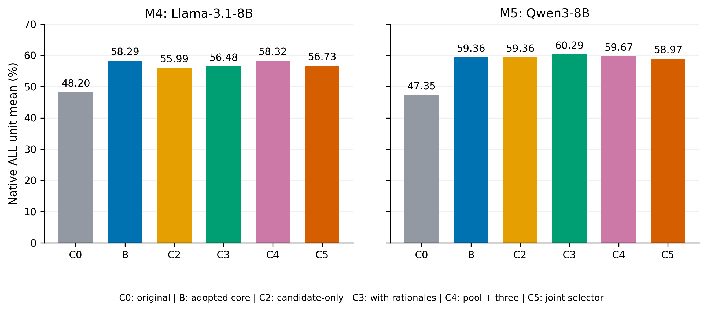
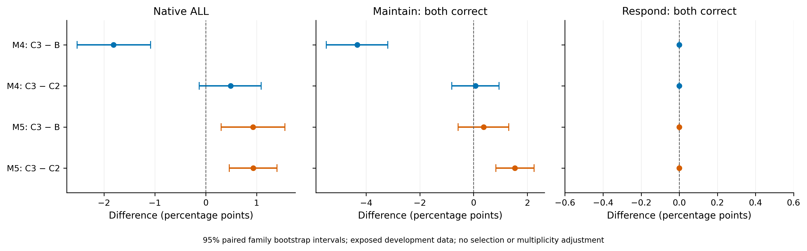
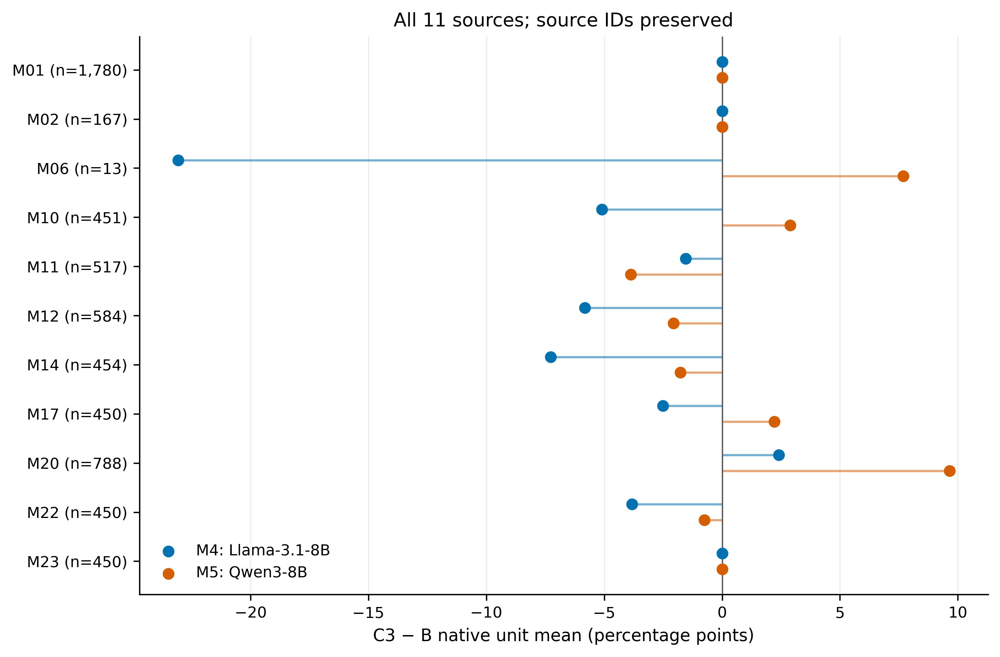
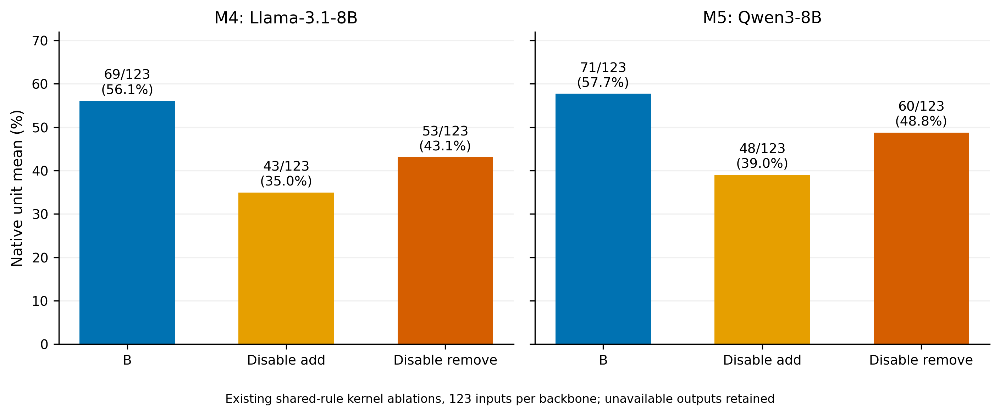

# Abstract {.unnumbered}

Changes to a medical question can introduce support, invalidate a decision premise, alter candidate rankings, or leave the correct answer unchanged. Evaluating these behaviors requires separating the benefits of a decision system from the value of additional verification. We study CF-MoA, an operation-based system that routes visible task inputs to established support recomputation, diagnostic candidate comparison, conditional model execution, or repeated native-answer readout. We then evaluate rationale-conditioned candidate verification, which selects among complete answers already produced by the readout component. A six-arm evaluation covers two MedRAG configurations and 13,905 inputs per configuration, scored as 6,104 non-reference native units from 11 sources. The adopted core improves the native-unit mean over the original systems by 10.09 and 12.01 percentage points. Additional rationale-conditioned verification changes that mean by −1.81 points on the Llama configuration and +0.93 points on the Qwen configuration, with corresponding 95% paired family bootstrap intervals of [−2.53, −1.08] and [+0.30, +1.56]. Rationale inclusion improves point estimates relative to candidate-only verification, but does not produce consistent gains over the core. Source-level results, paired correctness, operation ablations, and attributed request costs expose this distinction. All results come from an already exposed development benchmark; independent confirmation and a second candidate-generation replicate remain unexecuted. The findings support operation-level evaluation while limiting claims of a general benefit from additional candidate verification.

**Keywords:** medical question answering; counterfactual evaluation; support updating; candidate verification; retrieval-augmented generation

# Introduction

A medical question may change without requiring its answer to change. An added observation can strengthen one diagnosis while leaving another diagnosis preferable; removing one contraindication can leave an independent contraindication intact. Conversely, a seemingly small change to a patient attribute or a stated evidence condition can require a different answer. These cases place different demands on a question-answering system. They also make simple measures of answer agreement inadequate: identical answers can reflect either appropriate invariance or a failure to update.

Retrieval-augmented generation (RAG) supplies language models with external information [@lewis2020rag], and medical RAG evaluates how retrieval choices interact with question-answering performance [@xiong2024medrag]. Retrieval alone does not specify how a model should revise a decision when the supporting conditions change. Sampling and aggregation offer another route: multiple reasoning paths can be combined by self-consistency [@wang2023selfconsistency], while mixture-of-agents systems aggregate outputs across language-model agents [@wang2025moa]. Their success in other settings motivates a separate empirical question here: after a task-specific decision core has already produced a strong answer, does an additional selection stage improve it?

We address this question through CF-MoA, an operation-based system for medical question answering. Its five roles describe adding support, removing support, comparing candidates, executing a supplied model, and preserving judgments through repeated readout. The implementation routes each input by visible capabilities. Two roles share one rule-execution core; the roles do not denote five independently trained models. The adopted system, denoted B, directly retains the selected component's native output. A research extension verifies competing answers only within the ordinary repeated-readout branch. It uses the same original question and allowed context, optionally conditions on saved candidate rationales, and returns a complete existing answer.

The evaluation distinguishes three quantities that can otherwise be conflated: B's improvement over the original system, the extension's improvement over B, and the effect of including rationales within the verifier. We retain six arms, both model configurations, every source, and unavailable outputs in a common full-benchmark comparison. The data contain multiple tasks and related variants, so the main score averages native units and uncertainty is estimated by paired family resampling. Input accuracy and pairwise correctness are reported separately.

The adopted core improves the main score in both configurations, but additional rationale-conditioned verification has opposite effects. It lowers the Llama configuration's score by 1.81 percentage points and raises the Qwen configuration's score by 0.93 points. These findings motivate the paper's contributions: an explicit account of the operation-based system and its permitted inputs; a six-arm comparison that isolates additional verification from the adopted core; and a reproducible analysis of heterogeneity, update operations, failures, and attributed computation. The study is retrospective development evaluation. It does not establish independent generalization, clinical utility, or a universal benefit from multi-agent collaboration.

# Related Work

**Retrieval and medical question answering.** RAG combines generation with access to retrieved documents [@lewis2020rag]. MedRAG and the Medical Information Retrieval-Augmented Generation Evaluation (MIRAGE) benchmark examine retrieval-augmented medical question answering across corpora, retrievers, and language models [@xiong2024medrag]. Our two original systems use MedRAG with different language-model and output configurations. The present comparison retains their saved contexts and evaluates decision operations applied after those original systems. It therefore concerns the treatment of available evidence and candidate answers, rather than a new retrieval algorithm.

**Repeated reasoning and aggregation.** Self-consistency aggregates sampled reasoning paths [@wang2023selfconsistency]. Mixture-of-agents uses layered agent outputs as information for subsequent generation [@wang2025moa]. CF-MoA's adopted core instead selects an applicable operation and preserves its native result; its name identifies the local system lineage rather than an architectural equivalence to layered mixtures. The candidate-verification extension permits a bounded comparison of answers already generated by one component. An expanded-pool voting arm and a joint-selection arm distinguish this extension from simply generating more answers or selecting from the same pool in one decision.

**Candidate presentation and calibration.** Contextual calibration studies the influence of content-free inputs on language-model predictions [@zhao2021calibrate]. The diagnostic component uses a fixed disease catalog, several candidate permutations, and an existing content-free prior correction. That component belongs to B. The additional verifier's two code mappings serve a different purpose: they average binary judgments under opposite correctness encodings. These scores remain uncalibrated ranking signals. Neither procedure turns a model score into a probability of clinical correctness.

**Medical perturbation and evidence benchmarks.** The evaluation combines existing medical diagnosis, prescribing, question perturbation, evidence substitution, and robustness sources. Their distinctions matter: a changed patient fact, an irrelevant contextual cue, and a task that explicitly stipulates counterfactual evidence impose different answer contracts. Section 3 and Appendix A identify the source artifacts. We use these artifacts as the basis of a frozen local evaluation and retain their source-specific scoring limitations. The literature selection is targeted background for this empirical study, not a systematic review or a claim that adjacent approaches are absent.

# Task and Evaluation Contract

## Inputs and decision operations

An inference input is $x=(q,o,e,c,a_0)$, where $q$ contains the current question and patient information, $o$ contains native options when present, $e$ is the required supplied evidence, $c$ is the original system's allowed context, and $a_0$ is its saved answer when available. An explicit executable model is an additional optional input. Each arm receives the same legal input for a given model configuration. Gold answers, evaluation labels, classification explanations, hidden paired endpoints, and source identifiers that could provide an answer shortcut are excluded from inference. Provenance and scoring information remain in the offline evaluation ledger.

The benchmark uses five overlapping labels attached to specific judgments. R1 denotes newly established support; R2 denotes withdrawn or contradicted support; R3 denotes a need to compare competing judgments again; R4 denotes a consequence that must be inferred from changed premises; and R5 denotes a judgment that should remain unaffected. Support changes do not imply that the final answer must flip. R1–R3 may coexist, and R5 is established by the task's meaning rather than by model agreement. The labels describe evaluation strata; routing never reads them.

The system operates on each visible endpoint separately. It is not given both members of a hidden evaluation pair and asked to recover the expected relation. Pair-level measurements are constructed only after native predictions have been scored.

The project protocol permits external MedCorp retrieval while retaining all required source evidence. In particular, MedCounterFact inputs preserve their stipulated evidence, and MedRGB inputs retain their six fixed evidence-ratio conditions while also permitting external retrieval. The latter is a project adaptation of MedRGB, rather than a reproduction of its original static-evidence-only setting. Original and modified endpoints have the same information-access permissions. The present study reuses the saved contexts under that protocol.

## Native units and denominators

The frozen v5 evaluation contains 13,905 unique inference inputs per model configuration, 15,616 native scoring mappings, and 6,104 non-reference evaluation units from 4,766 families. One input can support multiple mappings, and one unit can contain several native tasks or variants. Reference inputs support paired evaluation but are excluded from the main ALL score. These counts are not interchangeable sample sizes, and none is described as a count of independently recruited patients.

Construction retained every eligible R1–R4 target in the preceding classified collection. For R5, 450 eligible comparison units were randomly sampled without replacement from each of eight source strata, using a seed generated once before selection and sorted unit identifiers. Model predictions and prior v3 membership did not determine these draws. The resulting R5 evaluation scope has 3,600 units. Frozen evaluation membership is distinct from the original semantic labels: an unsampled R5 label attached to a retained R1 unit does not automatically add that unit to the R5 score.

Let $J_u$ be the non-reference native scoring records belonging to unit $u$, and let $z_{muj}\in\{0,1\}$ be native main-answer correctness for arm $m$. We use the frozen unit score and overall mean

$$
s_{mu}=\frac{1}{|J_u|}\sum_{j\in J_u}z_{muj},
\qquad
S_m=\frac{1}{6104}\sum_{u=1}^{6104}s_{mu}.
$$

The main metric is $100S_m$. It is not a source macro-average, an average of the five R-category scores, or input-level accuracy. Native rules include exact option keys, exact sets for the primary multi-select score, normalized relation labels, and a frozen canonical diagnostic mapping. Multi-select overlap and robustness auxiliary fields are separate diagnostics. The diagnostic mapping is a local scoring contract, not the original source's semantic language-model grader. For R4 clinical scenarios, correctness means agreement with the source's expected answer.

The R-category denominators are R1: 2,866; R2: 79; R3: 733; R4: 13; and R5: 3,600. Because these groups overlap, their counts and scores cannot be summed to recover ALL. The five input formats contain 3,560 diagnosis inputs, 167 multi-select inputs, 989 relation inputs, 2,700 robustness inputs with auxiliary output, and 6,489 other single-choice inputs.

## Paired correctness and uncertainty

The frozen paired ledger contains 6,838 maintain pairs and 1,780 respond pairs. Their expected relations are based on the native task and reference answers, with compatible answer meanings, rather than inferred mechanically from R labels. For pair $p$ with endpoints $x_p^0$ and $x_p^1$, the main paired score is

$$
t_{mp}=\mathbb{1}[a_m(x_p^0)=y_p^0]\,
       \mathbb{1}[a_m(x_p^1)=y_p^1].
$$

Thus, a model receives credit only when both endpoints are correct; repeating an incorrect answer does not count as successful maintenance. Native scoring, rather than literal string equality where inappropriate, determines each indicator.

For each contrast, 5,000 paired bootstrap samples draw families with replacement using seed 240924. All compared arms share a resampled family sequence. Each replicate averages the atoms contributed by the sampled families, preserving unit weights within families instead of assigning equal weight to family means. ALL uses 6,104 units in 4,766 families; maintain uses 6,838 pairs in 2,806 families; respond uses 1,780 pairs in 1,780 families. We report 95% percentile intervals. These intervals describe variation in the exposed benchmark and do not correct for method selection, multiple comparisons, or previous data access.

Families group the related variants of an original case; cross-source groups with exactly matching original questions and options are connected into a dependency group. This procedure does not establish that all semantic near-duplicates have been identified.

# CF-MoA

## Adopted core B

The adopted core uses fixed predicates over visible inputs. It first routes diagnosis questions to the catalog component, then eligible prescribing questions to the rule component. Inputs with a complete supported executable model can use the model-execution component. Supported single-choice and relation questions with their original message context use repeated native-answer readout, denoted F. Other inputs preserve the original answer. The full evaluation routes 3,560 inputs to diagnosis, 123 to rules, 10,178 to F, and 44 to passthrough. The explicit-model component covers zero inputs in this clinical benchmark.

**Shared support addition and removal.** The rule component separates patient-fact extraction from execution of a fixed public rule bank. Its established eligibility predicate is limited to supported multi-select prescribing questions, including an explicit age of at least 65 and a recognized rule-bank drug option. The existing bank contains 71 rules; question scope determines the applicable rules and requested actions. Facts are extracted from the current question, not from unrelated patients in retrieved documents. Missing facts remain unknown.

Each supported option receives a state in $\{\mathrm{MET},\mathrm{CONTRADICTED},\mathrm{UNKNOWN}\}$. Necessary conditions combine by conjunction; independent support paths combine by disjunction. The existing documented-exception policy and native assembler remain authoritative. For an ordinary valid initial option set $A_0$, away from native special cases, the update is

$$
A_B=\{o:s(o)=\mathrm{MET}\}
\ \cup\ \bigl(A_0\cap\{o:s(o)=\mathrm{UNKNOWN}\}\bigr).
$$

The expression adds newly supported options, removes options whose relevant support is contradicted, and preserves selected options with unresolved support. Native “none” exclusivity, invalid initial answers, and extraction failures use the established assembler and fallback policies. A1 and A2 are records of the positive and negative operations from this single execution. There is no second fact-extraction model hidden behind these role names.

**Diagnostic comparison.** The diagnostic component uses a fixed public catalog of 49 diseases derived from the DDXPlus resource [@ddxplus]. The original model scores candidate codes under six permutations. Existing content-free distributions provide a prior correction for each permutation; the corrected choices are combined by majority vote, with mean corrected probability and fixed catalog order resolving ties. The frozen diagnostic scorer still uses its existing 46-label mapping. We do not expand that mapping after observing predictions. Catalog constraints, candidate resources, repeated decisions, and calibration all contribute to this component, so its overall gain cannot be attributed to calibration alone.

**Conditional model execution.** The A4 component extracts a typed intervention and executes it only when the complete supported physiological model, parameters, state, and question contract are supplied. Its historical validation uses a fixed glucose simulation model and is reported separately in Appendix C. The clinical v5 data do not meet this capability predicate. The 13 R4-labeled clinical units nevertheless remain in the evaluation and follow the other applicable routes.

**Repeated native-answer readout.** For ordinary supported tasks, F produces up to five complete native answers using seeds 42–46 and stops once a key has the required absolute majority of three votes. If all five draws complete without that majority, plurality among valid keys selects the answer, with ties resolved by the earliest response; if no key is valid, the first invalid response is retained for failure accounting. Invalid outputs remain in the trace. A separate adopted natural language inference (NLI) path uses two reasoning paths and two code mappings; this path is retained unchanged by the candidate-verification extension. In both cases, the adopted component's complete native response remains the output authority. B has no subsequent global generative editor.

## Rationale-conditioned candidate verification

The extension operates only on the ordinary F branch. Let $\mathcal{C}(x)$ contain the distinct legal answer keys observed in the saved F pool. For each key, the earliest complete saved response is its representative. Invalid votes remain recorded but do not become candidate keys. Candidate membership does not use gold correctness, expected improvement, or offline R labels. F must provide an available legal result and at least two distinct legal candidates before verification runs.

For candidate $k$, the verifier retains the original messages, native options, and allowed evidence. It appends the target candidate and the observed candidate set. In the rationale-conditioned arm, it also appends the earliest saved reasoning associated with each candidate, explicitly identified as untrusted model opinion. It does not append vote counts, the F winner as an authoritative label, hidden paired inputs, or evaluation metadata. A rationale is neither a newly retrieved source nor a verified patient observation.

Two scoring calls use opposite binary code mappings. Let $\ell_{kh}(b)$ be the log score of code $b\in\{A,B\}$ for mapping $h\in\{1,2\}$, and let $b_h^+$ be the code meaning “the target candidate is correct.” The ranking score is

$$
v(k\mid x)=\frac{1}{2}\sum_{h=1}^{2}
\frac{\exp\ell_{kh}(b_h^+)}
{\exp\ell_{kh}(A)+\exp\ell_{kh}(B)}.
$$

We select the maximum-scoring candidate. An exact tie retains the F key when it is tied; otherwise native candidate order breaks the tie. The complete representative response is returned without generating a new answer or repairing auxiliary fields. A completed verification makes $2|\mathcal{C}(x)|$ logical binary-scoring requests. Physical missing-code retrieval and failed-call costs are separately recorded and can make physical request counts differ from this expression. The score $v$ is an uncalibrated ranking signal.

Outside the supported branch, with fewer than two legal candidates, or on the adopted NLI route, the system retains B. A candidate-scoring failure records a technical failure and uses the saved F answer; an unavailable F answer remains unavailable. Shared backend failures stop the affected job rather than triggering a fresh answer draw. This contract makes the extension a test of selection among a given pool, with explicit failure behavior.

# Experimental Setup

## Model configurations and controls

We use the MedRAG Llama-3.1-8B-Instruct configuration, denoted M4, and the MedRAG Qwen3-8B configuration with thinking disabled, denoted M5 [@dubey2024llama; @yang2025qwen3]. Their original output protocols differ: M4's selected baseline includes structured-output repair, whereas M5's original baseline retains its earlier unconstrained protocol. Cross-configuration differences therefore combine model and interface effects. Within each configuration, all six arms share the same frozen input scope and original contexts.

The ordinary F readout uses bfloat16 weights, temperature 0.7, top-p 1.0, a 2,048-token output budget, and a 131,072-token context limit under the saved vLLM 0.8.5 profiles. The F readout uses structured native output in both configurations. The existing catalog and fact-extraction components retain their own shorter-context, temperature-zero profiles. Exact per-component settings, prompts, code snapshots, and reuse bindings remain in the released experiment package. The experiments use inference and deterministic tools; no new model training is reported.

| Arm | Decision rule | Role in the comparison |
|---|---|---|
| C0 | Original MedRAG configuration | Original-system reference |
| C1 / B | Adopted operation core | Strong system baseline |
| C2 | B plus candidate-only binary verification | Same-pool verification without saved rationales |
| C3 | B plus rationale-conditioned binary verification | Main research extension |
| C4 | B with old F votes plus three additional answers | Expanded-pool sampling control |
| C5 | B plus joint selection over the same candidates and rationales | Alternative same-pool selection control |

C4 uses the predefined supplementary seeds 42, 43, and 44 on eligible ordinary-F disagreements. A failed required supplementary answer leaves the control unavailable, rather than silently converting it into a two-draw control. C5 scores a joint finite-code choice under two opposing code assignments. C2, C3, and C5 preserve the existing pool. Their comparisons share the original computation but have different additional request and prompt costs; none is described as equal-cost merely because a common budget ceiling exists.

The complete v5 benchmark is the main scope. Earlier 121-input and 52-input development panels informed development and are not independent confirmation sets. The older 52-input panel still lacks four original M5 C0 outputs; that historical gap does not affect the complete full-v5 C0 results reported here. No new model calls or native grading are performed for this manuscript; the figures and tables are rebuilt from frozen completed results.

## Failure retention and computation accounting

All arms retain the complete input and native-unit denominators. An unavailable answer counts against performance under the frozen contract and is also reported explicitly. We separate a valid but incorrect answer, an unavailable answer, and a verifier failure with a retained F answer. Pool-trigger coverage includes the full scope and is not filtered by subsequent success or gold correctness.

Per-method computation assigns the shared B computation once to each independently considered B-based method, then adds that method's own incremental requests. This estimates the attributable computation of a method assembled from the recorded components. It is distinct from the physical ledger for the multi-arm experiment, where shared calls were actually executed once. Exact cache reuse is not treated as free historical computation. The upstream C0 and retrieval costs, and some historical event times, remain unknown. Reported event seconds are not exclusive GPU hours, end-to-end latency, or energy measurements.

# Results

## The adopted core improves the full native-unit mean

Table 1 reports every arm with both native-unit and input-level outcomes. B increases M4's ALL mean from 48.1990% to 58.2924%, and M5's from 47.3487% to 59.3616%. The paired family intervals for these gains are [+8.9580, +11.2340] and [+10.9177, +13.1510] percentage points, respectively. These are overall effects of the adopted components and their additional resources and computation. They do not isolate the contribution of the later verification stage.

**Table 1. Full-v5 results.** Each row contains 13,905 inputs, 15,616 scoring mappings, and 6,104 non-reference native units. ALL is the mean of native-unit scores. Unavailable inputs remain in the denominators.

| Configuration | Arm | ALL (%) | Correct inputs | Unavailable inputs |
|---|---|---:|---:|---:|
| M4 Llama | C0 | 48.1990 | 7,441 | 0 |
| M4 Llama | B | 58.2924 | 8,924 | 51 |
| M4 Llama | C2 | 55.9939 | 8,554 | 51 |
| M4 Llama | C3 | 56.4815 | 8,649 | 51 |
| M4 Llama | C4 | 58.3219 | 8,951 | 157 |
| M4 Llama | C5 | 56.7295 | 8,660 | 51 |
| M5 Qwen | C0 | 47.3487 | 6,913 | 0 |
| M5 Qwen | B | 59.3616 | 8,971 | 22 |
| M5 Qwen | C2 | 59.3562 | 8,843 | 22 |
| M5 Qwen | C3 | 60.2889 | 9,060 | 22 |
| M5 Qwen | C4 | 59.6723 | 8,878 | 86 |
| M5 Qwen | C5 | 58.9690 | 8,739 | 22 |

{#fig-main width=95%}

Input correctness and native-unit means need not rank arms identically. For example, M5 C2 has fewer correct inputs than B, while their ALL means are nearly equal. Different native-unit structures and shared mappings explain why an input-level count cannot substitute for the declared main metric. We retain both views rather than selecting the more favorable one.

## Additional verification has configuration-dependent effects

**Table 2. Paired contrasts in the ALL mean.** Effects and 95% family bootstrap intervals are in percentage points. These are descriptive intervals on exposed development data.

| Configuration | Contrast | Effect | 95% interval |
|---|---|---:|---|
| M4 | B − C0 | +10.0934 | [+8.9580, +11.2340] |
| M4 | C3 − B | −1.8108 | [−2.5287, −1.0819] |
| M4 | C3 − C2 | +0.4877 | [−0.1275, +1.0907] |
| M5 | B − C0 | +12.0129 | [+10.9177, +13.1510] |
| M5 | C3 − B | +0.9273 | [+0.3039, +1.5562] |
| M5 | C3 − C2 | +0.9327 | [+0.4641, +1.4010] |

C3's effect relative to B is negative for M4 and positive for M5. At input level, M4 C3 repairs 436 B errors but damages 711 B-correct inputs, for a net loss of 275 correct inputs. M5 repairs 452 and damages 363, for a net gain of 89. Both configurations therefore contain repairs and regressions. The aggregate difference is not explained by counting successful repairs alone.

Including rationales improves the point estimate relative to C2 in both configurations. The M4 interval crosses zero, whereas the M5 interval is positive. This comparison isolates the saved-rationale condition within the verifier's fixed candidate-pool design; it does not establish that the rationales are factually reliable. For M4, improving on C2 still leaves C3 below B.

C4 has positive ALL point differences from B in both configurations, but the broader results do not establish a consistent advantage. M4 C4 is only +0.0295 points above B, with an interval of [−0.5445, +0.5895], and has 106 additional unavailable inputs. M5 C4's ALL mean is above B, but its input-level correct count is lower and unavailable inputs increase by 64. C5's ALL point estimate is below B in both configurations. We preserve C3 as the declared research extension and B as the adopted default, without selecting a different winning arm for each configuration.

{#fig-forest width=95%}

## Source-level gains and regressions coexist

The aggregate C3 effect contains substantial source variation. On MedCounterFact (M20), C3 improves over B by +2.4112 points for M4 and +9.6447 for M5. On the AMQA-derived source (M12), the corresponding differences are −5.8219 and −2.0548. Cultural-cue questions (M11) also decrease in both configurations, by −1.5474 and −3.8685 points. These are source-specific point estimates; we do not interpret a ranking of small source effects as a corrected significance test.

The 13-unit R4 clinical source illustrates the danger of suppressing unfavorable strata. B's M5 score is already below C0, and C3 recovers only one unit relative to B. M4 C3 instead loses three units relative to B. The source remains in the full score. The system's separate explicit-model component has no clinical-v5 coverage, so these outcomes cannot be presented as evidence that model-based consequence execution succeeded or failed on these inputs.

M01 diagnosis scores are identical across B and C2–C5 because the extension leaves the catalog route unchanged. Other unchanged source scores should not automatically be interpreted as evidence of a particular routing mechanism: multiple routes or changed answers can produce the same source aggregate. The released format and route tables provide the needed separation. Figure 3 and Appendix A retain every source rather than reporting a selected improvement subset.

{#fig-sources width=95%}

## Paired outcomes distinguish maintenance from response

**Table 3. Both-endpoints-correct counts.** Maintain uses 6,838 pairs; respond uses 1,780 pairs. Equal respond counts are an observed result of the present outputs, not evidence that the verifier solves arbitrary changes.

| Arm | M4 maintain | M5 maintain | M4 respond | M5 respond |
|---|---:|---:|---:|---:|
| C0 | 4,005 | 3,528 | 13 | 27 |
| B | 4,440 | 4,460 | 347 | 360 |
| C2 | 4,139 | 4,381 | 347 | 360 |
| C3 | 4,144 | 4,486 | 347 | 360 |
| C4 | 4,509 | 4,412 | 347 | 360 |
| C5 | 4,150 | 4,246 | 347 | 360 |

Relative to B, C3 reduces M4 maintain correctness by 296 pairs and increases M5 by 26. The M4 change is −4.3288 percentage points, with a family interval of [−5.4864, −3.1947]. All B-based arms have the same respond count in each configuration. The core's improvement over C0 on respond pairs is therefore retained, but additional verification has no observed aggregate increment on this fixed subset. Pair correctness measures answer adequacy at both endpoints and should not be reduced to a preference for either changing or keeping an answer.

## Both support-update operations contribute within the rule subset

The operation ablation reuses the same extracted facts, support states, and native assembly policy for all 123 rule-routed inputs. Disabling an operation changes assembly alone; it does not rerun extraction or select a favorable subset. Table 4 therefore tests the role of the two update directions within the adopted shared rule core.

**Table 4. Existing support-operation ablation.** All cells use 123 inputs and 123 native ALL units. Unavailable counts are one for M4 and 14 for M5 in every arm.

| Configuration | Full B correct | Disable addition | Disable removal |
|---|---:|---:|---:|
| M4 | 69 | 43 | 53 |
| M5 | 71 | 48 | 60 |

Removing addition lowers correct counts by 26 and 23; removing withdrawal lowers them by 16 and 11. Each ablation can also repair some individual errors, so these net changes do not imply that either operation is always correct. The results support retaining both directions in this shared execution policy. They do not measure an interaction between two independently trained agents or an ablation of all 13,905 inputs.

{#fig-rules width=90%}

## Additional selection incurs measurable computation

Ordinary F covers 9,293 inputs per configuration. At least two observed legal keys occur on 2,964 M4 inputs and 2,295 M5 inputs, corresponding to 21.3161% and 16.5049% of the complete 13,905-input scope. These coverage counts include unavailable cases and invalid old votes in their accounting; they are not counts of successful verification. Candidate pools depend on the model configuration, so the triggered subsets are not identical controlled populations across configurations.

**Table 5. Attributed request costs for B and C3.** The table includes the shared core once per method and excludes unknown common C0/retrieval costs. Tokens are the total attributed C3 tokens, not only verifier tokens.

| Configuration | B requests | C3 extra requests | C3 total requests | C3 input tokens | C3 output tokens |
|---|---:|---:|---:|---:|---:|
| M4 | 59,800 | 13,308 | 73,108 | 358,643,985 | 9,699,532 |
| M5 | 58,301 | 9,820 | 68,121 | 294,927,306 | 7,655,025 |

C3 adds approximately 22.25% to B's attributed request count for M4 and 16.84% for M5. Additional computation accompanies a negative quality change in one configuration and a positive change in the other. Figure 5 displays the recorded B-based arms against their method-attributed requests. C0 is not assigned zero cost to place it on this frontier because its common upstream cost is unknown.

The physical ledger for the completed multi-arm full-v5 run records 162,979 requests, 957,810,324 input tokens, and 18,291,906 output tokens. These totals must not be divided by six to estimate a method cost, and method-attributed totals must not be summed to recover the physical ledger because they share B. For each configuration and B-based method, 2,503 inputs have historical timing gaps. The analysis therefore reports request and token attribution with missing-time markers, not a fully measured end-to-end efficiency claim.

{#fig-cost width=95%}

# Discussion

The largest consistent improvement belongs to the adopted operation core. Its catalog, rules, and repeated readout change both the available decision interface and the amount of computation. The result supports this particular system composition on the evaluated benchmark. It does not identify a single mechanism responsible for the entire improvement, and it cannot be reassigned to an extension evaluated later.

Additional candidate verification poses a distinct selection problem. By design, C3 cannot recover an answer key absent from its pool, and it can replace a correct selected answer with an incorrect existing candidate. The repair and damage counts establish that successful and harmful switches both occur; they do not measure the frequency of missing correct candidates or diagnose the medical cause of each mistake. Pool quality and selector quality should therefore be measured separately. Enlarging the pool is also not automatically beneficial: the C4 control changes both candidate opportunity and failure exposure, with its unavailable outputs retained in the result.

Rationales provide extra information to the verifier, but they can contain unsupported statements or persuasive explanations for a wrong key. Their positive incremental point estimates over C2 justify further study of how they affect selection. They do not certify rationale truthfulness, establish calibrated confidence, or guarantee improvement over majority-based readout. A direct evaluation of rationale validity and an independent replication of pool generation would be needed to test those stronger interpretations.

The source and pair analyses constrain the use of an aggregate gain. A positive overall score can coexist with harm on a particular source, and a changed overall mean can coexist with unchanged respond-pair performance. No arm was selected separately for each source or backbone after inspecting these outcomes. Keeping the adopted core as the common default preserves the distinction between an observed local gain and a deployment or generalization decision.

Finally, the five-role description is useful only when tied to actual computation. Shared rule addition and removal are two functions of one execution. A model-based executor with zero coverage cannot explain a clinical benchmark gain. Recording these facts makes the architecture interpretable without implying that every question benefits from five-agent collaboration.

# Limitations

**Development exposure and confirmation.** The full v5 benchmark was already exposed and contributed to method development and selection. Current bootstrap intervals do not remove that exposure. A planned frozen-method evaluation on new families and a second independently generated F pool were deferred and have not been executed. The manuscript therefore provides no independently confirmed generalization or across-pool stability result.

**Scope and scoring.** The sources differ in task semantics, patient realism, perturbation construction, and reference quality. R labels overlap, some groups are small, and the 13-unit R4 clinical subset has especially limited coverage. Classification follows the project's documented target-level review rules; no clinician inter-annotator agreement estimate is reported. Canonical diagnostic matching can penalize clinically related wording, while source expected answers do not provide a new clinical adjudication. An empty list of newly established data defects in the final closeout is not evidence that all items and labels have undergone a complete expert medical review.

**Attribution and model comparison.** B combines several already developed components with additional resources and inference. Only specified local comparisons, such as the rule-operation ablation and C3 versus C2, isolate narrower design changes. M4 and M5 differ in output protocol as well as model. Their disagreement in C3's effect is configuration dependence; a pure backbone explanation requires matched-protocol experiments. Candidate-trigger membership also differs because each model generates its own pool.

**Clinical applicability.** This is an offline benchmark study, not a prospective patient study, treatment trial, or deployment evaluation. Rule coverage is limited, and the A4 physiological results concern a supplied mathematical model. Neither exact-match improvements nor successful model execution establish clinical safety or correctness outside those contracts.

**Computation and reproducibility.** Some original-system costs and historical timings are unknown. Shared-call attribution describes the measured components rather than complete end-to-end resource use. The figure package reproduces reported summaries and can check them against the released compressed result records; it does not rerun the full language-model experiment. Original input data, licenses, model access, retrieval indices, and environment-specific paths remain separate prerequisites for fresh inference.

# Conclusion

CF-MoA provides an operation-based account of support updating and candidate decisions in medical question answering. Across two MedRAG configurations on the complete exposed v5 benchmark, the adopted core improves the native-unit mean substantially. Rationale-conditioned verification of its existing candidates adds a smaller, configuration-dependent effect: negative on M4 and positive on M5. The six-arm comparison, operation ablations, paired outcomes, and computation ledger show why system gains and verification gains require separate evidence. Independent confirmation and candidate-pool replication remain the next empirical steps before stronger generalization claims can be made.

# Declarations {.unnumbered}

**Data and code availability.** The completed experiment's code/configuration snapshots and result artifacts are available in the [full-v5 release](https://github.com/xiotakut/cf_mrg/tree/main/benchmarks/2026-09-26_cf_moa_rcv_full_v5) and the [transparent closeout release](https://github.com/xiotakut/cf_mrg/tree/main/benchmarks/2026-09-28_cf_moa_transparent_closeout), tied to commits `d857934` and `2d56c71`. Third-party source datasets retain their original access and licensing conditions. The present draft is accompanied by local source hashes, plotting and table-generation code, and a document build script. This local manuscript package has not yet been published to those releases.

**Ethics declaration.** The reported evaluation reuses existing benchmark material and historical experiment outputs. This manuscript reports no new patient recruitment or clinical intervention. It does not establish an institutional exemption or ethics approval. Author verification of the applicable institutional requirements, source-use permissions, and any required approval identifiers remains pending before submission. Full patient-like prompts and private execution traces are not reproduced in the paper's figure package.

**Author contributions.** Author names, affiliations, and contributor-specific Contributor Roles Taxonomy (CRediT) roles have not been supplied for this draft and must be completed by the authors. No authorship is assigned to the writing tools.

**Funding and competing interests.** Funding sources, grant identifiers, and competing-interest declarations have not been supplied. Their status is pending author confirmation; the draft does not assert that no funding or conflicts exist.

**AI assistance.** Codex assisted with evidence organization, literature metadata checks, English drafting, and code for rendering existing experimental results. The academic-paper skill supplied a writing and review workflow. No new model-evaluation results were generated for this manuscript. This disclosure describes drafting assistance and does not replace author review, accountability, or a future venue-specific disclosure.

# Appendix A. Source Composition and Complete Reporting {.unnumbered}

Table A1 identifies the frozen source strata and their native ALL-unit counts. The cited artifacts identify upstream resources; the local inclusion and qualification rules remain those of the frozen v5 construction. In particular, dataset-card counts and original-paper sample counts must not be substituted for this table's evaluation denominators.

| ID | Source artifact | ALL units |
|---|---|---:|
| M01 | MedEinst [@chen2026medeinst] | 1,780 |
| M02 | MedPIC-Bench [@medpicbench] | 167 |
| M06 | HIV-treatment causal scenarios [@prosperi2026hiv] | 13 |
| M10 | CPV-MedQA [@benkirane2025bias] | 451 |
| M11 | Counterfactual Cultural Cues [@rezaei2026cultural] | 517 |
| M12 | FairMedQA / AMQA [@xiao2025amqa] | 584 |
| M14 | DiversityMedQA [@rawat2024diversitymedqa] | 454 |
| M17 | MedPerturb [@gourabathina2025medperturb] | 450 |
| M20 | MedCounterFact [@mo2026faithfulness] | 788 |
| M22 | MedRGB [@ngo2024medrgb] | 450 |
| M23 | BioRAB [@li2025biorab] | 450 |
| Total | Non-reference native units | 6,104 |

The CPV citation describes the perturbation method; M10 uses the authors' [MedQA extension](https://huggingface.co/datasets/kenza-ily/medqa-cpv), rather than substituting the paper's primary question cohort. MedPIC-Bench is cited through its available dataset card, with no inferred publication date. Version-specific reference metadata and source-to-stratum mappings are recorded in the companion bibliography audit.

MedEinst derives its diagnostic material from DDXPlus [@ddxplus]; that upstream provenance is retained alongside the MedEinst citation.

Complete machine-readable tables accompany the draft: all six arms by configuration; all 11 sources; overlapping R1–R5 categories; all five input formats; all maintain/respond pair scores; every recorded family interval; and attributed costs and coverage. The source-level plot is a view of those complete tables. It does not define a new filtered benchmark. Input-format scores use input denominators, whereas source and R-category scores use native-unit denominators.

# Appendix B. Selection Procedure and Reproduction {.unnumbered}

The core and verifier can be summarized as the following procedure. The source implementation, including native-interface special cases and error handling, remains authoritative.

```text
Input: legal current input x; saved original context and answer
route = fixed_visible_capability_predicate(x)
B = execute_or_reuse_adopted_component(route, x)
if route is not ordinary F, or B is unavailable:
    return B
C = distinct legal keys actually observed in B's saved F pool
if |C| < 2:
    return B
for each candidate k in native order:
    choose earliest complete saved representative for k
    score correctness under both opposite A/B code mappings
    normalize each two-code distribution; average correctness scores
if verification has a technical failure:
    record failure and return saved F output
select maximum; exact ties prefer B, then native order
return the selected complete saved representative
```

The C2 procedure omits saved rationales from each verification request. C3 includes them as untrusted candidate reasoning. C5 replaces per-candidate binary scoring with joint finite-code selection. C4 performs three predefined additional native-answer draws and votes over old and additional answers; its failure policy is separate from verifier fallback.

To rebuild the manuscript artifacts, the companion package provides `scripts/build_figures_tables.py` and `scripts/build_manuscript.py`. The first reads frozen summary inputs and writes CSV, LaTeX tables, and PDF/PNG figures. Its optional raw-record check independently reaggregates the original compressed result records without invoking a model or grader. The second renders the canonical manuscript with the verified bibliography. Source and output hashes and execution receipts identify the exact inputs used. A rebuild of these artifacts establishes agreement with the saved results, not independent experimental replication.

# Appendix C. Historical Explicit-Model Validation {.unnumbered}

The adopted A4 component was previously evaluated on 24 virtual parameter/initial-state profiles, with 12 questions per profile and model configuration. The 288 questions per configuration use one fixed simglucose model, four fixed actions, and three question types. The software snapshot is version 0.2.11 at commit `a6f6777586c860457a2a1e6cce6d0bd3fd33d1cc` [@simglucose]. This is a conditional tool-execution panel; it is not part of the 6,104 clinical ALL units and is not the deferred independent confirmation experiment.

| Configuration | Historical arm | Binary /288 | Numerical /288 | Full output /288 |
|---|---|---:|---:|---:|
| M4 | Ordinary reanswer | 118 | 0 | 0 |
| M4 | Full execution | 286 | 270 | 270 |
| M4 | Patch without intervention execution | 234 | 67 | 67 |
| M4 | Typed patch and execution | 288 | 288 | 288 |
| M5 | Ordinary reanswer | 187 | 0 | 0 |
| M5 | Full execution | 265 | 222 | 222 |
| M5 | Patch without intervention execution | 234 | 67 | 67 |
| M5 | Typed patch and execution | 288 | 288 | 288 |

The typed patch results demonstrate agreement within the supplied model and question contract. They do not establish new-patient validity, cross-simulator transfer, or unrestricted causal reasoning in clinical text. The present manuscript reuses this historical panel without new language-model calls or numerical integration.

# References {.unnumbered}

::: {#refs}
:::
